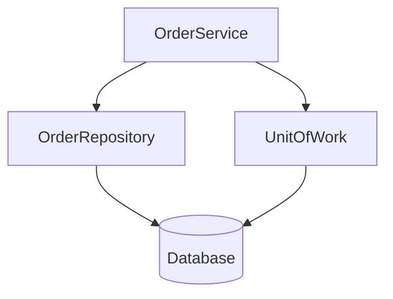

# D18-T023 — Repository and Unit of Work

Topic ID: `D18-T023`
Domain: Low-Level Design (LLD) and Object-Oriented Design
Subdomain: Repository and Unit of Work
Importance: core
Complexity: intermediate
Dependencies: `D18-T022`, `D18-T001`, `D01-T001`, `D01-T002`
Execution status of the code in section F: unexecuted

## A. Topic Overview

Repository mediates between domain and data mapping, presenting a collection-like interface. Unit of Work tracks changes and commits one transaction.

## B. First-Principles Explanation

Domain code speaks `save(Order)` not SQL. UoW ensures atomic commit across repositories sharing a session.

## C. Internal Working and Architecture

Implementation uses ORM session or JDBC connection bound to UoW scope—typically request or transaction scope.

## D. Diagrams and Visual Models



Service coordinates UoW; repositories share connection.

## E. Examples and Analogies

Spring `@Transactional` often plays UoW role.

## F. Code Examples

examples/d18_t023_repo.java (unexecuted).

```java
// unexecuted
interface OrderRepository { Optional<Order> findById(Id id); void save(Order o); }
```

Repository returns domain types, not JDBC rows.

## G. Practical Backend Application

Keep queries behind repository; avoid query objects in controllers.

## H. Advantages, Limitations and Trade-offs

| Pattern | Benefit | Cost | Choose when | Avoid when |
| --- | --- | --- | --- | --- |
| Repository | Testable persistence | Mapping layer | Rich domain | Simple CRUD anemic |
| Unit of Work | Atomic commit | Scope discipline | Multiple repos per txn | Read-only endpoints |

## I. Common Mistakes and Misconceptions

- Repository leaking SQL strings to services.
- One repository per table god.
- UoW wider than request.
- No transaction on write path.
- Domain depending on JPA annotations.

## J. Debugging and Troubleshooting

Partial commit—UoW boundary too small or missing @Transactional.

## K. Interview Preparation

### Beginner

#### Q1. What is Repository and Unit of Work in one sentence?

**Answer:** Repository and Unit of Work is collection-like persistence with transactional unit of work. Interviewers want a concrete backend example, not a glossary quote. Tie the definition to a change you would make in a service class or module boundary. Mention testability or deploy isolation as the payoff.

#### Q2. Why does Repository and Unit of Work matter in backend code?

**Answer:** Backend code lives for years and is changed under incident pressure. Repository and Unit of Work reduces the blast radius when requirements shift. Services integrate databases, queues, and third parties; rigid designs break at those seams. Strong answers name a bug class prevented, not only 'clean code'.

#### Q3. Give a small example of Repository and Unit of Work.

**Answer:** Pick one class in a payment or auth flow and show how collection-like persistence with transactional unit of work applies. Keep the example to three types so the whiteboard stays readable. State inputs, outputs, and who calls whom. End with how you would unit-test the seam.

#### Q4. When would you skip Repository and Unit of Work?

**Answer:** Skips are valid for throwaway scripts and one-off migrations. Over-applying Repository and Unit of Work adds indirection that obscures a 50-line feature. If the variation never appears in requirements, do not build the abstraction early. YAGNI still applies inside OOD.

#### Q5. How is Repository and Unit of Work different from a random utility class?

**Answer:** Utilities are stateless bags of functions without a modeled responsibility. Repository and Unit of Work encodes a deliberate collaboration contract between roles. The difference shows up when you mock one side in tests. If you cannot draw the roles, it is probably not intentional design.

### Intermediate

#### Q1. How does Repository and Unit of Work interact with SOLID?

**Answer:** SOLID is the constraint system; patterns are recurring shapes that satisfy it. Repository and Unit of Work often supports dependency inversion and open-closed goals. Violations of single responsibility usually break the pattern silently. In reviews, map each class to one principle before naming a pattern.

#### Q2. How do you test code structured with Repository and Unit of Work?

**Answer:** Replace slow or external collaborators with fakes at the abstraction introduced by the design. For Repository and Unit of Work, tests should exercise the public contract, not private construction details. Use contract tests at integration boundaries. Avoid testing the pattern itself; test behavior.

#### Q3. What metrics or smells suggest missing Repository and Unit of Work?

**Answer:** God classes, long switch statements, and copy-pasted integration code are common smells. When every new feature edits the same method, Repository and Unit of Work may help. Rising cyclomatic complexity in one class is a signal. Also watch for duplicate error handling across adapters.

#### Q4. How would you introduce Repository and Unit of Work in a legacy service?

**Answer:** Strangler approach: extract one seam behind an interface without rewriting the world. Keep old entry points until callers migrate to the Repository and Unit of Work shape. Add characterization tests before moving code. Ship behind a feature flag if behavior could diverge.

#### Q5. Compare Repository and Unit of Work with composition.

**Answer:** Composition favors has-a wiring; patterns often compose multiple objects. Repository and Unit of Work does not replace composition; it structures it. Prefer composition when inheritance depth grows. Patterns should make collaboration explicit, not magical.

### Advanced

#### Q1. Thread-safety concerns with Repository and Unit of Work?

**Answer:** Shared mutable singletons and registries are the usual hazard. If Repository and Unit of Work caches state, document visibility and locking. In web apps, prefer request-scoped objects over global caches. Load tests expose races that unit tests miss.

#### Q2. Performance cost of Repository and Unit of Work?

**Answer:** Indirection adds allocation and virtual dispatch; usually negligible in I/O bound services. Repository and Unit of Work shines when variation is rare compared to steady-state requests. Profile before collapsing abstractions for micro-optimizations. Watch N+1 calls hidden inside facades.

#### Q3. How does Repository and Unit of Work appear in frameworks (Spring, Django)?

**Answer:** Frameworks often embed the pattern in lifecycle hooks you override. Recognize Repository and Unit of Work in template methods of middleware stacks. Do not fight the framework with a second parallel pattern. Document where your code plugs in.

#### Q4. Versioning APIs while using Repository and Unit of Work?

**Answer:** Keep DTOs stable at the boundary; vary behavior behind the pattern. Repository and Unit of Work lets you add a new strategy without breaking old clients. Publish which implementations are supported per API version. Deprecation is a product policy, not a pattern feature.

#### Q5. Security implications of Repository and Unit of Work?

**Answer:** Proxies and decorators are natural choke points for authz logging. Do not let Repository and Unit of Work bypass central validation. Command objects should not carry secrets in logs. Audit who can register implementations at runtime.

### Scenarios

#### Q1. Production bug: behavior differs only in staging. How does Repository and Unit of Work help debug?

**Answer:** Swap the implementation in staging with a recording fake. With Repository and Unit of Work, compare traces per collaborator. Check configuration wiring first. Replay the command or event that triggered the path.

#### Q2. Team debate: pattern vs inline code. What data decides?

**Answer:** Count variation points expected in the next two quarters. If only one implementation exists, Repository and Unit of Work is speculative. Measure test pain when mocking is hard. Choose the design that reduces coordinated releases.

#### Q3. Interview design: parking lot / LLD. Where Repository and Unit of Work?

**Answer:** Identify entities and lifecycles before patterns. Apply Repository and Unit of Work at the variation point the interviewer highlights. Explain trade-offs aloud while drawing. Start simple; refactor to pattern when second variant appears.

#### Q4. Refactor deadline tomorrow. Minimal Repository and Unit of Work slice?

**Answer:** Extract interface plus one alternate implementation behind factory. Move only the volatile code path into Repository and Unit of Work. Leave data classes dumb. Add one integration test on the critical path.

#### Q5. Observability: what to log with Repository and Unit of Work?

**Answer:** Log correlation id, chosen implementation name, and latency per collaborator. Avoid logging payloads that Repository and Unit of Work transforms secretly. Metrics per strategy help detect misconfiguration. Trace spans should cross the abstraction boundary.

### Follow-ups

#### Q1. Related topic after Repository and Unit of Work?

**Answer:** See the next D18 topic in the learning path for the adjacent pattern or principle. DDD and microservice boundaries reuse the same collaboration thinking. Link to dependency injection containers when wiring appears. Return to SOLID if reviews feel subjective.

#### Q2. How does Repository and Unit of Work relate to microservices?

**Answer:** Patterns are in-process; services are deployment boundaries. Do not distribute a Repository and Unit of Work graph without a compelling scaling reason. Use events between services; use patterns inside a service. Watch for duplicated pattern layers in every microservice.

#### Q3. Books vs code review for learning Repository and Unit of Work?

**Answer:** Books teach vocabulary; reviews teach local conventions. After reading Repository and Unit of Work, find it in your repo's framework integration. Keep a personal catalog of smells that triggered each pattern. Teach juniors with before-and-after diffs, not slides only.


## L. Practical Exercises

Solutions are in `EXERCISES/solutions/D18-T023.md`. Try these before opening that file.

### Exercise 1 — implementation

Design OrderRepository interface and fake.

### Exercise 2 — debugging

Double save without transaction—find UoW gap.

### Exercise 3 — trade-off

Repository per aggregate vs per table.

## M. Revision Notes

- Repo hides persistence.
- UoW defines transaction boundary.
- Domain types at boundary.

## N. Related Topics

`D18-T022`, `D18-T005`, `D07` database topics.

## O. Completion Criteria

- Sketch repo for one aggregate.
- Explain UoW scope.
- Test service with fake repo.
