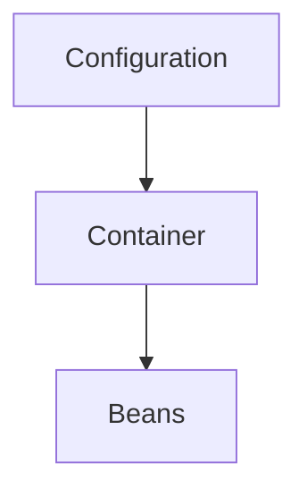

# D18-T024 — Dependency injection containers

Topic ID: `D18-T024`
Domain: Low-Level Design (LLD) and Object-Oriented Design
Subdomain: Dependency injection containers
Importance: core
Complexity: intermediate
Dependencies: `D18-T023`, `D18-T001`, `D01-T001`, `D01-T002`
Execution status of the code in section F: unexecuted

## A. Topic Overview

Containers (Spring, Guice) build object graphs from configuration, scopes, and qualifiers. They replace manual composition roots in large apps.

## B. First-Principles Explanation

Container reads metadata (annotations, modules) to instantiate beans, resolve dependencies, and manage lifecycles.

## C. Internal Working and Architecture

Startup: scan, create bean definitions, topological sort for injection, expose context. Request scope creates proxies in servlet apps.

## D. Diagrams and Visual Models



Config drives container; beans are wired instances.

## E. Examples and Analogies

Spring ApplicationContext as container.

## F. Code Examples

examples/d18_t024_spring.java (unexecuted).

```java
@Configuration @Bean methods register implementations of ports.
```

Use container for wiring only—keep business logic out of config classes.

## G. Practical Backend Application

Use Dependency injection containers when a backend module is about to grow a second variation.

## H. Advantages, Limitations and Trade-offs

| Feature | Benefit | Cost | Choose when | Avoid when |
| --- | --- | --- | --- | --- |
| Container | Consistent wiring | Learning curve | Large services | 100-line CLI |
| Auto-config | Fast bootstrap | Opaque magic | Standard stacks | Exotic deps |

## I. Common Mistakes and Misconceptions

- Business logic in @Configuration.
- Too many @Component scans.
- Circular dependency at startup.
- Wrong scope causing leaks.
- Testing without @SpringBootTest slice.

## J. Debugging and Troubleshooting

BeanCreationException—read caused by chain for missing dependency.

## K. Interview Preparation

### Beginner

#### Q1. What is Dependency injection containers in one sentence?

**Answer:** Dependency injection containers is framework-managed object graph and scopes. Interviewers want a concrete backend example, not a glossary quote. Tie the definition to a change you would make in a service class or module boundary. Mention testability or deploy isolation as the payoff.

#### Q2. Why does Dependency injection containers matter in backend code?

**Answer:** Backend code lives for years and is changed under incident pressure. Dependency injection containers reduces the blast radius when requirements shift. Services integrate databases, queues, and third parties; rigid designs break at those seams. Strong answers name a bug class prevented, not only 'clean code'.

#### Q3. Give a small example of Dependency injection containers.

**Answer:** Pick one class in a payment or auth flow and show how framework-managed object graph and scopes applies. Keep the example to three types so the whiteboard stays readable. State inputs, outputs, and who calls whom. End with how you would unit-test the seam.

#### Q4. When would you skip Dependency injection containers?

**Answer:** Skips are valid for throwaway scripts and one-off migrations. Over-applying Dependency injection containers adds indirection that obscures a 50-line feature. If the variation never appears in requirements, do not build the abstraction early. YAGNI still applies inside OOD.

#### Q5. How is Dependency injection containers different from a random utility class?

**Answer:** Utilities are stateless bags of functions without a modeled responsibility. Dependency injection containers encodes a deliberate collaboration contract between roles. The difference shows up when you mock one side in tests. If you cannot draw the roles, it is probably not intentional design.

### Intermediate

#### Q1. How does Dependency injection containers interact with SOLID?

**Answer:** SOLID is the constraint system; patterns are recurring shapes that satisfy it. Dependency injection containers often supports dependency inversion and open-closed goals. Violations of single responsibility usually break the pattern silently. In reviews, map each class to one principle before naming a pattern.

#### Q2. How do you test code structured with Dependency injection containers?

**Answer:** Replace slow or external collaborators with fakes at the abstraction introduced by the design. For Dependency injection containers, tests should exercise the public contract, not private construction details. Use contract tests at integration boundaries. Avoid testing the pattern itself; test behavior.

#### Q3. What metrics or smells suggest missing Dependency injection containers?

**Answer:** God classes, long switch statements, and copy-pasted integration code are common smells. When every new feature edits the same method, Dependency injection containers may help. Rising cyclomatic complexity in one class is a signal. Also watch for duplicate error handling across adapters.

#### Q4. How would you introduce Dependency injection containers in a legacy service?

**Answer:** Strangler approach: extract one seam behind an interface without rewriting the world. Keep old entry points until callers migrate to the Dependency injection containers shape. Add characterization tests before moving code. Ship behind a feature flag if behavior could diverge.

#### Q5. Compare Dependency injection containers with composition.

**Answer:** Composition favors has-a wiring; patterns often compose multiple objects. Dependency injection containers does not replace composition; it structures it. Prefer composition when inheritance depth grows. Patterns should make collaboration explicit, not magical.

### Advanced

#### Q1. Thread-safety concerns with Dependency injection containers?

**Answer:** Shared mutable singletons and registries are the usual hazard. If Dependency injection containers caches state, document visibility and locking. In web apps, prefer request-scoped objects over global caches. Load tests expose races that unit tests miss.

#### Q2. Performance cost of Dependency injection containers?

**Answer:** Indirection adds allocation and virtual dispatch; usually negligible in I/O bound services. Dependency injection containers shines when variation is rare compared to steady-state requests. Profile before collapsing abstractions for micro-optimizations. Watch N+1 calls hidden inside facades.

#### Q3. How does Dependency injection containers appear in frameworks (Spring, Django)?

**Answer:** Frameworks often embed the pattern in lifecycle hooks you override. Recognize Dependency injection containers in template methods of middleware stacks. Do not fight the framework with a second parallel pattern. Document where your code plugs in.

#### Q4. Versioning APIs while using Dependency injection containers?

**Answer:** Keep DTOs stable at the boundary; vary behavior behind the pattern. Dependency injection containers lets you add a new strategy without breaking old clients. Publish which implementations are supported per API version. Deprecation is a product policy, not a pattern feature.

#### Q5. Security implications of Dependency injection containers?

**Answer:** Proxies and decorators are natural choke points for authz logging. Do not let Dependency injection containers bypass central validation. Command objects should not carry secrets in logs. Audit who can register implementations at runtime.

### Scenarios

#### Q1. Production bug: behavior differs only in staging. How does Dependency injection containers help debug?

**Answer:** Swap the implementation in staging with a recording fake. With Dependency injection containers, compare traces per collaborator. Check configuration wiring first. Replay the command or event that triggered the path.

#### Q2. Team debate: pattern vs inline code. What data decides?

**Answer:** Count variation points expected in the next two quarters. If only one implementation exists, Dependency injection containers is speculative. Measure test pain when mocking is hard. Choose the design that reduces coordinated releases.

#### Q3. Interview design: parking lot / LLD. Where Dependency injection containers?

**Answer:** Identify entities and lifecycles before patterns. Apply Dependency injection containers at the variation point the interviewer highlights. Explain trade-offs aloud while drawing. Start simple; refactor to pattern when second variant appears.

#### Q4. Refactor deadline tomorrow. Minimal Dependency injection containers slice?

**Answer:** Extract interface plus one alternate implementation behind factory. Move only the volatile code path into Dependency injection containers. Leave data classes dumb. Add one integration test on the critical path.

#### Q5. Observability: what to log with Dependency injection containers?

**Answer:** Log correlation id, chosen implementation name, and latency per collaborator. Avoid logging payloads that Dependency injection containers transforms secretly. Metrics per strategy help detect misconfiguration. Trace spans should cross the abstraction boundary.

### Follow-ups

#### Q1. Related topic after Dependency injection containers?

**Answer:** See the next D18 topic in the learning path for the adjacent pattern or principle. DDD and microservice boundaries reuse the same collaboration thinking. Link to dependency injection containers when wiring appears. Return to SOLID if reviews feel subjective.

#### Q2. How does Dependency injection containers relate to microservices?

**Answer:** Patterns are in-process; services are deployment boundaries. Do not distribute a Dependency injection containers graph without a compelling scaling reason. Use events between services; use patterns inside a service. Watch for duplicated pattern layers in every microservice.

#### Q3. Books vs code review for learning Dependency injection containers?

**Answer:** Books teach vocabulary; reviews teach local conventions. After reading Dependency injection containers, find it in your repo's framework integration. Keep a personal catalog of smells that triggered each pattern. Teach juniors with before-and-after diffs, not slides only.


## L. Practical Exercises

Solutions are in `EXERCISES/solutions/D18-T024.md`. Try these before opening that file.

### Exercise 1 — implementation

Register two PaymentPort beans with @Qualifier.

### Exercise 2 — debugging

Prototype bean injected into singleton—explain bug.

### Exercise 3 — trade-off

Full context vs @WebMvcTest slice tests.

## M. Revision Notes

- Container is composition root at scale.
- Scopes matter.
- Keep config thin.

## N. Related Topics

`D18-T005`, `D18-T025`.

## O. Completion Criteria

- Explain bean scopes.
- Debug BeanCreationException.
- Write minimal @Configuration.
