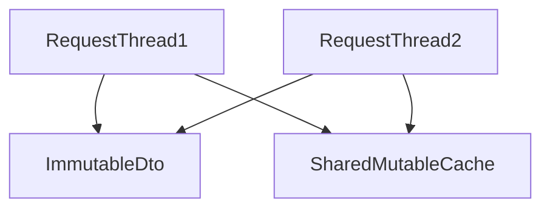

# D18-T026 — Concurrency-safe object design

Topic ID: `D18-T026`
Domain: Low-Level Design (LLD) and Object-Oriented Design
Subdomain: Concurrency-safe object design
Importance: core
Complexity: intermediate
Dependencies: `D18-T025`, `D18-T001`, `D01-T001`, `D01-T002`
Execution status of the code in section F: unexecuted

## A. Topic Overview

Shared mutable objects in multi-threaded servers need clear synchronization or immutability. Design choices affect correctness under load.

## B. First-Principles Explanation

Prefer immutable values; confine mutability to single-threaded actors; use concurrent collections when sharing.

## C. Internal Working and Architecture

Read-mostly caches need visibility rules; `@Synchronized` on wrong granularity hurts throughput.

## D. Diagrams and Visual Models



Immutable per request; shared cache needs locks.

## E. Examples and Analogies

Do not store per-user state in singleton service fields.

## F. Code Examples

examples/d18_t026_concurrent.java (unexecuted).

```java
private final ConcurrentHashMap<> cache = new ConcurrentHashMap<>();
```

Document thread safety on each bean scope.

## G. Practical Backend Application

Use Concurrency-safe object design when a backend module is about to grow a second variation.

## H. Advantages, Limitations and Trade-offs

| Approach | Benefit | Cost | Choose when | Avoid when |
| --- | --- | --- | --- | --- |
| Immutability | Safe sharing | Copy cost | DTOs, messages | Huge graphs |
| Confinement | No locks | Single thread | Event loop worker | Pool threads sharing |
| Locks | Correct mutability | Contention | In-memory cache | High write contention |

## I. Common Mistakes and Misconceptions

- Mutable singleton fields.
- Check-then-act races.
- Lock on interned string.
- Exposing internal mutable list.
- Deadlock between nested locks.

## J. Debugging and Troubleshooting

Rare corruption under load—race on non-atomic compound action.

## K. Interview Preparation

### Beginner

#### Q1. What is Concurrency-safe object design in one sentence?

**Answer:** Concurrency-safe object design is immutability confinement or synchronized shared state. Interviewers want a concrete backend example, not a glossary quote. Tie the definition to a change you would make in a service class or module boundary. Mention testability or deploy isolation as the payoff.

#### Q2. Why does Concurrency-safe object design matter in backend code?

**Answer:** Backend code lives for years and is changed under incident pressure. Concurrency-safe object design reduces the blast radius when requirements shift. Services integrate databases, queues, and third parties; rigid designs break at those seams. Strong answers name a bug class prevented, not only 'clean code'.

#### Q3. Give a small example of Concurrency-safe object design.

**Answer:** Pick one class in a payment or auth flow and show how immutability confinement or synchronized shared state applies. Keep the example to three types so the whiteboard stays readable. State inputs, outputs, and who calls whom. End with how you would unit-test the seam.

#### Q4. When would you skip Concurrency-safe object design?

**Answer:** Skips are valid for throwaway scripts and one-off migrations. Over-applying Concurrency-safe object design adds indirection that obscures a 50-line feature. If the variation never appears in requirements, do not build the abstraction early. YAGNI still applies inside OOD.

#### Q5. How is Concurrency-safe object design different from a random utility class?

**Answer:** Utilities are stateless bags of functions without a modeled responsibility. Concurrency-safe object design encodes a deliberate collaboration contract between roles. The difference shows up when you mock one side in tests. If you cannot draw the roles, it is probably not intentional design.

### Intermediate

#### Q1. How does Concurrency-safe object design interact with SOLID?

**Answer:** SOLID is the constraint system; patterns are recurring shapes that satisfy it. Concurrency-safe object design often supports dependency inversion and open-closed goals. Violations of single responsibility usually break the pattern silently. In reviews, map each class to one principle before naming a pattern.

#### Q2. How do you test code structured with Concurrency-safe object design?

**Answer:** Replace slow or external collaborators with fakes at the abstraction introduced by the design. For Concurrency-safe object design, tests should exercise the public contract, not private construction details. Use contract tests at integration boundaries. Avoid testing the pattern itself; test behavior.

#### Q3. What metrics or smells suggest missing Concurrency-safe object design?

**Answer:** God classes, long switch statements, and copy-pasted integration code are common smells. When every new feature edits the same method, Concurrency-safe object design may help. Rising cyclomatic complexity in one class is a signal. Also watch for duplicate error handling across adapters.

#### Q4. How would you introduce Concurrency-safe object design in a legacy service?

**Answer:** Strangler approach: extract one seam behind an interface without rewriting the world. Keep old entry points until callers migrate to the Concurrency-safe object design shape. Add characterization tests before moving code. Ship behind a feature flag if behavior could diverge.

#### Q5. Compare Concurrency-safe object design with composition.

**Answer:** Composition favors has-a wiring; patterns often compose multiple objects. Concurrency-safe object design does not replace composition; it structures it. Prefer composition when inheritance depth grows. Patterns should make collaboration explicit, not magical.

### Advanced

#### Q1. Thread-safety concerns with Concurrency-safe object design?

**Answer:** Shared mutable singletons and registries are the usual hazard. If Concurrency-safe object design caches state, document visibility and locking. In web apps, prefer request-scoped objects over global caches. Load tests expose races that unit tests miss.

#### Q2. Performance cost of Concurrency-safe object design?

**Answer:** Indirection adds allocation and virtual dispatch; usually negligible in I/O bound services. Concurrency-safe object design shines when variation is rare compared to steady-state requests. Profile before collapsing abstractions for micro-optimizations. Watch N+1 calls hidden inside facades.

#### Q3. How does Concurrency-safe object design appear in frameworks (Spring, Django)?

**Answer:** Frameworks often embed the pattern in lifecycle hooks you override. Recognize Concurrency-safe object design in template methods of middleware stacks. Do not fight the framework with a second parallel pattern. Document where your code plugs in.

#### Q4. Versioning APIs while using Concurrency-safe object design?

**Answer:** Keep DTOs stable at the boundary; vary behavior behind the pattern. Concurrency-safe object design lets you add a new strategy without breaking old clients. Publish which implementations are supported per API version. Deprecation is a product policy, not a pattern feature.

#### Q5. Security implications of Concurrency-safe object design?

**Answer:** Proxies and decorators are natural choke points for authz logging. Do not let Concurrency-safe object design bypass central validation. Command objects should not carry secrets in logs. Audit who can register implementations at runtime.

### Scenarios

#### Q1. Production bug: behavior differs only in staging. How does Concurrency-safe object design help debug?

**Answer:** Swap the implementation in staging with a recording fake. With Concurrency-safe object design, compare traces per collaborator. Check configuration wiring first. Replay the command or event that triggered the path.

#### Q2. Team debate: pattern vs inline code. What data decides?

**Answer:** Count variation points expected in the next two quarters. If only one implementation exists, Concurrency-safe object design is speculative. Measure test pain when mocking is hard. Choose the design that reduces coordinated releases.

#### Q3. Interview design: parking lot / LLD. Where Concurrency-safe object design?

**Answer:** Identify entities and lifecycles before patterns. Apply Concurrency-safe object design at the variation point the interviewer highlights. Explain trade-offs aloud while drawing. Start simple; refactor to pattern when second variant appears.

#### Q4. Refactor deadline tomorrow. Minimal Concurrency-safe object design slice?

**Answer:** Extract interface plus one alternate implementation behind factory. Move only the volatile code path into Concurrency-safe object design. Leave data classes dumb. Add one integration test on the critical path.

#### Q5. Observability: what to log with Concurrency-safe object design?

**Answer:** Log correlation id, chosen implementation name, and latency per collaborator. Avoid logging payloads that Concurrency-safe object design transforms secretly. Metrics per strategy help detect misconfiguration. Trace spans should cross the abstraction boundary.

### Follow-ups

#### Q1. Related topic after Concurrency-safe object design?

**Answer:** See the next D18 topic in the learning path for the adjacent pattern or principle. DDD and microservice boundaries reuse the same collaboration thinking. Link to dependency injection containers when wiring appears. Return to SOLID if reviews feel subjective.

#### Q2. How does Concurrency-safe object design relate to microservices?

**Answer:** Patterns are in-process; services are deployment boundaries. Do not distribute a Concurrency-safe object design graph without a compelling scaling reason. Use events between services; use patterns inside a service. Watch for duplicated pattern layers in every microservice.

#### Q3. Books vs code review for learning Concurrency-safe object design?

**Answer:** Books teach vocabulary; reviews teach local conventions. After reading Concurrency-safe object design, find it in your repo's framework integration. Keep a personal catalog of smells that triggered each pattern. Teach juniors with before-and-after diffs, not slides only.


## L. Practical Exercises

Solutions are in `EXERCISES/solutions/D18-T026.md`. Try these before opening that file.

### Exercise 1 — implementation

Make order summary DTO immutable.

### Exercise 2 — debugging

Find race in lazy-init singleton.

### Exercise 3 — trade-off

ConcurrentHashMap vs synchronized map.

## M. Revision Notes

- Immutable by default.
- Scope mutable state.
- Document bean thread safety.

## N. Related Topics

`D18-T011`, OS concurrency `D03`.

## O. Completion Criteria

- Review bean for shared mutation.
- Fix check-then-act.
- Choose concurrent collection.
