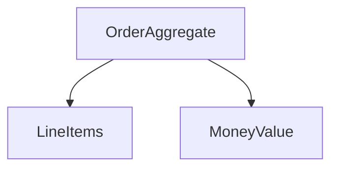

# D18-T027 — Domain modeling and invariants

Topic ID: `D18-T027`
Domain: Low-Level Design (LLD) and Object-Oriented Design
Subdomain: Domain modeling and invariants
Importance: core
Complexity: intermediate
Dependencies: `D18-T026`, `D18-T001`, `D01-T001`, `D01-T002`
Execution status of the code in section F: unexecuted

## A. Topic Overview

Domain modeling names entities, value objects, and invariants that must always hold. LLD interviews often start here before patterns.

## B. First-Principles Explanation

Value objects are immutable and compared by value; entities have identity. Invariants are enforced inside the aggregate.

## C. Internal Working and Architecture

Ubiquitous language aligns code terms with product language. Invalid states should be unrepresentable.

## D. Diagrams and Visual Models



Aggregate root owns consistency boundary.

## E. Examples and Analogies

Money as value object with currency + minor units.

## F. Code Examples

examples/d18_t027_money.java (unexecuted).

```java
// unexecuted
record Money(long cents, Currency currency) {
  Money add(Money other) {
    if (!currency.equals(other.currency)) throw new IllegalArgumentException();
    return new Money(cents + other.cents, currency);
  }
}
```

Enforce currency match in domain, not in controller.

## G. Practical Backend Application

Map ORM entities to domain at repository boundary if needed.

## H. Advantages, Limitations and Trade-offs

| Concept | Benefit | Cost | Choose when | Avoid when |
| --- | --- | --- | --- | --- |
| Value object | Safe math | Mapping | Money, email | Identity-heavy rows |
| Aggregate | Consistency | Load design | Transaction boundary | Entire schema one root |
| Invariant in ctor | No invalid object | Strict API | Critical rules | Draft states need flexibility |

## I. Common Mistakes and Misconceptions

- Primitive obsession (string money).
- Invariant only in service layer.
- Anemic entities.
- Aggregate too large.
- Leaking persistence into domain language.

## J. Debugging and Troubleshooting

Invalid order shipped—invariant bypassed via setter.

## K. Interview Preparation

### Beginner

#### Q1. What is Domain modeling and invariants in one sentence?

**Answer:** Domain modeling and invariants is entities values and rules that must always hold. Interviewers want a concrete backend example, not a glossary quote. Tie the definition to a change you would make in a service class or module boundary. Mention testability or deploy isolation as the payoff.

#### Q2. Why does Domain modeling and invariants matter in backend code?

**Answer:** Backend code lives for years and is changed under incident pressure. Domain modeling and invariants reduces the blast radius when requirements shift. Services integrate databases, queues, and third parties; rigid designs break at those seams. Strong answers name a bug class prevented, not only 'clean code'.

#### Q3. Give a small example of Domain modeling and invariants.

**Answer:** Pick one class in a payment or auth flow and show how entities values and rules that must always hold applies. Keep the example to three types so the whiteboard stays readable. State inputs, outputs, and who calls whom. End with how you would unit-test the seam.

#### Q4. When would you skip Domain modeling and invariants?

**Answer:** Skips are valid for throwaway scripts and one-off migrations. Over-applying Domain modeling and invariants adds indirection that obscures a 50-line feature. If the variation never appears in requirements, do not build the abstraction early. YAGNI still applies inside OOD.

#### Q5. How is Domain modeling and invariants different from a random utility class?

**Answer:** Utilities are stateless bags of functions without a modeled responsibility. Domain modeling and invariants encodes a deliberate collaboration contract between roles. The difference shows up when you mock one side in tests. If you cannot draw the roles, it is probably not intentional design.

### Intermediate

#### Q1. How does Domain modeling and invariants interact with SOLID?

**Answer:** SOLID is the constraint system; patterns are recurring shapes that satisfy it. Domain modeling and invariants often supports dependency inversion and open-closed goals. Violations of single responsibility usually break the pattern silently. In reviews, map each class to one principle before naming a pattern.

#### Q2. How do you test code structured with Domain modeling and invariants?

**Answer:** Replace slow or external collaborators with fakes at the abstraction introduced by the design. For Domain modeling and invariants, tests should exercise the public contract, not private construction details. Use contract tests at integration boundaries. Avoid testing the pattern itself; test behavior.

#### Q3. What metrics or smells suggest missing Domain modeling and invariants?

**Answer:** God classes, long switch statements, and copy-pasted integration code are common smells. When every new feature edits the same method, Domain modeling and invariants may help. Rising cyclomatic complexity in one class is a signal. Also watch for duplicate error handling across adapters.

#### Q4. How would you introduce Domain modeling and invariants in a legacy service?

**Answer:** Strangler approach: extract one seam behind an interface without rewriting the world. Keep old entry points until callers migrate to the Domain modeling and invariants shape. Add characterization tests before moving code. Ship behind a feature flag if behavior could diverge.

#### Q5. Compare Domain modeling and invariants with composition.

**Answer:** Composition favors has-a wiring; patterns often compose multiple objects. Domain modeling and invariants does not replace composition; it structures it. Prefer composition when inheritance depth grows. Patterns should make collaboration explicit, not magical.

### Advanced

#### Q1. Thread-safety concerns with Domain modeling and invariants?

**Answer:** Shared mutable singletons and registries are the usual hazard. If Domain modeling and invariants caches state, document visibility and locking. In web apps, prefer request-scoped objects over global caches. Load tests expose races that unit tests miss.

#### Q2. Performance cost of Domain modeling and invariants?

**Answer:** Indirection adds allocation and virtual dispatch; usually negligible in I/O bound services. Domain modeling and invariants shines when variation is rare compared to steady-state requests. Profile before collapsing abstractions for micro-optimizations. Watch N+1 calls hidden inside facades.

#### Q3. How does Domain modeling and invariants appear in frameworks (Spring, Django)?

**Answer:** Frameworks often embed the pattern in lifecycle hooks you override. Recognize Domain modeling and invariants in template methods of middleware stacks. Do not fight the framework with a second parallel pattern. Document where your code plugs in.

#### Q4. Versioning APIs while using Domain modeling and invariants?

**Answer:** Keep DTOs stable at the boundary; vary behavior behind the pattern. Domain modeling and invariants lets you add a new strategy without breaking old clients. Publish which implementations are supported per API version. Deprecation is a product policy, not a pattern feature.

#### Q5. Security implications of Domain modeling and invariants?

**Answer:** Proxies and decorators are natural choke points for authz logging. Do not let Domain modeling and invariants bypass central validation. Command objects should not carry secrets in logs. Audit who can register implementations at runtime.

### Scenarios

#### Q1. Production bug: behavior differs only in staging. How does Domain modeling and invariants help debug?

**Answer:** Swap the implementation in staging with a recording fake. With Domain modeling and invariants, compare traces per collaborator. Check configuration wiring first. Replay the command or event that triggered the path.

#### Q2. Team debate: pattern vs inline code. What data decides?

**Answer:** Count variation points expected in the next two quarters. If only one implementation exists, Domain modeling and invariants is speculative. Measure test pain when mocking is hard. Choose the design that reduces coordinated releases.

#### Q3. Interview design: parking lot / LLD. Where Domain modeling and invariants?

**Answer:** Identify entities and lifecycles before patterns. Apply Domain modeling and invariants at the variation point the interviewer highlights. Explain trade-offs aloud while drawing. Start simple; refactor to pattern when second variant appears.

#### Q4. Refactor deadline tomorrow. Minimal Domain modeling and invariants slice?

**Answer:** Extract interface plus one alternate implementation behind factory. Move only the volatile code path into Domain modeling and invariants. Leave data classes dumb. Add one integration test on the critical path.

#### Q5. Observability: what to log with Domain modeling and invariants?

**Answer:** Log correlation id, chosen implementation name, and latency per collaborator. Avoid logging payloads that Domain modeling and invariants transforms secretly. Metrics per strategy help detect misconfiguration. Trace spans should cross the abstraction boundary.

### Follow-ups

#### Q1. Related topic after Domain modeling and invariants?

**Answer:** See the next D18 topic in the learning path for the adjacent pattern or principle. DDD and microservice boundaries reuse the same collaboration thinking. Link to dependency injection containers when wiring appears. Return to SOLID if reviews feel subjective.

#### Q2. How does Domain modeling and invariants relate to microservices?

**Answer:** Patterns are in-process; services are deployment boundaries. Do not distribute a Domain modeling and invariants graph without a compelling scaling reason. Use events between services; use patterns inside a service. Watch for duplicated pattern layers in every microservice.

#### Q3. Books vs code review for learning Domain modeling and invariants?

**Answer:** Books teach vocabulary; reviews teach local conventions. After reading Domain modeling and invariants, find it in your repo's framework integration. Keep a personal catalog of smells that triggered each pattern. Teach juniors with before-and-after diffs, not slides only.


## L. Practical Exercises

Solutions are in `EXERCISES/solutions/D18-T027.md`. Try these before opening that file.

### Exercise 1 — implementation

Model Email value object with validation.

### Exercise 2 — debugging

Double currency addition bug—fix domain type.

### Exercise 3 — trade-off

Aggregate size vs performance.

## M. Revision Notes

- Value vs entity.
- Invariants inside aggregate.
- Ubiquitous language.

## N. Related Topics

`D18-T003`, `D18-T023`, DDD further reading.

## O. Completion Criteria

- Design value object.
- List invariants for library loan.
- Draw aggregate boundary.
