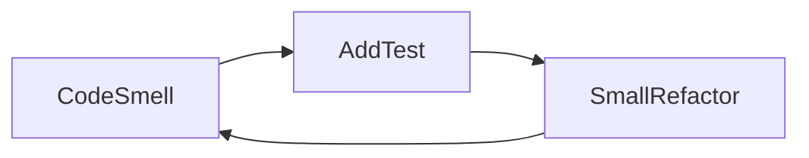

# D18-T028 — Refactoring and avoiding overengineering

Topic ID: `D18-T028`
Domain: Low-Level Design (LLD) and Object-Oriented Design
Subdomain: Refactoring and avoiding overengineering
Importance: core
Complexity: intermediate
Dependencies: `D18-T027`, `D18-T001`, `D01-T001`, `D01-T002`
Execution status of the code in section F: unexecuted

## A. Topic Overview

Refactoring improves structure without changing behavior. Avoiding overengineering keeps designs aligned to real variation and team size.

## B. First-Principles Explanation

Use tests as safety net; refactor in small steps; measure pain before introducing patterns.

## C. Internal Working and Architecture

Rule of three: tolerate duplication twice, abstract on third. Replace conditional with polymorphism when variants stabilize.

## D. Diagrams and Visual Models



Iterative loop with tests guarding behavior.

## E. Examples and Analogies

Extract method before extract class; introduce interface when second implementation arrives.

## F. Code Examples

examples/d18_t028_refactor.py (unexecuted).

```java
# unexecuted
# Step 1: extract function; Step 2: move to class when second caller needs state
def compute_total(lines): return sum(l.qty * l.price for l in lines)
```

Refactor after characterization test on pricing.

## G. Practical Backend Application

Resist pattern stacking in week-one microservice.

## H. Advantages, Limitations and Trade-offs

| Move | Benefit | Cost | Choose when | Avoid when |
| --- | --- | --- | --- | --- |
| Extract method | Clarity | None | Long method | Premature |
| Introduce pattern | Handles variation | Indirection | Second variant | Hypothetical future |
| Leave as is | Simplicity | Debt | Low churn area | Active incident magnet |

## I. Common Mistakes and Misconceptions

- Refactor without tests.
- Big bang rewrite.
- Pattern for one case.
- Gold plating extensibility.
- Ignoring team skill ceiling.

## J. Debugging and Troubleshooting

Regression after refactor—missing characterization test on edge case.

## K. Interview Preparation

### Beginner

#### Q1. What is Refactoring and avoiding overengineering in one sentence?

**Answer:** Refactoring and avoiding overengineering is safe structural change without behavior change. Interviewers want a concrete backend example, not a glossary quote. Tie the definition to a change you would make in a service class or module boundary. Mention testability or deploy isolation as the payoff.

#### Q2. Why does Refactoring and avoiding overengineering matter in backend code?

**Answer:** Backend code lives for years and is changed under incident pressure. Refactoring and avoiding overengineering reduces the blast radius when requirements shift. Services integrate databases, queues, and third parties; rigid designs break at those seams. Strong answers name a bug class prevented, not only 'clean code'.

#### Q3. Give a small example of Refactoring and avoiding overengineering.

**Answer:** Pick one class in a payment or auth flow and show how safe structural change without behavior change applies. Keep the example to three types so the whiteboard stays readable. State inputs, outputs, and who calls whom. End with how you would unit-test the seam.

#### Q4. When would you skip Refactoring and avoiding overengineering?

**Answer:** Skips are valid for throwaway scripts and one-off migrations. Over-applying Refactoring and avoiding overengineering adds indirection that obscures a 50-line feature. If the variation never appears in requirements, do not build the abstraction early. YAGNI still applies inside OOD.

#### Q5. How is Refactoring and avoiding overengineering different from a random utility class?

**Answer:** Utilities are stateless bags of functions without a modeled responsibility. Refactoring and avoiding overengineering encodes a deliberate collaboration contract between roles. The difference shows up when you mock one side in tests. If you cannot draw the roles, it is probably not intentional design.

### Intermediate

#### Q1. How does Refactoring and avoiding overengineering interact with SOLID?

**Answer:** SOLID is the constraint system; patterns are recurring shapes that satisfy it. Refactoring and avoiding overengineering often supports dependency inversion and open-closed goals. Violations of single responsibility usually break the pattern silently. In reviews, map each class to one principle before naming a pattern.

#### Q2. How do you test code structured with Refactoring and avoiding overengineering?

**Answer:** Replace slow or external collaborators with fakes at the abstraction introduced by the design. For Refactoring and avoiding overengineering, tests should exercise the public contract, not private construction details. Use contract tests at integration boundaries. Avoid testing the pattern itself; test behavior.

#### Q3. What metrics or smells suggest missing Refactoring and avoiding overengineering?

**Answer:** God classes, long switch statements, and copy-pasted integration code are common smells. When every new feature edits the same method, Refactoring and avoiding overengineering may help. Rising cyclomatic complexity in one class is a signal. Also watch for duplicate error handling across adapters.

#### Q4. How would you introduce Refactoring and avoiding overengineering in a legacy service?

**Answer:** Strangler approach: extract one seam behind an interface without rewriting the world. Keep old entry points until callers migrate to the Refactoring and avoiding overengineering shape. Add characterization tests before moving code. Ship behind a feature flag if behavior could diverge.

#### Q5. Compare Refactoring and avoiding overengineering with composition.

**Answer:** Composition favors has-a wiring; patterns often compose multiple objects. Refactoring and avoiding overengineering does not replace composition; it structures it. Prefer composition when inheritance depth grows. Patterns should make collaboration explicit, not magical.

### Advanced

#### Q1. Thread-safety concerns with Refactoring and avoiding overengineering?

**Answer:** Shared mutable singletons and registries are the usual hazard. If Refactoring and avoiding overengineering caches state, document visibility and locking. In web apps, prefer request-scoped objects over global caches. Load tests expose races that unit tests miss.

#### Q2. Performance cost of Refactoring and avoiding overengineering?

**Answer:** Indirection adds allocation and virtual dispatch; usually negligible in I/O bound services. Refactoring and avoiding overengineering shines when variation is rare compared to steady-state requests. Profile before collapsing abstractions for micro-optimizations. Watch N+1 calls hidden inside facades.

#### Q3. How does Refactoring and avoiding overengineering appear in frameworks (Spring, Django)?

**Answer:** Frameworks often embed the pattern in lifecycle hooks you override. Recognize Refactoring and avoiding overengineering in template methods of middleware stacks. Do not fight the framework with a second parallel pattern. Document where your code plugs in.

#### Q4. Versioning APIs while using Refactoring and avoiding overengineering?

**Answer:** Keep DTOs stable at the boundary; vary behavior behind the pattern. Refactoring and avoiding overengineering lets you add a new strategy without breaking old clients. Publish which implementations are supported per API version. Deprecation is a product policy, not a pattern feature.

#### Q5. Security implications of Refactoring and avoiding overengineering?

**Answer:** Proxies and decorators are natural choke points for authz logging. Do not let Refactoring and avoiding overengineering bypass central validation. Command objects should not carry secrets in logs. Audit who can register implementations at runtime.

### Scenarios

#### Q1. Production bug: behavior differs only in staging. How does Refactoring and avoiding overengineering help debug?

**Answer:** Swap the implementation in staging with a recording fake. With Refactoring and avoiding overengineering, compare traces per collaborator. Check configuration wiring first. Replay the command or event that triggered the path.

#### Q2. Team debate: pattern vs inline code. What data decides?

**Answer:** Count variation points expected in the next two quarters. If only one implementation exists, Refactoring and avoiding overengineering is speculative. Measure test pain when mocking is hard. Choose the design that reduces coordinated releases.

#### Q3. Interview design: parking lot / LLD. Where Refactoring and avoiding overengineering?

**Answer:** Identify entities and lifecycles before patterns. Apply Refactoring and avoiding overengineering at the variation point the interviewer highlights. Explain trade-offs aloud while drawing. Start simple; refactor to pattern when second variant appears.

#### Q4. Refactor deadline tomorrow. Minimal Refactoring and avoiding overengineering slice?

**Answer:** Extract interface plus one alternate implementation behind factory. Move only the volatile code path into Refactoring and avoiding overengineering. Leave data classes dumb. Add one integration test on the critical path.

#### Q5. Observability: what to log with Refactoring and avoiding overengineering?

**Answer:** Log correlation id, chosen implementation name, and latency per collaborator. Avoid logging payloads that Refactoring and avoiding overengineering transforms secretly. Metrics per strategy help detect misconfiguration. Trace spans should cross the abstraction boundary.

### Follow-ups

#### Q1. Related topic after Refactoring and avoiding overengineering?

**Answer:** See the next D18 topic in the learning path for the adjacent pattern or principle. DDD and microservice boundaries reuse the same collaboration thinking. Link to dependency injection containers when wiring appears. Return to SOLID if reviews feel subjective.

#### Q2. How does Refactoring and avoiding overengineering relate to microservices?

**Answer:** Patterns are in-process; services are deployment boundaries. Do not distribute a Refactoring and avoiding overengineering graph without a compelling scaling reason. Use events between services; use patterns inside a service. Watch for duplicated pattern layers in every microservice.

#### Q3. Books vs code review for learning Refactoring and avoiding overengineering?

**Answer:** Books teach vocabulary; reviews teach local conventions. After reading Refactoring and avoiding overengineering, find it in your repo's framework integration. Keep a personal catalog of smells that triggered each pattern. Teach juniors with before-and-after diffs, not slides only.


## L. Practical Exercises

Solutions are in `EXERCISES/solutions/D18-T028.md`. Try these before opening that file.

### Exercise 1 — implementation

Plan refactor steps for god service.

### Exercise 2 — debugging

Over-abstracted code hard to change—simplify.

### Exercise 3 — trade-off

When to stop refactoring.

## M. Revision Notes

- Test first.
- Small steps.
- Pattern on third variant.

## N. Related Topics

`D18-T002`, entire D18 path.

## O. Completion Criteria

- Outline refactor plan.
- Name overengineering smell.
- Apply rule of three.
