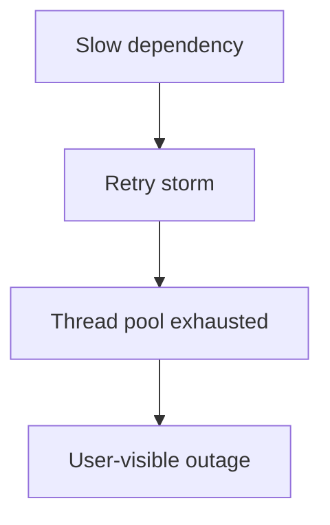

# D19-T029 — Microservices failure modes

Topic ID: `D19-T029`
Domain: Microservices Architecture
Subdomain: Microservices failure modes
Importance: common
Complexity: advanced
Dependencies: `D19-T028`, `D19-T001`, `D15-T001`, `D15-T002`, `D16-T001`, `D16-T002`
Execution status of the code in section F: not executed (local)

## A. Topic Overview

Microservices failure modes include cascading outages, data drift, contract skew, and operational entropy that a monolith hides in one process.

This note covers microservices failure modes as part of microservices architecture: cascading failure, split brain data, version skew, and related ideas.

In production the pattern appears when one bad deploy plus aggressive retries takes down gateway.

Interviewers use the topic to test whether you can reason about distributed systems without hand-waving.

Prerequisites include inventory dependencies; prior topic in the chain is `D19-T028`.

## B. First-Principles Explanation

A monolith colocates calls, transactions, and failures in one process. Microservices move those boundaries to the network.

Microservices failure modes exists to make one aspect of that distribution explicit: who owns what, how messages flow, or how failure is contained.

Networks add latency, partial failure, and duplicate delivery. Designs must state assumptions about consistency and idempotency.

What happens internally: a request or message enters at an edge or peer, policy is applied (auth, routing, limits), application logic runs against owned data, and side effects are emitted synchronously or asynchronously.

Why it works when done well: teams ship independently, blast radius shrinks, and technology choices can fit each workload. Limitations: blaming network without checking retry policy.

## C. Internal Working and Architecture

Components typically include the service runtime, its datastore, integration adapters (HTTP/gRPC clients, message publishers), and platform hooks (health checks, metrics, tracing).

For Microservices failure modes, emphasize cascading failure and split brain data as first-class design artifacts, not afterthoughts.

Execution path: validate incoming contract, authorize caller, perform domain operation in a single-writer store, emit events or replies, and record observability fields (trace id, idempotency key).

State is owned locally; other services see snapshots, caches, or events—not live foreign keys. Cross-cutting flows like one bad deploy plus aggressive retries takes down gateway should be diagrammed before coding.

Memory and CPU matter at scale, but operational state—queues, breaker positions, outbox backlog—often dominates incident response.

## D. Diagrams and Visual Models



Diagram for Microservices failure modes: one bad deploy plus aggressive retries takes down gateway.

## E. Examples and Analogies

Analogy: Microservices failure modes is like airport security for distributed traffic—helpful when volume and rules are clear, costly when every passenger needs a unique manual process.

Backend example: one bad deploy plus aggressive retries takes down gateway. Identify sync steps that need user-visible errors versus async steps that can retry.

Anti-pattern: blaming network without checking retry policy. The fix is usually clearer boundaries, contracts, or platform policy—not more services.

Do not confuse the marketing term with the operational requirement: every pattern here needs observability and rollback.

## F. Code Examples

File: conceptual illustration for Microservices failure modes. Dependencies: Python 3 standard library only (no broker or cluster required).

```python
"""Illustrates control flow for: one bad deploy plus aggressive retries takes down gateway."""

from dataclasses import dataclass
from enum import Enum
import time
import uuid


class StepResult(Enum):
    OK = "ok"
    FAIL = "fail"


@dataclass
class Correlation:
    trace_id: str
    idempotency_key: str


def with_correlation() -> Correlation:
    return Correlation(trace_id=str(uuid.uuid4()), idempotency_key=str(uuid.uuid4()))


def simulate_remote(name: str, fail: bool = False) -> StepResult:
    time.sleep(0.001)
    return StepResult.FAIL if fail else StepResult.OK


def run_flow(corr: Correlation) -> str:
    print("trace", corr.trace_id, "idem", corr.idempotency_key)
    if simulate_remote("primary") == StepResult.FAIL:
        return "aborted"
    if simulate_remote("secondary", fail=False) == StepResult.FAIL:
        simulate_remote("compensate")
        return "compensated"
    return "completed"


if __name__ == "__main__":
    assert run_flow(with_correlation()) == "completed"
    print("ok")
```

How to run: `python` this file from any directory. Expected output includes `ok`. Important lines: correlation ids model production tracing and idempotency. Replace `simulate_remote` with real HTTP or message clients in a service codebase.

## G. Practical Backend Application

When rolling out microservices failure modes, start with one vertical slice that matches one bad deploy plus aggressive retries takes down gateway.

Add trace propagation and structured logs before optimizing payload formats.

Document SLOs, on-call runbooks, and feature flags for the new path.

Security: authenticate service callers, authorize per operation, and minimize PII fan-out.

Scaling: watch fan-out multiplier, connection pools, and broker lag—not only CPU per pod.

## H. Advantages, Limitations and Trade-offs

| Choice | Benefit | Cost | Choose when | Avoid when |
| --- | --- | --- | --- | --- |
| Apply Microservices failure modes fully | Clear ownership and evolvability | Higher moving parts | Multiple teams, stable domain seams | One team, unclear boundaries |
| Defer / simplify | Faster delivery early | Rework later | Product still searching for model | You already feel deploy pain |
| Sync communication | Simple mental model | Tail latency stacks | Need immediate answer | Many side effects |
| Async messaging | Decouples peaks | Eventual consistency | Notifications, analytics | Interactive checkout guardrails |
| Strong consistency | Easier reasoning | Coupling and locks | Single service DB | Cross-service money movement |
| Eventual consistency | Independent scaling | Reconciliation work | Read models, replicas | Invariants spanning services without saga |

## I. Common Mistakes and Misconceptions

- Adopting microservices failure modes patterns before the organization can operate them (CI/CD, tracing, on-call).
- The classic pitfall: blaming network without checking retry policy.
- Treating cascading failure as a slide title instead of an enforced design rule in code review.
- Sharing databases or libraries that hide coupling while labels say microservices.
- Optimizing for number of services instead of deploy independence and clear ownership.
- Skipping contract tests between teams and discovering breaks only in production.

## J. Debugging and Troubleshooting

Symptoms: elevated 5xx at the gateway, growing outbox or queue lag, or inconsistent reads after one bad deploy plus aggressive retries takes down gateway.

Root causes often include missing timeouts, incompatible schema deploys, or shared datastore coupling.

Diagnosis: find a failing trace id, compare dependency dashboards, verify deploy versions, replay idempotent messages in a sandbox.

Mitigation: disable noncritical consumers, open breakers, extend deadlines only with product approval, fix forward with compatible contracts.

Long-term: contract tests, chaos exercises, and ADRs so the team does not repeat the same coupling.

## K. Interview Preparation

### Beginner

#### Q1. What is Microservices failure modes in a microservices system?

**Answer:** Microservices failure modes is about microservices failure modes include cascading outages, data drift, contract skew, and operational entropy that a monolith hides in one process. It shows up when multiple teams deploy services that must cooperate without sharing one database. Interviewers want a concrete example, not a glossary recitation. A strong answer mentions one bad deploy plus aggressive retries takes down gateway.

#### Q2. Why does Microservices failure modes matter for backend engineers?

**Answer:** Distributed systems move failure and consistency problems from hidden in-process calls to explicit network boundaries. Without microservices failure modes, teams rediscover the same outages and data bugs on every new service. Production work includes designing APIs, operability, and rollback paths—not only coding features. Tie the concept to deploy independence or customer-visible reliability.

#### Q3. Name one component involved in Microservices failure modes.

**Answer:** Typical building blocks include cascading failure, split brain data, version skew. Each component has an owner: application code, platform, or security. You should say what the component does in one sentence, not only its product name. Follow up with how you would observe it in metrics or traces.

#### Q4. What is a common misconception about Microservices failure modes?

**Answer:** People assume the pattern is free; in practice blaming network without checking retry policy. Another misconception is that tools alone implement the idea—policy and code review enforce it. Microservices amplify both good and bad architecture decisions. Interviewers listen for humility about operational cost.

#### Q5. How does Microservices failure modes relate to the API gateway or service mesh?

**Answer:** Edge gateways handle north-south client traffic; meshes often handle east-west policy between services. Microservices failure modes may appear in gateway routes, sidecar config, or pure application logic depending on topic. Do not dump every platform component—pick the one that actually enforces this concern. Mention correlation ids or auth when the topic touches cross-cutting security or observability.

### Intermediate

#### Q1. How would you implement Microservices failure modes on a greenfield checkout platform?

**Answer:** Start from one bad deploy plus aggressive retries takes down gateway and list services, data owners, and sync vs async steps. Publish API contracts and add contract tests before splitting repositories. Introduce observability (trace id propagation) before scaling service count. Roll out with feature flags or strangler routing if replacing legacy.

#### Q2. What trade-off does Microservices failure modes introduce versus a modular monolith?

**Answer:** Microservices failure modes include cascading outages, data drift, contract skew, and operational entropy that a monolith hides in one process. You gain team autonomy and independent scaling at the cost of network calls, versioning, and operations. Measure whether deploy frequency or incident rate actually improved after the split. If metrics did not improve, boundaries may be wrong—not the idea of distribution itself.

#### Q3. Which failures should you design for when applying Microservices failure modes?

**Answer:** Timeouts, partial responses, duplicate deliveries, and skewed versions during rolling deploys. Plan compensations or reconciliation when work spans services. Use bulkheads so one slow dependency does not exhaust shared pools. Document staleness SLAs wherever consistency is eventual.

#### Q4. How do you test Microservices failure modes end to end?

**Answer:** Contract tests between consumer and provider teams catch schema drift early. Integration tests with testcontainers or dedicated environments exercise real wire protocols. Chaos or fault injection validates breakers, retries, and saga compensations. Load tests reveal retry storms and fan-out tail latency.

#### Q5. What metrics and logs prove Microservices failure modes is healthy?

**Answer:** Golden signals per dependency: latency, traffic, errors, saturation. Business KPIs tied to the flow—checkout success rate, saga completion, outbox lag. Traces should show one root span with child spans across services. Alert on SLO burn rate, not only raw error counts.

### Advanced

#### Q1. Design a migration path that adopts Microservices failure modes without a big-bang rewrite.

**Answer:** Use strangler facades to route slices of traffic to new services. Keep backward-compatible schemas during expand-contract database changes. Run old and new paths in parallel with shadow traffic or dual writes when needed. Decommission legacy only after parity checklist and error budgets allow.

#### Q2. How does Microservices failure modes interact with sagas, outbox, or CQRS?

**Answer:** Sagas coordinate multi-step business processes; outbox makes emission reliable; CQRS separates read/write paths. For one bad deploy plus aggressive retries takes down gateway, pick the minimum pattern—do not stack all three by default. Compensations must be idempotent because messages arrive more than once. Projections may lag; document what users see during lag.

#### Q3. Explain security implications of Microservices failure modes.

**Answer:** Service-to-service auth should use short-lived tokens or mTLS, not long-lived shared secrets in repos. Authorize per route and scope, especially on admin or payment operations. Gateways terminate TLS but must not become a shadow database of PII. Audit who can change routing, config, or mesh policy.

#### Q4. When would you deliberately not apply Microservices failure modes yet?

**Answer:** When domain boundaries are unstable, team size is small, or platform automation is immature. A modular monolith with clear modules often outperforms premature distribution. Revisit the decision when deploy coupling or scaling limits hurt the business. This is engineering judgment, not dogma.

#### Q5. How do you prevent blaming network without checking retry policy?

**Answer:** Encode rules in architecture reviews: no shared tables, no domain logic in gateways. Use context maps and event storming before carving services. Automate checks—lint imports across service repos, contract tests in CI. Leaders reward outcomes (deploy speed, reliability), not service count.

### Scenarios

#### Q1. Checkout latency doubles after introducing microservices failure modes; databases look fine. What next?

**Answer:** Pull traces with the same trace id across gateway, services, and dependencies. Compare p95 per hop; look for fan-out, missing timeouts, or retry storms. Check for version skew between consumer and provider during a rolling deploy. Roll back or flip a feature flag while keeping observability on.

#### Q2. Two services disagree on customer balance after one bad deploy plus aggressive retries takes down gateway. How do you reconcile?

**Answer:** Identify the system of record for the balance and which service is a replica. Compare event logs or outbox tables for missing or duplicate deliveries. Run a reconciliation job with idempotent corrections and audit trail. Add monitors on lag between writer and reader.

#### Q3. On-call sees cascading 503s from the edge. How could Microservices failure modes contribute to the blast radius?

**Answer:** A breaker opening upstream may be correct—find the root slow dependency. Unbounded retries from many pods multiply load on a sick service. Shared thread pools without bulkheads let one client exhaust workers. Mitigate with backoff, jitter, concurrency limits, and cached fallbacks where safe.

#### Q4. Product wants a cross-service report joining five databases. What do you propose?

**Answer:** Reject distributed joins in request path; build a read model or data product fed by events. Use API composition with deadlines and partial results for interactive UI if needed. For analytics, stream events to a warehouse rather than live query micro-DBs. Document staleness acceptable to finance or support.

#### Q5. A team ships a breaking API change during Microservices failure modes rollout. How do you recover?

**Answer:** Roll forward compatible provider or roll back consumer if faster. Use versioned endpoints or additive schemas per expand-contract rules. Post-incident: add consumer-driven contract tests and deployment ordering policy. Track which clients still call deprecated fields before removal.

### Follow-ups

#### Q1. How does Microservices failure modes connect to D19-T028?

**Answer:** D19-T028 sets context; Microservices failure modes specializes the next concern in the microservices curriculum. Real systems combine several patterns—state how they compose without contradictions. Point to the note section that lists related topics for deeper reading. Interviewers like explicit sequencing: principles, boundaries, then platform mechanics.

#### Q2. How does Microservices failure modes connect to D19-T030?

**Answer:** D19-T030 build on the decisions you make here. If you skip fundamentals, later patterns (mesh, sagas) become cargo cult. Name one hand-off artifact: ADR, context map, or SLO document. Show you think in roadmaps, not single tickets.

#### Q3. What would you put in an architecture decision record for this choice?

**Answer:** Context: team topology, traffic, consistency needs. Decision: how Microservices failure modes will be applied, including rejected alternatives. Consequences: operability cost, failure modes, migration steps. Review date to revisit when team size or domain clarity changes.


## L. Practical Exercises

Solutions are in `EXERCISES/solutions/D19-T029.md`. Try these before opening that file.

### Exercise 1 — draw a context map for one bad deploy plus aggressive retries takes down gateway

Draw a context map for one bad deploy plus aggressive retries takes down gateway. Label sync calls, async events, and each datastore owner. Acceptance: no shared databases; every arrow has a contract name.
### Exercise 2 — given blaming network without checking retry policy, write an adr fragment (context, decision, consequences) explaining the fix for microservices failure modes

Given blaming network without checking retry policy, write an ADR fragment (context, decision, consequences) explaining the fix for Microservices failure modes. Acceptance: mentions observability and rollout, not only rename services.
### Exercise 3 — design metrics and alerts for one bad deploy plus aggressive retries takes down gateway under microservices failure modes

Design metrics and alerts for one bad deploy plus aggressive retries takes down gateway under Microservices failure modes. List three metrics, two alerts, and one runbook step. Acceptance: includes trace or correlation id usage.

## M. Revision Notes

- Microservices failure modes include cascading outages, data drift, contract skew, and operational entropy that a monolith hides in one process.
- Watch for: blaming network without checking retry policy
- Pillars: cascading failure, split brain data, version skew, thundering herd, on-call fatigue.
- Propagate trace and idempotency keys on every cross-service call.
- Prefer owned data and explicit contracts over shared libraries hiding coupling.

## N. Related Topics

Understand this before: `D19-T028`, `D19-T001`, `D15-T001`, `D15-T002`.

This topic supports: `D19-T030` and neighboring microservices notes in domain 19.

Often confused with: platform products (Kubernetes, Kafka) versus the architectural rule itself.

Interviewers combine this with `D19-T004` gateway, `D19-T015` sagas, `D19-T016` outbox, and `D19-T030` when not to split.

## O. Completion Criteria

- Explain Microservices failure modes with a concrete scenario (`one bad deploy plus aggressive retries takes down gateway`) without reading the note.
- Sketch the mermaid flow for your system variant.
- List one sync and one async step and justify each.
- Name the pitfall `blaming network without checking retry policy` and how you would detect it in code review.
- Answer five beginner and five scenario interview questions aloud.
- Complete the three exercises and compare with the solution file.
