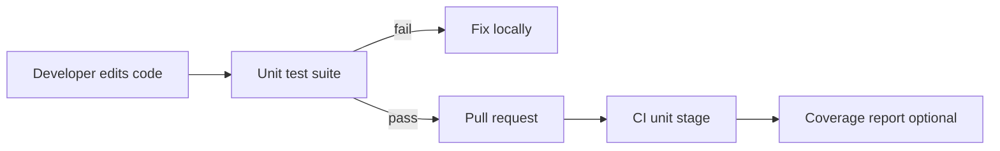

# D20-T001 — Unit testing

Topic ID: `D20-T001`
Domain: Software Testing
Subdomain: Unit testing
Importance: common
Complexity: intermediate
Dependencies: `D05-T001`, `D05-T002`, `D07-T001`, `D07-T002`
Execution status of the code in section F: unexecuted (illustrative pytest only)

## A. Topic Overview

Unit testing is how backend teams gain evidence that a single function or class with collaborators replaced by test doubles works before customers depend on it. Unit tests are the default safety net for pricing rules, validation, and state machines. In production systems the cost of a missed defect is downtime, bad data, or security exposure—not a red IDE squiggle. Interviewers use this topic to see whether you can choose the right test layer and keep pipelines fast enough that engineers still run them.

**How this topic fits the test taxonomy.** **Unit tests** exercise one module in isolation with doubles for I/O and finish in milliseconds. **Integration tests** wire real adapters (database, HTTP client, message broker) and prove collaborators agree on protocols. **Contract tests** freeze request/response shapes between services so teams can deploy independently. **Load tests** hold expected concurrent traffic to measure latency and error rate under normal demand. **Soak tests** run that load for hours or days to expose memory leaks, connection pool exhaustion, and gradual degradation. **Spike tests** jump traffic far above baseline in minutes to see autoscaling and queue backlogs behave. **Chaos tests** deliberately inject faults (killed pods, latency, partition) in production-like environments to validate resilience—not the same as functional correctness.

**Unit** tests are not **integration**, **contract**, **load**, **soak**, **spike**, or **chaos**—those answer wiring, compatibility, capacity, endurance, bursts, and resilience respectively.

Prerequisites: `D05-T002`. Next in the testing track: `D20-T002`.

## B. First-Principles Explanation

A unit under test is one cohesive module whose public API you call directly. Dependencies that touch disk, network, or time are replaced with fakes so the test proves logic, not wiring. The Arrange-Act-Assert pattern keeps each test one behavior. Tests should be deterministic: same input, same output, no hidden order dependence.

## C. Internal Working and Architecture

Components: test runner (pytest, JUnit), test case, assertions, and optional fixtures for shared setup. Execution flow: discover tests, run setup hooks, invoke the unit, assert outcomes, teardown. CI publishes junit XML and coverage if configured. Failures should print expected versus actual without scrolling through framework noise.

## D. Diagrams and Visual Models



Read left to right: unit tests are the first gate before slower stages run.

## E. Examples and Analogies

Analogy: unit tests are spell-check on one paragraph, not proof that the whole essay persuades. Backend example: test that `apply_discount` rejects negative percentages without starting Spring or Postgres.

## F. Code Examples

File: `examples/d20_t001_unit_discount.py`

Dependencies: `pytest` (illustrative; not installed in this knowledge-base repo by default).

```python
import pytest


def apply_discount_cents(amount_cents: int, percent: int) -> int:
    if percent < 0 or percent > 100:
        raise ValueError("percent out of range")
    return amount_cents - (amount_cents * percent // 100)


def test_apply_discount_rejects_negative_percent():
    with pytest.raises(ValueError, match="percent"):
        apply_discount_cents(1000, -1)


def test_apply_discount_rounds_down_on_cents():
    assert apply_discount_cents(1000, 15) == 850
```

How to run: `pytest path/to/test_file.py -q` from your service repo.

This example was **not executed** in the knowledge-base CI. Treat it as illustrative structure only.

## G. Practical Backend Application

Every service should keep unit tests for domain rules near the domain package. Handlers stay thin; heavy logic is testable without HTTP. Run them on every push with a sub-minute budget. Pair with mutation testing later if asserts feel weak.

## H. Advantages, Limitations and Trade-offs

| Choice | Benefit | Cost | Choose when | Avoid when |
| --- | --- | --- | --- | --- |
| Heavy mocking | Fast, isolated | Brittle if over-mocked | External I/O at edges | Testing trivial data classes |
| Real objects | Less mock drift | Slower setup | Pure domain graphs | Need network |
| Parameterized tests | Many cases, one test | Harder to debug one case | Tables of inputs | Each case needs unique setup |

## I. Common Mistakes and Misconceptions

- Calling unit tests on code that only works with a live database—that is integration testing.
- Asserting only `not None` instead of business outcomes.
- Sharing mutable global fixtures between tests.
- Testing private methods instead of public behavior.

## J. Debugging and Troubleshooting

Symptom: suite passes but prod math is wrong. Check whether tests use floats while prod uses integer cents. Symptom: slow unit suite. Profile imports and replace Spring context tests with plain tests.

## K. Interview Preparation

### Beginner

#### Q1. What is unit testing?

**Answer:** Unit testing is a deliberate quality activity that targets a single function or class with collaborators replaced by test doubles. It exists because shipping without evidence that the system behaves under real constraints is a gamble on luck. Teams schedule it where the risk is highest: before merge, before release, or before trusting a new dependency version. Interviewers expect you to name what is in scope for unit testing and what belongs in another layer.

#### Q2. When should you run unit testing in a delivery pipeline?

**Answer:** Run it after the change is buildable but before the change reaches users who cannot roll back easily. Fast feedback belongs on every pull request; expensive runs belong on main or nightly schedules. The gate should fail the pipeline when invariants break, not only when someone remembers to look at a dashboard. For a single function or class with collaborators replaced by test doubles, that usually means blocking merge on failures that reproduce customer impact.

#### Q3. How is unit testing different from clicking through the UI manually?

**Answer:** Manual exploration is valuable for usability and surprises, but it is not repeatable at scale. Automated checks encode the same steps and assertions so two engineers on two machines get the same verdict. Automation also runs on every commit, which manual passes cannot afford. Unit testing should leave an artifact: logs, junit XML, or a metrics report tied to a git SHA.

#### Q4. Where does this sit in the test pyramid?

**Answer:** The pyramid is a budget: many fast tests at the bottom, fewer slow tests at the top. Unit testing typically sits at the wide base of the pyramid because of runtime, flakiness, or infrastructure cost. Pushing everything to the top creates a slow pipeline and teams stop running tests. Pushing everything to the bottom misses failures that only appear when real wires are connected.

#### Q5. What is a minimal passing bar for unit testing on a new microservice?

**Answer:** Start with one happy path and one failure path that matches your SLA story. Add assertions on observability: correlation id in logs, correct status code, idempotent retry behavior. Document how to run locally in the README so onboarding is not blocked on CI secrets. Expand coverage when shared clock or random seeds without injection has burned you once in staging or production.

### Intermediate

#### Q1. How do you keep unit testing from becoming flaky?

**Answer:** Flakiness is a product bug in the test suite: it trains engineers to ignore red builds. Eliminate wall-clock sleeps; wait on conditions with timeouts and clear failure messages. Isolate shared state: unique tenants, random suffixes, and cleanup in fixtures. For a single function or class with collaborators replaced by test doubles, the usual flake source is shared clock or random seeds without injection.

#### Q2. What data strategy works best for unit testing?

**Answer:** Prefer builders or factories that create the smallest object graph that still exercises the path. Avoid copying production dumps into CI; they are huge, sensitive, and stale. Seed reference data once per suite when it is read-only; mutate per test when isolation matters. Version fixture schemas with migrations so tests fail when the database shape drifts.

#### Q3. How should failures in unit testing be triaged?

**Answer:** First classify: product regression, test bug, or environment drift. Re-run from the same commit with the same seed; if it passes, treat as flake and quarantine the test. Capture service logs, SQL, and request/response bodies at failure time. When pytest is involved, compare versions and configuration against the last green main build.

#### Q4. How does this relate to unit versus integration testing?

**Answer:** Unit tests prove logic with collaborators replaced by fakes; integration tests prove wiring. Unit testing often assumes some real infrastructure, so it is closer to integration than to pure unit work when you accidentally boot the framework. Keep business rules in unit tests so integration suites stay short. Use contract tests at boundaries so integration does not require every downstream service online.

#### Q5. What metrics prove unit testing is worth the CI minutes?

**Answer:** Track time to signal: median and p95 duration per stage. Track defect escape rate: bugs found in prod that this stage would have caught. Track flake rate: percentage of failed builds that pass on retry without code change. If duration grows without escape rate dropping, refactor the suite before adding more cases.

### Advanced

#### Q1. How do you parallelize unit testing safely?

**Answer:** Parallelism only works when tests do not share mutable global resources. Partition by tenant, database schema, or ephemeral container per worker. Use deterministic ports or dynamic allocation from the test runner. Collect junit per shard and merge in CI so one slow shard does not hide failures.

#### Q2. How do you test backward compatibility while evolving a single function or class with collaborators replaced by test doubles?

**Answer:** Keep golden files or contract fixtures for the previous version. Run consumer tests against both old and new provider builds in a matrix job. Feature-flag behavior and assert both paths until the flag is removed. Never delete a field consumers still parse without a deprecation window and telemetry.

#### Q3. How do chaos or load tests differ from functional tests?

**Answer:** Functional tests ask whether the answer is correct for a given input. Load and soak tests ask whether latency and error rate stay within SLO under sustained demand. Spike tests ask whether autoscaling and queues absorb a sudden jump. Chaos tests ask whether the system degrades gracefully when dependencies fail; they do not replace assertions on business rules.

#### Q4. When is unit testing the wrong tool?

**Answer:** Do not use it to prove visual design or copywriting. Do not use a full end-to-end suite to check a pure function; that hides the failing line. Do not run destructive chaos in shared staging without blast-radius controls. If shared clock or random seeds without injection is the only risk, a lighter technique may suffice.

#### Q5. How do you design tests for microservices ownership boundaries?

**Answer:** Each team owns tests for its deployable artifact and publishes contracts for its API. Cross-team journeys belong in a thin smoke suite, not in every service repo. Shared staging environments need namespace isolation and synthetic identities. Failure ownership follows the service that changed, proven by tracing the failing contract or integration test to a team.

### Scenarios

#### Q1. CI is green but production errors spike after deploy. What testing gap do you suspect?

**Answer:** Suspect missing coverage on the changed integration path or a config difference between CI and prod. Check whether canary metrics diverged before the full rollout completed. Compare feature flags, connection strings, and dependency versions. Unit testing should have caught a mismatch in a single function or class with collaborators replaced by test doubles if the scenario was represented in data and environment parity.

#### Q2. A test passes locally and fails only in CI. What do you check first?

**Answer:** Compare language runtime, dependency lockfiles, and timezone/locale settings. Look for tests that bind to localhost ports already in use on the shared runner. Ensure secrets and service URLs come from CI env vars, not developer `.env` files. Reproduce with the same container image CI uses; shared clock or random seeds without injection often appears only under resource limits.

#### Q3. Product wants to skip tests to hit a deadline. How do you respond?

**Answer:** Quantify risk: what paths changed, what is untested, and what rollback looks like. Offer a scoped test plan: smoke plus targeted regression on touched modules. Never disable the entire pipeline silently; use a tracked waiver with an expiry date. Schedule a hardening sprint immediately after launch if waivers are granted.

#### Q4. Two services blame each other for a broken release. How do tests settle it?

**Answer:** Run consumer contract tests against the provider artifact at the failing SHA. Replay production traffic samples in a sandbox if privacy policy allows. Use distributed tracing ids from a failing integration test to see which hop changed. The failing contract or integration test becomes the ticket owner for the team that broke compatibility.

#### Q5. Latency SLO is missed only under load. Which tests do you add?

**Answer:** Add a load test at expected RPS with pass/fail thresholds on p95 latency and error rate. Follow with a soak test to catch connection leaks that appear after hours. Add a spike test if marketing events cause step jumps in traffic. Functional tests alone will stay green while thread pools or GC pressure kill throughput.

### Follow-ups

#### Q1. How does this connect to CI test pipelines?

**Answer:** Pipelines should stage fast unit work first, then integration, then optional performance or chaos jobs. Artifacts from each stage must be retained long enough to debug flakes. Branch protection should require the stages that map to your risk model. See `D20-T025` for job graph patterns and caching.

#### Q2. How does Testcontainers change this topic?

**Answer:** Ephemeral containers give real Postgres, Redis, or Kafka without a shared pet staging server. Startup time trades against fidelity; cache images on runners. Wire health waits instead of fixed sleeps. See `D20-T026` for lifecycle and parallel worker patterns.

#### Q3. How does test coverage relate to confidence here?

**Answer:** Coverage counts lines executed, not assertions about behavior. High coverage with weak asserts creates false confidence. Use coverage to find untested branches, then add meaningful cases. See `D20-T024` for quality signals beyond a percentage gate.

## L. Practical Exercises

Solutions are in `EXERCISES/solutions/D20-T001.md`. Try these before opening that file.

### Exercise 1 — implementation

Write unit tests for a `parse_page_token` cursor helper: valid token round-trips, malformed token raises, empty means first page. Acceptance: three tests, no network.

### Exercise 2 — debugging

A unit test passes but production still applies the wrong tax rate. The test mocked the tax service to always return 0.08. Name the testing smell and the fix. Acceptance: you say the mock lied about behavior and you need a contract or integration test for the real rate source.

### Exercise 3 — trade-off

Team debates testing private `calculate_fee` versus public `quote_order`. Argue for testing through the public API only. Acceptance: mention refactor freedom and behavior-focused asserts.

## M. Revision Notes

- Unit = one module, doubles for I/O.
- AAA pattern; one behavior per test.
- Not integration; not load.
- Fast enough for every commit.
- Assert outcomes, not implementation details.

## N. Related Topics

Understand this before: `D05-T002`.

This topic supports: `D20-T002`.

Often confused with: integration tests that boot the whole application context.

Interviewers combine this with `D20-T001` unit tests, `D20-T025` CI pipelines.

## O. Completion Criteria

- Write a unit test without starting the framework server.
- Explain unit versus integration versus contract in one minute.
- Spot a bad mock that hides a production bug.
- Keep a unit stage under one minute on CI.
