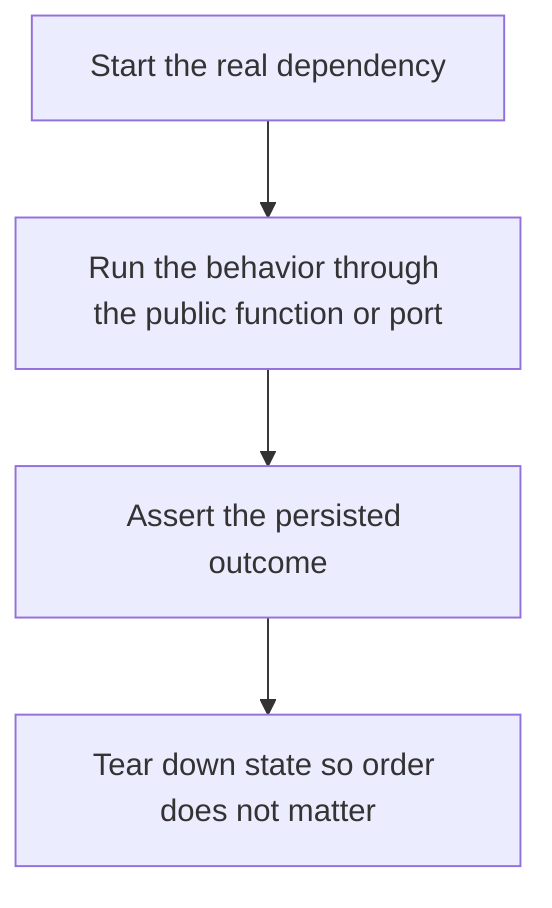

# D20-T002 — Integration testing

Topic ID: `D20-T002`
Domain: Software Testing
Subdomain: Integration testing
Importance: common
Complexity: intermediate
Dependencies: `D20-T001`, `D05-T001`, `D05-T002`, `D07-T001`, `D07-T002`
Execution status of the code in section F: unexecuted

## A. Topic Overview

An integration test runs a slice of the system with real collaborators you chose not to fake, such as a database or a queue, and checks a behavior across that boundary. It is slower than a unit test and catches SQL, migrations, and serialization bugs. It should still be deterministic. It does not need the whole production mesh.

In production this shows up as follows: A repository test starts PostgreSQL, runs the migration, writes an order, and reads it back. It does not mock the SQL. A second test uses its own transaction or schema so it cannot see the first order.

Interviewers use Integration testing to see whether you can state the failure mode, not only the definition. The failure to name is: a test that shares a database row with another test and fails only in CI

Prerequisites: `D20-T001`, `D05-T001`, `D05-T002`, `D07-T001`, `D07-T002`. Later notes should link here instead of repeating the mechanism.

## B. First-Principles Explanation

An integration test runs a slice of the system with real collaborators you chose not to fake, such as a database or a queue, and checks a behavior across that boundary. It is slower than a unit test and catches SQL, migrations, and serialization bugs. It should still be deterministic. It does not need the whole production mesh.

The useful picture is: An integration test is cooking on the real stove, not miming a flame. You still do not invite the whole city into the kitchen.

What has to be true:

1. Start the real dependency
2. Run the behavior through the public function or port
3. Assert the persisted outcome
4. Tear down state so order does not matter

It works when those steps preserve one invariant. It fails when a test that shares a database row with another test and fails only in CI. The alternative is: you boot the entire platform for a one-line calculation

## C. Internal Working and Architecture

Components involved: the caller, the state Integration testing mutates or reads, and the observer that reports flake rate and time spent in the integration stage.

Execution:

1. Start the real dependency
2. Run the behavior through the public function or port
3. Assert the persisted outcome
4. Tear down state so order does not matter

Data moves only along that path. A retry re-enters at step 1, so the operation must say what a duplicate does. Memory and locks stay inside this mechanism. Callers see the result or a typed error, not a half-updated invariant.

State to remember: choose this when the bug you fear lives in the boundary between your code and a real dependency. Do not choose it when you boot the entire platform for a one-line calculation.

## D. Diagrams and Visual Models



Read the diagram from top to bottom. Each box is one step of Integration testing. The failure mode (a test that shares a database row with another test and fails only in CI) is what you look for when a later box never happens or happens twice.

## E. Examples and Analogies

Analogy: An integration test is cooking on the real stove, not miming a flame. You still do not invite the whole city into the kitchen.

Production example: A repository test starts PostgreSQL, runs the migration, writes an order, and reads it back. It does not mock the SQL. A second test uses its own transaction or schema so it cannot see the first order.

A small counterexample is enough in an interview. Show the input, apply the steps, and show the broken outcome if someone uses the mechanism outside its rule: a test that shares a database row with another test and fails only in CI.

## F. Code Examples

The snippet is labeled unexecuted. It illustrates the shape of the idea. It is not a benchmark and it embeds no secret.

```python
def test_insert_roundtrip(db):
    db.insert('items', {'id': 1})
    assert db.get('items', 1)['id'] == 1
```

After the snippet, check flake rate and time spent in the integration stage. If that signal moves the wrong way, the snippet is the wrong tool for the workload.

## G. Practical Backend Application

Use Integration testing in a service when the bug you fear lives in the boundary between your code and a real dependency.

A typical place is the production case already stated: A repository test starts PostgreSQL, runs the migration, writes an order, and reads it back. It does not mock the SQL. A second test uses its own transaction or schema so it cannot see the first order.

Operationally you alert on flake rate and time spent in the integration stage. You do not alert only on process uptime. The dashboard should show the failure mode, a success rate, and the saturation signal (queue depth, lock wait, or latency) that predicts it.

## H. Advantages, Limitations and Trade-offs

| Choice | Benefit | Cost | Choose when | Avoid when |
| --- | --- | --- | --- | --- |
| Apply Integration testing | the bug you fear lives in the boundary between your code and a real dependency | Extra moving parts and a new failure mode | The failure you are preventing is already real | you boot the entire platform for a one-line calculation |
| Simpler alternative | Less code and fewer dependencies | a test that shares a database row with another test and fails only in CI | The workload does not hit the limit | The invariant must hold under concurrency or failure |

Integration testing is a trade. State the benefit and the cost in the same sentence when you propose it in a design review.

## I. Common Mistakes and Misconceptions

- Shared mutable fixtures.
- Mocking the database in a test you called integration.
- No cleanup.
- Treating a diagram of Integration testing as proof that the invariant holds in production.
- Copying a default configuration without naming flake rate and time spent in the integration stage.

## J. Debugging and Troubleshooting

Symptom: a test that shares a database row with another test and fails only in CI

First check: flake rate and time spent in the integration stage.

Then compare one healthy instance against one unhealthy instance. Confirm whether retries are duplicating work. Confirm whether a timeout is shorter than the work. Fix the invariant, then watch the same metric for a full peak, not only for the next minute.

Useful questions: did the step order in section C actually happen, or did a caller skip a step? Did a deploy change the data shape that Integration testing assumes?

## K. Interview Preparation

### Beginner

#### Q1. What problem does Integration testing solve?

**Answer:** An integration test runs a slice of the system with real collaborators you chose not to fake, such as a database or a queue, and checks a behavior across that boundary. It is slower than a unit test and catches SQL, migrations, and serialization bugs. It should still be deterministic. It does not need the whole production mesh. Without it, the usual backend failure is: a test that shares a database row with another test and fails only in CI.

#### Q2. Where does Integration testing sit on a request path?

**Answer:** Integration testing is not a library you sprinkle on every call. the bug you fear lives in the boundary between your code and a real dependency You notice it when flake rate and time spent in the integration stage. Name the constraint that makes this choice correct. Say what you would measure to confirm it.

#### Q3. Give a concrete example of Integration testing.

**Answer:** A repository test starts PostgreSQL, runs the migration, writes an order, and reads it back. It does not mock the SQL. A second test uses its own transaction or schema so it cannot see the first order. Walk the input, the state change, and the observable output.

#### Q4. What is a common mix-up around Integration testing?

**Answer:** a test that shares a database row with another test and fails only in CI The corrective check is flake rate and time spent in the integration stage. Name the constraint that makes this choice correct. Say what you would measure to confirm it. Say which alternative you rejected and why.

#### Q5. When would you skip Integration testing?

**Answer:** you boot the entire platform for a one-line calculation Skipping is a decision with a measured cost, not a slogan. Name the constraint that makes this choice correct. Say what you would measure to confirm it. Say which alternative you rejected and why.

### Intermediate

#### Q1. What invariant makes Integration testing correct?

**Answer:** An integration test runs a slice of the system with real collaborators you chose not to fake, such as a database or a queue, and checks a behavior across that boundary. It is slower than a unit test and catches SQL, migrations, and serialization bugs. It should still be deterministic. It does not need the whole production mesh. State the invariant before you name the tool.

#### Q2. How do you test Integration testing?

**Answer:** Assert the failure mode directly: a test that shares a database row with another test and fails only in CI. The assertion should watch flake rate and time spent in the integration stage. Include a concurrent or retry case if the bug only appears then. Name the constraint that makes this choice correct.

#### Q3. What signal tells you Integration testing is misbehaving in production?

**Answer:** Watch flake rate and time spent in the integration stage. The user-visible symptom is usually a test that shares a database row with another test and fails only in CI. Name the constraint that makes this choice correct. Say what you would measure to confirm it.

#### Q4. How would you introduce Integration testing into a legacy service?

**Answer:** the bug you fear lives in the boundary between your code and a real dependency Ship it behind a metric so you can compare the old path. Roll back if a test that shares a database row with another test and fails only in CI gets worse. Name the constraint that makes this choice correct. Say what you would measure to confirm it.

#### Q5. What do you trade away by choosing Integration testing?

**Answer:** the bug you fear lives in the boundary between your code and a real dependency you boot the entire platform for a one-line calculation Say the cost in latency, storage, or operational load. Name the constraint that makes this choice correct. Say what you would measure to confirm it. Say which alternative you rejected and why.

### Advanced

#### Q1. What breaks if a dependency of Integration testing is slow or down?

**Answer:** a test that shares a database row with another test and fails only in CI Degrade using the rule: you boot the entire platform for a one-line calculation. Timeouts must be shorter than the caller's deadline. Name the constraint that makes this choice correct. Say what you would measure to confirm it.

#### Q2. How does Integration testing behave under retries?

**Answer:** Retries repeat work, so Integration testing must define what a duplicate does. a test that shares a database row with another test and fails only in CI Idempotency keys or fences belong next to the write, not in a comment. Name the constraint that makes this choice correct. Say what you would measure to confirm it.

#### Q3. What is the capacity limit of Integration testing?

**Answer:** The limit shows up as flake rate and time spent in the integration stage. Add capacity only after you know whether the bottleneck is CPU, lock wait, or network. Name the constraint that makes this choice correct. Say what you would measure to confirm it.

#### Q4. How do you evolve Integration testing without a flag day?

**Answer:** the bug you fear lives in the boundary between your code and a real dependency Version the contract or the on-disk format. Readers should tolerate one old and one new shape during the rollout. Name the constraint that makes this choice correct. Say what you would measure to confirm it.

#### Q5. What security or correctness bug hides inside Integration testing?

**Answer:** a test that shares a database row with another test and fails only in CI Check authorization and tenancy at the same boundary as the mechanism. A cache or queue must not widen who can read the data. Name the constraint that makes this choice correct. Say what you would measure to confirm it.

### Scenario

#### Q1. Incident: a test that shares a database row with another test and fails only in CI. What do you check first?

**Answer:** Start with flake rate and time spent in the integration stage. Compare a good host and a bad host before you restart anything. An integration test runs a slice of the system with real collaborators you chose not to fake, such as a database or a queue, and checks a behavior across that boundary. It is slower than a unit test and catches SQL, migrations, and serialization bugs. It should still be deterministic. It does not need the whole production mesh.

#### Q2. A reviewer wants the clever version. What data settles it?

**Answer:** the bug you fear lives in the boundary between your code and a real dependency you boot the entire platform for a one-line calculation Bring flake rate and time spent in the integration stage from a load test or from production, not a slogan. Name the constraint that makes this choice correct. Say what you would measure to confirm it. Say which alternative you rejected and why.

#### Q3. You have one hour to explain Integration testing at a whiteboard.

**Answer:** Draw the happy path in four boxes. Then draw the failure: a test that shares a database row with another test and fails only in CI. End with the metric you would page on. Name the constraint that makes this choice correct.

#### Q4. The bug only appears under two concurrent callers.

**Answer:** a test that shares a database row with another test and fails only in CI Reproduce with a barrier so both sides enter the critical window. Confirm the fix with flake rate and time spent in the integration stage. Name the constraint that makes this choice correct. Say what you would measure to confirm it.

#### Q5. Leadership wants this on every service next week.

**Answer:** you boot the entire platform for a one-line calculation the bug you fear lives in the boundary between your code and a real dependency Roll it out where the failure mode is already hurting users. Name the constraint that makes this choice correct. Say what you would measure to confirm it. Say which alternative you rejected and why.

### Follow-up

#### Q1. What did you assume about the data size or the clock?

**Answer:** An integration test runs a slice of the system with real collaborators you chose not to fake, such as a database or a queue, and checks a behavior across that boundary. It is slower than a unit test and catches SQL, migrations, and serialization bugs. It should still be deterministic. It does not need the whole production mesh. Clocks are not a total order across machines. State whether the algorithm needs bounded size or a single leader.

#### Q2. What would you measure after the change ships?

**Answer:** Page on flake rate and time spent in the integration stage. Keep a before/after dashboard for one week. Alert on the failure mode, not only on CPU. Name the constraint that makes this choice correct.

#### Q3. Which neighboring topic did you deliberately not re-teach?

**Answer:** This note owns Integration testing. Related identifiers are in section N. Shared ideas are linked, not copied. Name the constraint that makes this choice correct.

## L. Practical Exercises

Solutions are in `EXERCISES/solutions/D20-T002.md`, not in this section.

1. Whiteboard the four steps of Integration testing and mark where `a test that shares a database row with another test and fails only in CI` enters.
2. Read the snippet in section F and write the assertion that would catch that failure. The assertion must mention `flake rate and time spent in the integration stage`.
3. Argue for or against using Integration testing on a service you know. Use the choose and avoid rows from section H. Do not appeal to popularity.

## M. Revision Notes

- Mechanism: An integration test runs a slice of the system with real collaborators you chose not to fake, such as a database or a queue, and checks a behavior across that boundary.
- Failure: a test that shares a database row with another test and fails only in CI
- Metric: flake rate and time spent in the integration stage
- Choose when: the bug you fear lives in the boundary between your code and a real dependency
- Avoid when: you boot the entire platform for a one-line calculation

## N. Related Topics

Dependencies to review first: `D20-T001`, `D05-T001`, `D05-T002`, `D07-T001`, `D07-T002`.

Shared ideas stay in those notes. This note does not restate them.

## O. Completion Criteria

- You can explain Integration testing without reading this note, including the failure mode.
- You can draw the diagram in section D from memory.
- You can say when not to use it, using the avoid condition in section H.
- You can name the metric you would watch after shipping it.
