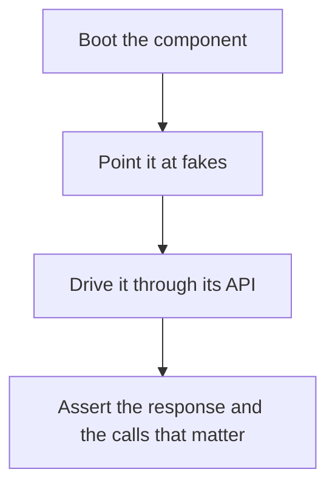

# D20-T003 — Component testing

Topic ID: `D20-T003`
Domain: Software Testing
Subdomain: Component testing
Importance: common
Complexity: intermediate
Dependencies: `D20-T002`, `D20-T001`, `D05-T001`, `D05-T002`, `D07-T001`, `D07-T002`
Execution status of the code in section F: unexecuted

## A. Topic Overview

A component test checks one service or module through its external interface while replacing the systems it depends on with fakes you control. It sits between a unit test and a full end-to-end test. The fake must implement the contract you actually rely on. If the fake is kinder than production, the test is fiction.

In production this shows up as follows: The order API runs in a test with a fake payment service that can return 503. The test asserts the order stays unpaid and the client receives a retryable error. The fake is not a copy of the entire payment company.

Interviewers use Component testing to see whether you can state the failure mode, not only the definition. The failure to name is: a fake that never times out or returns an error, so production failures are untested

Prerequisites: `D20-T002`, `D20-T001`, `D05-T001`, `D05-T002`, `D07-T001`, `D07-T002`. Later notes should link here instead of repeating the mechanism.

## B. First-Principles Explanation

A component test checks one service or module through its external interface while replacing the systems it depends on with fakes you control. It sits between a unit test and a full end-to-end test. The fake must implement the contract you actually rely on. If the fake is kinder than production, the test is fiction.

The useful picture is: A component test is rehearsing one actor with a stand-in for the rest of the cast. The stand-in has to be able to forget a line, or the rehearsal never practices a mistake.

What has to be true:

1. Boot the component
2. Point it at fakes
3. Drive it through its API
4. Assert the response and the calls that matter

It works when those steps preserve one invariant. It fails when a fake that never times out or returns an error, so production failures are untested. The alternative is: the fake cannot reproduce the failure you claim to test

## C. Internal Working and Architecture

Components involved: the caller, the state Component testing mutates or reads, and the observer that reports bugs found only in staging that the component tests could have injected.

Execution:

1. Boot the component
2. Point it at fakes
3. Drive it through its API
4. Assert the response and the calls that matter

Data moves only along that path. A retry re-enters at step 1, so the operation must say what a duplicate does. Memory and locks stay inside this mechanism. Callers see the result or a typed error, not a half-updated invariant.

State to remember: choose this when you want the service's behavior without the real neighbors. Do not choose it when the fake cannot reproduce the failure you claim to test.

## D. Diagrams and Visual Models



Read the diagram from top to bottom. Each box is one step of Component testing. The failure mode (a fake that never times out or returns an error, so production failures are untested) is what you look for when a later box never happens or happens twice.

## E. Examples and Analogies

Analogy: A component test is rehearsing one actor with a stand-in for the rest of the cast. The stand-in has to be able to forget a line, or the rehearsal never practices a mistake.

Production example: The order API runs in a test with a fake payment service that can return 503. The test asserts the order stays unpaid and the client receives a retryable error. The fake is not a copy of the entire payment company.

A small counterexample is enough in an interview. Show the input, apply the steps, and show the broken outcome if someone uses the mechanism outside its rule: a fake that never times out or returns an error, so production failures are untested.

## F. Code Examples

The snippet is labeled unexecuted. It illustrates the shape of the idea. It is not a benchmark and it embeds no secret.

```python
def test_timeout(client, fake_db):
    fake_db.delay = 2
    assert client.get('/items').status_code == 504
```

After the snippet, check bugs found only in staging that the component tests could have injected. If that signal moves the wrong way, the snippet is the wrong tool for the workload.

## G. Practical Backend Application

Use Component testing in a service when you want the service's behavior without the real neighbors.

A typical place is the production case already stated: The order API runs in a test with a fake payment service that can return 503. The test asserts the order stays unpaid and the client receives a retryable error. The fake is not a copy of the entire payment company.

Operationally you alert on bugs found only in staging that the component tests could have injected. You do not alert only on process uptime. The dashboard should show the failure mode, a success rate, and the saturation signal (queue depth, lock wait, or latency) that predicts it.

## H. Advantages, Limitations and Trade-offs

| Choice | Benefit | Cost | Choose when | Avoid when |
| --- | --- | --- | --- | --- |
| Apply Component testing | you want the service's behavior without the real neighbors | Extra moving parts and a new failure mode | The failure you are preventing is already real | the fake cannot reproduce the failure you claim to test |
| Simpler alternative | Less code and fewer dependencies | a fake that never times out or returns an error, so production failures are untested | The workload does not hit the limit | The invariant must hold under concurrency or failure |

Component testing is a trade. State the benefit and the cost in the same sentence when you propose it in a design review.

## I. Common Mistakes and Misconceptions

- Happy-path fakes only.
- Asserting on private methods.
- A component test that is secretly end-to-end and flaky.
- Treating a diagram of Component testing as proof that the invariant holds in production.
- Copying a default configuration without naming bugs found only in staging that the component tests could have injected.

## J. Debugging and Troubleshooting

Symptom: a fake that never times out or returns an error, so production failures are untested

First check: bugs found only in staging that the component tests could have injected.

Then compare one healthy instance against one unhealthy instance. Confirm whether retries are duplicating work. Confirm whether a timeout is shorter than the work. Fix the invariant, then watch the same metric for a full peak, not only for the next minute.

Useful questions: did the step order in section C actually happen, or did a caller skip a step? Did a deploy change the data shape that Component testing assumes?

## K. Interview Preparation

### Beginner

#### Q1. What problem does Component testing solve?

**Answer:** A component test checks one service or module through its external interface while replacing the systems it depends on with fakes you control. It sits between a unit test and a full end-to-end test. The fake must implement the contract you actually rely on. If the fake is kinder than production, the test is fiction. Without it, the usual backend failure is: a fake that never times out or returns an error, so production failures are untested.

#### Q2. Where does Component testing sit on a request path?

**Answer:** Component testing is not a library you sprinkle on every call. you want the service's behavior without the real neighbors You notice it when bugs found only in staging that the component tests could have injected. Name the constraint that makes this choice correct. Say what you would measure to confirm it.

#### Q3. Give a concrete example of Component testing.

**Answer:** The order API runs in a test with a fake payment service that can return 503. The test asserts the order stays unpaid and the client receives a retryable error. The fake is not a copy of the entire payment company. Walk the input, the state change, and the observable output.

#### Q4. What is a common mix-up around Component testing?

**Answer:** a fake that never times out or returns an error, so production failures are untested The corrective check is bugs found only in staging that the component tests could have injected. Name the constraint that makes this choice correct. Say what you would measure to confirm it. Say which alternative you rejected and why.

#### Q5. When would you skip Component testing?

**Answer:** the fake cannot reproduce the failure you claim to test Skipping is a decision with a measured cost, not a slogan. Name the constraint that makes this choice correct. Say what you would measure to confirm it. Say which alternative you rejected and why.

### Intermediate

#### Q1. What invariant makes Component testing correct?

**Answer:** A component test checks one service or module through its external interface while replacing the systems it depends on with fakes you control. It sits between a unit test and a full end-to-end test. The fake must implement the contract you actually rely on. If the fake is kinder than production, the test is fiction. State the invariant before you name the tool.

#### Q2. How do you test Component testing?

**Answer:** Assert the failure mode directly: a fake that never times out or returns an error, so production failures are untested. The assertion should watch bugs found only in staging that the component tests could have injected. Include a concurrent or retry case if the bug only appears then. Name the constraint that makes this choice correct.

#### Q3. What signal tells you Component testing is misbehaving in production?

**Answer:** Watch bugs found only in staging that the component tests could have injected. The user-visible symptom is usually a fake that never times out or returns an error, so production failures are untested. Name the constraint that makes this choice correct. Say what you would measure to confirm it.

#### Q4. How would you introduce Component testing into a legacy service?

**Answer:** you want the service's behavior without the real neighbors Ship it behind a metric so you can compare the old path. Roll back if a fake that never times out or returns an error, so production failures are untested gets worse. Name the constraint that makes this choice correct. Say what you would measure to confirm it.

#### Q5. What do you trade away by choosing Component testing?

**Answer:** you want the service's behavior without the real neighbors the fake cannot reproduce the failure you claim to test Say the cost in latency, storage, or operational load. Name the constraint that makes this choice correct. Say what you would measure to confirm it. Say which alternative you rejected and why.

### Advanced

#### Q1. What breaks if a dependency of Component testing is slow or down?

**Answer:** a fake that never times out or returns an error, so production failures are untested Degrade using the rule: the fake cannot reproduce the failure you claim to test. Timeouts must be shorter than the caller's deadline. Name the constraint that makes this choice correct. Say what you would measure to confirm it.

#### Q2. How does Component testing behave under retries?

**Answer:** Retries repeat work, so Component testing must define what a duplicate does. a fake that never times out or returns an error, so production failures are untested Idempotency keys or fences belong next to the write, not in a comment. Name the constraint that makes this choice correct. Say what you would measure to confirm it.

#### Q3. What is the capacity limit of Component testing?

**Answer:** The limit shows up as bugs found only in staging that the component tests could have injected. Add capacity only after you know whether the bottleneck is CPU, lock wait, or network. Name the constraint that makes this choice correct. Say what you would measure to confirm it.

#### Q4. How do you evolve Component testing without a flag day?

**Answer:** you want the service's behavior without the real neighbors Version the contract or the on-disk format. Readers should tolerate one old and one new shape during the rollout. Name the constraint that makes this choice correct. Say what you would measure to confirm it.

#### Q5. What security or correctness bug hides inside Component testing?

**Answer:** a fake that never times out or returns an error, so production failures are untested Check authorization and tenancy at the same boundary as the mechanism. A cache or queue must not widen who can read the data. Name the constraint that makes this choice correct. Say what you would measure to confirm it.

### Scenario

#### Q1. Incident: a fake that never times out or returns an error, so production failures are untested. What do you check first?

**Answer:** Start with bugs found only in staging that the component tests could have injected. Compare a good host and a bad host before you restart anything. A component test checks one service or module through its external interface while replacing the systems it depends on with fakes you control. It sits between a unit test and a full end-to-end test. The fake must implement the contract you actually rely on. If the fake is kinder than production, the test is fiction.

#### Q2. A reviewer wants the clever version. What data settles it?

**Answer:** you want the service's behavior without the real neighbors the fake cannot reproduce the failure you claim to test Bring bugs found only in staging that the component tests could have injected from a load test or from production, not a slogan. Name the constraint that makes this choice correct. Say what you would measure to confirm it. Say which alternative you rejected and why.

#### Q3. You have one hour to explain Component testing at a whiteboard.

**Answer:** Draw the happy path in four boxes. Then draw the failure: a fake that never times out or returns an error, so production failures are untested. End with the metric you would page on. Name the constraint that makes this choice correct.

#### Q4. The bug only appears under two concurrent callers.

**Answer:** a fake that never times out or returns an error, so production failures are untested Reproduce with a barrier so both sides enter the critical window. Confirm the fix with bugs found only in staging that the component tests could have injected. Name the constraint that makes this choice correct. Say what you would measure to confirm it.

#### Q5. Leadership wants this on every service next week.

**Answer:** the fake cannot reproduce the failure you claim to test you want the service's behavior without the real neighbors Roll it out where the failure mode is already hurting users. Name the constraint that makes this choice correct. Say what you would measure to confirm it. Say which alternative you rejected and why.

### Follow-up

#### Q1. What did you assume about the data size or the clock?

**Answer:** A component test checks one service or module through its external interface while replacing the systems it depends on with fakes you control. It sits between a unit test and a full end-to-end test. The fake must implement the contract you actually rely on. If the fake is kinder than production, the test is fiction. Clocks are not a total order across machines. State whether the algorithm needs bounded size or a single leader.

#### Q2. What would you measure after the change ships?

**Answer:** Page on bugs found only in staging that the component tests could have injected. Keep a before/after dashboard for one week. Alert on the failure mode, not only on CPU. Name the constraint that makes this choice correct.

#### Q3. Which neighboring topic did you deliberately not re-teach?

**Answer:** This note owns Component testing. Related identifiers are in section N. Shared ideas are linked, not copied. Name the constraint that makes this choice correct.

## L. Practical Exercises

Solutions are in `EXERCISES/solutions/D20-T003.md`, not in this section.

1. Whiteboard the four steps of Component testing and mark where `a fake that never times out or returns an error, so production failures are untested` enters.
2. Read the snippet in section F and write the assertion that would catch that failure. The assertion must mention `bugs found only in staging that the component tests could have injected`.
3. Argue for or against using Component testing on a service you know. Use the choose and avoid rows from section H. Do not appeal to popularity.

## M. Revision Notes

- Mechanism: A component test checks one service or module through its external interface while replacing the systems it depends on with fakes you control.
- Failure: a fake that never times out or returns an error, so production failures are untested
- Metric: bugs found only in staging that the component tests could have injected
- Choose when: you want the service's behavior without the real neighbors
- Avoid when: the fake cannot reproduce the failure you claim to test

## N. Related Topics

Dependencies to review first: `D20-T002`, `D20-T001`, `D05-T001`, `D05-T002`, `D07-T001`, `D07-T002`.

Shared ideas stay in those notes. This note does not restate them.

## O. Completion Criteria

- You can explain Component testing without reading this note, including the failure mode.
- You can draw the diagram in section D from memory.
- You can say when not to use it, using the avoid condition in section H.
- You can name the metric you would watch after shipping it.
