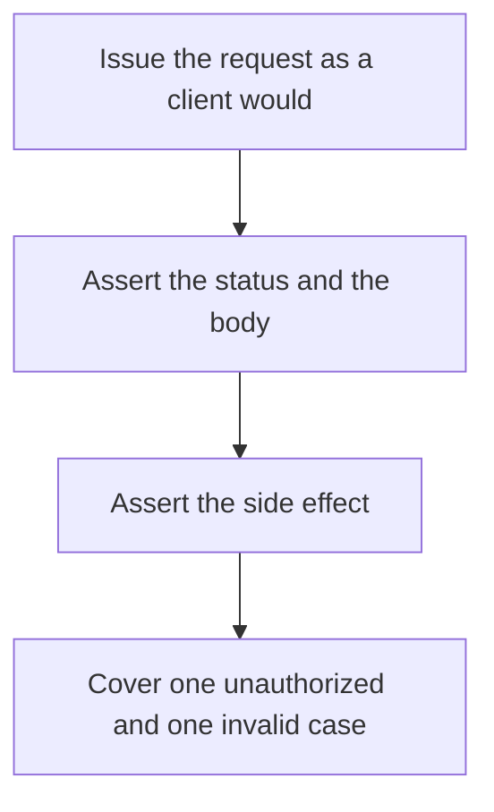

# D20-T004 — API testing

Topic ID: `D20-T004`
Domain: Software Testing
Subdomain: API testing
Importance: common
Complexity: intermediate
Dependencies: `D20-T003`, `D20-T001`, `D05-T001`, `D05-T002`, `D07-T001`, `D07-T002`
Execution status of the code in section F: unexecuted

## A. Topic Overview

API testing calls the HTTP or RPC interface and asserts status, body, headers, and side effects. It includes authentication, validation, and the error contract. Generated cases from the schema catch drift. A test that only checks 200 with a happy body misses the contract clients actually break on.

In production this shows up as follows: A test creates an order with a token, expects 201 and a body with an id, then fetches that id. A second test omits the token and expects 401. A third sends a negative quantity and expects 400, not 500.

Interviewers use API testing to see whether you can state the failure mode, not only the definition. The failure to name is: a suite that accepts any 2xx and any JSON shape, so a breaking change stays green

Prerequisites: `D20-T003`, `D20-T001`, `D05-T001`, `D05-T002`, `D07-T001`, `D07-T002`. Later notes should link here instead of repeating the mechanism.

## B. First-Principles Explanation

API testing calls the HTTP or RPC interface and asserts status, body, headers, and side effects. It includes authentication, validation, and the error contract. Generated cases from the schema catch drift. A test that only checks 200 with a happy body misses the contract clients actually break on.

The useful picture is: API testing is reading the menu the customer sees and sending the order back, including the orders the kitchen should refuse.

What has to be true:

1. Issue the request as a client would
2. Assert the status and the body
3. Assert the side effect
4. Cover one unauthorized and one invalid case

It works when those steps preserve one invariant. It fails when a suite that accepts any 2xx and any JSON shape, so a breaking change stays green. The alternative is: you only unit-test the controller function and never the serialization

## C. Internal Working and Architecture

Components involved: the caller, the state API testing mutates or reads, and the observer that reports contract mismatches found by clients after a green API suite.

Execution:

1. Issue the request as a client would
2. Assert the status and the body
3. Assert the side effect
4. Cover one unauthorized and one invalid case

Data moves only along that path. A retry re-enters at step 1, so the operation must say what a duplicate does. Memory and locks stay inside this mechanism. Callers see the result or a typed error, not a half-updated invariant.

State to remember: choose this when clients depend on a network contract. Do not choose it when you only unit-test the controller function and never the serialization.

## D. Diagrams and Visual Models



Read the diagram from top to bottom. Each box is one step of API testing. The failure mode (a suite that accepts any 2xx and any JSON shape, so a breaking change stays green) is what you look for when a later box never happens or happens twice.

## E. Examples and Analogies

Analogy: API testing is reading the menu the customer sees and sending the order back, including the orders the kitchen should refuse.

Production example: A test creates an order with a token, expects 201 and a body with an id, then fetches that id. A second test omits the token and expects 401. A third sends a negative quantity and expects 400, not 500.

A small counterexample is enough in an interview. Show the input, apply the steps, and show the broken outcome if someone uses the mechanism outside its rule: a suite that accepts any 2xx and any JSON shape, so a breaking change stays green.

## F. Code Examples

The snippet is labeled unexecuted. It illustrates the shape of the idea. It is not a benchmark and it embeds no secret.

```python
def test_create_unauthorized(client):
    response = client.post('/orders', json={'sku': 'a'})
    assert response.status_code == 401
```

After the snippet, check contract mismatches found by clients after a green API suite. If that signal moves the wrong way, the snippet is the wrong tool for the workload.

## G. Practical Backend Application

Use API testing in a service when clients depend on a network contract.

A typical place is the production case already stated: A test creates an order with a token, expects 201 and a body with an id, then fetches that id. A second test omits the token and expects 401. A third sends a negative quantity and expects 400, not 500.

Operationally you alert on contract mismatches found by clients after a green API suite. You do not alert only on process uptime. The dashboard should show the failure mode, a success rate, and the saturation signal (queue depth, lock wait, or latency) that predicts it.

## H. Advantages, Limitations and Trade-offs

| Choice | Benefit | Cost | Choose when | Avoid when |
| --- | --- | --- | --- | --- |
| Apply API testing | clients depend on a network contract | Extra moving parts and a new failure mode | The failure you are preventing is already real | you only unit-test the controller function and never the serialization |
| Simpler alternative | Less code and fewer dependencies | a suite that accepts any 2xx and any JSON shape, so a breaking change stays green | The workload does not hit the limit | The invariant must hold under concurrency or failure |

API testing is a trade. State the benefit and the cost in the same sentence when you propose it in a design review.

## I. Common Mistakes and Misconceptions

- Ignoring error codes.
- Sharing one token for every case including the unauthorized one.
- Asserting the whole JSON including volatile timestamps without a matcher.
- Treating a diagram of API testing as proof that the invariant holds in production.
- Copying a default configuration without naming contract mismatches found by clients after a green API suite.

## J. Debugging and Troubleshooting

Symptom: a suite that accepts any 2xx and any JSON shape, so a breaking change stays green

First check: contract mismatches found by clients after a green API suite.

Then compare one healthy instance against one unhealthy instance. Confirm whether retries are duplicating work. Confirm whether a timeout is shorter than the work. Fix the invariant, then watch the same metric for a full peak, not only for the next minute.

Useful questions: did the step order in section C actually happen, or did a caller skip a step? Did a deploy change the data shape that API testing assumes?

## K. Interview Preparation

### Beginner

#### Q1. What problem does API testing solve?

**Answer:** API testing calls the HTTP or RPC interface and asserts status, body, headers, and side effects. It includes authentication, validation, and the error contract. Generated cases from the schema catch drift. A test that only checks 200 with a happy body misses the contract clients actually break on. Without it, the usual backend failure is: a suite that accepts any 2xx and any JSON shape, so a breaking change stays green.

#### Q2. Where does API testing sit on a request path?

**Answer:** API testing is not a library you sprinkle on every call. clients depend on a network contract You notice it when contract mismatches found by clients after a green API suite. Name the constraint that makes this choice correct. Say what you would measure to confirm it.

#### Q3. Give a concrete example of API testing.

**Answer:** A test creates an order with a token, expects 201 and a body with an id, then fetches that id. A second test omits the token and expects 401. A third sends a negative quantity and expects 400, not 500. Walk the input, the state change, and the observable output.

#### Q4. What is a common mix-up around API testing?

**Answer:** a suite that accepts any 2xx and any JSON shape, so a breaking change stays green The corrective check is contract mismatches found by clients after a green API suite. Name the constraint that makes this choice correct. Say what you would measure to confirm it. Say which alternative you rejected and why.

#### Q5. When would you skip API testing?

**Answer:** you only unit-test the controller function and never the serialization Skipping is a decision with a measured cost, not a slogan. Name the constraint that makes this choice correct. Say what you would measure to confirm it. Say which alternative you rejected and why.

### Intermediate

#### Q1. What invariant makes API testing correct?

**Answer:** API testing calls the HTTP or RPC interface and asserts status, body, headers, and side effects. It includes authentication, validation, and the error contract. Generated cases from the schema catch drift. A test that only checks 200 with a happy body misses the contract clients actually break on. State the invariant before you name the tool.

#### Q2. How do you test API testing?

**Answer:** Assert the failure mode directly: a suite that accepts any 2xx and any JSON shape, so a breaking change stays green. The assertion should watch contract mismatches found by clients after a green API suite. Include a concurrent or retry case if the bug only appears then. Name the constraint that makes this choice correct.

#### Q3. What signal tells you API testing is misbehaving in production?

**Answer:** Watch contract mismatches found by clients after a green API suite. The user-visible symptom is usually a suite that accepts any 2xx and any JSON shape, so a breaking change stays green. Name the constraint that makes this choice correct. Say what you would measure to confirm it.

#### Q4. How would you introduce API testing into a legacy service?

**Answer:** clients depend on a network contract Ship it behind a metric so you can compare the old path. Roll back if a suite that accepts any 2xx and any JSON shape, so a breaking change stays green gets worse. Name the constraint that makes this choice correct. Say what you would measure to confirm it.

#### Q5. What do you trade away by choosing API testing?

**Answer:** clients depend on a network contract you only unit-test the controller function and never the serialization Say the cost in latency, storage, or operational load. Name the constraint that makes this choice correct. Say what you would measure to confirm it. Say which alternative you rejected and why.

### Advanced

#### Q1. What breaks if a dependency of API testing is slow or down?

**Answer:** a suite that accepts any 2xx and any JSON shape, so a breaking change stays green Degrade using the rule: you only unit-test the controller function and never the serialization. Timeouts must be shorter than the caller's deadline. Name the constraint that makes this choice correct. Say what you would measure to confirm it.

#### Q2. How does API testing behave under retries?

**Answer:** Retries repeat work, so API testing must define what a duplicate does. a suite that accepts any 2xx and any JSON shape, so a breaking change stays green Idempotency keys or fences belong next to the write, not in a comment. Name the constraint that makes this choice correct. Say what you would measure to confirm it.

#### Q3. What is the capacity limit of API testing?

**Answer:** The limit shows up as contract mismatches found by clients after a green API suite. Add capacity only after you know whether the bottleneck is CPU, lock wait, or network. Name the constraint that makes this choice correct. Say what you would measure to confirm it.

#### Q4. How do you evolve API testing without a flag day?

**Answer:** clients depend on a network contract Version the contract or the on-disk format. Readers should tolerate one old and one new shape during the rollout. Name the constraint that makes this choice correct. Say what you would measure to confirm it.

#### Q5. What security or correctness bug hides inside API testing?

**Answer:** a suite that accepts any 2xx and any JSON shape, so a breaking change stays green Check authorization and tenancy at the same boundary as the mechanism. A cache or queue must not widen who can read the data. Name the constraint that makes this choice correct. Say what you would measure to confirm it.

### Scenario

#### Q1. Incident: a suite that accepts any 2xx and any JSON shape, so a breaking change stays green. What do you check first?

**Answer:** Start with contract mismatches found by clients after a green API suite. Compare a good host and a bad host before you restart anything. API testing calls the HTTP or RPC interface and asserts status, body, headers, and side effects. It includes authentication, validation, and the error contract. Generated cases from the schema catch drift. A test that only checks 200 with a happy body misses the contract clients actually break on.

#### Q2. A reviewer wants the clever version. What data settles it?

**Answer:** clients depend on a network contract you only unit-test the controller function and never the serialization Bring contract mismatches found by clients after a green API suite from a load test or from production, not a slogan. Name the constraint that makes this choice correct. Say what you would measure to confirm it. Say which alternative you rejected and why.

#### Q3. You have one hour to explain API testing at a whiteboard.

**Answer:** Draw the happy path in four boxes. Then draw the failure: a suite that accepts any 2xx and any JSON shape, so a breaking change stays green. End with the metric you would page on. Name the constraint that makes this choice correct.

#### Q4. The bug only appears under two concurrent callers.

**Answer:** a suite that accepts any 2xx and any JSON shape, so a breaking change stays green Reproduce with a barrier so both sides enter the critical window. Confirm the fix with contract mismatches found by clients after a green API suite. Name the constraint that makes this choice correct. Say what you would measure to confirm it.

#### Q5. Leadership wants this on every service next week.

**Answer:** you only unit-test the controller function and never the serialization clients depend on a network contract Roll it out where the failure mode is already hurting users. Name the constraint that makes this choice correct. Say what you would measure to confirm it. Say which alternative you rejected and why.

### Follow-up

#### Q1. What did you assume about the data size or the clock?

**Answer:** API testing calls the HTTP or RPC interface and asserts status, body, headers, and side effects. It includes authentication, validation, and the error contract. Generated cases from the schema catch drift. A test that only checks 200 with a happy body misses the contract clients actually break on. Clocks are not a total order across machines. State whether the algorithm needs bounded size or a single leader.

#### Q2. What would you measure after the change ships?

**Answer:** Page on contract mismatches found by clients after a green API suite. Keep a before/after dashboard for one week. Alert on the failure mode, not only on CPU. Name the constraint that makes this choice correct.

#### Q3. Which neighboring topic did you deliberately not re-teach?

**Answer:** This note owns API testing. Related identifiers are in section N. Shared ideas are linked, not copied. Name the constraint that makes this choice correct.

## L. Practical Exercises

Solutions are in `EXERCISES/solutions/D20-T004.md`, not in this section.

1. Whiteboard the four steps of API testing and mark where `a suite that accepts any 2xx and any JSON shape, so a breaking change stays green` enters.
2. Read the snippet in section F and write the assertion that would catch that failure. The assertion must mention `contract mismatches found by clients after a green API suite`.
3. Argue for or against using API testing on a service you know. Use the choose and avoid rows from section H. Do not appeal to popularity.

## M. Revision Notes

- Mechanism: API testing calls the HTTP or RPC interface and asserts status, body, headers, and side effects.
- Failure: a suite that accepts any 2xx and any JSON shape, so a breaking change stays green
- Metric: contract mismatches found by clients after a green API suite
- Choose when: clients depend on a network contract
- Avoid when: you only unit-test the controller function and never the serialization

## N. Related Topics

Dependencies to review first: `D20-T003`, `D20-T001`, `D05-T001`, `D05-T002`, `D07-T001`, `D07-T002`.

Shared ideas stay in those notes. This note does not restate them.

## O. Completion Criteria

- You can explain API testing without reading this note, including the failure mode.
- You can draw the diagram in section D from memory.
- You can say when not to use it, using the avoid condition in section H.
- You can name the metric you would watch after shipping it.
