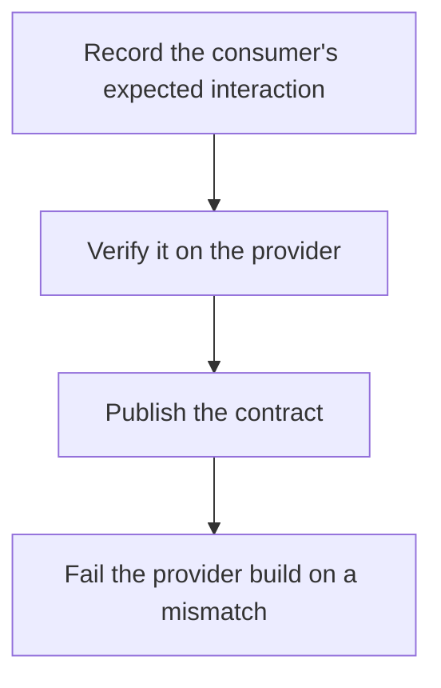

# D20-T006 — Contract testing

Topic ID: `D20-T006`
Domain: Software Testing
Subdomain: Contract testing
Importance: common
Complexity: intermediate
Dependencies: `D20-T005`, `D20-T001`, `D05-T001`, `D05-T002`, `D07-T001`, `D07-T002`
Execution status of the code in section F: unexecuted

## A. Topic Overview

Contract testing checks that a provider and a consumer agree on a request and response without running the whole system together. The consumer publishes the interactions it needs. The provider verifies them against its real endpoints. The contract is the shared artifact. It catches a provider change that would break a consumer before production.

In production this shows up as follows: The web app's contract says GET /items/1 returns an id and a price. The item service's pipeline replays that interaction. Removing price fails the item service build, not the web app's production deploy.

Interviewers use Contract testing to see whether you can state the failure mode, not only the definition. The failure to name is: a contract that is never verified, or one that omits the error case the consumer actually handles

Prerequisites: `D20-T005`, `D20-T001`, `D05-T001`, `D05-T002`, `D07-T001`, `D07-T002`. Later notes should link here instead of repeating the mechanism.

## B. First-Principles Explanation

Contract testing checks that a provider and a consumer agree on a request and response without running the whole system together. The consumer publishes the interactions it needs. The provider verifies them against its real endpoints. The contract is the shared artifact. It catches a provider change that would break a consumer before production.

The useful picture is: A contract test is both sides signing the same drawing. It is not a promise scribbled by one side and left in a drawer.

What has to be true:

1. Record the consumer's expected interaction
2. Verify it on the provider
3. Publish the contract
4. Fail the provider build on a mismatch

It works when those steps preserve one invariant. It fails when a contract that is never verified, or one that omits the error case the consumer actually handles. The alternative is: you keep a wiki page and call it a contract

## C. Internal Working and Architecture

Components involved: the caller, the state Contract testing mutates or reads, and the observer that reports breakages caught in the provider build versus in production.

Execution:

1. Record the consumer's expected interaction
2. Verify it on the provider
3. Publish the contract
4. Fail the provider build on a mismatch

Data moves only along that path. A retry re-enters at step 1, so the operation must say what a duplicate does. Memory and locks stay inside this mechanism. Callers see the result or a typed error, not a half-updated invariant.

State to remember: choose this when two teams deploy separately and share an API. Do not choose it when you keep a wiki page and call it a contract.

## D. Diagrams and Visual Models



Read the diagram from top to bottom. Each box is one step of Contract testing. The failure mode (a contract that is never verified, or one that omits the error case the consumer actually handles) is what you look for when a later box never happens or happens twice.

## E. Examples and Analogies

Analogy: A contract test is both sides signing the same drawing. It is not a promise scribbled by one side and left in a drawer.

Production example: The web app's contract says GET /items/1 returns an id and a price. The item service's pipeline replays that interaction. Removing price fails the item service build, not the web app's production deploy.

A small counterexample is enough in an interview. Show the input, apply the steps, and show the broken outcome if someone uses the mechanism outside its rule: a contract that is never verified, or one that omits the error case the consumer actually handles.

## F. Code Examples

The snippet is labeled unexecuted. It illustrates the shape of the idea. It is not a benchmark and it embeds no secret.

```python
contract = {'request': {'method': 'GET', 'path': '/items/1'}, 'response': {'status': 200}}
```

After the snippet, check breakages caught in the provider build versus in production. If that signal moves the wrong way, the snippet is the wrong tool for the workload.

## G. Practical Backend Application

Use Contract testing in a service when two teams deploy separately and share an API.

A typical place is the production case already stated: The web app's contract says GET /items/1 returns an id and a price. The item service's pipeline replays that interaction. Removing price fails the item service build, not the web app's production deploy.

Operationally you alert on breakages caught in the provider build versus in production. You do not alert only on process uptime. The dashboard should show the failure mode, a success rate, and the saturation signal (queue depth, lock wait, or latency) that predicts it.

## H. Advantages, Limitations and Trade-offs

| Choice | Benefit | Cost | Choose when | Avoid when |
| --- | --- | --- | --- | --- |
| Apply Contract testing | two teams deploy separately and share an API | Extra moving parts and a new failure mode | The failure you are preventing is already real | you keep a wiki page and call it a contract |
| Simpler alternative | Less code and fewer dependencies | a contract that is never verified, or one that omits the error case the consumer actually handles | The workload does not hit the limit | The invariant must hold under concurrency or failure |

Contract testing is a trade. State the benefit and the cost in the same sentence when you propose it in a design review.

## I. Common Mistakes and Misconceptions

- Contracts that only cover 200.
- No provider verification.
- A contract generated and never committed.
- Treating a diagram of Contract testing as proof that the invariant holds in production.
- Copying a default configuration without naming breakages caught in the provider build versus in production.

## J. Debugging and Troubleshooting

Symptom: a contract that is never verified, or one that omits the error case the consumer actually handles

First check: breakages caught in the provider build versus in production.

Then compare one healthy instance against one unhealthy instance. Confirm whether retries are duplicating work. Confirm whether a timeout is shorter than the work. Fix the invariant, then watch the same metric for a full peak, not only for the next minute.

Useful questions: did the step order in section C actually happen, or did a caller skip a step? Did a deploy change the data shape that Contract testing assumes?

## K. Interview Preparation

### Beginner

#### Q1. What problem does Contract testing solve?

**Answer:** Contract testing checks that a provider and a consumer agree on a request and response without running the whole system together. The consumer publishes the interactions it needs. The provider verifies them against its real endpoints. The contract is the shared artifact. It catches a provider change that would break a consumer before production. Without it, the usual backend failure is: a contract that is never verified, or one that omits the error case the consumer actually handles.

#### Q2. Where does Contract testing sit on a request path?

**Answer:** Contract testing is not a library you sprinkle on every call. two teams deploy separately and share an API You notice it when breakages caught in the provider build versus in production. Name the constraint that makes this choice correct. Say what you would measure to confirm it.

#### Q3. Give a concrete example of Contract testing.

**Answer:** The web app's contract says GET /items/1 returns an id and a price. The item service's pipeline replays that interaction. Removing price fails the item service build, not the web app's production deploy. Walk the input, the state change, and the observable output.

#### Q4. What is a common mix-up around Contract testing?

**Answer:** a contract that is never verified, or one that omits the error case the consumer actually handles The corrective check is breakages caught in the provider build versus in production. Name the constraint that makes this choice correct. Say what you would measure to confirm it. Say which alternative you rejected and why.

#### Q5. When would you skip Contract testing?

**Answer:** you keep a wiki page and call it a contract Skipping is a decision with a measured cost, not a slogan. Name the constraint that makes this choice correct. Say what you would measure to confirm it. Say which alternative you rejected and why.

### Intermediate

#### Q1. What invariant makes Contract testing correct?

**Answer:** Contract testing checks that a provider and a consumer agree on a request and response without running the whole system together. The consumer publishes the interactions it needs. The provider verifies them against its real endpoints. The contract is the shared artifact. It catches a provider change that would break a consumer before production. State the invariant before you name the tool.

#### Q2. How do you test Contract testing?

**Answer:** Assert the failure mode directly: a contract that is never verified, or one that omits the error case the consumer actually handles. The assertion should watch breakages caught in the provider build versus in production. Include a concurrent or retry case if the bug only appears then. Name the constraint that makes this choice correct.

#### Q3. What signal tells you Contract testing is misbehaving in production?

**Answer:** Watch breakages caught in the provider build versus in production. The user-visible symptom is usually a contract that is never verified, or one that omits the error case the consumer actually handles. Name the constraint that makes this choice correct. Say what you would measure to confirm it.

#### Q4. How would you introduce Contract testing into a legacy service?

**Answer:** two teams deploy separately and share an API Ship it behind a metric so you can compare the old path. Roll back if a contract that is never verified, or one that omits the error case the consumer actually handles gets worse. Name the constraint that makes this choice correct. Say what you would measure to confirm it.

#### Q5. What do you trade away by choosing Contract testing?

**Answer:** two teams deploy separately and share an API you keep a wiki page and call it a contract Say the cost in latency, storage, or operational load. Name the constraint that makes this choice correct. Say what you would measure to confirm it. Say which alternative you rejected and why.

### Advanced

#### Q1. What breaks if a dependency of Contract testing is slow or down?

**Answer:** a contract that is never verified, or one that omits the error case the consumer actually handles Degrade using the rule: you keep a wiki page and call it a contract. Timeouts must be shorter than the caller's deadline. Name the constraint that makes this choice correct. Say what you would measure to confirm it.

#### Q2. How does Contract testing behave under retries?

**Answer:** Retries repeat work, so Contract testing must define what a duplicate does. a contract that is never verified, or one that omits the error case the consumer actually handles Idempotency keys or fences belong next to the write, not in a comment. Name the constraint that makes this choice correct. Say what you would measure to confirm it.

#### Q3. What is the capacity limit of Contract testing?

**Answer:** The limit shows up as breakages caught in the provider build versus in production. Add capacity only after you know whether the bottleneck is CPU, lock wait, or network. Name the constraint that makes this choice correct. Say what you would measure to confirm it.

#### Q4. How do you evolve Contract testing without a flag day?

**Answer:** two teams deploy separately and share an API Version the contract or the on-disk format. Readers should tolerate one old and one new shape during the rollout. Name the constraint that makes this choice correct. Say what you would measure to confirm it.

#### Q5. What security or correctness bug hides inside Contract testing?

**Answer:** a contract that is never verified, or one that omits the error case the consumer actually handles Check authorization and tenancy at the same boundary as the mechanism. A cache or queue must not widen who can read the data. Name the constraint that makes this choice correct. Say what you would measure to confirm it.

### Scenario

#### Q1. Incident: a contract that is never verified, or one that omits the error case the consumer actually handles. What do you check first?

**Answer:** Start with breakages caught in the provider build versus in production. Compare a good host and a bad host before you restart anything. Contract testing checks that a provider and a consumer agree on a request and response without running the whole system together. The consumer publishes the interactions it needs. The provider verifies them against its real endpoints. The contract is the shared artifact. It catches a provider change that would break a consumer before production.

#### Q2. A reviewer wants the clever version. What data settles it?

**Answer:** two teams deploy separately and share an API you keep a wiki page and call it a contract Bring breakages caught in the provider build versus in production from a load test or from production, not a slogan. Name the constraint that makes this choice correct. Say what you would measure to confirm it. Say which alternative you rejected and why.

#### Q3. You have one hour to explain Contract testing at a whiteboard.

**Answer:** Draw the happy path in four boxes. Then draw the failure: a contract that is never verified, or one that omits the error case the consumer actually handles. End with the metric you would page on. Name the constraint that makes this choice correct.

#### Q4. The bug only appears under two concurrent callers.

**Answer:** a contract that is never verified, or one that omits the error case the consumer actually handles Reproduce with a barrier so both sides enter the critical window. Confirm the fix with breakages caught in the provider build versus in production. Name the constraint that makes this choice correct. Say what you would measure to confirm it.

#### Q5. Leadership wants this on every service next week.

**Answer:** you keep a wiki page and call it a contract two teams deploy separately and share an API Roll it out where the failure mode is already hurting users. Name the constraint that makes this choice correct. Say what you would measure to confirm it. Say which alternative you rejected and why.

### Follow-up

#### Q1. What did you assume about the data size or the clock?

**Answer:** Contract testing checks that a provider and a consumer agree on a request and response without running the whole system together. The consumer publishes the interactions it needs. The provider verifies them against its real endpoints. The contract is the shared artifact. It catches a provider change that would break a consumer before production. Clocks are not a total order across machines. State whether the algorithm needs bounded size or a single leader.

#### Q2. What would you measure after the change ships?

**Answer:** Page on breakages caught in the provider build versus in production. Keep a before/after dashboard for one week. Alert on the failure mode, not only on CPU. Name the constraint that makes this choice correct.

#### Q3. Which neighboring topic did you deliberately not re-teach?

**Answer:** This note owns Contract testing. Related identifiers are in section N. Shared ideas are linked, not copied. Name the constraint that makes this choice correct.

## L. Practical Exercises

Solutions are in `EXERCISES/solutions/D20-T006.md`, not in this section.

1. Whiteboard the four steps of Contract testing and mark where `a contract that is never verified, or one that omits the error case the consumer actually handles` enters.
2. Read the snippet in section F and write the assertion that would catch that failure. The assertion must mention `breakages caught in the provider build versus in production`.
3. Argue for or against using Contract testing on a service you know. Use the choose and avoid rows from section H. Do not appeal to popularity.

## M. Revision Notes

- Mechanism: Contract testing checks that a provider and a consumer agree on a request and response without running the whole system together.
- Failure: a contract that is never verified, or one that omits the error case the consumer actually handles
- Metric: breakages caught in the provider build versus in production
- Choose when: two teams deploy separately and share an API
- Avoid when: you keep a wiki page and call it a contract

## N. Related Topics

Dependencies to review first: `D20-T005`, `D20-T001`, `D05-T001`, `D05-T002`, `D07-T001`, `D07-T002`.

Shared ideas stay in those notes. This note does not restate them.

## O. Completion Criteria

- You can explain Contract testing without reading this note, including the failure mode.
- You can draw the diagram in section D from memory.
- You can say when not to use it, using the avoid condition in section H.
- You can name the metric you would watch after shipping it.
