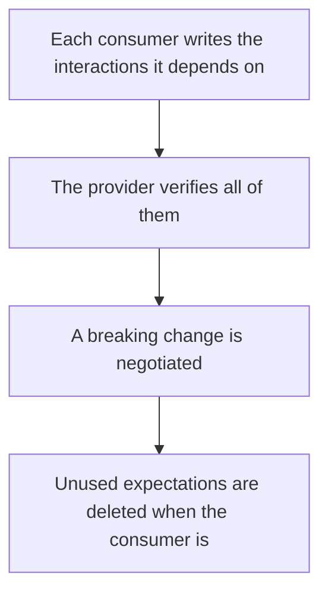

# D20-T007 — Consumer-driven contracts

Topic ID: `D20-T007`
Domain: Software Testing
Subdomain: Consumer-driven contracts
Importance: common
Complexity: intermediate
Dependencies: `D20-T006`, `D20-T001`, `D05-T001`, `D05-T002`, `D07-T001`, `D07-T002`
Execution status of the code in section F: unexecuted

## A. Topic Overview

Consumer-driven contracts mean the consumer's expectations drive the contract, because the consumer is the one who breaks. Each consumer publishes its needs. The provider verifies the union. The provider may support several consumers and must not drop a field one of them requires. This is a social and a technical rule: the provider does not invent the contract alone.

In production this shows up as follows: Two clients need different fields of an order. Both publish contracts. The order service build runs both. A cleanup of an 'unused' field fails because the second client still requires it.

Interviewers use Consumer-driven contracts to see whether you can state the failure mode, not only the definition. The failure to name is: a provider shipping a change that satisfies a guessed contract and breaks a quiet consumer

Prerequisites: `D20-T006`, `D20-T001`, `D05-T001`, `D05-T002`, `D07-T001`, `D07-T002`. Later notes should link here instead of repeating the mechanism.

## B. First-Principles Explanation

Consumer-driven contracts mean the consumer's expectations drive the contract, because the consumer is the one who breaks. Each consumer publishes its needs. The provider verifies the union. The provider may support several consumers and must not drop a field one of them requires. This is a social and a technical rule: the provider does not invent the contract alone.

The useful picture is: Consumer-driven contracts are the diners writing down the dishes they still order. The kitchen may add a dish. It may not remove one that a diner still listed.

What has to be true:

1. Each consumer writes the interactions it depends on
2. The provider verifies all of them
3. A breaking change is negotiated
4. Unused expectations are deleted when the consumer is

It works when those steps preserve one invariant. It fails when a provider shipping a change that satisfies a guessed contract and breaks a quiet consumer. The alternative is: the provider dictates a schema and never runs the consumers' expectations

## C. Internal Working and Architecture

Components involved: the caller, the state Consumer-driven contracts mutates or reads, and the observer that reports consumers broken in production after a provider release that was contract-green for a subset.

Execution:

1. Each consumer writes the interactions it depends on
2. The provider verifies all of them
3. A breaking change is negotiated
4. Unused expectations are deleted when the consumer is

Data moves only along that path. A retry re-enters at step 1, so the operation must say what a duplicate does. Memory and locks stay inside this mechanism. Callers see the result or a typed error, not a half-updated invariant.

State to remember: choose this when several consumers evolve separately from the provider. Do not choose it when the provider dictates a schema and never runs the consumers' expectations.

## D. Diagrams and Visual Models



Read the diagram from top to bottom. Each box is one step of Consumer-driven contracts. The failure mode (a provider shipping a change that satisfies a guessed contract and breaks a quiet consumer) is what you look for when a later box never happens or happens twice.

## E. Examples and Analogies

Analogy: Consumer-driven contracts are the diners writing down the dishes they still order. The kitchen may add a dish. It may not remove one that a diner still listed.

Production example: Two clients need different fields of an order. Both publish contracts. The order service build runs both. A cleanup of an 'unused' field fails because the second client still requires it.

A small counterexample is enough in an interview. Show the input, apply the steps, and show the broken outcome if someone uses the mechanism outside its rule: a provider shipping a change that satisfies a guessed contract and breaks a quiet consumer.

## F. Code Examples

The snippet is labeled unexecuted. It illustrates the shape of the idea. It is not a benchmark and it embeds no secret.

```python
def covers(provider_contracts, consumer):
    return consumer in provider_contracts
```

After the snippet, check consumers broken in production after a provider release that was contract-green for a subset. If that signal moves the wrong way, the snippet is the wrong tool for the workload.

## G. Practical Backend Application

Use Consumer-driven contracts in a service when several consumers evolve separately from the provider.

A typical place is the production case already stated: Two clients need different fields of an order. Both publish contracts. The order service build runs both. A cleanup of an 'unused' field fails because the second client still requires it.

Operationally you alert on consumers broken in production after a provider release that was contract-green for a subset. You do not alert only on process uptime. The dashboard should show the failure mode, a success rate, and the saturation signal (queue depth, lock wait, or latency) that predicts it.

## H. Advantages, Limitations and Trade-offs

| Choice | Benefit | Cost | Choose when | Avoid when |
| --- | --- | --- | --- | --- |
| Apply Consumer-driven contracts | several consumers evolve separately from the provider | Extra moving parts and a new failure mode | The failure you are preventing is already real | the provider dictates a schema and never runs the consumers' expectations |
| Simpler alternative | Less code and fewer dependencies | a provider shipping a change that satisfies a guessed contract and breaks a quiet consumer | The workload does not hit the limit | The invariant must hold under concurrency or failure |

Consumer-driven contracts is a trade. State the benefit and the cost in the same sentence when you propose it in a design review.

## I. Common Mistakes and Misconceptions

- One contract written by the provider and labeled consumer-driven.
- Ignoring a consumer because it is internal.
- Never deleting a contract for a dead client, so you cannot evolve.
- Treating a diagram of Consumer-driven contracts as proof that the invariant holds in production.
- Copying a default configuration without naming consumers broken in production after a provider release that was contract-green for a subset.

## J. Debugging and Troubleshooting

Symptom: a provider shipping a change that satisfies a guessed contract and breaks a quiet consumer

First check: consumers broken in production after a provider release that was contract-green for a subset.

Then compare one healthy instance against one unhealthy instance. Confirm whether retries are duplicating work. Confirm whether a timeout is shorter than the work. Fix the invariant, then watch the same metric for a full peak, not only for the next minute.

Useful questions: did the step order in section C actually happen, or did a caller skip a step? Did a deploy change the data shape that Consumer-driven contracts assumes?

## K. Interview Preparation

### Beginner

#### Q1. What problem does Consumer-driven contracts solve?

**Answer:** Consumer-driven contracts mean the consumer's expectations drive the contract, because the consumer is the one who breaks. Each consumer publishes its needs. The provider verifies the union. The provider may support several consumers and must not drop a field one of them requires. This is a social and a technical rule: the provider does not invent the contract alone. Without it, the usual backend failure is: a provider shipping a change that satisfies a guessed contract and breaks a quiet consumer.

#### Q2. Where does Consumer-driven contracts sit on a request path?

**Answer:** Consumer-driven contracts is not a library you sprinkle on every call. several consumers evolve separately from the provider You notice it when consumers broken in production after a provider release that was contract-green for a subset. Name the constraint that makes this choice correct. Say what you would measure to confirm it.

#### Q3. Give a concrete example of Consumer-driven contracts.

**Answer:** Two clients need different fields of an order. Both publish contracts. The order service build runs both. A cleanup of an 'unused' field fails because the second client still requires it. Walk the input, the state change, and the observable output.

#### Q4. What is a common mix-up around Consumer-driven contracts?

**Answer:** a provider shipping a change that satisfies a guessed contract and breaks a quiet consumer The corrective check is consumers broken in production after a provider release that was contract-green for a subset. Name the constraint that makes this choice correct. Say what you would measure to confirm it. Say which alternative you rejected and why.

#### Q5. When would you skip Consumer-driven contracts?

**Answer:** the provider dictates a schema and never runs the consumers' expectations Skipping is a decision with a measured cost, not a slogan. Name the constraint that makes this choice correct. Say what you would measure to confirm it. Say which alternative you rejected and why.

### Intermediate

#### Q1. What invariant makes Consumer-driven contracts correct?

**Answer:** Consumer-driven contracts mean the consumer's expectations drive the contract, because the consumer is the one who breaks. Each consumer publishes its needs. The provider verifies the union. The provider may support several consumers and must not drop a field one of them requires. This is a social and a technical rule: the provider does not invent the contract alone. State the invariant before you name the tool.

#### Q2. How do you test Consumer-driven contracts?

**Answer:** Assert the failure mode directly: a provider shipping a change that satisfies a guessed contract and breaks a quiet consumer. The assertion should watch consumers broken in production after a provider release that was contract-green for a subset. Include a concurrent or retry case if the bug only appears then. Name the constraint that makes this choice correct.

#### Q3. What signal tells you Consumer-driven contracts is misbehaving in production?

**Answer:** Watch consumers broken in production after a provider release that was contract-green for a subset. The user-visible symptom is usually a provider shipping a change that satisfies a guessed contract and breaks a quiet consumer. Name the constraint that makes this choice correct. Say what you would measure to confirm it.

#### Q4. How would you introduce Consumer-driven contracts into a legacy service?

**Answer:** several consumers evolve separately from the provider Ship it behind a metric so you can compare the old path. Roll back if a provider shipping a change that satisfies a guessed contract and breaks a quiet consumer gets worse. Name the constraint that makes this choice correct. Say what you would measure to confirm it.

#### Q5. What do you trade away by choosing Consumer-driven contracts?

**Answer:** several consumers evolve separately from the provider the provider dictates a schema and never runs the consumers' expectations Say the cost in latency, storage, or operational load. Name the constraint that makes this choice correct. Say what you would measure to confirm it. Say which alternative you rejected and why.

### Advanced

#### Q1. What breaks if a dependency of Consumer-driven contracts is slow or down?

**Answer:** a provider shipping a change that satisfies a guessed contract and breaks a quiet consumer Degrade using the rule: the provider dictates a schema and never runs the consumers' expectations. Timeouts must be shorter than the caller's deadline. Name the constraint that makes this choice correct. Say what you would measure to confirm it.

#### Q2. How does Consumer-driven contracts behave under retries?

**Answer:** Retries repeat work, so Consumer-driven contracts must define what a duplicate does. a provider shipping a change that satisfies a guessed contract and breaks a quiet consumer Idempotency keys or fences belong next to the write, not in a comment. Name the constraint that makes this choice correct. Say what you would measure to confirm it.

#### Q3. What is the capacity limit of Consumer-driven contracts?

**Answer:** The limit shows up as consumers broken in production after a provider release that was contract-green for a subset. Add capacity only after you know whether the bottleneck is CPU, lock wait, or network. Name the constraint that makes this choice correct. Say what you would measure to confirm it.

#### Q4. How do you evolve Consumer-driven contracts without a flag day?

**Answer:** several consumers evolve separately from the provider Version the contract or the on-disk format. Readers should tolerate one old and one new shape during the rollout. Name the constraint that makes this choice correct. Say what you would measure to confirm it.

#### Q5. What security or correctness bug hides inside Consumer-driven contracts?

**Answer:** a provider shipping a change that satisfies a guessed contract and breaks a quiet consumer Check authorization and tenancy at the same boundary as the mechanism. A cache or queue must not widen who can read the data. Name the constraint that makes this choice correct. Say what you would measure to confirm it.

### Scenario

#### Q1. Incident: a provider shipping a change that satisfies a guessed contract and breaks a quiet consumer. What do you check first?

**Answer:** Start with consumers broken in production after a provider release that was contract-green for a subset. Compare a good host and a bad host before you restart anything. Consumer-driven contracts mean the consumer's expectations drive the contract, because the consumer is the one who breaks. Each consumer publishes its needs. The provider verifies the union. The provider may support several consumers and must not drop a field one of them requires. This is a social and a technical rule: the provider does not invent the contract alone.

#### Q2. A reviewer wants the clever version. What data settles it?

**Answer:** several consumers evolve separately from the provider the provider dictates a schema and never runs the consumers' expectations Bring consumers broken in production after a provider release that was contract-green for a subset from a load test or from production, not a slogan. Name the constraint that makes this choice correct. Say what you would measure to confirm it. Say which alternative you rejected and why.

#### Q3. You have one hour to explain Consumer-driven contracts at a whiteboard.

**Answer:** Draw the happy path in four boxes. Then draw the failure: a provider shipping a change that satisfies a guessed contract and breaks a quiet consumer. End with the metric you would page on. Name the constraint that makes this choice correct.

#### Q4. The bug only appears under two concurrent callers.

**Answer:** a provider shipping a change that satisfies a guessed contract and breaks a quiet consumer Reproduce with a barrier so both sides enter the critical window. Confirm the fix with consumers broken in production after a provider release that was contract-green for a subset. Name the constraint that makes this choice correct. Say what you would measure to confirm it.

#### Q5. Leadership wants this on every service next week.

**Answer:** the provider dictates a schema and never runs the consumers' expectations several consumers evolve separately from the provider Roll it out where the failure mode is already hurting users. Name the constraint that makes this choice correct. Say what you would measure to confirm it. Say which alternative you rejected and why.

### Follow-up

#### Q1. What did you assume about the data size or the clock?

**Answer:** Consumer-driven contracts mean the consumer's expectations drive the contract, because the consumer is the one who breaks. Each consumer publishes its needs. The provider verifies the union. The provider may support several consumers and must not drop a field one of them requires. This is a social and a technical rule: the provider does not invent the contract alone. Clocks are not a total order across machines. State whether the algorithm needs bounded size or a single leader.

#### Q2. What would you measure after the change ships?

**Answer:** Page on consumers broken in production after a provider release that was contract-green for a subset. Keep a before/after dashboard for one week. Alert on the failure mode, not only on CPU. Name the constraint that makes this choice correct.

#### Q3. Which neighboring topic did you deliberately not re-teach?

**Answer:** This note owns Consumer-driven contracts. Related identifiers are in section N. Shared ideas are linked, not copied. Name the constraint that makes this choice correct.

## L. Practical Exercises

Solutions are in `EXERCISES/solutions/D20-T007.md`, not in this section.

1. Whiteboard the four steps of Consumer-driven contracts and mark where `a provider shipping a change that satisfies a guessed contract and breaks a quiet consumer` enters.
2. Read the snippet in section F and write the assertion that would catch that failure. The assertion must mention `consumers broken in production after a provider release that was contract-green for a subset`.
3. Argue for or against using Consumer-driven contracts on a service you know. Use the choose and avoid rows from section H. Do not appeal to popularity.

## M. Revision Notes

- Mechanism: Consumer-driven contracts mean the consumer's expectations drive the contract, because the consumer is the one who breaks.
- Failure: a provider shipping a change that satisfies a guessed contract and breaks a quiet consumer
- Metric: consumers broken in production after a provider release that was contract-green for a subset
- Choose when: several consumers evolve separately from the provider
- Avoid when: the provider dictates a schema and never runs the consumers' expectations

## N. Related Topics

Dependencies to review first: `D20-T006`, `D20-T001`, `D05-T001`, `D05-T002`, `D07-T001`, `D07-T002`.

Shared ideas stay in those notes. This note does not restate them.

## O. Completion Criteria

- You can explain Consumer-driven contracts without reading this note, including the failure mode.
- You can draw the diagram in section D from memory.
- You can say when not to use it, using the avoid condition in section H.
- You can name the metric you would watch after shipping it.
