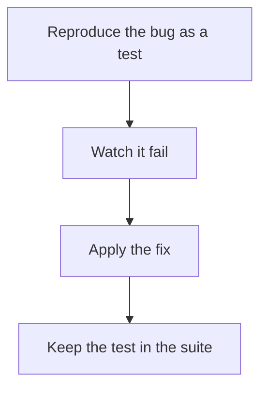

# D20-T008 — Regression testing

Topic ID: `D20-T008`
Domain: Software Testing
Subdomain: Regression testing
Importance: common
Complexity: intermediate
Dependencies: `D20-T007`, `D20-T001`, `D05-T001`, `D05-T002`, `D07-T001`, `D07-T002`
Execution status of the code in section F: unexecuted

## A. Topic Overview

Regression testing checks that a fixed bug or an existing behavior stays fixed after a change. The test should fail on the old code and pass on the new code. A suite that never caught a bug is not evidence. Regressions are named and small. Re-running the entire world is a pipeline choice, not the definition.

In production this shows up as follows: A bug let an empty display name through. The test submits an empty name and expects a 400. It was observed red on the old commit. It stays next to the validator.

Interviewers use Regression testing to see whether you can state the failure mode, not only the definition. The failure to name is: a test written after the fix that would have passed on the broken code too

Prerequisites: `D20-T007`, `D20-T001`, `D05-T001`, `D05-T002`, `D07-T001`, `D07-T002`. Later notes should link here instead of repeating the mechanism.

## B. First-Principles Explanation

Regression testing checks that a fixed bug or an existing behavior stays fixed after a change. The test should fail on the old code and pass on the new code. A suite that never caught a bug is not evidence. Regressions are named and small. Re-running the entire world is a pipeline choice, not the definition.

The useful picture is: A regression test is a photograph of a pothole you filled. If the photograph would also have matched the open hole, it does not protect you.

What has to be true:

1. Reproduce the bug as a test
2. Watch it fail
3. Apply the fix
4. Keep the test in the suite

It works when those steps preserve one invariant. It fails when a test written after the fix that would have passed on the broken code too. The alternative is: you add a test that cannot fail for the reason the bug failed

## C. Internal Working and Architecture

Components involved: the caller, the state Regression testing mutates or reads, and the observer that reports escaped bugs that match a missing regression test.

Execution:

1. Reproduce the bug as a test
2. Watch it fail
3. Apply the fix
4. Keep the test in the suite

Data moves only along that path. A retry re-enters at step 1, so the operation must say what a duplicate does. Memory and locks stay inside this mechanism. Callers see the result or a typed error, not a half-updated invariant.

State to remember: choose this when a defect escaped or a behavior must not change. Do not choose it when you add a test that cannot fail for the reason the bug failed.

## D. Diagrams and Visual Models



Read the diagram from top to bottom. Each box is one step of Regression testing. The failure mode (a test written after the fix that would have passed on the broken code too) is what you look for when a later box never happens or happens twice.

## E. Examples and Analogies

Analogy: A regression test is a photograph of a pothole you filled. If the photograph would also have matched the open hole, it does not protect you.

Production example: A bug let an empty display name through. The test submits an empty name and expects a 400. It was observed red on the old commit. It stays next to the validator.

A small counterexample is enough in an interview. Show the input, apply the steps, and show the broken outcome if someone uses the mechanism outside its rule: a test written after the fix that would have passed on the broken code too.

## F. Code Examples

The snippet is labeled unexecuted. It illustrates the shape of the idea. It is not a benchmark and it embeds no secret.

```python
def test_blank_name_rejected(validate):
    assert validate('') is False
```

After the snippet, check escaped bugs that match a missing regression test. If that signal moves the wrong way, the snippet is the wrong tool for the workload.

## G. Practical Backend Application

Use Regression testing in a service when a defect escaped or a behavior must not change.

A typical place is the production case already stated: A bug let an empty display name through. The test submits an empty name and expects a 400. It was observed red on the old commit. It stays next to the validator.

Operationally you alert on escaped bugs that match a missing regression test. You do not alert only on process uptime. The dashboard should show the failure mode, a success rate, and the saturation signal (queue depth, lock wait, or latency) that predicts it.

## H. Advantages, Limitations and Trade-offs

| Choice | Benefit | Cost | Choose when | Avoid when |
| --- | --- | --- | --- | --- |
| Apply Regression testing | a defect escaped or a behavior must not change | Extra moving parts and a new failure mode | The failure you are preventing is already real | you add a test that cannot fail for the reason the bug failed |
| Simpler alternative | Less code and fewer dependencies | a test written after the fix that would have passed on the broken code too | The workload does not hit the limit | The invariant must hold under concurrency or failure |

Regression testing is a trade. State the benefit and the cost in the same sentence when you propose it in a design review.

## I. Common Mistakes and Misconceptions

- Writing the test only on the fixed code and never checking it fails.
- Disabling a red test.
- Calling a full rerun a regression strategy with no new case.
- Treating a diagram of Regression testing as proof that the invariant holds in production.
- Copying a default configuration without naming escaped bugs that match a missing regression test.

## J. Debugging and Troubleshooting

Symptom: a test written after the fix that would have passed on the broken code too

First check: escaped bugs that match a missing regression test.

Then compare one healthy instance against one unhealthy instance. Confirm whether retries are duplicating work. Confirm whether a timeout is shorter than the work. Fix the invariant, then watch the same metric for a full peak, not only for the next minute.

Useful questions: did the step order in section C actually happen, or did a caller skip a step? Did a deploy change the data shape that Regression testing assumes?

## K. Interview Preparation

### Beginner

#### Q1. What problem does Regression testing solve?

**Answer:** Regression testing checks that a fixed bug or an existing behavior stays fixed after a change. The test should fail on the old code and pass on the new code. A suite that never caught a bug is not evidence. Regressions are named and small. Re-running the entire world is a pipeline choice, not the definition. Without it, the usual backend failure is: a test written after the fix that would have passed on the broken code too.

#### Q2. Where does Regression testing sit on a request path?

**Answer:** Regression testing is not a library you sprinkle on every call. a defect escaped or a behavior must not change You notice it when escaped bugs that match a missing regression test. Name the constraint that makes this choice correct. Say what you would measure to confirm it.

#### Q3. Give a concrete example of Regression testing.

**Answer:** A bug let an empty display name through. The test submits an empty name and expects a 400. It was observed red on the old commit. It stays next to the validator. Walk the input, the state change, and the observable output.

#### Q4. What is a common mix-up around Regression testing?

**Answer:** a test written after the fix that would have passed on the broken code too The corrective check is escaped bugs that match a missing regression test. Name the constraint that makes this choice correct. Say what you would measure to confirm it. Say which alternative you rejected and why.

#### Q5. When would you skip Regression testing?

**Answer:** you add a test that cannot fail for the reason the bug failed Skipping is a decision with a measured cost, not a slogan. Name the constraint that makes this choice correct. Say what you would measure to confirm it. Say which alternative you rejected and why.

### Intermediate

#### Q1. What invariant makes Regression testing correct?

**Answer:** Regression testing checks that a fixed bug or an existing behavior stays fixed after a change. The test should fail on the old code and pass on the new code. A suite that never caught a bug is not evidence. Regressions are named and small. Re-running the entire world is a pipeline choice, not the definition. State the invariant before you name the tool.

#### Q2. How do you test Regression testing?

**Answer:** Assert the failure mode directly: a test written after the fix that would have passed on the broken code too. The assertion should watch escaped bugs that match a missing regression test. Include a concurrent or retry case if the bug only appears then. Name the constraint that makes this choice correct.

#### Q3. What signal tells you Regression testing is misbehaving in production?

**Answer:** Watch escaped bugs that match a missing regression test. The user-visible symptom is usually a test written after the fix that would have passed on the broken code too. Name the constraint that makes this choice correct. Say what you would measure to confirm it.

#### Q4. How would you introduce Regression testing into a legacy service?

**Answer:** a defect escaped or a behavior must not change Ship it behind a metric so you can compare the old path. Roll back if a test written after the fix that would have passed on the broken code too gets worse. Name the constraint that makes this choice correct. Say what you would measure to confirm it.

#### Q5. What do you trade away by choosing Regression testing?

**Answer:** a defect escaped or a behavior must not change you add a test that cannot fail for the reason the bug failed Say the cost in latency, storage, or operational load. Name the constraint that makes this choice correct. Say what you would measure to confirm it. Say which alternative you rejected and why.

### Advanced

#### Q1. What breaks if a dependency of Regression testing is slow or down?

**Answer:** a test written after the fix that would have passed on the broken code too Degrade using the rule: you add a test that cannot fail for the reason the bug failed. Timeouts must be shorter than the caller's deadline. Name the constraint that makes this choice correct. Say what you would measure to confirm it.

#### Q2. How does Regression testing behave under retries?

**Answer:** Retries repeat work, so Regression testing must define what a duplicate does. a test written after the fix that would have passed on the broken code too Idempotency keys or fences belong next to the write, not in a comment. Name the constraint that makes this choice correct. Say what you would measure to confirm it.

#### Q3. What is the capacity limit of Regression testing?

**Answer:** The limit shows up as escaped bugs that match a missing regression test. Add capacity only after you know whether the bottleneck is CPU, lock wait, or network. Name the constraint that makes this choice correct. Say what you would measure to confirm it.

#### Q4. How do you evolve Regression testing without a flag day?

**Answer:** a defect escaped or a behavior must not change Version the contract or the on-disk format. Readers should tolerate one old and one new shape during the rollout. Name the constraint that makes this choice correct. Say what you would measure to confirm it.

#### Q5. What security or correctness bug hides inside Regression testing?

**Answer:** a test written after the fix that would have passed on the broken code too Check authorization and tenancy at the same boundary as the mechanism. A cache or queue must not widen who can read the data. Name the constraint that makes this choice correct. Say what you would measure to confirm it.

### Scenario

#### Q1. Incident: a test written after the fix that would have passed on the broken code too. What do you check first?

**Answer:** Start with escaped bugs that match a missing regression test. Compare a good host and a bad host before you restart anything. Regression testing checks that a fixed bug or an existing behavior stays fixed after a change. The test should fail on the old code and pass on the new code. A suite that never caught a bug is not evidence. Regressions are named and small. Re-running the entire world is a pipeline choice, not the definition.

#### Q2. A reviewer wants the clever version. What data settles it?

**Answer:** a defect escaped or a behavior must not change you add a test that cannot fail for the reason the bug failed Bring escaped bugs that match a missing regression test from a load test or from production, not a slogan. Name the constraint that makes this choice correct. Say what you would measure to confirm it. Say which alternative you rejected and why.

#### Q3. You have one hour to explain Regression testing at a whiteboard.

**Answer:** Draw the happy path in four boxes. Then draw the failure: a test written after the fix that would have passed on the broken code too. End with the metric you would page on. Name the constraint that makes this choice correct.

#### Q4. The bug only appears under two concurrent callers.

**Answer:** a test written after the fix that would have passed on the broken code too Reproduce with a barrier so both sides enter the critical window. Confirm the fix with escaped bugs that match a missing regression test. Name the constraint that makes this choice correct. Say what you would measure to confirm it.

#### Q5. Leadership wants this on every service next week.

**Answer:** you add a test that cannot fail for the reason the bug failed a defect escaped or a behavior must not change Roll it out where the failure mode is already hurting users. Name the constraint that makes this choice correct. Say what you would measure to confirm it. Say which alternative you rejected and why.

### Follow-up

#### Q1. What did you assume about the data size or the clock?

**Answer:** Regression testing checks that a fixed bug or an existing behavior stays fixed after a change. The test should fail on the old code and pass on the new code. A suite that never caught a bug is not evidence. Regressions are named and small. Re-running the entire world is a pipeline choice, not the definition. Clocks are not a total order across machines. State whether the algorithm needs bounded size or a single leader.

#### Q2. What would you measure after the change ships?

**Answer:** Page on escaped bugs that match a missing regression test. Keep a before/after dashboard for one week. Alert on the failure mode, not only on CPU. Name the constraint that makes this choice correct.

#### Q3. Which neighboring topic did you deliberately not re-teach?

**Answer:** This note owns Regression testing. Related identifiers are in section N. Shared ideas are linked, not copied. Name the constraint that makes this choice correct.

## L. Practical Exercises

Solutions are in `EXERCISES/solutions/D20-T008.md`, not in this section.

1. Whiteboard the four steps of Regression testing and mark where `a test written after the fix that would have passed on the broken code too` enters.
2. Read the snippet in section F and write the assertion that would catch that failure. The assertion must mention `escaped bugs that match a missing regression test`.
3. Argue for or against using Regression testing on a service you know. Use the choose and avoid rows from section H. Do not appeal to popularity.

## M. Revision Notes

- Mechanism: Regression testing checks that a fixed bug or an existing behavior stays fixed after a change.
- Failure: a test written after the fix that would have passed on the broken code too
- Metric: escaped bugs that match a missing regression test
- Choose when: a defect escaped or a behavior must not change
- Avoid when: you add a test that cannot fail for the reason the bug failed

## N. Related Topics

Dependencies to review first: `D20-T007`, `D20-T001`, `D05-T001`, `D05-T002`, `D07-T001`, `D07-T002`.

Shared ideas stay in those notes. This note does not restate them.

## O. Completion Criteria

- You can explain Regression testing without reading this note, including the failure mode.
- You can draw the diagram in section D from memory.
- You can say when not to use it, using the avoid condition in section H.
- You can name the metric you would watch after shipping it.
