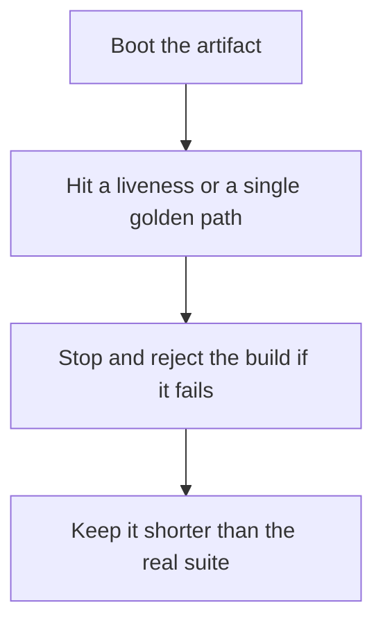

# D20-T009 — Smoke and sanity testing

Topic ID: `D20-T009`
Domain: Software Testing
Subdomain: Smoke and sanity testing
Importance: common
Complexity: intermediate
Dependencies: `D20-T008`, `D20-T001`, `D05-T001`, `D05-T002`, `D07-T001`, `D07-T002`
Execution status of the code in section F: unexecuted

## A. Topic Overview

A smoke test is a shallow check that the build is alive enough to test further: it boots, a health endpoint answers, and a critical path returns. A sanity test is a narrow check after a small change that the obvious thing still works. Neither replaces functional tests. Their job is to fail fast. A smoke test that takes an hour is a suite with the wrong name.

In production this shows up as follows: CI runs a two-minute smoke container that migrates a scratch database and calls health. If the image cannot boot, the long suite never starts.

Interviewers use Smoke and sanity testing to see whether you can state the failure mode, not only the definition. The failure to name is: a green smoke test that does not touch the broken migration, so the real suite starts and fails late

Prerequisites: `D20-T008`, `D20-T001`, `D05-T001`, `D05-T002`, `D07-T001`, `D07-T002`. Later notes should link here instead of repeating the mechanism.

## B. First-Principles Explanation

A smoke test is a shallow check that the build is alive enough to test further: it boots, a health endpoint answers, and a critical path returns. A sanity test is a narrow check after a small change that the obvious thing still works. Neither replaces functional tests. Their job is to fail fast. A smoke test that takes an hour is a suite with the wrong name.

The useful picture is: Smoke is looking for fire before you unpack the boxes. Sanity is plugging in the lamp you just moved. Neither is inventorying the house.

What has to be true:

1. Boot the artifact
2. Hit a liveness or a single golden path
3. Stop and reject the build if it fails
4. Keep it shorter than the real suite

It works when those steps preserve one invariant. It fails when a green smoke test that does not touch the broken migration, so the real suite starts and fails late. The alternative is: you expand smoke until it is the only suite and it is slow

## C. Internal Working and Architecture

Components involved: the caller, the state Smoke and sanity testing mutates or reads, and the observer that reports time to reject a dead build.

Execution:

1. Boot the artifact
2. Hit a liveness or a single golden path
3. Stop and reject the build if it fails
4. Keep it shorter than the real suite

Data moves only along that path. A retry re-enters at step 1, so the operation must say what a duplicate does. Memory and locks stay inside this mechanism. Callers see the result or a typed error, not a half-updated invariant.

State to remember: choose this when you need a fast reject of a broken artifact. Do not choose it when you expand smoke until it is the only suite and it is slow.

## D. Diagrams and Visual Models



Read the diagram from top to bottom. Each box is one step of Smoke and sanity testing. The failure mode (a green smoke test that does not touch the broken migration, so the real suite starts and fails late) is what you look for when a later box never happens or happens twice.

## E. Examples and Analogies

Analogy: Smoke is looking for fire before you unpack the boxes. Sanity is plugging in the lamp you just moved. Neither is inventorying the house.

Production example: CI runs a two-minute smoke container that migrates a scratch database and calls health. If the image cannot boot, the long suite never starts.

A small counterexample is enough in an interview. Show the input, apply the steps, and show the broken outcome if someone uses the mechanism outside its rule: a green smoke test that does not touch the broken migration, so the real suite starts and fails late.

## F. Code Examples

The snippet is labeled unexecuted. It illustrates the shape of the idea. It is not a benchmark and it embeds no secret.

```python
def test_smoke(client):
    assert client.get('/health').status_code == 200
```

After the snippet, check time to reject a dead build. If that signal moves the wrong way, the snippet is the wrong tool for the workload.

## G. Practical Backend Application

Use Smoke and sanity testing in a service when you need a fast reject of a broken artifact.

A typical place is the production case already stated: CI runs a two-minute smoke container that migrates a scratch database and calls health. If the image cannot boot, the long suite never starts.

Operationally you alert on time to reject a dead build. You do not alert only on process uptime. The dashboard should show the failure mode, a success rate, and the saturation signal (queue depth, lock wait, or latency) that predicts it.

## H. Advantages, Limitations and Trade-offs

| Choice | Benefit | Cost | Choose when | Avoid when |
| --- | --- | --- | --- | --- |
| Apply Smoke and sanity testing | you need a fast reject of a broken artifact | Extra moving parts and a new failure mode | The failure you are preventing is already real | you expand smoke until it is the only suite and it is slow |
| Simpler alternative | Less code and fewer dependencies | a green smoke test that does not touch the broken migration, so the real suite starts and fails late | The workload does not hit the limit | The invariant must hold under concurrency or failure |

Smoke and sanity testing is a trade. State the benefit and the cost in the same sentence when you propose it in a design review.

## I. Common Mistakes and Misconceptions

- A smoke test with no assertion.
- Hours of tests labeled smoke.
- Skipping the migration in the boot check.
- Treating a diagram of Smoke and sanity testing as proof that the invariant holds in production.
- Copying a default configuration without naming time to reject a dead build.

## J. Debugging and Troubleshooting

Symptom: a green smoke test that does not touch the broken migration, so the real suite starts and fails late

First check: time to reject a dead build.

Then compare one healthy instance against one unhealthy instance. Confirm whether retries are duplicating work. Confirm whether a timeout is shorter than the work. Fix the invariant, then watch the same metric for a full peak, not only for the next minute.

Useful questions: did the step order in section C actually happen, or did a caller skip a step? Did a deploy change the data shape that Smoke and sanity testing assumes?

## K. Interview Preparation

### Beginner

#### Q1. What problem does Smoke and sanity testing solve?

**Answer:** A smoke test is a shallow check that the build is alive enough to test further: it boots, a health endpoint answers, and a critical path returns. A sanity test is a narrow check after a small change that the obvious thing still works. Neither replaces functional tests. Their job is to fail fast. A smoke test that takes an hour is a suite with the wrong name. Without it, the usual backend failure is: a green smoke test that does not touch the broken migration, so the real suite starts and fails late.

#### Q2. Where does Smoke and sanity testing sit on a request path?

**Answer:** Smoke and sanity testing is not a library you sprinkle on every call. you need a fast reject of a broken artifact You notice it when time to reject a dead build. Name the constraint that makes this choice correct. Say what you would measure to confirm it.

#### Q3. Give a concrete example of Smoke and sanity testing.

**Answer:** CI runs a two-minute smoke container that migrates a scratch database and calls health. If the image cannot boot, the long suite never starts. Walk the input, the state change, and the observable output. Name the constraint that makes this choice correct.

#### Q4. What is a common mix-up around Smoke and sanity testing?

**Answer:** a green smoke test that does not touch the broken migration, so the real suite starts and fails late The corrective check is time to reject a dead build. Name the constraint that makes this choice correct. Say what you would measure to confirm it. Say which alternative you rejected and why.

#### Q5. When would you skip Smoke and sanity testing?

**Answer:** you expand smoke until it is the only suite and it is slow Skipping is a decision with a measured cost, not a slogan. Name the constraint that makes this choice correct. Say what you would measure to confirm it. Say which alternative you rejected and why.

### Intermediate

#### Q1. What invariant makes Smoke and sanity testing correct?

**Answer:** A smoke test is a shallow check that the build is alive enough to test further: it boots, a health endpoint answers, and a critical path returns. A sanity test is a narrow check after a small change that the obvious thing still works. Neither replaces functional tests. Their job is to fail fast. A smoke test that takes an hour is a suite with the wrong name. State the invariant before you name the tool.

#### Q2. How do you test Smoke and sanity testing?

**Answer:** Assert the failure mode directly: a green smoke test that does not touch the broken migration, so the real suite starts and fails late. The assertion should watch time to reject a dead build. Include a concurrent or retry case if the bug only appears then. Name the constraint that makes this choice correct.

#### Q3. What signal tells you Smoke and sanity testing is misbehaving in production?

**Answer:** Watch time to reject a dead build. The user-visible symptom is usually a green smoke test that does not touch the broken migration, so the real suite starts and fails late. Name the constraint that makes this choice correct. Say what you would measure to confirm it.

#### Q4. How would you introduce Smoke and sanity testing into a legacy service?

**Answer:** you need a fast reject of a broken artifact Ship it behind a metric so you can compare the old path. Roll back if a green smoke test that does not touch the broken migration, so the real suite starts and fails late gets worse. Name the constraint that makes this choice correct. Say what you would measure to confirm it.

#### Q5. What do you trade away by choosing Smoke and sanity testing?

**Answer:** you need a fast reject of a broken artifact you expand smoke until it is the only suite and it is slow Say the cost in latency, storage, or operational load. Name the constraint that makes this choice correct. Say what you would measure to confirm it. Say which alternative you rejected and why.

### Advanced

#### Q1. What breaks if a dependency of Smoke and sanity testing is slow or down?

**Answer:** a green smoke test that does not touch the broken migration, so the real suite starts and fails late Degrade using the rule: you expand smoke until it is the only suite and it is slow. Timeouts must be shorter than the caller's deadline. Name the constraint that makes this choice correct. Say what you would measure to confirm it.

#### Q2. How does Smoke and sanity testing behave under retries?

**Answer:** Retries repeat work, so Smoke and sanity testing must define what a duplicate does. a green smoke test that does not touch the broken migration, so the real suite starts and fails late Idempotency keys or fences belong next to the write, not in a comment. Name the constraint that makes this choice correct. Say what you would measure to confirm it.

#### Q3. What is the capacity limit of Smoke and sanity testing?

**Answer:** The limit shows up as time to reject a dead build. Add capacity only after you know whether the bottleneck is CPU, lock wait, or network. Name the constraint that makes this choice correct. Say what you would measure to confirm it.

#### Q4. How do you evolve Smoke and sanity testing without a flag day?

**Answer:** you need a fast reject of a broken artifact Version the contract or the on-disk format. Readers should tolerate one old and one new shape during the rollout. Name the constraint that makes this choice correct. Say what you would measure to confirm it.

#### Q5. What security or correctness bug hides inside Smoke and sanity testing?

**Answer:** a green smoke test that does not touch the broken migration, so the real suite starts and fails late Check authorization and tenancy at the same boundary as the mechanism. A cache or queue must not widen who can read the data. Name the constraint that makes this choice correct. Say what you would measure to confirm it.

### Scenario

#### Q1. Incident: a green smoke test that does not touch the broken migration, so the real suite starts and fails late. What do you check first?

**Answer:** Start with time to reject a dead build. Compare a good host and a bad host before you restart anything. A smoke test is a shallow check that the build is alive enough to test further: it boots, a health endpoint answers, and a critical path returns. A sanity test is a narrow check after a small change that the obvious thing still works. Neither replaces functional tests. Their job is to fail fast. A smoke test that takes an hour is a suite with the wrong name.

#### Q2. A reviewer wants the clever version. What data settles it?

**Answer:** you need a fast reject of a broken artifact you expand smoke until it is the only suite and it is slow Bring time to reject a dead build from a load test or from production, not a slogan. Name the constraint that makes this choice correct. Say what you would measure to confirm it. Say which alternative you rejected and why.

#### Q3. You have one hour to explain Smoke and sanity testing at a whiteboard.

**Answer:** Draw the happy path in four boxes. Then draw the failure: a green smoke test that does not touch the broken migration, so the real suite starts and fails late. End with the metric you would page on. Name the constraint that makes this choice correct.

#### Q4. The bug only appears under two concurrent callers.

**Answer:** a green smoke test that does not touch the broken migration, so the real suite starts and fails late Reproduce with a barrier so both sides enter the critical window. Confirm the fix with time to reject a dead build. Name the constraint that makes this choice correct. Say what you would measure to confirm it.

#### Q5. Leadership wants this on every service next week.

**Answer:** you expand smoke until it is the only suite and it is slow you need a fast reject of a broken artifact Roll it out where the failure mode is already hurting users. Name the constraint that makes this choice correct. Say what you would measure to confirm it. Say which alternative you rejected and why.

### Follow-up

#### Q1. What did you assume about the data size or the clock?

**Answer:** A smoke test is a shallow check that the build is alive enough to test further: it boots, a health endpoint answers, and a critical path returns. A sanity test is a narrow check after a small change that the obvious thing still works. Neither replaces functional tests. Their job is to fail fast. A smoke test that takes an hour is a suite with the wrong name. Clocks are not a total order across machines. State whether the algorithm needs bounded size or a single leader.

#### Q2. What would you measure after the change ships?

**Answer:** Page on time to reject a dead build. Keep a before/after dashboard for one week. Alert on the failure mode, not only on CPU. Name the constraint that makes this choice correct.

#### Q3. Which neighboring topic did you deliberately not re-teach?

**Answer:** This note owns Smoke and sanity testing. Related identifiers are in section N. Shared ideas are linked, not copied. Name the constraint that makes this choice correct.

## L. Practical Exercises

Solutions are in `EXERCISES/solutions/D20-T009.md`, not in this section.

1. Whiteboard the four steps of Smoke and sanity testing and mark where `a green smoke test that does not touch the broken migration, so the real suite starts and fails late` enters.
2. Read the snippet in section F and write the assertion that would catch that failure. The assertion must mention `time to reject a dead build`.
3. Argue for or against using Smoke and sanity testing on a service you know. Use the choose and avoid rows from section H. Do not appeal to popularity.

## M. Revision Notes

- Mechanism: A smoke test is a shallow check that the build is alive enough to test further: it boots, a health endpoint answers, and a critical path returns.
- Failure: a green smoke test that does not touch the broken migration, so the real suite starts and fails late
- Metric: time to reject a dead build
- Choose when: you need a fast reject of a broken artifact
- Avoid when: you expand smoke until it is the only suite and it is slow

## N. Related Topics

Dependencies to review first: `D20-T008`, `D20-T001`, `D05-T001`, `D05-T002`, `D07-T001`, `D07-T002`.

Shared ideas stay in those notes. This note does not restate them.

## O. Completion Criteria

- You can explain Smoke and sanity testing without reading this note, including the failure mode.
- You can draw the diagram in section D from memory.
- You can say when not to use it, using the avoid condition in section H.
- You can name the metric you would watch after shipping it.
