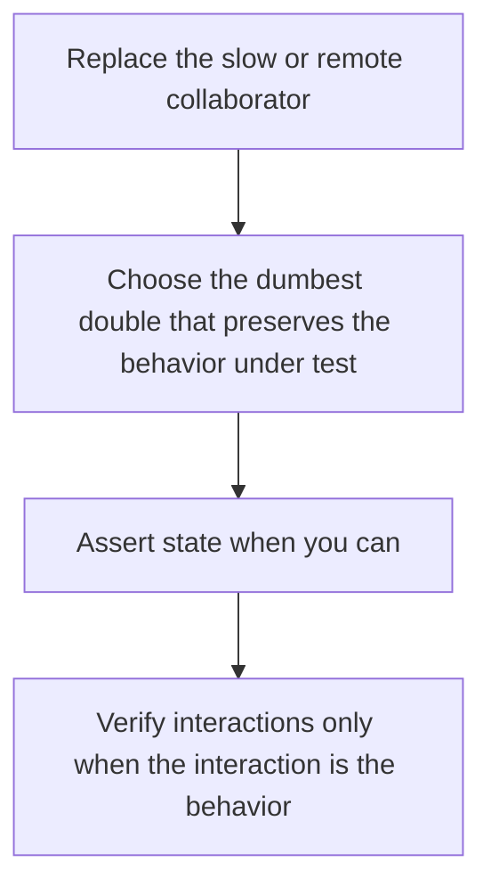

# D20-T011 — Test doubles, mocks, stubs and fakes

Topic ID: `D20-T011`
Domain: Software Testing
Subdomain: Test doubles, mocks, stubs and fakes
Importance: common
Complexity: intermediate
Dependencies: `D20-T010`, `D20-T001`, `D05-T001`, `D05-T002`, `D07-T001`, `D07-T002`
Execution status of the code in section F: unexecuted

## A. Topic Overview

A test double stands in for a collaborator. A dummy is passed and unused. A stub returns canned answers. A mock expects specific calls. A fake has a working simpler implementation, such as an in-memory queue. Spies record calls. Over-mocking tests the mocks. A fake that skips a failure mode gives false confidence. Prefer a stub or fake at the edge and real logic inside.

In production this shows up as follows: The order service test uses an in-memory payment fake that can approve or decline. It does not mock the domain object's internal method calls. A contract test still checks the real payment HTTP shape elsewhere.

Interviewers use Test doubles, mocks, stubs and fakes to see whether you can state the failure mode, not only the definition. The failure to name is: a test that breaks when a log line changes because a mock expected that call

Prerequisites: `D20-T010`, `D20-T001`, `D05-T001`, `D05-T002`, `D07-T001`, `D07-T002`. Later notes should link here instead of repeating the mechanism.

## B. First-Principles Explanation

A test double stands in for a collaborator. A dummy is passed and unused. A stub returns canned answers. A mock expects specific calls. A fake has a working simpler implementation, such as an in-memory queue. Spies record calls. Over-mocking tests the mocks. A fake that skips a failure mode gives false confidence. Prefer a stub or fake at the edge and real logic inside.

The useful picture is: A double is a stand-in actor. A fake is an understudy who can actually say the lines. A mock is a script supervisor who stops the scene if a line is missed. Supervisors are tiring if you hire one for every extra.

What has to be true:

1. Replace the slow or remote collaborator
2. Choose the dumbest double that preserves the behavior under test
3. Assert state when you can
4. Verify interactions only when the interaction is the behavior

It works when those steps preserve one invariant. It fails when a test that breaks when a log line changes because a mock expected that call. The alternative is: you mock the thing you are trying to test

## C. Internal Working and Architecture

Components involved: the caller, the state Test doubles, mocks, stubs and fakes mutates or reads, and the observer that reports tests rewritten on every refactor that did not change behavior.

Execution:

1. Replace the slow or remote collaborator
2. Choose the dumbest double that preserves the behavior under test
3. Assert state when you can
4. Verify interactions only when the interaction is the behavior

Data moves only along that path. A retry re-enters at step 1, so the operation must say what a duplicate does. Memory and locks stay inside this mechanism. Callers see the result or a typed error, not a half-updated invariant.

State to remember: choose this when the collaborator is remote, slow, or non-deterministic. Do not choose it when you mock the thing you are trying to test.

## D. Diagrams and Visual Models



Read the diagram from top to bottom. Each box is one step of Test doubles, mocks, stubs and fakes. The failure mode (a test that breaks when a log line changes because a mock expected that call) is what you look for when a later box never happens or happens twice.

## E. Examples and Analogies

Analogy: A double is a stand-in actor. A fake is an understudy who can actually say the lines. A mock is a script supervisor who stops the scene if a line is missed. Supervisors are tiring if you hire one for every extra.

Production example: The order service test uses an in-memory payment fake that can approve or decline. It does not mock the domain object's internal method calls. A contract test still checks the real payment HTTP shape elsewhere.

A small counterexample is enough in an interview. Show the input, apply the steps, and show the broken outcome if someone uses the mechanism outside its rule: a test that breaks when a log line changes because a mock expected that call.

## F. Code Examples

The snippet is labeled unexecuted. It illustrates the shape of the idea. It is not a benchmark and it embeds no secret.

```python
class InMemoryQueue:
    def __init__(self):
        self.items = []
    def put(self, item):
        self.items.append(item)
```

After the snippet, check tests rewritten on every refactor that did not change behavior. If that signal moves the wrong way, the snippet is the wrong tool for the workload.

## G. Practical Backend Application

Use Test doubles, mocks, stubs and fakes in a service when the collaborator is remote, slow, or non-deterministic.

A typical place is the production case already stated: The order service test uses an in-memory payment fake that can approve or decline. It does not mock the domain object's internal method calls. A contract test still checks the real payment HTTP shape elsewhere.

Operationally you alert on tests rewritten on every refactor that did not change behavior. You do not alert only on process uptime. The dashboard should show the failure mode, a success rate, and the saturation signal (queue depth, lock wait, or latency) that predicts it.

## H. Advantages, Limitations and Trade-offs

| Choice | Benefit | Cost | Choose when | Avoid when |
| --- | --- | --- | --- | --- |
| Apply Test doubles, mocks, stubs and fakes | the collaborator is remote, slow, or non-deterministic | Extra moving parts and a new failure mode | The failure you are preventing is already real | you mock the thing you are trying to test |
| Simpler alternative | Less code and fewer dependencies | a test that breaks when a log line changes because a mock expected that call | The workload does not hit the limit | The invariant must hold under concurrency or failure |

Test doubles, mocks, stubs and fakes is a trade. State the benefit and the cost in the same sentence when you propose it in a design review.

## I. Common Mistakes and Misconceptions

- Mocks of value objects.
- Fakes with only the happy path.
- Verifying call order that is not a requirement.
- Treating a diagram of Test doubles, mocks, stubs and fakes as proof that the invariant holds in production.
- Copying a default configuration without naming tests rewritten on every refactor that did not change behavior.

## J. Debugging and Troubleshooting

Symptom: a test that breaks when a log line changes because a mock expected that call

First check: tests rewritten on every refactor that did not change behavior.

Then compare one healthy instance against one unhealthy instance. Confirm whether retries are duplicating work. Confirm whether a timeout is shorter than the work. Fix the invariant, then watch the same metric for a full peak, not only for the next minute.

Useful questions: did the step order in section C actually happen, or did a caller skip a step? Did a deploy change the data shape that Test doubles, mocks, stubs and fakes assumes?

## K. Interview Preparation

### Beginner

#### Q1. What problem does Test doubles, mocks, stubs and fakes solve?

**Answer:** A test double stands in for a collaborator. A dummy is passed and unused. A stub returns canned answers. A mock expects specific calls. A fake has a working simpler implementation, such as an in-memory queue. Spies record calls. Over-mocking tests the mocks. A fake that skips a failure mode gives false confidence. Prefer a stub or fake at the edge and real logic inside. Without it, the usual backend failure is: a test that breaks when a log line changes because a mock expected that call.

#### Q2. Where does Test doubles, mocks, stubs and fakes sit on a request path?

**Answer:** Test doubles, mocks, stubs and fakes is not a library you sprinkle on every call. the collaborator is remote, slow, or non-deterministic You notice it when tests rewritten on every refactor that did not change behavior. Name the constraint that makes this choice correct. Say what you would measure to confirm it.

#### Q3. Give a concrete example of Test doubles, mocks, stubs and fakes.

**Answer:** The order service test uses an in-memory payment fake that can approve or decline. It does not mock the domain object's internal method calls. A contract test still checks the real payment HTTP shape elsewhere. Walk the input, the state change, and the observable output.

#### Q4. What is a common mix-up around Test doubles, mocks, stubs and fakes?

**Answer:** a test that breaks when a log line changes because a mock expected that call The corrective check is tests rewritten on every refactor that did not change behavior. Name the constraint that makes this choice correct. Say what you would measure to confirm it. Say which alternative you rejected and why.

#### Q5. When would you skip Test doubles, mocks, stubs and fakes?

**Answer:** you mock the thing you are trying to test Skipping is a decision with a measured cost, not a slogan. Name the constraint that makes this choice correct. Say what you would measure to confirm it. Say which alternative you rejected and why.

### Intermediate

#### Q1. What invariant makes Test doubles, mocks, stubs and fakes correct?

**Answer:** A test double stands in for a collaborator. A dummy is passed and unused. A stub returns canned answers. A mock expects specific calls. A fake has a working simpler implementation, such as an in-memory queue. Spies record calls. Over-mocking tests the mocks. A fake that skips a failure mode gives false confidence. Prefer a stub or fake at the edge and real logic inside. State the invariant before you name the tool.

#### Q2. How do you test Test doubles, mocks, stubs and fakes?

**Answer:** Assert the failure mode directly: a test that breaks when a log line changes because a mock expected that call. The assertion should watch tests rewritten on every refactor that did not change behavior. Include a concurrent or retry case if the bug only appears then. Name the constraint that makes this choice correct.

#### Q3. What signal tells you Test doubles, mocks, stubs and fakes is misbehaving in production?

**Answer:** Watch tests rewritten on every refactor that did not change behavior. The user-visible symptom is usually a test that breaks when a log line changes because a mock expected that call. Name the constraint that makes this choice correct. Say what you would measure to confirm it.

#### Q4. How would you introduce Test doubles, mocks, stubs and fakes into a legacy service?

**Answer:** the collaborator is remote, slow, or non-deterministic Ship it behind a metric so you can compare the old path. Roll back if a test that breaks when a log line changes because a mock expected that call gets worse. Name the constraint that makes this choice correct. Say what you would measure to confirm it.

#### Q5. What do you trade away by choosing Test doubles, mocks, stubs and fakes?

**Answer:** the collaborator is remote, slow, or non-deterministic you mock the thing you are trying to test Say the cost in latency, storage, or operational load. Name the constraint that makes this choice correct. Say what you would measure to confirm it. Say which alternative you rejected and why.

### Advanced

#### Q1. What breaks if a dependency of Test doubles, mocks, stubs and fakes is slow or down?

**Answer:** a test that breaks when a log line changes because a mock expected that call Degrade using the rule: you mock the thing you are trying to test. Timeouts must be shorter than the caller's deadline. Name the constraint that makes this choice correct. Say what you would measure to confirm it.

#### Q2. How does Test doubles, mocks, stubs and fakes behave under retries?

**Answer:** Retries repeat work, so Test doubles, mocks, stubs and fakes must define what a duplicate does. a test that breaks when a log line changes because a mock expected that call Idempotency keys or fences belong next to the write, not in a comment. Name the constraint that makes this choice correct. Say what you would measure to confirm it.

#### Q3. What is the capacity limit of Test doubles, mocks, stubs and fakes?

**Answer:** The limit shows up as tests rewritten on every refactor that did not change behavior. Add capacity only after you know whether the bottleneck is CPU, lock wait, or network. Name the constraint that makes this choice correct. Say what you would measure to confirm it.

#### Q4. How do you evolve Test doubles, mocks, stubs and fakes without a flag day?

**Answer:** the collaborator is remote, slow, or non-deterministic Version the contract or the on-disk format. Readers should tolerate one old and one new shape during the rollout. Name the constraint that makes this choice correct. Say what you would measure to confirm it.

#### Q5. What security or correctness bug hides inside Test doubles, mocks, stubs and fakes?

**Answer:** a test that breaks when a log line changes because a mock expected that call Check authorization and tenancy at the same boundary as the mechanism. A cache or queue must not widen who can read the data. Name the constraint that makes this choice correct. Say what you would measure to confirm it.

### Scenario

#### Q1. Incident: a test that breaks when a log line changes because a mock expected that call. What do you check first?

**Answer:** Start with tests rewritten on every refactor that did not change behavior. Compare a good host and a bad host before you restart anything. A test double stands in for a collaborator. A dummy is passed and unused. A stub returns canned answers. A mock expects specific calls. A fake has a working simpler implementation, such as an in-memory queue. Spies record calls. Over-mocking tests the mocks. A fake that skips a failure mode gives false confidence. Prefer a stub or fake at the edge and real logic inside.

#### Q2. A reviewer wants the clever version. What data settles it?

**Answer:** the collaborator is remote, slow, or non-deterministic you mock the thing you are trying to test Bring tests rewritten on every refactor that did not change behavior from a load test or from production, not a slogan. Name the constraint that makes this choice correct. Say what you would measure to confirm it. Say which alternative you rejected and why.

#### Q3. You have one hour to explain Test doubles, mocks, stubs and fakes at a whiteboard.

**Answer:** Draw the happy path in four boxes. Then draw the failure: a test that breaks when a log line changes because a mock expected that call. End with the metric you would page on. Name the constraint that makes this choice correct.

#### Q4. The bug only appears under two concurrent callers.

**Answer:** a test that breaks when a log line changes because a mock expected that call Reproduce with a barrier so both sides enter the critical window. Confirm the fix with tests rewritten on every refactor that did not change behavior. Name the constraint that makes this choice correct. Say what you would measure to confirm it.

#### Q5. Leadership wants this on every service next week.

**Answer:** you mock the thing you are trying to test the collaborator is remote, slow, or non-deterministic Roll it out where the failure mode is already hurting users. Name the constraint that makes this choice correct. Say what you would measure to confirm it. Say which alternative you rejected and why.

### Follow-up

#### Q1. What did you assume about the data size or the clock?

**Answer:** A test double stands in for a collaborator. A dummy is passed and unused. A stub returns canned answers. A mock expects specific calls. A fake has a working simpler implementation, such as an in-memory queue. Spies record calls. Over-mocking tests the mocks. A fake that skips a failure mode gives false confidence. Prefer a stub or fake at the edge and real logic inside. Clocks are not a total order across machines. State whether the algorithm needs bounded size or a single leader.

#### Q2. What would you measure after the change ships?

**Answer:** Page on tests rewritten on every refactor that did not change behavior. Keep a before/after dashboard for one week. Alert on the failure mode, not only on CPU. Name the constraint that makes this choice correct.

#### Q3. Which neighboring topic did you deliberately not re-teach?

**Answer:** This note owns Test doubles, mocks, stubs and fakes. Related identifiers are in section N. Shared ideas are linked, not copied. Name the constraint that makes this choice correct.

## L. Practical Exercises

Solutions are in `EXERCISES/solutions/D20-T011.md`, not in this section.

1. Whiteboard the four steps of Test doubles, mocks, stubs and fakes and mark where `a test that breaks when a log line changes because a mock expected that call` enters.
2. Read the snippet in section F and write the assertion that would catch that failure. The assertion must mention `tests rewritten on every refactor that did not change behavior`.
3. Argue for or against using Test doubles, mocks, stubs and fakes on a service you know. Use the choose and avoid rows from section H. Do not appeal to popularity.

## M. Revision Notes

- Mechanism: A test double stands in for a collaborator.
- Failure: a test that breaks when a log line changes because a mock expected that call
- Metric: tests rewritten on every refactor that did not change behavior
- Choose when: the collaborator is remote, slow, or non-deterministic
- Avoid when: you mock the thing you are trying to test

## N. Related Topics

Dependencies to review first: `D20-T010`, `D20-T001`, `D05-T001`, `D05-T002`, `D07-T001`, `D07-T002`.

Shared ideas stay in those notes. This note does not restate them.

## O. Completion Criteria

- You can explain Test doubles, mocks, stubs and fakes without reading this note, including the failure mode.
- You can draw the diagram in section D from memory.
- You can say when not to use it, using the avoid condition in section H.
- You can name the metric you would watch after shipping it.
