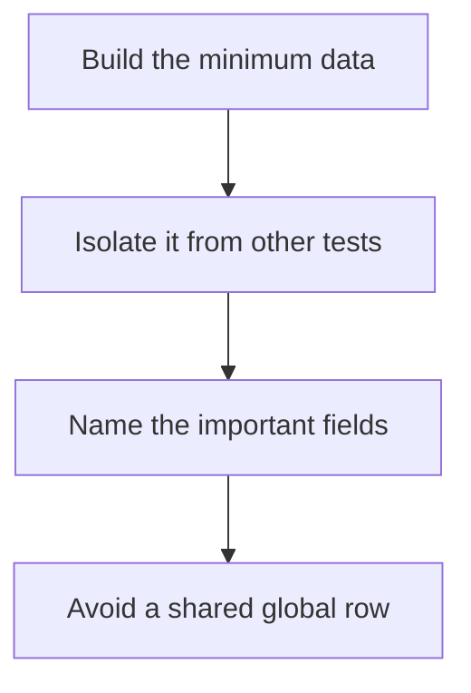

# D20-T012 — Fixtures and test data management

Topic ID: `D20-T012`
Domain: Software Testing
Subdomain: Fixtures and test data management
Importance: common
Complexity: intermediate
Dependencies: `D20-T011`, `D20-T001`, `D05-T001`, `D05-T002`, `D07-T001`, `D07-T002`
Execution status of the code in section F: unexecuted

## A. Topic Overview

A fixture is the arranged state a test starts from. Test data management decides how that state is created and isolated. Builders make only the fields the test cares about. Shared mutable fixtures cause order dependence. Production data snapshots are usually illegal or brittle. Each test should arrange what it needs and clean up.

In production this shows up as follows: Each test inserts its own user with a unique id inside a transaction that rolls back. A builder sets a default email. A test that cares about a locked account sets that field and no other.

Interviewers use Fixtures and test data management to see whether you can state the failure mode, not only the definition. The failure to name is: a suite that passes alone and fails in parallel because two tests update the same user

Prerequisites: `D20-T011`, `D20-T001`, `D05-T001`, `D05-T002`, `D07-T001`, `D07-T002`. Later notes should link here instead of repeating the mechanism.

## B. First-Principles Explanation

A fixture is the arranged state a test starts from. Test data management decides how that state is created and isolated. Builders make only the fields the test cares about. Shared mutable fixtures cause order dependence. Production data snapshots are usually illegal or brittle. Each test should arrange what it needs and clean up.

The useful picture is: A fixture is the set on a stage. If two plays share one set and both move the chair, the second play starts in the wrong room.

What has to be true:

1. Build the minimum data
2. Isolate it from other tests
3. Name the important fields
4. Avoid a shared global row

It works when those steps preserve one invariant. It fails when a suite that passes alone and fails in parallel because two tests update the same user. The alternative is: you load a production dump into every test

## C. Internal Working and Architecture

Components involved: the caller, the state Fixtures and test data management mutates or reads, and the observer that reports order-dependent failures and time spent debugging shared fixtures.

Execution:

1. Build the minimum data
2. Isolate it from other tests
3. Name the important fields
4. Avoid a shared global row

Data moves only along that path. A retry re-enters at step 1, so the operation must say what a duplicate does. Memory and locks stay inside this mechanism. Callers see the result or a typed error, not a half-updated invariant.

State to remember: choose this when a test needs state. Do not choose it when you load a production dump into every test.

## D. Diagrams and Visual Models



Read the diagram from top to bottom. Each box is one step of Fixtures and test data management. The failure mode (a suite that passes alone and fails in parallel because two tests update the same user) is what you look for when a later box never happens or happens twice.

## E. Examples and Analogies

Analogy: A fixture is the set on a stage. If two plays share one set and both move the chair, the second play starts in the wrong room.

Production example: Each test inserts its own user with a unique id inside a transaction that rolls back. A builder sets a default email. A test that cares about a locked account sets that field and no other.

A small counterexample is enough in an interview. Show the input, apply the steps, and show the broken outcome if someone uses the mechanism outside its rule: a suite that passes alone and fails in parallel because two tests update the same user.

## F. Code Examples

The snippet is labeled unexecuted. It illustrates the shape of the idea. It is not a benchmark and it embeds no secret.

```python
def order(**overrides):
    base = {'id': 'o1', 'total': 10}
    base.update(overrides)
    return base
```

After the snippet, check order-dependent failures and time spent debugging shared fixtures. If that signal moves the wrong way, the snippet is the wrong tool for the workload.

## G. Practical Backend Application

Use Fixtures and test data management in a service when a test needs state.

A typical place is the production case already stated: Each test inserts its own user with a unique id inside a transaction that rolls back. A builder sets a default email. A test that cares about a locked account sets that field and no other.

Operationally you alert on order-dependent failures and time spent debugging shared fixtures. You do not alert only on process uptime. The dashboard should show the failure mode, a success rate, and the saturation signal (queue depth, lock wait, or latency) that predicts it.

## H. Advantages, Limitations and Trade-offs

| Choice | Benefit | Cost | Choose when | Avoid when |
| --- | --- | --- | --- | --- |
| Apply Fixtures and test data management | a test needs state | Extra moving parts and a new failure mode | The failure you are preventing is already real | you load a production dump into every test |
| Simpler alternative | Less code and fewer dependencies | a suite that passes alone and fails in parallel because two tests update the same user | The workload does not hit the limit | The invariant must hold under concurrency or failure |

Fixtures and test data management is a trade. State the benefit and the cost in the same sentence when you propose it in a design review.

## I. Common Mistakes and Misconceptions

- Shared mutable fixtures.
- Giant JSON files nobody can edit.
- Cleanup that depends on test order.
- Treating a diagram of Fixtures and test data management as proof that the invariant holds in production.
- Copying a default configuration without naming order-dependent failures and time spent debugging shared fixtures.

## J. Debugging and Troubleshooting

Symptom: a suite that passes alone and fails in parallel because two tests update the same user

First check: order-dependent failures and time spent debugging shared fixtures.

Then compare one healthy instance against one unhealthy instance. Confirm whether retries are duplicating work. Confirm whether a timeout is shorter than the work. Fix the invariant, then watch the same metric for a full peak, not only for the next minute.

Useful questions: did the step order in section C actually happen, or did a caller skip a step? Did a deploy change the data shape that Fixtures and test data management assumes?

## K. Interview Preparation

### Beginner

#### Q1. What problem does Fixtures and test data management solve?

**Answer:** A fixture is the arranged state a test starts from. Test data management decides how that state is created and isolated. Builders make only the fields the test cares about. Shared mutable fixtures cause order dependence. Production data snapshots are usually illegal or brittle. Each test should arrange what it needs and clean up. Without it, the usual backend failure is: a suite that passes alone and fails in parallel because two tests update the same user.

#### Q2. Where does Fixtures and test data management sit on a request path?

**Answer:** Fixtures and test data management is not a library you sprinkle on every call. a test needs state You notice it when order-dependent failures and time spent debugging shared fixtures. Name the constraint that makes this choice correct. Say what you would measure to confirm it.

#### Q3. Give a concrete example of Fixtures and test data management.

**Answer:** Each test inserts its own user with a unique id inside a transaction that rolls back. A builder sets a default email. A test that cares about a locked account sets that field and no other. Walk the input, the state change, and the observable output.

#### Q4. What is a common mix-up around Fixtures and test data management?

**Answer:** a suite that passes alone and fails in parallel because two tests update the same user The corrective check is order-dependent failures and time spent debugging shared fixtures. Name the constraint that makes this choice correct. Say what you would measure to confirm it. Say which alternative you rejected and why.

#### Q5. When would you skip Fixtures and test data management?

**Answer:** you load a production dump into every test Skipping is a decision with a measured cost, not a slogan. Name the constraint that makes this choice correct. Say what you would measure to confirm it. Say which alternative you rejected and why.

### Intermediate

#### Q1. What invariant makes Fixtures and test data management correct?

**Answer:** A fixture is the arranged state a test starts from. Test data management decides how that state is created and isolated. Builders make only the fields the test cares about. Shared mutable fixtures cause order dependence. Production data snapshots are usually illegal or brittle. Each test should arrange what it needs and clean up. State the invariant before you name the tool.

#### Q2. How do you test Fixtures and test data management?

**Answer:** Assert the failure mode directly: a suite that passes alone and fails in parallel because two tests update the same user. The assertion should watch order-dependent failures and time spent debugging shared fixtures. Include a concurrent or retry case if the bug only appears then. Name the constraint that makes this choice correct.

#### Q3. What signal tells you Fixtures and test data management is misbehaving in production?

**Answer:** Watch order-dependent failures and time spent debugging shared fixtures. The user-visible symptom is usually a suite that passes alone and fails in parallel because two tests update the same user. Name the constraint that makes this choice correct. Say what you would measure to confirm it.

#### Q4. How would you introduce Fixtures and test data management into a legacy service?

**Answer:** a test needs state Ship it behind a metric so you can compare the old path. Roll back if a suite that passes alone and fails in parallel because two tests update the same user gets worse. Name the constraint that makes this choice correct. Say what you would measure to confirm it.

#### Q5. What do you trade away by choosing Fixtures and test data management?

**Answer:** a test needs state you load a production dump into every test Say the cost in latency, storage, or operational load. Name the constraint that makes this choice correct. Say what you would measure to confirm it. Say which alternative you rejected and why.

### Advanced

#### Q1. What breaks if a dependency of Fixtures and test data management is slow or down?

**Answer:** a suite that passes alone and fails in parallel because two tests update the same user Degrade using the rule: you load a production dump into every test. Timeouts must be shorter than the caller's deadline. Name the constraint that makes this choice correct. Say what you would measure to confirm it.

#### Q2. How does Fixtures and test data management behave under retries?

**Answer:** Retries repeat work, so Fixtures and test data management must define what a duplicate does. a suite that passes alone and fails in parallel because two tests update the same user Idempotency keys or fences belong next to the write, not in a comment. Name the constraint that makes this choice correct. Say what you would measure to confirm it.

#### Q3. What is the capacity limit of Fixtures and test data management?

**Answer:** The limit shows up as order-dependent failures and time spent debugging shared fixtures. Add capacity only after you know whether the bottleneck is CPU, lock wait, or network. Name the constraint that makes this choice correct. Say what you would measure to confirm it.

#### Q4. How do you evolve Fixtures and test data management without a flag day?

**Answer:** a test needs state Version the contract or the on-disk format. Readers should tolerate one old and one new shape during the rollout. Name the constraint that makes this choice correct. Say what you would measure to confirm it.

#### Q5. What security or correctness bug hides inside Fixtures and test data management?

**Answer:** a suite that passes alone and fails in parallel because two tests update the same user Check authorization and tenancy at the same boundary as the mechanism. A cache or queue must not widen who can read the data. Name the constraint that makes this choice correct. Say what you would measure to confirm it.

### Scenario

#### Q1. Incident: a suite that passes alone and fails in parallel because two tests update the same user. What do you check first?

**Answer:** Start with order-dependent failures and time spent debugging shared fixtures. Compare a good host and a bad host before you restart anything. A fixture is the arranged state a test starts from. Test data management decides how that state is created and isolated. Builders make only the fields the test cares about. Shared mutable fixtures cause order dependence. Production data snapshots are usually illegal or brittle. Each test should arrange what it needs and clean up.

#### Q2. A reviewer wants the clever version. What data settles it?

**Answer:** a test needs state you load a production dump into every test Bring order-dependent failures and time spent debugging shared fixtures from a load test or from production, not a slogan. Name the constraint that makes this choice correct. Say what you would measure to confirm it. Say which alternative you rejected and why.

#### Q3. You have one hour to explain Fixtures and test data management at a whiteboard.

**Answer:** Draw the happy path in four boxes. Then draw the failure: a suite that passes alone and fails in parallel because two tests update the same user. End with the metric you would page on. Name the constraint that makes this choice correct.

#### Q4. The bug only appears under two concurrent callers.

**Answer:** a suite that passes alone and fails in parallel because two tests update the same user Reproduce with a barrier so both sides enter the critical window. Confirm the fix with order-dependent failures and time spent debugging shared fixtures. Name the constraint that makes this choice correct. Say what you would measure to confirm it.

#### Q5. Leadership wants this on every service next week.

**Answer:** you load a production dump into every test a test needs state Roll it out where the failure mode is already hurting users. Name the constraint that makes this choice correct. Say what you would measure to confirm it. Say which alternative you rejected and why.

### Follow-up

#### Q1. What did you assume about the data size or the clock?

**Answer:** A fixture is the arranged state a test starts from. Test data management decides how that state is created and isolated. Builders make only the fields the test cares about. Shared mutable fixtures cause order dependence. Production data snapshots are usually illegal or brittle. Each test should arrange what it needs and clean up. Clocks are not a total order across machines. State whether the algorithm needs bounded size or a single leader.

#### Q2. What would you measure after the change ships?

**Answer:** Page on order-dependent failures and time spent debugging shared fixtures. Keep a before/after dashboard for one week. Alert on the failure mode, not only on CPU. Name the constraint that makes this choice correct.

#### Q3. Which neighboring topic did you deliberately not re-teach?

**Answer:** This note owns Fixtures and test data management. Related identifiers are in section N. Shared ideas are linked, not copied. Name the constraint that makes this choice correct.

## L. Practical Exercises

Solutions are in `EXERCISES/solutions/D20-T012.md`, not in this section.

1. Whiteboard the four steps of Fixtures and test data management and mark where `a suite that passes alone and fails in parallel because two tests update the same user` enters.
2. Read the snippet in section F and write the assertion that would catch that failure. The assertion must mention `order-dependent failures and time spent debugging shared fixtures`.
3. Argue for or against using Fixtures and test data management on a service you know. Use the choose and avoid rows from section H. Do not appeal to popularity.

## M. Revision Notes

- Mechanism: A fixture is the arranged state a test starts from.
- Failure: a suite that passes alone and fails in parallel because two tests update the same user
- Metric: order-dependent failures and time spent debugging shared fixtures
- Choose when: a test needs state
- Avoid when: you load a production dump into every test

## N. Related Topics

Dependencies to review first: `D20-T011`, `D20-T001`, `D05-T001`, `D05-T002`, `D07-T001`, `D07-T002`.

Shared ideas stay in those notes. This note does not restate them.

## O. Completion Criteria

- You can explain Fixtures and test data management without reading this note, including the failure mode.
- You can draw the diagram in section D from memory.
- You can say when not to use it, using the avoid condition in section H.
- You can name the metric you would watch after shipping it.
