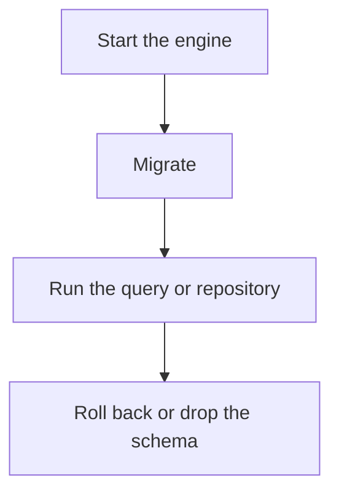

# D20-T013 — Database integration tests

Topic ID: `D20-T013`
Domain: Software Testing
Subdomain: Database integration tests
Importance: common
Complexity: intermediate
Dependencies: `D20-T012`, `D20-T001`, `D05-T001`, `D05-T002`, `D07-T001`, `D07-T002`
Execution status of the code in section F: unexecuted

## A. Topic Overview

A database integration test runs real SQL against a real engine, usually in a container or an embedded mode that matches production closely enough. It applies migrations. It checks constraints, queries, and transactions. Mocking the database misses the bugs this test exists to catch. Isolation is a transaction rollback or a fresh schema.

In production this shows up as follows: CI starts PostgreSQL, runs migrations, and checks that a duplicate email fails. The test rolls back. SQLite is not used as a stand-in if the production constraint is PostgreSQL-specific.

Interviewers use Database integration tests to see whether you can state the failure mode, not only the definition. The failure to name is: a test using a different database engine than production and missing a constraint behavior

Prerequisites: `D20-T012`, `D20-T001`, `D05-T001`, `D05-T002`, `D07-T001`, `D07-T002`. Later notes should link here instead of repeating the mechanism.

## B. First-Principles Explanation

A database integration test runs real SQL against a real engine, usually in a container or an embedded mode that matches production closely enough. It applies migrations. It checks constraints, queries, and transactions. Mocking the database misses the bugs this test exists to catch. Isolation is a transaction rollback or a fresh schema.

The useful picture is: Testing SQL on a real engine is tasting the sauce in the real pan. Tasting a drawing of the pan does not tell you it is salty.

What has to be true:

1. Start the engine
2. Migrate
3. Run the query or repository
4. Roll back or drop the schema

It works when those steps preserve one invariant. It fails when a test using a different database engine than production and missing a constraint behavior. The alternative is: you mock the connection for this layer

## C. Internal Working and Architecture

Components involved: the caller, the state Database integration tests mutates or reads, and the observer that reports SQL bugs escaped to production, and suite time.

Execution:

1. Start the engine
2. Migrate
3. Run the query or repository
4. Roll back or drop the schema

Data moves only along that path. A retry re-enters at step 1, so the operation must say what a duplicate does. Memory and locks stay inside this mechanism. Callers see the result or a typed error, not a half-updated invariant.

State to remember: choose this when behavior depends on SQL, types, or constraints. Do not choose it when you mock the connection for this layer.

## D. Diagrams and Visual Models



Read the diagram from top to bottom. Each box is one step of Database integration tests. The failure mode (a test using a different database engine than production and missing a constraint behavior) is what you look for when a later box never happens or happens twice.

## E. Examples and Analogies

Analogy: Testing SQL on a real engine is tasting the sauce in the real pan. Tasting a drawing of the pan does not tell you it is salty.

Production example: CI starts PostgreSQL, runs migrations, and checks that a duplicate email fails. The test rolls back. SQLite is not used as a stand-in if the production constraint is PostgreSQL-specific.

A small counterexample is enough in an interview. Show the input, apply the steps, and show the broken outcome if someone uses the mechanism outside its rule: a test using a different database engine than production and missing a constraint behavior.

## F. Code Examples

The snippet is labeled unexecuted. It illustrates the shape of the idea. It is not a benchmark and it embeds no secret.

```python
def test_unique_email(db):
    db.insert('users', {'email': 'a@b.c'})
    try:
        db.insert('users', {'email': 'a@b.c'})
        raised = False
    except Exception:
        raised = True
    assert raised
```

After the snippet, check SQL bugs escaped to production, and suite time. If that signal moves the wrong way, the snippet is the wrong tool for the workload.

## G. Practical Backend Application

Use Database integration tests in a service when behavior depends on SQL, types, or constraints.

A typical place is the production case already stated: CI starts PostgreSQL, runs migrations, and checks that a duplicate email fails. The test rolls back. SQLite is not used as a stand-in if the production constraint is PostgreSQL-specific.

Operationally you alert on SQL bugs escaped to production, and suite time. You do not alert only on process uptime. The dashboard should show the failure mode, a success rate, and the saturation signal (queue depth, lock wait, or latency) that predicts it.

## H. Advantages, Limitations and Trade-offs

| Choice | Benefit | Cost | Choose when | Avoid when |
| --- | --- | --- | --- | --- |
| Apply Database integration tests | behavior depends on SQL, types, or constraints | Extra moving parts and a new failure mode | The failure you are preventing is already real | you mock the connection for this layer |
| Simpler alternative | Less code and fewer dependencies | a test using a different database engine than production and missing a constraint behavior | The workload does not hit the limit | The invariant must hold under concurrency or failure |

Database integration tests is a trade. State the benefit and the cost in the same sentence when you propose it in a design review.

## I. Common Mistakes and Misconceptions

- A different engine.
- No migrations.
- Leftover rows.
- Treating a diagram of Database integration tests as proof that the invariant holds in production.
- Copying a default configuration without naming SQL bugs escaped to production, and suite time.

## J. Debugging and Troubleshooting

Symptom: a test using a different database engine than production and missing a constraint behavior

First check: SQL bugs escaped to production, and suite time.

Then compare one healthy instance against one unhealthy instance. Confirm whether retries are duplicating work. Confirm whether a timeout is shorter than the work. Fix the invariant, then watch the same metric for a full peak, not only for the next minute.

Useful questions: did the step order in section C actually happen, or did a caller skip a step? Did a deploy change the data shape that Database integration tests assumes?

## K. Interview Preparation

### Beginner

#### Q1. What problem does Database integration tests solve?

**Answer:** A database integration test runs real SQL against a real engine, usually in a container or an embedded mode that matches production closely enough. It applies migrations. It checks constraints, queries, and transactions. Mocking the database misses the bugs this test exists to catch. Isolation is a transaction rollback or a fresh schema. Without it, the usual backend failure is: a test using a different database engine than production and missing a constraint behavior.

#### Q2. Where does Database integration tests sit on a request path?

**Answer:** Database integration tests is not a library you sprinkle on every call. behavior depends on SQL, types, or constraints You notice it when SQL bugs escaped to production, and suite time. Name the constraint that makes this choice correct. Say what you would measure to confirm it.

#### Q3. Give a concrete example of Database integration tests.

**Answer:** CI starts PostgreSQL, runs migrations, and checks that a duplicate email fails. The test rolls back. SQLite is not used as a stand-in if the production constraint is PostgreSQL-specific. Walk the input, the state change, and the observable output.

#### Q4. What is a common mix-up around Database integration tests?

**Answer:** a test using a different database engine than production and missing a constraint behavior The corrective check is SQL bugs escaped to production, and suite time. Name the constraint that makes this choice correct. Say what you would measure to confirm it. Say which alternative you rejected and why.

#### Q5. When would you skip Database integration tests?

**Answer:** you mock the connection for this layer Skipping is a decision with a measured cost, not a slogan. Name the constraint that makes this choice correct. Say what you would measure to confirm it. Say which alternative you rejected and why.

### Intermediate

#### Q1. What invariant makes Database integration tests correct?

**Answer:** A database integration test runs real SQL against a real engine, usually in a container or an embedded mode that matches production closely enough. It applies migrations. It checks constraints, queries, and transactions. Mocking the database misses the bugs this test exists to catch. Isolation is a transaction rollback or a fresh schema. State the invariant before you name the tool.

#### Q2. How do you test Database integration tests?

**Answer:** Assert the failure mode directly: a test using a different database engine than production and missing a constraint behavior. The assertion should watch SQL bugs escaped to production, and suite time. Include a concurrent or retry case if the bug only appears then. Name the constraint that makes this choice correct.

#### Q3. What signal tells you Database integration tests is misbehaving in production?

**Answer:** Watch SQL bugs escaped to production, and suite time. The user-visible symptom is usually a test using a different database engine than production and missing a constraint behavior. Name the constraint that makes this choice correct. Say what you would measure to confirm it.

#### Q4. How would you introduce Database integration tests into a legacy service?

**Answer:** behavior depends on SQL, types, or constraints Ship it behind a metric so you can compare the old path. Roll back if a test using a different database engine than production and missing a constraint behavior gets worse. Name the constraint that makes this choice correct. Say what you would measure to confirm it.

#### Q5. What do you trade away by choosing Database integration tests?

**Answer:** behavior depends on SQL, types, or constraints you mock the connection for this layer Say the cost in latency, storage, or operational load. Name the constraint that makes this choice correct. Say what you would measure to confirm it. Say which alternative you rejected and why.

### Advanced

#### Q1. What breaks if a dependency of Database integration tests is slow or down?

**Answer:** a test using a different database engine than production and missing a constraint behavior Degrade using the rule: you mock the connection for this layer. Timeouts must be shorter than the caller's deadline. Name the constraint that makes this choice correct. Say what you would measure to confirm it.

#### Q2. How does Database integration tests behave under retries?

**Answer:** Retries repeat work, so Database integration tests must define what a duplicate does. a test using a different database engine than production and missing a constraint behavior Idempotency keys or fences belong next to the write, not in a comment. Name the constraint that makes this choice correct. Say what you would measure to confirm it.

#### Q3. What is the capacity limit of Database integration tests?

**Answer:** The limit shows up as SQL bugs escaped to production, and suite time. Add capacity only after you know whether the bottleneck is CPU, lock wait, or network. Name the constraint that makes this choice correct. Say what you would measure to confirm it.

#### Q4. How do you evolve Database integration tests without a flag day?

**Answer:** behavior depends on SQL, types, or constraints Version the contract or the on-disk format. Readers should tolerate one old and one new shape during the rollout. Name the constraint that makes this choice correct. Say what you would measure to confirm it.

#### Q5. What security or correctness bug hides inside Database integration tests?

**Answer:** a test using a different database engine than production and missing a constraint behavior Check authorization and tenancy at the same boundary as the mechanism. A cache or queue must not widen who can read the data. Name the constraint that makes this choice correct. Say what you would measure to confirm it.

### Scenario

#### Q1. Incident: a test using a different database engine than production and missing a constraint behavior. What do you check first?

**Answer:** Start with SQL bugs escaped to production, and suite time. Compare a good host and a bad host before you restart anything. A database integration test runs real SQL against a real engine, usually in a container or an embedded mode that matches production closely enough. It applies migrations. It checks constraints, queries, and transactions. Mocking the database misses the bugs this test exists to catch. Isolation is a transaction rollback or a fresh schema.

#### Q2. A reviewer wants the clever version. What data settles it?

**Answer:** behavior depends on SQL, types, or constraints you mock the connection for this layer Bring SQL bugs escaped to production, and suite time from a load test or from production, not a slogan. Name the constraint that makes this choice correct. Say what you would measure to confirm it. Say which alternative you rejected and why.

#### Q3. You have one hour to explain Database integration tests at a whiteboard.

**Answer:** Draw the happy path in four boxes. Then draw the failure: a test using a different database engine than production and missing a constraint behavior. End with the metric you would page on. Name the constraint that makes this choice correct.

#### Q4. The bug only appears under two concurrent callers.

**Answer:** a test using a different database engine than production and missing a constraint behavior Reproduce with a barrier so both sides enter the critical window. Confirm the fix with SQL bugs escaped to production, and suite time. Name the constraint that makes this choice correct. Say what you would measure to confirm it.

#### Q5. Leadership wants this on every service next week.

**Answer:** you mock the connection for this layer behavior depends on SQL, types, or constraints Roll it out where the failure mode is already hurting users. Name the constraint that makes this choice correct. Say what you would measure to confirm it. Say which alternative you rejected and why.

### Follow-up

#### Q1. What did you assume about the data size or the clock?

**Answer:** A database integration test runs real SQL against a real engine, usually in a container or an embedded mode that matches production closely enough. It applies migrations. It checks constraints, queries, and transactions. Mocking the database misses the bugs this test exists to catch. Isolation is a transaction rollback or a fresh schema. Clocks are not a total order across machines. State whether the algorithm needs bounded size or a single leader.

#### Q2. What would you measure after the change ships?

**Answer:** Page on SQL bugs escaped to production, and suite time. Keep a before/after dashboard for one week. Alert on the failure mode, not only on CPU. Name the constraint that makes this choice correct.

#### Q3. Which neighboring topic did you deliberately not re-teach?

**Answer:** This note owns Database integration tests. Related identifiers are in section N. Shared ideas are linked, not copied. Name the constraint that makes this choice correct.

## L. Practical Exercises

Solutions are in `EXERCISES/solutions/D20-T013.md`, not in this section.

1. Whiteboard the four steps of Database integration tests and mark where `a test using a different database engine than production and missing a constraint behavior` enters.
2. Read the snippet in section F and write the assertion that would catch that failure. The assertion must mention `SQL bugs escaped to production, and suite time`.
3. Argue for or against using Database integration tests on a service you know. Use the choose and avoid rows from section H. Do not appeal to popularity.

## M. Revision Notes

- Mechanism: A database integration test runs real SQL against a real engine, usually in a container or an embedded mode that matches production closely enough.
- Failure: a test using a different database engine than production and missing a constraint behavior
- Metric: SQL bugs escaped to production, and suite time
- Choose when: behavior depends on SQL, types, or constraints
- Avoid when: you mock the connection for this layer

## N. Related Topics

Dependencies to review first: `D20-T012`, `D20-T001`, `D05-T001`, `D05-T002`, `D07-T001`, `D07-T002`.

Shared ideas stay in those notes. This note does not restate them.

## O. Completion Criteria

- You can explain Database integration tests without reading this note, including the failure mode.
- You can draw the diagram in section D from memory.
- You can say when not to use it, using the avoid condition in section H.
- You can name the metric you would watch after shipping it.
