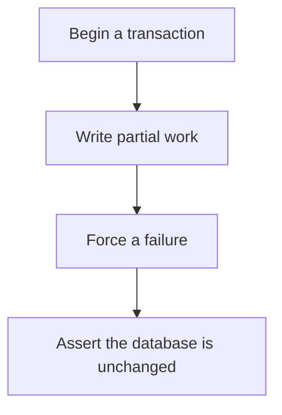

# D20-T014 — Testing transactions and rollbacks

Topic ID: `D20-T014`
Domain: Software Testing
Subdomain: Testing transactions and rollbacks
Importance: core
Complexity: intermediate
Dependencies: `D20-T013`, `D20-T001`, `D05-T001`, `D05-T002`, `D07-T001`, `D07-T002`
Execution status of the code in section F: unexecuted

## A. Topic Overview

Testing transactions means proving that a failure rolls back every write in the unit, and that a commit is visible afterward. Open a transaction, write two rows, force a failure, and assert neither row remains. Also test the isolation bug you fear, such as two sessions creating a duplicate. A test that never forces a rollback does not test the transaction.

In production this shows up as follows: The order and the outbox row are written in one transaction. The test throws after the order insert and asserts that neither the order nor the outbox row is visible. A second test commits and sees both.

Interviewers use Testing transactions and rollbacks to see whether you can state the failure mode, not only the definition. The failure to name is: a catch block that commits, or a test that uses a connection that auto-commits and never notices

Prerequisites: `D20-T013`, `D20-T001`, `D05-T001`, `D05-T002`, `D07-T001`, `D07-T002`. Later notes should link here instead of repeating the mechanism.

## B. First-Principles Explanation

Testing transactions means proving that a failure rolls back every write in the unit, and that a commit is visible afterward. Open a transaction, write two rows, force a failure, and assert neither row remains. Also test the isolation bug you fear, such as two sessions creating a duplicate. A test that never forces a rollback does not test the transaction.

The useful picture is: A transaction test is knocking over the table mid-course and checking that the kitchen did not serve half a meal.

What has to be true:

1. Begin a transaction
2. Write partial work
3. Force a failure
4. Assert the database is unchanged

It works when those steps preserve one invariant. It fails when a catch block that commits, or a test that uses a connection that auto-commits and never notices. The alternative is: you assert only the happy commit

## C. Internal Working and Architecture

Components involved: the caller, the state Testing transactions and rollbacks mutates or reads, and the observer that reports partial rows after a forced failure.

Execution:

1. Begin a transaction
2. Write partial work
3. Force a failure
4. Assert the database is unchanged

Data moves only along that path. A retry re-enters at step 1, so the operation must say what a duplicate does. Memory and locks stay inside this mechanism. Callers see the result or a typed error, not a half-updated invariant.

State to remember: choose this when several writes must succeed or fail together. Do not choose it when you assert only the happy commit.

## D. Diagrams and Visual Models



Read the diagram from top to bottom. Each box is one step of Testing transactions and rollbacks. The failure mode (a catch block that commits, or a test that uses a connection that auto-commits and never notices) is what you look for when a later box never happens or happens twice.

## E. Examples and Analogies

Analogy: A transaction test is knocking over the table mid-course and checking that the kitchen did not serve half a meal.

Production example: The order and the outbox row are written in one transaction. The test throws after the order insert and asserts that neither the order nor the outbox row is visible. A second test commits and sees both.

A small counterexample is enough in an interview. Show the input, apply the steps, and show the broken outcome if someone uses the mechanism outside its rule: a catch block that commits, or a test that uses a connection that auto-commits and never notices.

## F. Code Examples

The snippet is labeled unexecuted. It illustrates the shape of the idea. It is not a benchmark and it embeds no secret.

```python
def test_rollback(db):
    try:
        with db.transaction():
            db.insert('a', {'id': 1})
            raise RuntimeError('boom')
    except RuntimeError:
        pass
    assert db.get('a', 1) is None
```

After the snippet, check partial rows after a forced failure. If that signal moves the wrong way, the snippet is the wrong tool for the workload.

## G. Practical Backend Application

Use Testing transactions and rollbacks in a service when several writes must succeed or fail together.

A typical place is the production case already stated: The order and the outbox row are written in one transaction. The test throws after the order insert and asserts that neither the order nor the outbox row is visible. A second test commits and sees both.

Operationally you alert on partial rows after a forced failure. You do not alert only on process uptime. The dashboard should show the failure mode, a success rate, and the saturation signal (queue depth, lock wait, or latency) that predicts it.

## H. Advantages, Limitations and Trade-offs

| Choice | Benefit | Cost | Choose when | Avoid when |
| --- | --- | --- | --- | --- |
| Apply Testing transactions and rollbacks | several writes must succeed or fail together | Extra moving parts and a new failure mode | The failure you are preventing is already real | you assert only the happy commit |
| Simpler alternative | Less code and fewer dependencies | a catch block that commits, or a test that uses a connection that auto-commits and never notices | The workload does not hit the limit | The invariant must hold under concurrency or failure |

Testing transactions and rollbacks is a trade. State the benefit and the cost in the same sentence when you propose it in a design review.

## I. Common Mistakes and Misconceptions

- Autocommit connections.
- Catching the error and continuing.
- Checking rollback on a mock.
- Treating a diagram of Testing transactions and rollbacks as proof that the invariant holds in production.
- Copying a default configuration without naming partial rows after a forced failure.

## J. Debugging and Troubleshooting

Symptom: a catch block that commits, or a test that uses a connection that auto-commits and never notices

First check: partial rows after a forced failure.

Then compare one healthy instance against one unhealthy instance. Confirm whether retries are duplicating work. Confirm whether a timeout is shorter than the work. Fix the invariant, then watch the same metric for a full peak, not only for the next minute.

Useful questions: did the step order in section C actually happen, or did a caller skip a step? Did a deploy change the data shape that Testing transactions and rollbacks assumes?

## K. Interview Preparation

### Beginner

#### Q1. What problem does Testing transactions and rollbacks solve?

**Answer:** Testing transactions means proving that a failure rolls back every write in the unit, and that a commit is visible afterward. Open a transaction, write two rows, force a failure, and assert neither row remains. Also test the isolation bug you fear, such as two sessions creating a duplicate. A test that never forces a rollback does not test the transaction. Without it, the usual backend failure is: a catch block that commits, or a test that uses a connection that auto-commits and never notices.

#### Q2. Where does Testing transactions and rollbacks sit on a request path?

**Answer:** Testing transactions and rollbacks is not a library you sprinkle on every call. several writes must succeed or fail together You notice it when partial rows after a forced failure. Name the constraint that makes this choice correct. Say what you would measure to confirm it.

#### Q3. Give a concrete example of Testing transactions and rollbacks.

**Answer:** The order and the outbox row are written in one transaction. The test throws after the order insert and asserts that neither the order nor the outbox row is visible. A second test commits and sees both. Walk the input, the state change, and the observable output.

#### Q4. What is a common mix-up around Testing transactions and rollbacks?

**Answer:** a catch block that commits, or a test that uses a connection that auto-commits and never notices The corrective check is partial rows after a forced failure. Name the constraint that makes this choice correct. Say what you would measure to confirm it. Say which alternative you rejected and why.

#### Q5. When would you skip Testing transactions and rollbacks?

**Answer:** you assert only the happy commit Skipping is a decision with a measured cost, not a slogan. Name the constraint that makes this choice correct. Say what you would measure to confirm it. Say which alternative you rejected and why.

### Intermediate

#### Q1. What invariant makes Testing transactions and rollbacks correct?

**Answer:** Testing transactions means proving that a failure rolls back every write in the unit, and that a commit is visible afterward. Open a transaction, write two rows, force a failure, and assert neither row remains. Also test the isolation bug you fear, such as two sessions creating a duplicate. A test that never forces a rollback does not test the transaction. State the invariant before you name the tool.

#### Q2. How do you test Testing transactions and rollbacks?

**Answer:** Assert the failure mode directly: a catch block that commits, or a test that uses a connection that auto-commits and never notices. The assertion should watch partial rows after a forced failure. Include a concurrent or retry case if the bug only appears then. Name the constraint that makes this choice correct.

#### Q3. What signal tells you Testing transactions and rollbacks is misbehaving in production?

**Answer:** Watch partial rows after a forced failure. The user-visible symptom is usually a catch block that commits, or a test that uses a connection that auto-commits and never notices. Name the constraint that makes this choice correct. Say what you would measure to confirm it.

#### Q4. How would you introduce Testing transactions and rollbacks into a legacy service?

**Answer:** several writes must succeed or fail together Ship it behind a metric so you can compare the old path. Roll back if a catch block that commits, or a test that uses a connection that auto-commits and never notices gets worse. Name the constraint that makes this choice correct. Say what you would measure to confirm it.

#### Q5. What do you trade away by choosing Testing transactions and rollbacks?

**Answer:** several writes must succeed or fail together you assert only the happy commit Say the cost in latency, storage, or operational load. Name the constraint that makes this choice correct. Say what you would measure to confirm it. Say which alternative you rejected and why.

### Advanced

#### Q1. What breaks if a dependency of Testing transactions and rollbacks is slow or down?

**Answer:** a catch block that commits, or a test that uses a connection that auto-commits and never notices Degrade using the rule: you assert only the happy commit. Timeouts must be shorter than the caller's deadline. Name the constraint that makes this choice correct. Say what you would measure to confirm it.

#### Q2. How does Testing transactions and rollbacks behave under retries?

**Answer:** Retries repeat work, so Testing transactions and rollbacks must define what a duplicate does. a catch block that commits, or a test that uses a connection that auto-commits and never notices Idempotency keys or fences belong next to the write, not in a comment. Name the constraint that makes this choice correct. Say what you would measure to confirm it.

#### Q3. What is the capacity limit of Testing transactions and rollbacks?

**Answer:** The limit shows up as partial rows after a forced failure. Add capacity only after you know whether the bottleneck is CPU, lock wait, or network. Name the constraint that makes this choice correct. Say what you would measure to confirm it.

#### Q4. How do you evolve Testing transactions and rollbacks without a flag day?

**Answer:** several writes must succeed or fail together Version the contract or the on-disk format. Readers should tolerate one old and one new shape during the rollout. Name the constraint that makes this choice correct. Say what you would measure to confirm it.

#### Q5. What security or correctness bug hides inside Testing transactions and rollbacks?

**Answer:** a catch block that commits, or a test that uses a connection that auto-commits and never notices Check authorization and tenancy at the same boundary as the mechanism. A cache or queue must not widen who can read the data. Name the constraint that makes this choice correct. Say what you would measure to confirm it.

### Scenario

#### Q1. Incident: a catch block that commits, or a test that uses a connection that auto-commits and never notices. What do you check first?

**Answer:** Start with partial rows after a forced failure. Compare a good host and a bad host before you restart anything. Testing transactions means proving that a failure rolls back every write in the unit, and that a commit is visible afterward. Open a transaction, write two rows, force a failure, and assert neither row remains. Also test the isolation bug you fear, such as two sessions creating a duplicate. A test that never forces a rollback does not test the transaction.

#### Q2. A reviewer wants the clever version. What data settles it?

**Answer:** several writes must succeed or fail together you assert only the happy commit Bring partial rows after a forced failure from a load test or from production, not a slogan. Name the constraint that makes this choice correct. Say what you would measure to confirm it. Say which alternative you rejected and why.

#### Q3. You have one hour to explain Testing transactions and rollbacks at a whiteboard.

**Answer:** Draw the happy path in four boxes. Then draw the failure: a catch block that commits, or a test that uses a connection that auto-commits and never notices. End with the metric you would page on. Name the constraint that makes this choice correct.

#### Q4. The bug only appears under two concurrent callers.

**Answer:** a catch block that commits, or a test that uses a connection that auto-commits and never notices Reproduce with a barrier so both sides enter the critical window. Confirm the fix with partial rows after a forced failure. Name the constraint that makes this choice correct. Say what you would measure to confirm it.

#### Q5. Leadership wants this on every service next week.

**Answer:** you assert only the happy commit several writes must succeed or fail together Roll it out where the failure mode is already hurting users. Name the constraint that makes this choice correct. Say what you would measure to confirm it. Say which alternative you rejected and why.

### Follow-up

#### Q1. What did you assume about the data size or the clock?

**Answer:** Testing transactions means proving that a failure rolls back every write in the unit, and that a commit is visible afterward. Open a transaction, write two rows, force a failure, and assert neither row remains. Also test the isolation bug you fear, such as two sessions creating a duplicate. A test that never forces a rollback does not test the transaction. Clocks are not a total order across machines. State whether the algorithm needs bounded size or a single leader.

#### Q2. What would you measure after the change ships?

**Answer:** Page on partial rows after a forced failure. Keep a before/after dashboard for one week. Alert on the failure mode, not only on CPU. Name the constraint that makes this choice correct.

#### Q3. Which neighboring topic did you deliberately not re-teach?

**Answer:** This note owns Testing transactions and rollbacks. Related identifiers are in section N. Shared ideas are linked, not copied. Name the constraint that makes this choice correct.

## L. Practical Exercises

Solutions are in `EXERCISES/solutions/D20-T014.md`, not in this section.

1. Whiteboard the four steps of Testing transactions and rollbacks and mark where `a catch block that commits, or a test that uses a connection that auto-commits and never notices` enters.
2. Read the snippet in section F and write the assertion that would catch that failure. The assertion must mention `partial rows after a forced failure`.
3. Argue for or against using Testing transactions and rollbacks on a service you know. Use the choose and avoid rows from section H. Do not appeal to popularity.

## M. Revision Notes

- Mechanism: Testing transactions means proving that a failure rolls back every write in the unit, and that a commit is visible afterward.
- Failure: a catch block that commits, or a test that uses a connection that auto-commits and never notices
- Metric: partial rows after a forced failure
- Choose when: several writes must succeed or fail together
- Avoid when: you assert only the happy commit

## N. Related Topics

Dependencies to review first: `D20-T013`, `D20-T001`, `D05-T001`, `D05-T002`, `D07-T001`, `D07-T002`.

Shared ideas stay in those notes. This note does not restate them.

## O. Completion Criteria

- You can explain Testing transactions and rollbacks without reading this note, including the failure mode.
- You can draw the diagram in section D from memory.
- You can say when not to use it, using the avoid condition in section H.
- You can name the metric you would watch after shipping it.
