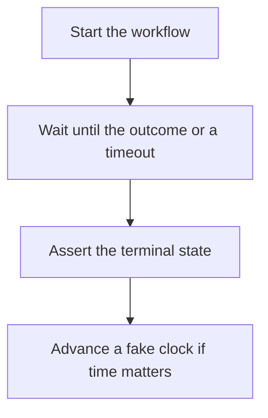

# D20-T015 — Testing asynchronous workflows

Topic ID: `D20-T015`
Domain: Software Testing
Subdomain: Testing asynchronous workflows
Importance: common
Complexity: intermediate
Dependencies: `D20-T014`, `D20-T001`, `D05-T001`, `D05-T002`, `D07-T001`, `D07-T002`
Execution status of the code in section F: unexecuted

## A. Topic Overview

Testing asynchronous workflows means asserting an outcome that happens after the caller returns: a message consumed, a row updated, a timer fired. The test waits on the outcome with a timeout, not on a fixed sleep. It also tests a failure path and a duplicate delivery if the workflow is at-least-once. Time is controlled if the workflow depends on a clock.

In production this shows up as follows: A test enqueues a job and polls the job row until it is done or two seconds pass. A second test delivers the same message twice and asserts one email row. The clock in a delay test is fake.

Interviewers use Testing asynchronous workflows to see whether you can state the failure mode, not only the definition. The failure to name is: a sleep that is too short on a slow CI machine, or a test that returns before the worker runs

Prerequisites: `D20-T014`, `D20-T001`, `D05-T001`, `D05-T002`, `D07-T001`, `D07-T002`. Later notes should link here instead of repeating the mechanism.

## B. First-Principles Explanation

Testing asynchronous workflows means asserting an outcome that happens after the caller returns: a message consumed, a row updated, a timer fired. The test waits on the outcome with a timeout, not on a fixed sleep. It also tests a failure path and a duplicate delivery if the workflow is at-least-once. Time is controlled if the workflow depends on a clock.

The useful picture is: An async test is ordering a cake and waiting until the counter actually shows your name, not counting to ten and hoping.

What has to be true:

1. Start the workflow
2. Wait until the outcome or a timeout
3. Assert the terminal state
4. Advance a fake clock if time matters

It works when those steps preserve one invariant. It fails when a sleep that is too short on a slow CI machine, or a test that returns before the worker runs. The alternative is: you sleep and hope

## C. Internal Working and Architecture

Components involved: the caller, the state Testing asynchronous workflows mutates or reads, and the observer that reports flake rate of async tests.

Execution:

1. Start the workflow
2. Wait until the outcome or a timeout
3. Assert the terminal state
4. Advance a fake clock if time matters

Data moves only along that path. A retry re-enters at step 1, so the operation must say what a duplicate does. Memory and locks stay inside this mechanism. Callers see the result or a typed error, not a half-updated invariant.

State to remember: choose this when the result happens off the calling stack. Do not choose it when you sleep and hope.

## D. Diagrams and Visual Models



Read the diagram from top to bottom. Each box is one step of Testing asynchronous workflows. The failure mode (a sleep that is too short on a slow CI machine, or a test that returns before the worker runs) is what you look for when a later box never happens or happens twice.

## E. Examples and Analogies

Analogy: An async test is ordering a cake and waiting until the counter actually shows your name, not counting to ten and hoping.

Production example: A test enqueues a job and polls the job row until it is done or two seconds pass. A second test delivers the same message twice and asserts one email row. The clock in a delay test is fake.

A small counterexample is enough in an interview. Show the input, apply the steps, and show the broken outcome if someone uses the mechanism outside its rule: a sleep that is too short on a slow CI machine, or a test that returns before the worker runs.

## F. Code Examples

The snippet is labeled unexecuted. It illustrates the shape of the idea. It is not a benchmark and it embeds no secret.

```python
def wait_until(pred, timeout=2):
    import time
    end = time.time() + timeout
    while time.time() < end:
        if pred():
            return
    raise AssertionError('timeout')
```

After the snippet, check flake rate of async tests. If that signal moves the wrong way, the snippet is the wrong tool for the workload.

## G. Practical Backend Application

Use Testing asynchronous workflows in a service when the result happens off the calling stack.

A typical place is the production case already stated: A test enqueues a job and polls the job row until it is done or two seconds pass. A second test delivers the same message twice and asserts one email row. The clock in a delay test is fake.

Operationally you alert on flake rate of async tests. You do not alert only on process uptime. The dashboard should show the failure mode, a success rate, and the saturation signal (queue depth, lock wait, or latency) that predicts it.

## H. Advantages, Limitations and Trade-offs

| Choice | Benefit | Cost | Choose when | Avoid when |
| --- | --- | --- | --- | --- |
| Apply Testing asynchronous workflows | the result happens off the calling stack | Extra moving parts and a new failure mode | The failure you are preventing is already real | you sleep and hope |
| Simpler alternative | Less code and fewer dependencies | a sleep that is too short on a slow CI machine, or a test that returns before the worker runs | The workload does not hit the limit | The invariant must hold under concurrency or failure |

Testing asynchronous workflows is a trade. State the benefit and the cost in the same sentence when you propose it in a design review.

## I. Common Mistakes and Misconceptions

- Fixed sleeps.
- No timeout.
- Ignoring duplicate delivery.
- Treating a diagram of Testing asynchronous workflows as proof that the invariant holds in production.
- Copying a default configuration without naming flake rate of async tests.

## J. Debugging and Troubleshooting

Symptom: a sleep that is too short on a slow CI machine, or a test that returns before the worker runs

First check: flake rate of async tests.

Then compare one healthy instance against one unhealthy instance. Confirm whether retries are duplicating work. Confirm whether a timeout is shorter than the work. Fix the invariant, then watch the same metric for a full peak, not only for the next minute.

Useful questions: did the step order in section C actually happen, or did a caller skip a step? Did a deploy change the data shape that Testing asynchronous workflows assumes?

## K. Interview Preparation

### Beginner

#### Q1. What problem does Testing asynchronous workflows solve?

**Answer:** Testing asynchronous workflows means asserting an outcome that happens after the caller returns: a message consumed, a row updated, a timer fired. The test waits on the outcome with a timeout, not on a fixed sleep. It also tests a failure path and a duplicate delivery if the workflow is at-least-once. Time is controlled if the workflow depends on a clock. Without it, the usual backend failure is: a sleep that is too short on a slow CI machine, or a test that returns before the worker runs.

#### Q2. Where does Testing asynchronous workflows sit on a request path?

**Answer:** Testing asynchronous workflows is not a library you sprinkle on every call. the result happens off the calling stack You notice it when flake rate of async tests. Name the constraint that makes this choice correct. Say what you would measure to confirm it.

#### Q3. Give a concrete example of Testing asynchronous workflows.

**Answer:** A test enqueues a job and polls the job row until it is done or two seconds pass. A second test delivers the same message twice and asserts one email row. The clock in a delay test is fake. Walk the input, the state change, and the observable output.

#### Q4. What is a common mix-up around Testing asynchronous workflows?

**Answer:** a sleep that is too short on a slow CI machine, or a test that returns before the worker runs The corrective check is flake rate of async tests. Name the constraint that makes this choice correct. Say what you would measure to confirm it. Say which alternative you rejected and why.

#### Q5. When would you skip Testing asynchronous workflows?

**Answer:** you sleep and hope Skipping is a decision with a measured cost, not a slogan. Name the constraint that makes this choice correct. Say what you would measure to confirm it. Say which alternative you rejected and why.

### Intermediate

#### Q1. What invariant makes Testing asynchronous workflows correct?

**Answer:** Testing asynchronous workflows means asserting an outcome that happens after the caller returns: a message consumed, a row updated, a timer fired. The test waits on the outcome with a timeout, not on a fixed sleep. It also tests a failure path and a duplicate delivery if the workflow is at-least-once. Time is controlled if the workflow depends on a clock. State the invariant before you name the tool.

#### Q2. How do you test Testing asynchronous workflows?

**Answer:** Assert the failure mode directly: a sleep that is too short on a slow CI machine, or a test that returns before the worker runs. The assertion should watch flake rate of async tests. Include a concurrent or retry case if the bug only appears then. Name the constraint that makes this choice correct.

#### Q3. What signal tells you Testing asynchronous workflows is misbehaving in production?

**Answer:** Watch flake rate of async tests. The user-visible symptom is usually a sleep that is too short on a slow CI machine, or a test that returns before the worker runs. Name the constraint that makes this choice correct. Say what you would measure to confirm it.

#### Q4. How would you introduce Testing asynchronous workflows into a legacy service?

**Answer:** the result happens off the calling stack Ship it behind a metric so you can compare the old path. Roll back if a sleep that is too short on a slow CI machine, or a test that returns before the worker runs gets worse. Name the constraint that makes this choice correct. Say what you would measure to confirm it.

#### Q5. What do you trade away by choosing Testing asynchronous workflows?

**Answer:** the result happens off the calling stack you sleep and hope Say the cost in latency, storage, or operational load. Name the constraint that makes this choice correct. Say what you would measure to confirm it. Say which alternative you rejected and why.

### Advanced

#### Q1. What breaks if a dependency of Testing asynchronous workflows is slow or down?

**Answer:** a sleep that is too short on a slow CI machine, or a test that returns before the worker runs Degrade using the rule: you sleep and hope. Timeouts must be shorter than the caller's deadline. Name the constraint that makes this choice correct. Say what you would measure to confirm it.

#### Q2. How does Testing asynchronous workflows behave under retries?

**Answer:** Retries repeat work, so Testing asynchronous workflows must define what a duplicate does. a sleep that is too short on a slow CI machine, or a test that returns before the worker runs Idempotency keys or fences belong next to the write, not in a comment. Name the constraint that makes this choice correct. Say what you would measure to confirm it.

#### Q3. What is the capacity limit of Testing asynchronous workflows?

**Answer:** The limit shows up as flake rate of async tests. Add capacity only after you know whether the bottleneck is CPU, lock wait, or network. Name the constraint that makes this choice correct. Say what you would measure to confirm it.

#### Q4. How do you evolve Testing asynchronous workflows without a flag day?

**Answer:** the result happens off the calling stack Version the contract or the on-disk format. Readers should tolerate one old and one new shape during the rollout. Name the constraint that makes this choice correct. Say what you would measure to confirm it.

#### Q5. What security or correctness bug hides inside Testing asynchronous workflows?

**Answer:** a sleep that is too short on a slow CI machine, or a test that returns before the worker runs Check authorization and tenancy at the same boundary as the mechanism. A cache or queue must not widen who can read the data. Name the constraint that makes this choice correct. Say what you would measure to confirm it.

### Scenario

#### Q1. Incident: a sleep that is too short on a slow CI machine, or a test that returns before the worker runs. What do you check first?

**Answer:** Start with flake rate of async tests. Compare a good host and a bad host before you restart anything. Testing asynchronous workflows means asserting an outcome that happens after the caller returns: a message consumed, a row updated, a timer fired. The test waits on the outcome with a timeout, not on a fixed sleep. It also tests a failure path and a duplicate delivery if the workflow is at-least-once. Time is controlled if the workflow depends on a clock.

#### Q2. A reviewer wants the clever version. What data settles it?

**Answer:** the result happens off the calling stack you sleep and hope Bring flake rate of async tests from a load test or from production, not a slogan. Name the constraint that makes this choice correct. Say what you would measure to confirm it. Say which alternative you rejected and why.

#### Q3. You have one hour to explain Testing asynchronous workflows at a whiteboard.

**Answer:** Draw the happy path in four boxes. Then draw the failure: a sleep that is too short on a slow CI machine, or a test that returns before the worker runs. End with the metric you would page on. Name the constraint that makes this choice correct.

#### Q4. The bug only appears under two concurrent callers.

**Answer:** a sleep that is too short on a slow CI machine, or a test that returns before the worker runs Reproduce with a barrier so both sides enter the critical window. Confirm the fix with flake rate of async tests. Name the constraint that makes this choice correct. Say what you would measure to confirm it.

#### Q5. Leadership wants this on every service next week.

**Answer:** you sleep and hope the result happens off the calling stack Roll it out where the failure mode is already hurting users. Name the constraint that makes this choice correct. Say what you would measure to confirm it. Say which alternative you rejected and why.

### Follow-up

#### Q1. What did you assume about the data size or the clock?

**Answer:** Testing asynchronous workflows means asserting an outcome that happens after the caller returns: a message consumed, a row updated, a timer fired. The test waits on the outcome with a timeout, not on a fixed sleep. It also tests a failure path and a duplicate delivery if the workflow is at-least-once. Time is controlled if the workflow depends on a clock. Clocks are not a total order across machines. State whether the algorithm needs bounded size or a single leader.

#### Q2. What would you measure after the change ships?

**Answer:** Page on flake rate of async tests. Keep a before/after dashboard for one week. Alert on the failure mode, not only on CPU. Name the constraint that makes this choice correct.

#### Q3. Which neighboring topic did you deliberately not re-teach?

**Answer:** This note owns Testing asynchronous workflows. Related identifiers are in section N. Shared ideas are linked, not copied. Name the constraint that makes this choice correct.

## L. Practical Exercises

Solutions are in `EXERCISES/solutions/D20-T015.md`, not in this section.

1. Whiteboard the four steps of Testing asynchronous workflows and mark where `a sleep that is too short on a slow CI machine, or a test that returns before the worker runs` enters.
2. Read the snippet in section F and write the assertion that would catch that failure. The assertion must mention `flake rate of async tests`.
3. Argue for or against using Testing asynchronous workflows on a service you know. Use the choose and avoid rows from section H. Do not appeal to popularity.

## M. Revision Notes

- Mechanism: Testing asynchronous workflows means asserting an outcome that happens after the caller returns: a message consumed, a row updated, a timer fired.
- Failure: a sleep that is too short on a slow CI machine, or a test that returns before the worker runs
- Metric: flake rate of async tests
- Choose when: the result happens off the calling stack
- Avoid when: you sleep and hope

## N. Related Topics

Dependencies to review first: `D20-T014`, `D20-T001`, `D05-T001`, `D05-T002`, `D07-T001`, `D07-T002`.

Shared ideas stay in those notes. This note does not restate them.

## O. Completion Criteria

- You can explain Testing asynchronous workflows without reading this note, including the failure mode.
- You can draw the diagram in section D from memory.
- You can say when not to use it, using the avoid condition in section H.
- You can name the metric you would watch after shipping it.
