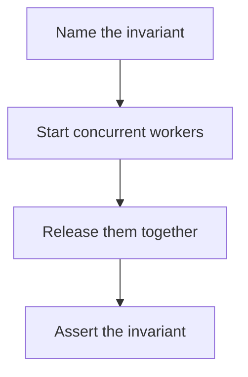

# D20-T017 — Concurrency and race testing

Topic ID: `D20-T017`
Domain: Software Testing
Subdomain: Concurrency and race testing
Importance: core
Complexity: intermediate
Dependencies: `D20-T016`, `D20-T001`, `D05-T001`, `D05-T002`, `D07-T001`, `D07-T002`
Execution status of the code in section F: unexecuted

## A. Topic Overview

Concurrency and race testing try to force the interleaving that loses an update. A barrier holds threads until they can enter the critical section together. The assertion is the invariant, such as a counter equaling the number of increments. A test that is green once did not prove much. Running it many times or under a scheduler that explores interleavings raises the chance of seeing the bug.

In production this shows up as follows: Two threads decrement the last seat. A barrier releases both inside the transaction. The assertion is that one booking exists and the seat count is not negative. The test repeats.

Interviewers use Concurrency and race testing to see whether you can state the failure mode, not only the definition. The failure to name is: a lost update the test cannot see because it never overlaps the critical section

Prerequisites: `D20-T016`, `D20-T001`, `D05-T001`, `D05-T002`, `D07-T001`, `D07-T002`. Later notes should link here instead of repeating the mechanism.

## B. First-Principles Explanation

Concurrency and race testing try to force the interleaving that loses an update. A barrier holds threads until they can enter the critical section together. The assertion is the invariant, such as a counter equaling the number of increments. A test that is green once did not prove much. Running it many times or under a scheduler that explores interleavings raises the chance of seeing the bug.

The useful picture is: A race test is starting the race at the same whistle. If runners start seconds apart, you did not test the collision.

What has to be true:

1. Name the invariant
2. Start concurrent workers
3. Release them together
4. Assert the invariant

It works when those steps preserve one invariant. It fails when a lost update the test cannot see because it never overlaps the critical section. The alternative is: you run two threads loosely and treat one green run as proof

## C. Internal Working and Architecture

Components involved: the caller, the state Concurrency and race testing mutates or reads, and the observer that reports invariant failures per thousand runs.

Execution:

1. Name the invariant
2. Start concurrent workers
3. Release them together
4. Assert the invariant

Data moves only along that path. A retry re-enters at step 1, so the operation must say what a duplicate does. Memory and locks stay inside this mechanism. Callers see the result or a typed error, not a half-updated invariant.

State to remember: choose this when a bug depends on timing. Do not choose it when you run two threads loosely and treat one green run as proof.

## D. Diagrams and Visual Models



Read the diagram from top to bottom. Each box is one step of Concurrency and race testing. The failure mode (a lost update the test cannot see because it never overlaps the critical section) is what you look for when a later box never happens or happens twice.

## E. Examples and Analogies

Analogy: A race test is starting the race at the same whistle. If runners start seconds apart, you did not test the collision.

Production example: Two threads decrement the last seat. A barrier releases both inside the transaction. The assertion is that one booking exists and the seat count is not negative. The test repeats.

A small counterexample is enough in an interview. Show the input, apply the steps, and show the broken outcome if someone uses the mechanism outside its rule: a lost update the test cannot see because it never overlaps the critical section.

## F. Code Examples

The snippet is labeled unexecuted. It illustrates the shape of the idea. It is not a benchmark and it embeds no secret.

```python
import threading

def test_increments():
    n = {'v': 0}
    lock = threading.Lock()
    def add():
        with lock:
            n['v'] += 1
    threads = [threading.Thread(target=add) for _ in range(20)]
    for t in threads:
        t.start()
    for t in threads:
        t.join()
    assert n['v'] == 20
```

After the snippet, check invariant failures per thousand runs. If that signal moves the wrong way, the snippet is the wrong tool for the workload.

## G. Practical Backend Application

Use Concurrency and race testing in a service when a bug depends on timing.

A typical place is the production case already stated: Two threads decrement the last seat. A barrier releases both inside the transaction. The assertion is that one booking exists and the seat count is not negative. The test repeats.

Operationally you alert on invariant failures per thousand runs. You do not alert only on process uptime. The dashboard should show the failure mode, a success rate, and the saturation signal (queue depth, lock wait, or latency) that predicts it.

## H. Advantages, Limitations and Trade-offs

| Choice | Benefit | Cost | Choose when | Avoid when |
| --- | --- | --- | --- | --- |
| Apply Concurrency and race testing | a bug depends on timing | Extra moving parts and a new failure mode | The failure you are preventing is already real | you run two threads loosely and treat one green run as proof |
| Simpler alternative | Less code and fewer dependencies | a lost update the test cannot see because it never overlaps the critical section | The workload does not hit the limit | The invariant must hold under concurrency or failure |

Concurrency and race testing is a trade. State the benefit and the cost in the same sentence when you propose it in a design review.

## I. Common Mistakes and Misconceptions

- No barrier.
- One iteration.
- Asserting a log line instead of the invariant.
- Treating a diagram of Concurrency and race testing as proof that the invariant holds in production.
- Copying a default configuration without naming invariant failures per thousand runs.

## J. Debugging and Troubleshooting

Symptom: a lost update the test cannot see because it never overlaps the critical section

First check: invariant failures per thousand runs.

Then compare one healthy instance against one unhealthy instance. Confirm whether retries are duplicating work. Confirm whether a timeout is shorter than the work. Fix the invariant, then watch the same metric for a full peak, not only for the next minute.

Useful questions: did the step order in section C actually happen, or did a caller skip a step? Did a deploy change the data shape that Concurrency and race testing assumes?

## K. Interview Preparation

### Beginner

#### Q1. What problem does Concurrency and race testing solve?

**Answer:** Concurrency and race testing try to force the interleaving that loses an update. A barrier holds threads until they can enter the critical section together. The assertion is the invariant, such as a counter equaling the number of increments. A test that is green once did not prove much. Running it many times or under a scheduler that explores interleavings raises the chance of seeing the bug. Without it, the usual backend failure is: a lost update the test cannot see because it never overlaps the critical section.

#### Q2. Where does Concurrency and race testing sit on a request path?

**Answer:** Concurrency and race testing is not a library you sprinkle on every call. a bug depends on timing You notice it when invariant failures per thousand runs. Name the constraint that makes this choice correct. Say what you would measure to confirm it.

#### Q3. Give a concrete example of Concurrency and race testing.

**Answer:** Two threads decrement the last seat. A barrier releases both inside the transaction. The assertion is that one booking exists and the seat count is not negative. The test repeats. Walk the input, the state change, and the observable output.

#### Q4. What is a common mix-up around Concurrency and race testing?

**Answer:** a lost update the test cannot see because it never overlaps the critical section The corrective check is invariant failures per thousand runs. Name the constraint that makes this choice correct. Say what you would measure to confirm it. Say which alternative you rejected and why.

#### Q5. When would you skip Concurrency and race testing?

**Answer:** you run two threads loosely and treat one green run as proof Skipping is a decision with a measured cost, not a slogan. Name the constraint that makes this choice correct. Say what you would measure to confirm it. Say which alternative you rejected and why.

### Intermediate

#### Q1. What invariant makes Concurrency and race testing correct?

**Answer:** Concurrency and race testing try to force the interleaving that loses an update. A barrier holds threads until they can enter the critical section together. The assertion is the invariant, such as a counter equaling the number of increments. A test that is green once did not prove much. Running it many times or under a scheduler that explores interleavings raises the chance of seeing the bug. State the invariant before you name the tool.

#### Q2. How do you test Concurrency and race testing?

**Answer:** Assert the failure mode directly: a lost update the test cannot see because it never overlaps the critical section. The assertion should watch invariant failures per thousand runs. Include a concurrent or retry case if the bug only appears then. Name the constraint that makes this choice correct.

#### Q3. What signal tells you Concurrency and race testing is misbehaving in production?

**Answer:** Watch invariant failures per thousand runs. The user-visible symptom is usually a lost update the test cannot see because it never overlaps the critical section. Name the constraint that makes this choice correct. Say what you would measure to confirm it.

#### Q4. How would you introduce Concurrency and race testing into a legacy service?

**Answer:** a bug depends on timing Ship it behind a metric so you can compare the old path. Roll back if a lost update the test cannot see because it never overlaps the critical section gets worse. Name the constraint that makes this choice correct. Say what you would measure to confirm it.

#### Q5. What do you trade away by choosing Concurrency and race testing?

**Answer:** a bug depends on timing you run two threads loosely and treat one green run as proof Say the cost in latency, storage, or operational load. Name the constraint that makes this choice correct. Say what you would measure to confirm it. Say which alternative you rejected and why.

### Advanced

#### Q1. What breaks if a dependency of Concurrency and race testing is slow or down?

**Answer:** a lost update the test cannot see because it never overlaps the critical section Degrade using the rule: you run two threads loosely and treat one green run as proof. Timeouts must be shorter than the caller's deadline. Name the constraint that makes this choice correct. Say what you would measure to confirm it.

#### Q2. How does Concurrency and race testing behave under retries?

**Answer:** Retries repeat work, so Concurrency and race testing must define what a duplicate does. a lost update the test cannot see because it never overlaps the critical section Idempotency keys or fences belong next to the write, not in a comment. Name the constraint that makes this choice correct. Say what you would measure to confirm it.

#### Q3. What is the capacity limit of Concurrency and race testing?

**Answer:** The limit shows up as invariant failures per thousand runs. Add capacity only after you know whether the bottleneck is CPU, lock wait, or network. Name the constraint that makes this choice correct. Say what you would measure to confirm it.

#### Q4. How do you evolve Concurrency and race testing without a flag day?

**Answer:** a bug depends on timing Version the contract or the on-disk format. Readers should tolerate one old and one new shape during the rollout. Name the constraint that makes this choice correct. Say what you would measure to confirm it.

#### Q5. What security or correctness bug hides inside Concurrency and race testing?

**Answer:** a lost update the test cannot see because it never overlaps the critical section Check authorization and tenancy at the same boundary as the mechanism. A cache or queue must not widen who can read the data. Name the constraint that makes this choice correct. Say what you would measure to confirm it.

### Scenario

#### Q1. Incident: a lost update the test cannot see because it never overlaps the critical section. What do you check first?

**Answer:** Start with invariant failures per thousand runs. Compare a good host and a bad host before you restart anything. Concurrency and race testing try to force the interleaving that loses an update. A barrier holds threads until they can enter the critical section together. The assertion is the invariant, such as a counter equaling the number of increments. A test that is green once did not prove much. Running it many times or under a scheduler that explores interleavings raises the chance of seeing the bug.

#### Q2. A reviewer wants the clever version. What data settles it?

**Answer:** a bug depends on timing you run two threads loosely and treat one green run as proof Bring invariant failures per thousand runs from a load test or from production, not a slogan. Name the constraint that makes this choice correct. Say what you would measure to confirm it. Say which alternative you rejected and why.

#### Q3. You have one hour to explain Concurrency and race testing at a whiteboard.

**Answer:** Draw the happy path in four boxes. Then draw the failure: a lost update the test cannot see because it never overlaps the critical section. End with the metric you would page on. Name the constraint that makes this choice correct.

#### Q4. The bug only appears under two concurrent callers.

**Answer:** a lost update the test cannot see because it never overlaps the critical section Reproduce with a barrier so both sides enter the critical window. Confirm the fix with invariant failures per thousand runs. Name the constraint that makes this choice correct. Say what you would measure to confirm it.

#### Q5. Leadership wants this on every service next week.

**Answer:** you run two threads loosely and treat one green run as proof a bug depends on timing Roll it out where the failure mode is already hurting users. Name the constraint that makes this choice correct. Say what you would measure to confirm it. Say which alternative you rejected and why.

### Follow-up

#### Q1. What did you assume about the data size or the clock?

**Answer:** Concurrency and race testing try to force the interleaving that loses an update. A barrier holds threads until they can enter the critical section together. The assertion is the invariant, such as a counter equaling the number of increments. A test that is green once did not prove much. Running it many times or under a scheduler that explores interleavings raises the chance of seeing the bug. Clocks are not a total order across machines. State whether the algorithm needs bounded size or a single leader.

#### Q2. What would you measure after the change ships?

**Answer:** Page on invariant failures per thousand runs. Keep a before/after dashboard for one week. Alert on the failure mode, not only on CPU. Name the constraint that makes this choice correct.

#### Q3. Which neighboring topic did you deliberately not re-teach?

**Answer:** This note owns Concurrency and race testing. Related identifiers are in section N. Shared ideas are linked, not copied. Name the constraint that makes this choice correct.

## L. Practical Exercises

Solutions are in `EXERCISES/solutions/D20-T017.md`, not in this section.

1. Whiteboard the four steps of Concurrency and race testing and mark where `a lost update the test cannot see because it never overlaps the critical section` enters.
2. Read the snippet in section F and write the assertion that would catch that failure. The assertion must mention `invariant failures per thousand runs`.
3. Argue for or against using Concurrency and race testing on a service you know. Use the choose and avoid rows from section H. Do not appeal to popularity.

## M. Revision Notes

- Mechanism: Concurrency and race testing try to force the interleaving that loses an update.
- Failure: a lost update the test cannot see because it never overlaps the critical section
- Metric: invariant failures per thousand runs
- Choose when: a bug depends on timing
- Avoid when: you run two threads loosely and treat one green run as proof

## N. Related Topics

Dependencies to review first: `D20-T016`, `D20-T001`, `D05-T001`, `D05-T002`, `D07-T001`, `D07-T002`.

Shared ideas stay in those notes. This note does not restate them.

## O. Completion Criteria

- You can explain Concurrency and race testing without reading this note, including the failure mode.
- You can draw the diagram in section D from memory.
- You can say when not to use it, using the avoid condition in section H.
- You can name the metric you would watch after shipping it.
