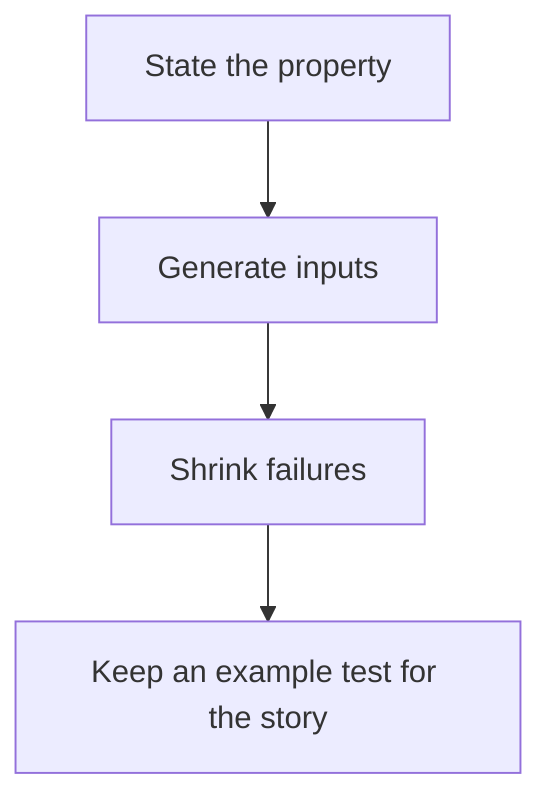

# D20-T018 — Property-based testing

Topic ID: `D20-T018`
Domain: Software Testing
Subdomain: Property-based testing
Importance: common
Complexity: intermediate
Dependencies: `D20-T017`, `D20-T001`, `D05-T001`, `D05-T002`, `D07-T001`, `D07-T002`
Execution status of the code in section F: unexecuted

## A. Topic Overview

Property-based testing states a property that must hold for many generated inputs, instead of one example. A generator builds values. The framework shrinks a failing value to a smaller one. Properties include round-trip, idempotence, and invariants. A property that is too weak, such as 'does not throw,' proves little. You still keep a few examples for the cases humans must read.

In production this shows up as follows: The encoder and decoder are tested by generating strings, including empty and unicode, and asserting a round trip. When a property fails, the shrunk input is added as an example.

Interviewers use Property-based testing to see whether you can state the failure mode, not only the definition. The failure to name is: a property that encodes the same bug as the implementation, so both are wrong together

Prerequisites: `D20-T017`, `D20-T001`, `D05-T001`, `D05-T002`, `D07-T001`, `D07-T002`. Later notes should link here instead of repeating the mechanism.

## B. First-Principles Explanation

Property-based testing states a property that must hold for many generated inputs, instead of one example. A generator builds values. The framework shrinks a failing value to a smaller one. Properties include round-trip, idempotence, and invariants. A property that is too weak, such as 'does not throw,' proves little. You still keep a few examples for the cases humans must read.

The useful picture is: Property testing is claiming every loaf rises, then pulling random loaves out of the oven. Shrinking is cutting the failed loaf down until the smallest burnt piece remains.

What has to be true:

1. State the property
2. Generate inputs
3. Shrink failures
4. Keep an example test for the story

It works when those steps preserve one invariant. It fails when a property that encodes the same bug as the implementation, so both are wrong together. The alternative is: you assert the implementation against a copy of itself

## C. Internal Working and Architecture

Components involved: the caller, the state Property-based testing mutates or reads, and the observer that reports failures found by generation that example tests missed.

Execution:

1. State the property
2. Generate inputs
3. Shrink failures
4. Keep an example test for the story

Data moves only along that path. A retry re-enters at step 1, so the operation must say what a duplicate does. Memory and locks stay inside this mechanism. Callers see the result or a typed error, not a half-updated invariant.

State to remember: choose this when the correct behavior is a rule over a large input space. Do not choose it when you assert the implementation against a copy of itself.

## D. Diagrams and Visual Models



Read the diagram from top to bottom. Each box is one step of Property-based testing. The failure mode (a property that encodes the same bug as the implementation, so both are wrong together) is what you look for when a later box never happens or happens twice.

## E. Examples and Analogies

Analogy: Property testing is claiming every loaf rises, then pulling random loaves out of the oven. Shrinking is cutting the failed loaf down until the smallest burnt piece remains.

Production example: The encoder and decoder are tested by generating strings, including empty and unicode, and asserting a round trip. When a property fails, the shrunk input is added as an example.

A small counterexample is enough in an interview. Show the input, apply the steps, and show the broken outcome if someone uses the mechanism outside its rule: a property that encodes the same bug as the implementation, so both are wrong together.

## F. Code Examples

The snippet is labeled unexecuted. It illustrates the shape of the idea. It is not a benchmark and it embeds no secret.

```python
def test_roundtrip(text):
    assert decode(encode(text)) == text
```

After the snippet, check failures found by generation that example tests missed. If that signal moves the wrong way, the snippet is the wrong tool for the workload.

## G. Practical Backend Application

Use Property-based testing in a service when the correct behavior is a rule over a large input space.

A typical place is the production case already stated: The encoder and decoder are tested by generating strings, including empty and unicode, and asserting a round trip. When a property fails, the shrunk input is added as an example.

Operationally you alert on failures found by generation that example tests missed. You do not alert only on process uptime. The dashboard should show the failure mode, a success rate, and the saturation signal (queue depth, lock wait, or latency) that predicts it.

## H. Advantages, Limitations and Trade-offs

| Choice | Benefit | Cost | Choose when | Avoid when |
| --- | --- | --- | --- | --- |
| Apply Property-based testing | the correct behavior is a rule over a large input space | Extra moving parts and a new failure mode | The failure you are preventing is already real | you assert the implementation against a copy of itself |
| Simpler alternative | Less code and fewer dependencies | a property that encodes the same bug as the implementation, so both are wrong together | The workload does not hit the limit | The invariant must hold under concurrency or failure |

Property-based testing is a trade. State the benefit and the cost in the same sentence when you propose it in a design review.

## I. Common Mistakes and Misconceptions

- Properties that only check 'no exception'.
- Generators that never build the edge case.
- No shrinking.
- Treating a diagram of Property-based testing as proof that the invariant holds in production.
- Copying a default configuration without naming failures found by generation that example tests missed.

## J. Debugging and Troubleshooting

Symptom: a property that encodes the same bug as the implementation, so both are wrong together

First check: failures found by generation that example tests missed.

Then compare one healthy instance against one unhealthy instance. Confirm whether retries are duplicating work. Confirm whether a timeout is shorter than the work. Fix the invariant, then watch the same metric for a full peak, not only for the next minute.

Useful questions: did the step order in section C actually happen, or did a caller skip a step? Did a deploy change the data shape that Property-based testing assumes?

## K. Interview Preparation

### Beginner

#### Q1. What problem does Property-based testing solve?

**Answer:** Property-based testing states a property that must hold for many generated inputs, instead of one example. A generator builds values. The framework shrinks a failing value to a smaller one. Properties include round-trip, idempotence, and invariants. A property that is too weak, such as 'does not throw,' proves little. You still keep a few examples for the cases humans must read. Without it, the usual backend failure is: a property that encodes the same bug as the implementation, so both are wrong together.

#### Q2. Where does Property-based testing sit on a request path?

**Answer:** Property-based testing is not a library you sprinkle on every call. the correct behavior is a rule over a large input space You notice it when failures found by generation that example tests missed. Name the constraint that makes this choice correct. Say what you would measure to confirm it.

#### Q3. Give a concrete example of Property-based testing.

**Answer:** The encoder and decoder are tested by generating strings, including empty and unicode, and asserting a round trip. When a property fails, the shrunk input is added as an example. Walk the input, the state change, and the observable output. Name the constraint that makes this choice correct.

#### Q4. What is a common mix-up around Property-based testing?

**Answer:** a property that encodes the same bug as the implementation, so both are wrong together The corrective check is failures found by generation that example tests missed. Name the constraint that makes this choice correct. Say what you would measure to confirm it. Say which alternative you rejected and why.

#### Q5. When would you skip Property-based testing?

**Answer:** you assert the implementation against a copy of itself Skipping is a decision with a measured cost, not a slogan. Name the constraint that makes this choice correct. Say what you would measure to confirm it. Say which alternative you rejected and why.

### Intermediate

#### Q1. What invariant makes Property-based testing correct?

**Answer:** Property-based testing states a property that must hold for many generated inputs, instead of one example. A generator builds values. The framework shrinks a failing value to a smaller one. Properties include round-trip, idempotence, and invariants. A property that is too weak, such as 'does not throw,' proves little. You still keep a few examples for the cases humans must read. State the invariant before you name the tool.

#### Q2. How do you test Property-based testing?

**Answer:** Assert the failure mode directly: a property that encodes the same bug as the implementation, so both are wrong together. The assertion should watch failures found by generation that example tests missed. Include a concurrent or retry case if the bug only appears then. Name the constraint that makes this choice correct.

#### Q3. What signal tells you Property-based testing is misbehaving in production?

**Answer:** Watch failures found by generation that example tests missed. The user-visible symptom is usually a property that encodes the same bug as the implementation, so both are wrong together. Name the constraint that makes this choice correct. Say what you would measure to confirm it.

#### Q4. How would you introduce Property-based testing into a legacy service?

**Answer:** the correct behavior is a rule over a large input space Ship it behind a metric so you can compare the old path. Roll back if a property that encodes the same bug as the implementation, so both are wrong together gets worse. Name the constraint that makes this choice correct. Say what you would measure to confirm it.

#### Q5. What do you trade away by choosing Property-based testing?

**Answer:** the correct behavior is a rule over a large input space you assert the implementation against a copy of itself Say the cost in latency, storage, or operational load. Name the constraint that makes this choice correct. Say what you would measure to confirm it. Say which alternative you rejected and why.

### Advanced

#### Q1. What breaks if a dependency of Property-based testing is slow or down?

**Answer:** a property that encodes the same bug as the implementation, so both are wrong together Degrade using the rule: you assert the implementation against a copy of itself. Timeouts must be shorter than the caller's deadline. Name the constraint that makes this choice correct. Say what you would measure to confirm it.

#### Q2. How does Property-based testing behave under retries?

**Answer:** Retries repeat work, so Property-based testing must define what a duplicate does. a property that encodes the same bug as the implementation, so both are wrong together Idempotency keys or fences belong next to the write, not in a comment. Name the constraint that makes this choice correct. Say what you would measure to confirm it.

#### Q3. What is the capacity limit of Property-based testing?

**Answer:** The limit shows up as failures found by generation that example tests missed. Add capacity only after you know whether the bottleneck is CPU, lock wait, or network. Name the constraint that makes this choice correct. Say what you would measure to confirm it.

#### Q4. How do you evolve Property-based testing without a flag day?

**Answer:** the correct behavior is a rule over a large input space Version the contract or the on-disk format. Readers should tolerate one old and one new shape during the rollout. Name the constraint that makes this choice correct. Say what you would measure to confirm it.

#### Q5. What security or correctness bug hides inside Property-based testing?

**Answer:** a property that encodes the same bug as the implementation, so both are wrong together Check authorization and tenancy at the same boundary as the mechanism. A cache or queue must not widen who can read the data. Name the constraint that makes this choice correct. Say what you would measure to confirm it.

### Scenario

#### Q1. Incident: a property that encodes the same bug as the implementation, so both are wrong together. What do you check first?

**Answer:** Start with failures found by generation that example tests missed. Compare a good host and a bad host before you restart anything. Property-based testing states a property that must hold for many generated inputs, instead of one example. A generator builds values. The framework shrinks a failing value to a smaller one. Properties include round-trip, idempotence, and invariants. A property that is too weak, such as 'does not throw,' proves little. You still keep a few examples for the cases humans must read.

#### Q2. A reviewer wants the clever version. What data settles it?

**Answer:** the correct behavior is a rule over a large input space you assert the implementation against a copy of itself Bring failures found by generation that example tests missed from a load test or from production, not a slogan. Name the constraint that makes this choice correct. Say what you would measure to confirm it. Say which alternative you rejected and why.

#### Q3. You have one hour to explain Property-based testing at a whiteboard.

**Answer:** Draw the happy path in four boxes. Then draw the failure: a property that encodes the same bug as the implementation, so both are wrong together. End with the metric you would page on. Name the constraint that makes this choice correct.

#### Q4. The bug only appears under two concurrent callers.

**Answer:** a property that encodes the same bug as the implementation, so both are wrong together Reproduce with a barrier so both sides enter the critical window. Confirm the fix with failures found by generation that example tests missed. Name the constraint that makes this choice correct. Say what you would measure to confirm it.

#### Q5. Leadership wants this on every service next week.

**Answer:** you assert the implementation against a copy of itself the correct behavior is a rule over a large input space Roll it out where the failure mode is already hurting users. Name the constraint that makes this choice correct. Say what you would measure to confirm it. Say which alternative you rejected and why.

### Follow-up

#### Q1. What did you assume about the data size or the clock?

**Answer:** Property-based testing states a property that must hold for many generated inputs, instead of one example. A generator builds values. The framework shrinks a failing value to a smaller one. Properties include round-trip, idempotence, and invariants. A property that is too weak, such as 'does not throw,' proves little. You still keep a few examples for the cases humans must read. Clocks are not a total order across machines. State whether the algorithm needs bounded size or a single leader.

#### Q2. What would you measure after the change ships?

**Answer:** Page on failures found by generation that example tests missed. Keep a before/after dashboard for one week. Alert on the failure mode, not only on CPU. Name the constraint that makes this choice correct.

#### Q3. Which neighboring topic did you deliberately not re-teach?

**Answer:** This note owns Property-based testing. Related identifiers are in section N. Shared ideas are linked, not copied. Name the constraint that makes this choice correct.

## L. Practical Exercises

Solutions are in `EXERCISES/solutions/D20-T018.md`, not in this section.

1. Whiteboard the four steps of Property-based testing and mark where `a property that encodes the same bug as the implementation, so both are wrong together` enters.
2. Read the snippet in section F and write the assertion that would catch that failure. The assertion must mention `failures found by generation that example tests missed`.
3. Argue for or against using Property-based testing on a service you know. Use the choose and avoid rows from section H. Do not appeal to popularity.

## M. Revision Notes

- Mechanism: Property-based testing states a property that must hold for many generated inputs, instead of one example.
- Failure: a property that encodes the same bug as the implementation, so both are wrong together
- Metric: failures found by generation that example tests missed
- Choose when: the correct behavior is a rule over a large input space
- Avoid when: you assert the implementation against a copy of itself

## N. Related Topics

Dependencies to review first: `D20-T017`, `D20-T001`, `D05-T001`, `D05-T002`, `D07-T001`, `D07-T002`.

Shared ideas stay in those notes. This note does not restate them.

## O. Completion Criteria

- You can explain Property-based testing without reading this note, including the failure mode.
- You can draw the diagram in section D from memory.
- You can say when not to use it, using the avoid condition in section H.
- You can name the metric you would watch after shipping it.
