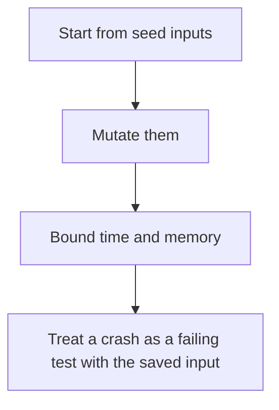

# D20-T019 — Fuzz testing

Topic ID: `D20-T019`
Domain: Software Testing
Subdomain: Fuzz testing
Importance: common
Complexity: intermediate
Dependencies: `D20-T018`, `D20-T001`, `D05-T001`, `D05-T002`, `D07-T001`, `D07-T002`
Execution status of the code in section F: unexecuted

## A. Topic Overview

Fuzz testing feeds malformed and unexpected inputs to a parser or a service and watches for crashes, hangs, and sanitizer failures. Coverage-guided fuzzing mutates inputs that reach new code. It is good at finding panics and memory bugs. It does not know your business assertions unless you add them. Corpus inputs should be saved. A hang needs a timeout.

In production this shows up as follows: A JSON parser or a request decoder runs under a fuzzer with a one-second timeout per input. A crash is stored as a regression file and replayed in CI. Business rules stay in ordinary tests.

Interviewers use Fuzz testing to see whether you can state the failure mode, not only the definition. The failure to name is: a hang with no timeout, or a fuzzer that only finds crashes you do not replay in CI

Prerequisites: `D20-T018`, `D20-T001`, `D05-T001`, `D05-T002`, `D07-T001`, `D07-T002`. Later notes should link here instead of repeating the mechanism.

## B. First-Principles Explanation

Fuzz testing feeds malformed and unexpected inputs to a parser or a service and watches for crashes, hangs, and sanitizer failures. Coverage-guided fuzzing mutates inputs that reach new code. It is good at finding panics and memory bugs. It does not know your business assertions unless you add them. Corpus inputs should be saved. A hang needs a timeout.

The useful picture is: Fuzzing is shaking a vending machine with coins of every bent shape to see whether it jams or dumps the drawer. You keep the bent coin that broke it.

What has to be true:

1. Start from seed inputs
2. Mutate them
3. Bound time and memory
4. Treat a crash as a failing test with the saved input

It works when those steps preserve one invariant. It fails when a hang with no timeout, or a fuzzer that only finds crashes you do not replay in CI. The alternative is: you expect the fuzzer to judge business correctness alone

## C. Internal Working and Architecture

Components involved: the caller, the state Fuzz testing mutates or reads, and the observer that reports unique crashes and coverage growth.

Execution:

1. Start from seed inputs
2. Mutate them
3. Bound time and memory
4. Treat a crash as a failing test with the saved input

Data moves only along that path. A retry re-enters at step 1, so the operation must say what a duplicate does. Memory and locks stay inside this mechanism. Callers see the result or a typed error, not a half-updated invariant.

State to remember: choose this when the attack surface is a parser or a decoder. Do not choose it when you expect the fuzzer to judge business correctness alone.

## D. Diagrams and Visual Models



Read the diagram from top to bottom. Each box is one step of Fuzz testing. The failure mode (a hang with no timeout, or a fuzzer that only finds crashes you do not replay in CI) is what you look for when a later box never happens or happens twice.

## E. Examples and Analogies

Analogy: Fuzzing is shaking a vending machine with coins of every bent shape to see whether it jams or dumps the drawer. You keep the bent coin that broke it.

Production example: A JSON parser or a request decoder runs under a fuzzer with a one-second timeout per input. A crash is stored as a regression file and replayed in CI. Business rules stay in ordinary tests.

A small counterexample is enough in an interview. Show the input, apply the steps, and show the broken outcome if someone uses the mechanism outside its rule: a hang with no timeout, or a fuzzer that only finds crashes you do not replay in CI.

## F. Code Examples

The snippet is labeled unexecuted. It illustrates the shape of the idea. It is not a benchmark and it embeds no secret.

```python
def parse_or_error(raw):
    try:
        return ('ok', raw.decode())
    except UnicodeError:
        return ('error', None)
```

After the snippet, check unique crashes and coverage growth. If that signal moves the wrong way, the snippet is the wrong tool for the workload.

## G. Practical Backend Application

Use Fuzz testing in a service when the attack surface is a parser or a decoder.

A typical place is the production case already stated: A JSON parser or a request decoder runs under a fuzzer with a one-second timeout per input. A crash is stored as a regression file and replayed in CI. Business rules stay in ordinary tests.

Operationally you alert on unique crashes and coverage growth. You do not alert only on process uptime. The dashboard should show the failure mode, a success rate, and the saturation signal (queue depth, lock wait, or latency) that predicts it.

## H. Advantages, Limitations and Trade-offs

| Choice | Benefit | Cost | Choose when | Avoid when |
| --- | --- | --- | --- | --- |
| Apply Fuzz testing | the attack surface is a parser or a decoder | Extra moving parts and a new failure mode | The failure you are preventing is already real | you expect the fuzzer to judge business correctness alone |
| Simpler alternative | Less code and fewer dependencies | a hang with no timeout, or a fuzzer that only finds crashes you do not replay in CI | The workload does not hit the limit | The invariant must hold under concurrency or failure |

Fuzz testing is a trade. State the benefit and the cost in the same sentence when you propose it in a design review.

## I. Common Mistakes and Misconceptions

- No timeout.
- Discarding the crashing input.
- Fuzzing only the happy corpus.
- Treating a diagram of Fuzz testing as proof that the invariant holds in production.
- Copying a default configuration without naming unique crashes and coverage growth.

## J. Debugging and Troubleshooting

Symptom: a hang with no timeout, or a fuzzer that only finds crashes you do not replay in CI

First check: unique crashes and coverage growth.

Then compare one healthy instance against one unhealthy instance. Confirm whether retries are duplicating work. Confirm whether a timeout is shorter than the work. Fix the invariant, then watch the same metric for a full peak, not only for the next minute.

Useful questions: did the step order in section C actually happen, or did a caller skip a step? Did a deploy change the data shape that Fuzz testing assumes?

## K. Interview Preparation

### Beginner

#### Q1. What problem does Fuzz testing solve?

**Answer:** Fuzz testing feeds malformed and unexpected inputs to a parser or a service and watches for crashes, hangs, and sanitizer failures. Coverage-guided fuzzing mutates inputs that reach new code. It is good at finding panics and memory bugs. It does not know your business assertions unless you add them. Corpus inputs should be saved. A hang needs a timeout. Without it, the usual backend failure is: a hang with no timeout, or a fuzzer that only finds crashes you do not replay in CI.

#### Q2. Where does Fuzz testing sit on a request path?

**Answer:** Fuzz testing is not a library you sprinkle on every call. the attack surface is a parser or a decoder You notice it when unique crashes and coverage growth. Name the constraint that makes this choice correct. Say what you would measure to confirm it.

#### Q3. Give a concrete example of Fuzz testing.

**Answer:** A JSON parser or a request decoder runs under a fuzzer with a one-second timeout per input. A crash is stored as a regression file and replayed in CI. Business rules stay in ordinary tests. Walk the input, the state change, and the observable output.

#### Q4. What is a common mix-up around Fuzz testing?

**Answer:** a hang with no timeout, or a fuzzer that only finds crashes you do not replay in CI The corrective check is unique crashes and coverage growth. Name the constraint that makes this choice correct. Say what you would measure to confirm it. Say which alternative you rejected and why.

#### Q5. When would you skip Fuzz testing?

**Answer:** you expect the fuzzer to judge business correctness alone Skipping is a decision with a measured cost, not a slogan. Name the constraint that makes this choice correct. Say what you would measure to confirm it. Say which alternative you rejected and why.

### Intermediate

#### Q1. What invariant makes Fuzz testing correct?

**Answer:** Fuzz testing feeds malformed and unexpected inputs to a parser or a service and watches for crashes, hangs, and sanitizer failures. Coverage-guided fuzzing mutates inputs that reach new code. It is good at finding panics and memory bugs. It does not know your business assertions unless you add them. Corpus inputs should be saved. A hang needs a timeout. State the invariant before you name the tool.

#### Q2. How do you test Fuzz testing?

**Answer:** Assert the failure mode directly: a hang with no timeout, or a fuzzer that only finds crashes you do not replay in CI. The assertion should watch unique crashes and coverage growth. Include a concurrent or retry case if the bug only appears then. Name the constraint that makes this choice correct.

#### Q3. What signal tells you Fuzz testing is misbehaving in production?

**Answer:** Watch unique crashes and coverage growth. The user-visible symptom is usually a hang with no timeout, or a fuzzer that only finds crashes you do not replay in CI. Name the constraint that makes this choice correct. Say what you would measure to confirm it.

#### Q4. How would you introduce Fuzz testing into a legacy service?

**Answer:** the attack surface is a parser or a decoder Ship it behind a metric so you can compare the old path. Roll back if a hang with no timeout, or a fuzzer that only finds crashes you do not replay in CI gets worse. Name the constraint that makes this choice correct. Say what you would measure to confirm it.

#### Q5. What do you trade away by choosing Fuzz testing?

**Answer:** the attack surface is a parser or a decoder you expect the fuzzer to judge business correctness alone Say the cost in latency, storage, or operational load. Name the constraint that makes this choice correct. Say what you would measure to confirm it. Say which alternative you rejected and why.

### Advanced

#### Q1. What breaks if a dependency of Fuzz testing is slow or down?

**Answer:** a hang with no timeout, or a fuzzer that only finds crashes you do not replay in CI Degrade using the rule: you expect the fuzzer to judge business correctness alone. Timeouts must be shorter than the caller's deadline. Name the constraint that makes this choice correct. Say what you would measure to confirm it.

#### Q2. How does Fuzz testing behave under retries?

**Answer:** Retries repeat work, so Fuzz testing must define what a duplicate does. a hang with no timeout, or a fuzzer that only finds crashes you do not replay in CI Idempotency keys or fences belong next to the write, not in a comment. Name the constraint that makes this choice correct. Say what you would measure to confirm it.

#### Q3. What is the capacity limit of Fuzz testing?

**Answer:** The limit shows up as unique crashes and coverage growth. Add capacity only after you know whether the bottleneck is CPU, lock wait, or network. Name the constraint that makes this choice correct. Say what you would measure to confirm it.

#### Q4. How do you evolve Fuzz testing without a flag day?

**Answer:** the attack surface is a parser or a decoder Version the contract or the on-disk format. Readers should tolerate one old and one new shape during the rollout. Name the constraint that makes this choice correct. Say what you would measure to confirm it.

#### Q5. What security or correctness bug hides inside Fuzz testing?

**Answer:** a hang with no timeout, or a fuzzer that only finds crashes you do not replay in CI Check authorization and tenancy at the same boundary as the mechanism. A cache or queue must not widen who can read the data. Name the constraint that makes this choice correct. Say what you would measure to confirm it.

### Scenario

#### Q1. Incident: a hang with no timeout, or a fuzzer that only finds crashes you do not replay in CI. What do you check first?

**Answer:** Start with unique crashes and coverage growth. Compare a good host and a bad host before you restart anything. Fuzz testing feeds malformed and unexpected inputs to a parser or a service and watches for crashes, hangs, and sanitizer failures. Coverage-guided fuzzing mutates inputs that reach new code. It is good at finding panics and memory bugs. It does not know your business assertions unless you add them. Corpus inputs should be saved. A hang needs a timeout.

#### Q2. A reviewer wants the clever version. What data settles it?

**Answer:** the attack surface is a parser or a decoder you expect the fuzzer to judge business correctness alone Bring unique crashes and coverage growth from a load test or from production, not a slogan. Name the constraint that makes this choice correct. Say what you would measure to confirm it. Say which alternative you rejected and why.

#### Q3. You have one hour to explain Fuzz testing at a whiteboard.

**Answer:** Draw the happy path in four boxes. Then draw the failure: a hang with no timeout, or a fuzzer that only finds crashes you do not replay in CI. End with the metric you would page on. Name the constraint that makes this choice correct.

#### Q4. The bug only appears under two concurrent callers.

**Answer:** a hang with no timeout, or a fuzzer that only finds crashes you do not replay in CI Reproduce with a barrier so both sides enter the critical window. Confirm the fix with unique crashes and coverage growth. Name the constraint that makes this choice correct. Say what you would measure to confirm it.

#### Q5. Leadership wants this on every service next week.

**Answer:** you expect the fuzzer to judge business correctness alone the attack surface is a parser or a decoder Roll it out where the failure mode is already hurting users. Name the constraint that makes this choice correct. Say what you would measure to confirm it. Say which alternative you rejected and why.

### Follow-up

#### Q1. What did you assume about the data size or the clock?

**Answer:** Fuzz testing feeds malformed and unexpected inputs to a parser or a service and watches for crashes, hangs, and sanitizer failures. Coverage-guided fuzzing mutates inputs that reach new code. It is good at finding panics and memory bugs. It does not know your business assertions unless you add them. Corpus inputs should be saved. A hang needs a timeout. Clocks are not a total order across machines. State whether the algorithm needs bounded size or a single leader.

#### Q2. What would you measure after the change ships?

**Answer:** Page on unique crashes and coverage growth. Keep a before/after dashboard for one week. Alert on the failure mode, not only on CPU. Name the constraint that makes this choice correct.

#### Q3. Which neighboring topic did you deliberately not re-teach?

**Answer:** This note owns Fuzz testing. Related identifiers are in section N. Shared ideas are linked, not copied. Name the constraint that makes this choice correct.

## L. Practical Exercises

Solutions are in `EXERCISES/solutions/D20-T019.md`, not in this section.

1. Whiteboard the four steps of Fuzz testing and mark where `a hang with no timeout, or a fuzzer that only finds crashes you do not replay in CI` enters.
2. Read the snippet in section F and write the assertion that would catch that failure. The assertion must mention `unique crashes and coverage growth`.
3. Argue for or against using Fuzz testing on a service you know. Use the choose and avoid rows from section H. Do not appeal to popularity.

## M. Revision Notes

- Mechanism: Fuzz testing feeds malformed and unexpected inputs to a parser or a service and watches for crashes, hangs, and sanitizer failures.
- Failure: a hang with no timeout, or a fuzzer that only finds crashes you do not replay in CI
- Metric: unique crashes and coverage growth
- Choose when: the attack surface is a parser or a decoder
- Avoid when: you expect the fuzzer to judge business correctness alone

## N. Related Topics

Dependencies to review first: `D20-T018`, `D20-T001`, `D05-T001`, `D05-T002`, `D07-T001`, `D07-T002`.

Shared ideas stay in those notes. This note does not restate them.

## O. Completion Criteria

- You can explain Fuzz testing without reading this note, including the failure mode.
- You can draw the diagram in section D from memory.
- You can say when not to use it, using the avoid condition in section H.
- You can name the metric you would watch after shipping it.
