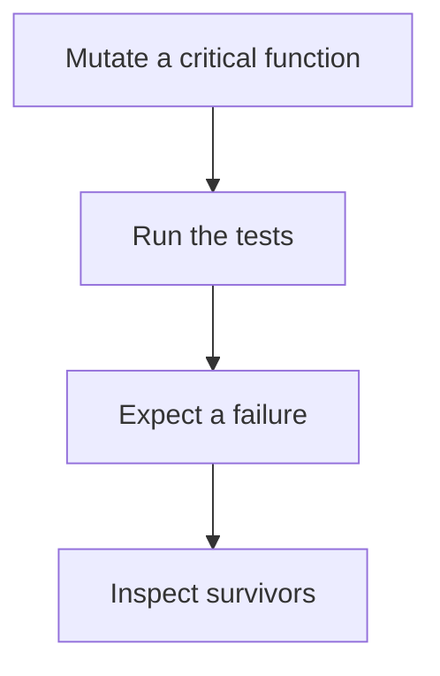

# D20-T020 — Mutation testing

Topic ID: `D20-T020`
Domain: Software Testing
Subdomain: Mutation testing
Importance: common
Complexity: intermediate
Dependencies: `D20-T019`, `D20-T001`, `D05-T001`, `D05-T002`, `D07-T001`, `D07-T002`
Execution status of the code in section F: unexecuted

## A. Topic Overview

Mutation testing changes the program in small ways, such as flipping a comparison, and checks that the tests fail. A mutant that survives means no test noticed the change. It measures whether tests can detect faults, not whether the line ran. It is expensive, so it is aimed at critical modules. Equivalent mutants are changes that do not alter behavior and should not be counted as a miss.

In production this shows up as follows: The payment rounding function is mutated in CI nightly. A surviving mutant that flips a boundary becomes a new test. The whole monorepo is not mutated on every commit.

Interviewers use Mutation testing to see whether you can state the failure mode, not only the definition. The failure to name is: a high line-coverage number with mutants that still survive

Prerequisites: `D20-T019`, `D20-T001`, `D05-T001`, `D05-T002`, `D07-T001`, `D07-T002`. Later notes should link here instead of repeating the mechanism.

## B. First-Principles Explanation

Mutation testing changes the program in small ways, such as flipping a comparison, and checks that the tests fail. A mutant that survives means no test noticed the change. It measures whether tests can detect faults, not whether the line ran. It is expensive, so it is aimed at critical modules. Equivalent mutants are changes that do not alter behavior and should not be counted as a miss.

The useful picture is: Mutation testing is secretly rewriting a sign in the shop and seeing whether any inspector complains. If nobody complains, the inspectors were not looking.

What has to be true:

1. Mutate a critical function
2. Run the tests
3. Expect a failure
4. Inspect survivors

It works when those steps preserve one invariant. It fails when a high line-coverage number with mutants that still survive. The alternative is: you chase 100 percent on generated code

## C. Internal Working and Architecture

Components involved: the caller, the state Mutation testing mutates or reads, and the observer that reports survivor count in the module you care about.

Execution:

1. Mutate a critical function
2. Run the tests
3. Expect a failure
4. Inspect survivors

Data moves only along that path. A retry re-enters at step 1, so the operation must say what a duplicate does. Memory and locks stay inside this mechanism. Callers see the result or a typed error, not a half-updated invariant.

State to remember: choose this when you need to know whether tests can catch a real change. Do not choose it when you chase 100 percent on generated code.

## D. Diagrams and Visual Models



Read the diagram from top to bottom. Each box is one step of Mutation testing. The failure mode (a high line-coverage number with mutants that still survive) is what you look for when a later box never happens or happens twice.

## E. Examples and Analogies

Analogy: Mutation testing is secretly rewriting a sign in the shop and seeing whether any inspector complains. If nobody complains, the inspectors were not looking.

Production example: The payment rounding function is mutated in CI nightly. A surviving mutant that flips a boundary becomes a new test. The whole monorepo is not mutated on every commit.

A small counterexample is enough in an interview. Show the input, apply the steps, and show the broken outcome if someone uses the mechanism outside its rule: a high line-coverage number with mutants that still survive.

## F. Code Examples

The snippet is labeled unexecuted. It illustrates the shape of the idea. It is not a benchmark and it embeds no secret.

```python
def price_ok(total):
    return total >= 0
```

After the snippet, check survivor count in the module you care about. If that signal moves the wrong way, the snippet is the wrong tool for the workload.

## G. Practical Backend Application

Use Mutation testing in a service when you need to know whether tests can catch a real change.

A typical place is the production case already stated: The payment rounding function is mutated in CI nightly. A surviving mutant that flips a boundary becomes a new test. The whole monorepo is not mutated on every commit.

Operationally you alert on survivor count in the module you care about. You do not alert only on process uptime. The dashboard should show the failure mode, a success rate, and the saturation signal (queue depth, lock wait, or latency) that predicts it.

## H. Advantages, Limitations and Trade-offs

| Choice | Benefit | Cost | Choose when | Avoid when |
| --- | --- | --- | --- | --- |
| Apply Mutation testing | you need to know whether tests can catch a real change | Extra moving parts and a new failure mode | The failure you are preventing is already real | you chase 100 percent on generated code |
| Simpler alternative | Less code and fewer dependencies | a high line-coverage number with mutants that still survive | The workload does not hit the limit | The invariant must hold under concurrency or failure |

Mutation testing is a trade. State the benefit and the cost in the same sentence when you propose it in a design review.

## I. Common Mistakes and Misconceptions

- Treating coverage as mutation score.
- Mutating everything on every push.
- Counting equivalent mutants as failures of the suite.
- Treating a diagram of Mutation testing as proof that the invariant holds in production.
- Copying a default configuration without naming survivor count in the module you care about.

## J. Debugging and Troubleshooting

Symptom: a high line-coverage number with mutants that still survive

First check: survivor count in the module you care about.

Then compare one healthy instance against one unhealthy instance. Confirm whether retries are duplicating work. Confirm whether a timeout is shorter than the work. Fix the invariant, then watch the same metric for a full peak, not only for the next minute.

Useful questions: did the step order in section C actually happen, or did a caller skip a step? Did a deploy change the data shape that Mutation testing assumes?

## K. Interview Preparation

### Beginner

#### Q1. What problem does Mutation testing solve?

**Answer:** Mutation testing changes the program in small ways, such as flipping a comparison, and checks that the tests fail. A mutant that survives means no test noticed the change. It measures whether tests can detect faults, not whether the line ran. It is expensive, so it is aimed at critical modules. Equivalent mutants are changes that do not alter behavior and should not be counted as a miss. Without it, the usual backend failure is: a high line-coverage number with mutants that still survive.

#### Q2. Where does Mutation testing sit on a request path?

**Answer:** Mutation testing is not a library you sprinkle on every call. you need to know whether tests can catch a real change You notice it when survivor count in the module you care about. Name the constraint that makes this choice correct. Say what you would measure to confirm it.

#### Q3. Give a concrete example of Mutation testing.

**Answer:** The payment rounding function is mutated in CI nightly. A surviving mutant that flips a boundary becomes a new test. The whole monorepo is not mutated on every commit. Walk the input, the state change, and the observable output.

#### Q4. What is a common mix-up around Mutation testing?

**Answer:** a high line-coverage number with mutants that still survive The corrective check is survivor count in the module you care about. Name the constraint that makes this choice correct. Say what you would measure to confirm it. Say which alternative you rejected and why.

#### Q5. When would you skip Mutation testing?

**Answer:** you chase 100 percent on generated code Skipping is a decision with a measured cost, not a slogan. Name the constraint that makes this choice correct. Say what you would measure to confirm it. Say which alternative you rejected and why.

### Intermediate

#### Q1. What invariant makes Mutation testing correct?

**Answer:** Mutation testing changes the program in small ways, such as flipping a comparison, and checks that the tests fail. A mutant that survives means no test noticed the change. It measures whether tests can detect faults, not whether the line ran. It is expensive, so it is aimed at critical modules. Equivalent mutants are changes that do not alter behavior and should not be counted as a miss. State the invariant before you name the tool.

#### Q2. How do you test Mutation testing?

**Answer:** Assert the failure mode directly: a high line-coverage number with mutants that still survive. The assertion should watch survivor count in the module you care about. Include a concurrent or retry case if the bug only appears then. Name the constraint that makes this choice correct.

#### Q3. What signal tells you Mutation testing is misbehaving in production?

**Answer:** Watch survivor count in the module you care about. The user-visible symptom is usually a high line-coverage number with mutants that still survive. Name the constraint that makes this choice correct. Say what you would measure to confirm it.

#### Q4. How would you introduce Mutation testing into a legacy service?

**Answer:** you need to know whether tests can catch a real change Ship it behind a metric so you can compare the old path. Roll back if a high line-coverage number with mutants that still survive gets worse. Name the constraint that makes this choice correct. Say what you would measure to confirm it.

#### Q5. What do you trade away by choosing Mutation testing?

**Answer:** you need to know whether tests can catch a real change you chase 100 percent on generated code Say the cost in latency, storage, or operational load. Name the constraint that makes this choice correct. Say what you would measure to confirm it. Say which alternative you rejected and why.

### Advanced

#### Q1. What breaks if a dependency of Mutation testing is slow or down?

**Answer:** a high line-coverage number with mutants that still survive Degrade using the rule: you chase 100 percent on generated code. Timeouts must be shorter than the caller's deadline. Name the constraint that makes this choice correct. Say what you would measure to confirm it.

#### Q2. How does Mutation testing behave under retries?

**Answer:** Retries repeat work, so Mutation testing must define what a duplicate does. a high line-coverage number with mutants that still survive Idempotency keys or fences belong next to the write, not in a comment. Name the constraint that makes this choice correct. Say what you would measure to confirm it.

#### Q3. What is the capacity limit of Mutation testing?

**Answer:** The limit shows up as survivor count in the module you care about. Add capacity only after you know whether the bottleneck is CPU, lock wait, or network. Name the constraint that makes this choice correct. Say what you would measure to confirm it.

#### Q4. How do you evolve Mutation testing without a flag day?

**Answer:** you need to know whether tests can catch a real change Version the contract or the on-disk format. Readers should tolerate one old and one new shape during the rollout. Name the constraint that makes this choice correct. Say what you would measure to confirm it.

#### Q5. What security or correctness bug hides inside Mutation testing?

**Answer:** a high line-coverage number with mutants that still survive Check authorization and tenancy at the same boundary as the mechanism. A cache or queue must not widen who can read the data. Name the constraint that makes this choice correct. Say what you would measure to confirm it.

### Scenario

#### Q1. Incident: a high line-coverage number with mutants that still survive. What do you check first?

**Answer:** Start with survivor count in the module you care about. Compare a good host and a bad host before you restart anything. Mutation testing changes the program in small ways, such as flipping a comparison, and checks that the tests fail. A mutant that survives means no test noticed the change. It measures whether tests can detect faults, not whether the line ran. It is expensive, so it is aimed at critical modules. Equivalent mutants are changes that do not alter behavior and should not be counted as a miss.

#### Q2. A reviewer wants the clever version. What data settles it?

**Answer:** you need to know whether tests can catch a real change you chase 100 percent on generated code Bring survivor count in the module you care about from a load test or from production, not a slogan. Name the constraint that makes this choice correct. Say what you would measure to confirm it. Say which alternative you rejected and why.

#### Q3. You have one hour to explain Mutation testing at a whiteboard.

**Answer:** Draw the happy path in four boxes. Then draw the failure: a high line-coverage number with mutants that still survive. End with the metric you would page on. Name the constraint that makes this choice correct.

#### Q4. The bug only appears under two concurrent callers.

**Answer:** a high line-coverage number with mutants that still survive Reproduce with a barrier so both sides enter the critical window. Confirm the fix with survivor count in the module you care about. Name the constraint that makes this choice correct. Say what you would measure to confirm it.

#### Q5. Leadership wants this on every service next week.

**Answer:** you chase 100 percent on generated code you need to know whether tests can catch a real change Roll it out where the failure mode is already hurting users. Name the constraint that makes this choice correct. Say what you would measure to confirm it. Say which alternative you rejected and why.

### Follow-up

#### Q1. What did you assume about the data size or the clock?

**Answer:** Mutation testing changes the program in small ways, such as flipping a comparison, and checks that the tests fail. A mutant that survives means no test noticed the change. It measures whether tests can detect faults, not whether the line ran. It is expensive, so it is aimed at critical modules. Equivalent mutants are changes that do not alter behavior and should not be counted as a miss. Clocks are not a total order across machines. State whether the algorithm needs bounded size or a single leader.

#### Q2. What would you measure after the change ships?

**Answer:** Page on survivor count in the module you care about. Keep a before/after dashboard for one week. Alert on the failure mode, not only on CPU. Name the constraint that makes this choice correct.

#### Q3. Which neighboring topic did you deliberately not re-teach?

**Answer:** This note owns Mutation testing. Related identifiers are in section N. Shared ideas are linked, not copied. Name the constraint that makes this choice correct.

## L. Practical Exercises

Solutions are in `EXERCISES/solutions/D20-T020.md`, not in this section.

1. Whiteboard the four steps of Mutation testing and mark where `a high line-coverage number with mutants that still survive` enters.
2. Read the snippet in section F and write the assertion that would catch that failure. The assertion must mention `survivor count in the module you care about`.
3. Argue for or against using Mutation testing on a service you know. Use the choose and avoid rows from section H. Do not appeal to popularity.

## M. Revision Notes

- Mechanism: Mutation testing changes the program in small ways, such as flipping a comparison, and checks that the tests fail.
- Failure: a high line-coverage number with mutants that still survive
- Metric: survivor count in the module you care about
- Choose when: you need to know whether tests can catch a real change
- Avoid when: you chase 100 percent on generated code

## N. Related Topics

Dependencies to review first: `D20-T019`, `D20-T001`, `D05-T001`, `D05-T002`, `D07-T001`, `D07-T002`.

Shared ideas stay in those notes. This note does not restate them.

## O. Completion Criteria

- You can explain Mutation testing without reading this note, including the failure mode.
- You can draw the diagram in section D from memory.
- You can say when not to use it, using the avoid condition in section H.
- You can name the metric you would watch after shipping it.
