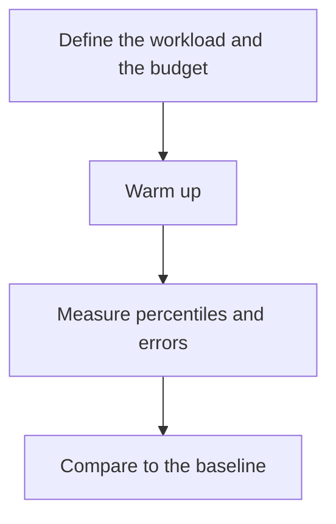

# D20-T021 — Performance testing

Topic ID: `D20-T021`
Domain: Software Testing
Subdomain: Performance testing
Importance: common
Complexity: intermediate
Dependencies: `D20-T020`, `D20-T001`, `D05-T001`, `D05-T002`, `D07-T001`, `D07-T002`
Execution status of the code in section F: unexecuted

## A. Topic Overview

Performance testing measures latency, throughput, and resource use under a stated workload. It needs a baseline, a production-like data volume, and a pass/fail budget. A number without a workload is not a result. Warmup, percentiles, and saturation belong in the report. The test should fail the build or the release if the budget breaks, or it will never be read.

In production this shows up as follows: The search endpoint is loaded with a production-sized index for ten minutes. The release fails if p99 exceeds 200 ms or errors exceed one percent. The report stores the workload, not only the number.

Interviewers use Performance testing to see whether you can state the failure mode, not only the definition. The failure to name is: a mean latency hiding a bad tail, or a test on an empty database

Prerequisites: `D20-T020`, `D20-T001`, `D05-T001`, `D05-T002`, `D07-T001`, `D07-T002`. Later notes should link here instead of repeating the mechanism.

## B. First-Principles Explanation

Performance testing measures latency, throughput, and resource use under a stated workload. It needs a baseline, a production-like data volume, and a pass/fail budget. A number without a workload is not a result. Warmup, percentiles, and saturation belong in the report. The test should fail the build or the release if the budget breaks, or it will never be read.

The useful picture is: A performance test is a timed drill with a full pack, not a stroll that you describe as 'feels fast.'

What has to be true:

1. Define the workload and the budget
2. Warm up
3. Measure percentiles and errors
4. Compare to the baseline

It works when those steps preserve one invariant. It fails when a mean latency hiding a bad tail, or a test on an empty database. The alternative is: you benchmark a laptop once and paste the number into a ticket

## C. Internal Working and Architecture

Components involved: the caller, the state Performance testing mutates or reads, and the observer that reports p99 latency and error rate against the budget.

Execution:

1. Define the workload and the budget
2. Warm up
3. Measure percentiles and errors
4. Compare to the baseline

Data moves only along that path. A retry re-enters at step 1, so the operation must say what a duplicate does. Memory and locks stay inside this mechanism. Callers see the result or a typed error, not a half-updated invariant.

State to remember: choose this when a change can affect latency or throughput. Do not choose it when you benchmark a laptop once and paste the number into a ticket.

## D. Diagrams and Visual Models



Read the diagram from top to bottom. Each box is one step of Performance testing. The failure mode (a mean latency hiding a bad tail, or a test on an empty database) is what you look for when a later box never happens or happens twice.

## E. Examples and Analogies

Analogy: A performance test is a timed drill with a full pack, not a stroll that you describe as 'feels fast.'

Production example: The search endpoint is loaded with a production-sized index for ten minutes. The release fails if p99 exceeds 200 ms or errors exceed one percent. The report stores the workload, not only the number.

A small counterexample is enough in an interview. Show the input, apply the steps, and show the broken outcome if someone uses the mechanism outside its rule: a mean latency hiding a bad tail, or a test on an empty database.

## F. Code Examples

The snippet is labeled unexecuted. It illustrates the shape of the idea. It is not a benchmark and it embeds no secret.

```python
def within_budget(p99_ms, budget_ms):
    return p99_ms <= budget_ms
```

After the snippet, check p99 latency and error rate against the budget. If that signal moves the wrong way, the snippet is the wrong tool for the workload.

## G. Practical Backend Application

Use Performance testing in a service when a change can affect latency or throughput.

A typical place is the production case already stated: The search endpoint is loaded with a production-sized index for ten minutes. The release fails if p99 exceeds 200 ms or errors exceed one percent. The report stores the workload, not only the number.

Operationally you alert on p99 latency and error rate against the budget. You do not alert only on process uptime. The dashboard should show the failure mode, a success rate, and the saturation signal (queue depth, lock wait, or latency) that predicts it.

## H. Advantages, Limitations and Trade-offs

| Choice | Benefit | Cost | Choose when | Avoid when |
| --- | --- | --- | --- | --- |
| Apply Performance testing | a change can affect latency or throughput | Extra moving parts and a new failure mode | The failure you are preventing is already real | you benchmark a laptop once and paste the number into a ticket |
| Simpler alternative | Less code and fewer dependencies | a mean latency hiding a bad tail, or a test on an empty database | The workload does not hit the limit | The invariant must hold under concurrency or failure |

Performance testing is a trade. State the benefit and the cost in the same sentence when you propose it in a design review.

## I. Common Mistakes and Misconceptions

- Averages only.
- Empty data.
- No budget.
- Treating a diagram of Performance testing as proof that the invariant holds in production.
- Copying a default configuration without naming p99 latency and error rate against the budget.

## J. Debugging and Troubleshooting

Symptom: a mean latency hiding a bad tail, or a test on an empty database

First check: p99 latency and error rate against the budget.

Then compare one healthy instance against one unhealthy instance. Confirm whether retries are duplicating work. Confirm whether a timeout is shorter than the work. Fix the invariant, then watch the same metric for a full peak, not only for the next minute.

Useful questions: did the step order in section C actually happen, or did a caller skip a step? Did a deploy change the data shape that Performance testing assumes?

## K. Interview Preparation

### Beginner

#### Q1. What problem does Performance testing solve?

**Answer:** Performance testing measures latency, throughput, and resource use under a stated workload. It needs a baseline, a production-like data volume, and a pass/fail budget. A number without a workload is not a result. Warmup, percentiles, and saturation belong in the report. The test should fail the build or the release if the budget breaks, or it will never be read. Without it, the usual backend failure is: a mean latency hiding a bad tail, or a test on an empty database.

#### Q2. Where does Performance testing sit on a request path?

**Answer:** Performance testing is not a library you sprinkle on every call. a change can affect latency or throughput You notice it when p99 latency and error rate against the budget. Name the constraint that makes this choice correct. Say what you would measure to confirm it.

#### Q3. Give a concrete example of Performance testing.

**Answer:** The search endpoint is loaded with a production-sized index for ten minutes. The release fails if p99 exceeds 200 ms or errors exceed one percent. The report stores the workload, not only the number. Walk the input, the state change, and the observable output.

#### Q4. What is a common mix-up around Performance testing?

**Answer:** a mean latency hiding a bad tail, or a test on an empty database The corrective check is p99 latency and error rate against the budget. Name the constraint that makes this choice correct. Say what you would measure to confirm it. Say which alternative you rejected and why.

#### Q5. When would you skip Performance testing?

**Answer:** you benchmark a laptop once and paste the number into a ticket Skipping is a decision with a measured cost, not a slogan. Name the constraint that makes this choice correct. Say what you would measure to confirm it. Say which alternative you rejected and why.

### Intermediate

#### Q1. What invariant makes Performance testing correct?

**Answer:** Performance testing measures latency, throughput, and resource use under a stated workload. It needs a baseline, a production-like data volume, and a pass/fail budget. A number without a workload is not a result. Warmup, percentiles, and saturation belong in the report. The test should fail the build or the release if the budget breaks, or it will never be read. State the invariant before you name the tool.

#### Q2. How do you test Performance testing?

**Answer:** Assert the failure mode directly: a mean latency hiding a bad tail, or a test on an empty database. The assertion should watch p99 latency and error rate against the budget. Include a concurrent or retry case if the bug only appears then. Name the constraint that makes this choice correct.

#### Q3. What signal tells you Performance testing is misbehaving in production?

**Answer:** Watch p99 latency and error rate against the budget. The user-visible symptom is usually a mean latency hiding a bad tail, or a test on an empty database. Name the constraint that makes this choice correct. Say what you would measure to confirm it.

#### Q4. How would you introduce Performance testing into a legacy service?

**Answer:** a change can affect latency or throughput Ship it behind a metric so you can compare the old path. Roll back if a mean latency hiding a bad tail, or a test on an empty database gets worse. Name the constraint that makes this choice correct. Say what you would measure to confirm it.

#### Q5. What do you trade away by choosing Performance testing?

**Answer:** a change can affect latency or throughput you benchmark a laptop once and paste the number into a ticket Say the cost in latency, storage, or operational load. Name the constraint that makes this choice correct. Say what you would measure to confirm it. Say which alternative you rejected and why.

### Advanced

#### Q1. What breaks if a dependency of Performance testing is slow or down?

**Answer:** a mean latency hiding a bad tail, or a test on an empty database Degrade using the rule: you benchmark a laptop once and paste the number into a ticket. Timeouts must be shorter than the caller's deadline. Name the constraint that makes this choice correct. Say what you would measure to confirm it.

#### Q2. How does Performance testing behave under retries?

**Answer:** Retries repeat work, so Performance testing must define what a duplicate does. a mean latency hiding a bad tail, or a test on an empty database Idempotency keys or fences belong next to the write, not in a comment. Name the constraint that makes this choice correct. Say what you would measure to confirm it.

#### Q3. What is the capacity limit of Performance testing?

**Answer:** The limit shows up as p99 latency and error rate against the budget. Add capacity only after you know whether the bottleneck is CPU, lock wait, or network. Name the constraint that makes this choice correct. Say what you would measure to confirm it.

#### Q4. How do you evolve Performance testing without a flag day?

**Answer:** a change can affect latency or throughput Version the contract or the on-disk format. Readers should tolerate one old and one new shape during the rollout. Name the constraint that makes this choice correct. Say what you would measure to confirm it.

#### Q5. What security or correctness bug hides inside Performance testing?

**Answer:** a mean latency hiding a bad tail, or a test on an empty database Check authorization and tenancy at the same boundary as the mechanism. A cache or queue must not widen who can read the data. Name the constraint that makes this choice correct. Say what you would measure to confirm it.

### Scenario

#### Q1. Incident: a mean latency hiding a bad tail, or a test on an empty database. What do you check first?

**Answer:** Start with p99 latency and error rate against the budget. Compare a good host and a bad host before you restart anything. Performance testing measures latency, throughput, and resource use under a stated workload. It needs a baseline, a production-like data volume, and a pass/fail budget. A number without a workload is not a result. Warmup, percentiles, and saturation belong in the report. The test should fail the build or the release if the budget breaks, or it will never be read.

#### Q2. A reviewer wants the clever version. What data settles it?

**Answer:** a change can affect latency or throughput you benchmark a laptop once and paste the number into a ticket Bring p99 latency and error rate against the budget from a load test or from production, not a slogan. Name the constraint that makes this choice correct. Say what you would measure to confirm it. Say which alternative you rejected and why.

#### Q3. You have one hour to explain Performance testing at a whiteboard.

**Answer:** Draw the happy path in four boxes. Then draw the failure: a mean latency hiding a bad tail, or a test on an empty database. End with the metric you would page on. Name the constraint that makes this choice correct.

#### Q4. The bug only appears under two concurrent callers.

**Answer:** a mean latency hiding a bad tail, or a test on an empty database Reproduce with a barrier so both sides enter the critical window. Confirm the fix with p99 latency and error rate against the budget. Name the constraint that makes this choice correct. Say what you would measure to confirm it.

#### Q5. Leadership wants this on every service next week.

**Answer:** you benchmark a laptop once and paste the number into a ticket a change can affect latency or throughput Roll it out where the failure mode is already hurting users. Name the constraint that makes this choice correct. Say what you would measure to confirm it. Say which alternative you rejected and why.

### Follow-up

#### Q1. What did you assume about the data size or the clock?

**Answer:** Performance testing measures latency, throughput, and resource use under a stated workload. It needs a baseline, a production-like data volume, and a pass/fail budget. A number without a workload is not a result. Warmup, percentiles, and saturation belong in the report. The test should fail the build or the release if the budget breaks, or it will never be read. Clocks are not a total order across machines. State whether the algorithm needs bounded size or a single leader.

#### Q2. What would you measure after the change ships?

**Answer:** Page on p99 latency and error rate against the budget. Keep a before/after dashboard for one week. Alert on the failure mode, not only on CPU. Name the constraint that makes this choice correct.

#### Q3. Which neighboring topic did you deliberately not re-teach?

**Answer:** This note owns Performance testing. Related identifiers are in section N. Shared ideas are linked, not copied. Name the constraint that makes this choice correct.

## L. Practical Exercises

Solutions are in `EXERCISES/solutions/D20-T021.md`, not in this section.

1. Whiteboard the four steps of Performance testing and mark where `a mean latency hiding a bad tail, or a test on an empty database` enters.
2. Read the snippet in section F and write the assertion that would catch that failure. The assertion must mention `p99 latency and error rate against the budget`.
3. Argue for or against using Performance testing on a service you know. Use the choose and avoid rows from section H. Do not appeal to popularity.

## M. Revision Notes

- Mechanism: Performance testing measures latency, throughput, and resource use under a stated workload.
- Failure: a mean latency hiding a bad tail, or a test on an empty database
- Metric: p99 latency and error rate against the budget
- Choose when: a change can affect latency or throughput
- Avoid when: you benchmark a laptop once and paste the number into a ticket

## N. Related Topics

Dependencies to review first: `D20-T020`, `D20-T001`, `D05-T001`, `D05-T002`, `D07-T001`, `D07-T002`.

Shared ideas stay in those notes. This note does not restate them.

## O. Completion Criteria

- You can explain Performance testing without reading this note, including the failure mode.
- You can draw the diagram in section D from memory.
- You can say when not to use it, using the avoid condition in section H.
- You can name the metric you would watch after shipping it.
