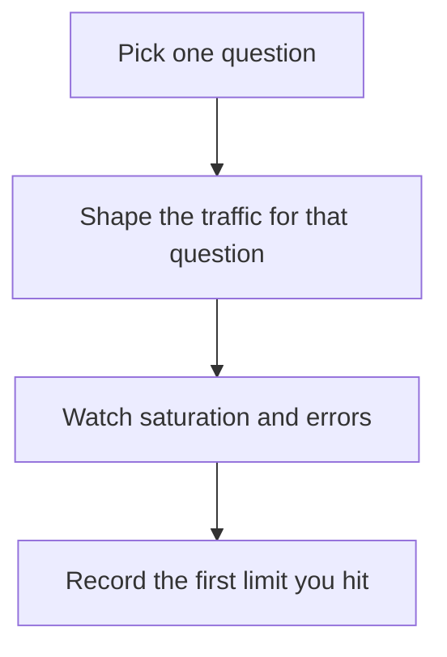

# D20-T022 — Load, stress, spike and soak testing

Topic ID: `D20-T022`
Domain: Software Testing
Subdomain: Load, stress, spike and soak testing
Importance: common
Complexity: intermediate
Dependencies: `D20-T021`, `D20-T001`, `D05-T001`, `D05-T002`, `D07-T001`, `D07-T002`
Execution status of the code in section F: unexecuted

## A. Topic Overview

Load testing uses the expected traffic. Stress testing pushes past it until something breaks, and you write down what broke. Spike testing applies a sudden jump. Soak testing runs long enough to see leaks, queue growth, and disk fill. They answer different questions. Running a five-minute load test does not tell you the daily disk curve.

In production this shows up as follows: Before a sale, the team runs a spike to five times traffic and a soak overnight. The spike finds a pool queue. The soak finds a log disk fill. A ten-minute average test had missed both.

Interviewers use Load, stress, spike and soak testing to see whether you can state the failure mode, not only the definition. The failure to name is: a soak never run, so a connection leak appears on Saturday, or a spike test that ramps so slowly it is just load

Prerequisites: `D20-T021`, `D20-T001`, `D05-T001`, `D05-T002`, `D07-T001`, `D07-T002`. Later notes should link here instead of repeating the mechanism.

## B. First-Principles Explanation

Load testing uses the expected traffic. Stress testing pushes past it until something breaks, and you write down what broke. Spike testing applies a sudden jump. Soak testing runs long enough to see leaks, queue growth, and disk fill. They answer different questions. Running a five-minute load test does not tell you the daily disk curve.

The useful picture is: Load is a normal Saturday. Stress is packing the room until a door breaks. Spike is a bus arriving at once. Soak is leaving the lights on all night to see what overheats.

What has to be true:

1. Pick one question
2. Shape the traffic for that question
3. Watch saturation and errors
4. Record the first limit you hit

It works when those steps preserve one invariant. It fails when a soak never run, so a connection leak appears on Saturday, or a spike test that ramps so slowly it is just load. The alternative is: you use one short test as the answer to all four

## C. Internal Working and Architecture

Components involved: the caller, the state Load, stress, spike and soak testing mutates or reads, and the observer that reports the limiting resource and the time-to-failure under soak.

Execution:

1. Pick one question
2. Shape the traffic for that question
3. Watch saturation and errors
4. Record the first limit you hit

Data moves only along that path. A retry re-enters at step 1, so the operation must say what a duplicate does. Memory and locks stay inside this mechanism. Callers see the result or a typed error, not a half-updated invariant.

State to remember: choose this when you need a specific capacity question. Do not choose it when you use one short test as the answer to all four.

## D. Diagrams and Visual Models



Read the diagram from top to bottom. Each box is one step of Load, stress, spike and soak testing. The failure mode (a soak never run, so a connection leak appears on Saturday, or a spike test that ramps so slowly it is just load) is what you look for when a later box never happens or happens twice.

## E. Examples and Analogies

Analogy: Load is a normal Saturday. Stress is packing the room until a door breaks. Spike is a bus arriving at once. Soak is leaving the lights on all night to see what overheats.

Production example: Before a sale, the team runs a spike to five times traffic and a soak overnight. The spike finds a pool queue. The soak finds a log disk fill. A ten-minute average test had missed both.

A small counterexample is enough in an interview. Show the input, apply the steps, and show the broken outcome if someone uses the mechanism outside its rule: a soak never run, so a connection leak appears on Saturday, or a spike test that ramps so slowly it is just load.

## F. Code Examples

The snippet is labeled unexecuted. It illustrates the shape of the idea. It is not a benchmark and it embeds no secret.

```python
def shape(kind, base):
    if kind == 'spike':
        return base * 10
    if kind == 'stress':
        return base * 3
    return base
```

After the snippet, check the limiting resource and the time-to-failure under soak. If that signal moves the wrong way, the snippet is the wrong tool for the workload.

## G. Practical Backend Application

Use Load, stress, spike and soak testing in a service when you need a specific capacity question.

A typical place is the production case already stated: Before a sale, the team runs a spike to five times traffic and a soak overnight. The spike finds a pool queue. The soak finds a log disk fill. A ten-minute average test had missed both.

Operationally you alert on the limiting resource and the time-to-failure under soak. You do not alert only on process uptime. The dashboard should show the failure mode, a success rate, and the saturation signal (queue depth, lock wait, or latency) that predicts it.

## H. Advantages, Limitations and Trade-offs

| Choice | Benefit | Cost | Choose when | Avoid when |
| --- | --- | --- | --- | --- |
| Apply Load, stress, spike and soak testing | you need a specific capacity question | Extra moving parts and a new failure mode | The failure you are preventing is already real | you use one short test as the answer to all four |
| Simpler alternative | Less code and fewer dependencies | a soak never run, so a connection leak appears on Saturday, or a spike test that ramps so slowly it is just load | The workload does not hit the limit | The invariant must hold under concurrency or failure |

Load, stress, spike and soak testing is a trade. State the benefit and the cost in the same sentence when you propose it in a design review.

## I. Common Mistakes and Misconceptions

- No limiting-resource note.
- A spike that is actually a ramp.
- Stopping soak before leaks show.
- Treating a diagram of Load, stress, spike and soak testing as proof that the invariant holds in production.
- Copying a default configuration without naming the limiting resource and the time-to-failure under soak.

## J. Debugging and Troubleshooting

Symptom: a soak never run, so a connection leak appears on Saturday, or a spike test that ramps so slowly it is just load

First check: the limiting resource and the time-to-failure under soak.

Then compare one healthy instance against one unhealthy instance. Confirm whether retries are duplicating work. Confirm whether a timeout is shorter than the work. Fix the invariant, then watch the same metric for a full peak, not only for the next minute.

Useful questions: did the step order in section C actually happen, or did a caller skip a step? Did a deploy change the data shape that Load, stress, spike and soak testing assumes?

## K. Interview Preparation

### Beginner

#### Q1. What problem does Load, stress, spike and soak testing solve?

**Answer:** Load testing uses the expected traffic. Stress testing pushes past it until something breaks, and you write down what broke. Spike testing applies a sudden jump. Soak testing runs long enough to see leaks, queue growth, and disk fill. They answer different questions. Running a five-minute load test does not tell you the daily disk curve. Without it, the usual backend failure is: a soak never run, so a connection leak appears on Saturday, or a spike test that ramps so slowly it is just load.

#### Q2. Where does Load, stress, spike and soak testing sit on a request path?

**Answer:** Load, stress, spike and soak testing is not a library you sprinkle on every call. you need a specific capacity question You notice it when the limiting resource and the time-to-failure under soak. Name the constraint that makes this choice correct. Say what you would measure to confirm it.

#### Q3. Give a concrete example of Load, stress, spike and soak testing.

**Answer:** Before a sale, the team runs a spike to five times traffic and a soak overnight. The spike finds a pool queue. The soak finds a log disk fill. A ten-minute average test had missed both. Walk the input, the state change, and the observable output.

#### Q4. What is a common mix-up around Load, stress, spike and soak testing?

**Answer:** a soak never run, so a connection leak appears on Saturday, or a spike test that ramps so slowly it is just load The corrective check is the limiting resource and the time-to-failure under soak. Name the constraint that makes this choice correct. Say what you would measure to confirm it. Say which alternative you rejected and why.

#### Q5. When would you skip Load, stress, spike and soak testing?

**Answer:** you use one short test as the answer to all four Skipping is a decision with a measured cost, not a slogan. Name the constraint that makes this choice correct. Say what you would measure to confirm it. Say which alternative you rejected and why.

### Intermediate

#### Q1. What invariant makes Load, stress, spike and soak testing correct?

**Answer:** Load testing uses the expected traffic. Stress testing pushes past it until something breaks, and you write down what broke. Spike testing applies a sudden jump. Soak testing runs long enough to see leaks, queue growth, and disk fill. They answer different questions. Running a five-minute load test does not tell you the daily disk curve. State the invariant before you name the tool.

#### Q2. How do you test Load, stress, spike and soak testing?

**Answer:** Assert the failure mode directly: a soak never run, so a connection leak appears on Saturday, or a spike test that ramps so slowly it is just load. The assertion should watch the limiting resource and the time-to-failure under soak. Include a concurrent or retry case if the bug only appears then. Name the constraint that makes this choice correct.

#### Q3. What signal tells you Load, stress, spike and soak testing is misbehaving in production?

**Answer:** Watch the limiting resource and the time-to-failure under soak. The user-visible symptom is usually a soak never run, so a connection leak appears on Saturday, or a spike test that ramps so slowly it is just load. Name the constraint that makes this choice correct. Say what you would measure to confirm it.

#### Q4. How would you introduce Load, stress, spike and soak testing into a legacy service?

**Answer:** you need a specific capacity question Ship it behind a metric so you can compare the old path. Roll back if a soak never run, so a connection leak appears on Saturday, or a spike test that ramps so slowly it is just load gets worse. Name the constraint that makes this choice correct. Say what you would measure to confirm it.

#### Q5. What do you trade away by choosing Load, stress, spike and soak testing?

**Answer:** you need a specific capacity question you use one short test as the answer to all four Say the cost in latency, storage, or operational load. Name the constraint that makes this choice correct. Say what you would measure to confirm it. Say which alternative you rejected and why.

### Advanced

#### Q1. What breaks if a dependency of Load, stress, spike and soak testing is slow or down?

**Answer:** a soak never run, so a connection leak appears on Saturday, or a spike test that ramps so slowly it is just load Degrade using the rule: you use one short test as the answer to all four. Timeouts must be shorter than the caller's deadline. Name the constraint that makes this choice correct. Say what you would measure to confirm it.

#### Q2. How does Load, stress, spike and soak testing behave under retries?

**Answer:** Retries repeat work, so Load, stress, spike and soak testing must define what a duplicate does. a soak never run, so a connection leak appears on Saturday, or a spike test that ramps so slowly it is just load Idempotency keys or fences belong next to the write, not in a comment. Name the constraint that makes this choice correct. Say what you would measure to confirm it.

#### Q3. What is the capacity limit of Load, stress, spike and soak testing?

**Answer:** The limit shows up as the limiting resource and the time-to-failure under soak. Add capacity only after you know whether the bottleneck is CPU, lock wait, or network. Name the constraint that makes this choice correct. Say what you would measure to confirm it.

#### Q4. How do you evolve Load, stress, spike and soak testing without a flag day?

**Answer:** you need a specific capacity question Version the contract or the on-disk format. Readers should tolerate one old and one new shape during the rollout. Name the constraint that makes this choice correct. Say what you would measure to confirm it.

#### Q5. What security or correctness bug hides inside Load, stress, spike and soak testing?

**Answer:** a soak never run, so a connection leak appears on Saturday, or a spike test that ramps so slowly it is just load Check authorization and tenancy at the same boundary as the mechanism. A cache or queue must not widen who can read the data. Name the constraint that makes this choice correct. Say what you would measure to confirm it.

### Scenario

#### Q1. Incident: a soak never run, so a connection leak appears on Saturday, or a spike test that ramps so slowly it is just load. What do you check first?

**Answer:** Start with the limiting resource and the time-to-failure under soak. Compare a good host and a bad host before you restart anything. Load testing uses the expected traffic. Stress testing pushes past it until something breaks, and you write down what broke. Spike testing applies a sudden jump. Soak testing runs long enough to see leaks, queue growth, and disk fill. They answer different questions. Running a five-minute load test does not tell you the daily disk curve.

#### Q2. A reviewer wants the clever version. What data settles it?

**Answer:** you need a specific capacity question you use one short test as the answer to all four Bring the limiting resource and the time-to-failure under soak from a load test or from production, not a slogan. Name the constraint that makes this choice correct. Say what you would measure to confirm it. Say which alternative you rejected and why.

#### Q3. You have one hour to explain Load, stress, spike and soak testing at a whiteboard.

**Answer:** Draw the happy path in four boxes. Then draw the failure: a soak never run, so a connection leak appears on Saturday, or a spike test that ramps so slowly it is just load. End with the metric you would page on. Name the constraint that makes this choice correct.

#### Q4. The bug only appears under two concurrent callers.

**Answer:** a soak never run, so a connection leak appears on Saturday, or a spike test that ramps so slowly it is just load Reproduce with a barrier so both sides enter the critical window. Confirm the fix with the limiting resource and the time-to-failure under soak. Name the constraint that makes this choice correct. Say what you would measure to confirm it.

#### Q5. Leadership wants this on every service next week.

**Answer:** you use one short test as the answer to all four you need a specific capacity question Roll it out where the failure mode is already hurting users. Name the constraint that makes this choice correct. Say what you would measure to confirm it. Say which alternative you rejected and why.

### Follow-up

#### Q1. What did you assume about the data size or the clock?

**Answer:** Load testing uses the expected traffic. Stress testing pushes past it until something breaks, and you write down what broke. Spike testing applies a sudden jump. Soak testing runs long enough to see leaks, queue growth, and disk fill. They answer different questions. Running a five-minute load test does not tell you the daily disk curve. Clocks are not a total order across machines. State whether the algorithm needs bounded size or a single leader.

#### Q2. What would you measure after the change ships?

**Answer:** Page on the limiting resource and the time-to-failure under soak. Keep a before/after dashboard for one week. Alert on the failure mode, not only on CPU. Name the constraint that makes this choice correct.

#### Q3. Which neighboring topic did you deliberately not re-teach?

**Answer:** This note owns Load, stress, spike and soak testing. Related identifiers are in section N. Shared ideas are linked, not copied. Name the constraint that makes this choice correct.

## L. Practical Exercises

Solutions are in `EXERCISES/solutions/D20-T022.md`, not in this section.

1. Whiteboard the four steps of Load, stress, spike and soak testing and mark where `a soak never run, so a connection leak appears on Saturday, or a spike test that ramps so slowly it is just load` enters.
2. Read the snippet in section F and write the assertion that would catch that failure. The assertion must mention `the limiting resource and the time-to-failure under soak`.
3. Argue for or against using Load, stress, spike and soak testing on a service you know. Use the choose and avoid rows from section H. Do not appeal to popularity.

## M. Revision Notes

- Mechanism: Load testing uses the expected traffic.
- Failure: a soak never run, so a connection leak appears on Saturday, or a spike test that ramps so slowly it is just load
- Metric: the limiting resource and the time-to-failure under soak
- Choose when: you need a specific capacity question
- Avoid when: you use one short test as the answer to all four

## N. Related Topics

Dependencies to review first: `D20-T021`, `D20-T001`, `D05-T001`, `D05-T002`, `D07-T001`, `D07-T002`.

Shared ideas stay in those notes. This note does not restate them.

## O. Completion Criteria

- You can explain Load, stress, spike and soak testing without reading this note, including the failure mode.
- You can draw the diagram in section D from memory.
- You can say when not to use it, using the avoid condition in section H.
- You can name the metric you would watch after shipping it.
