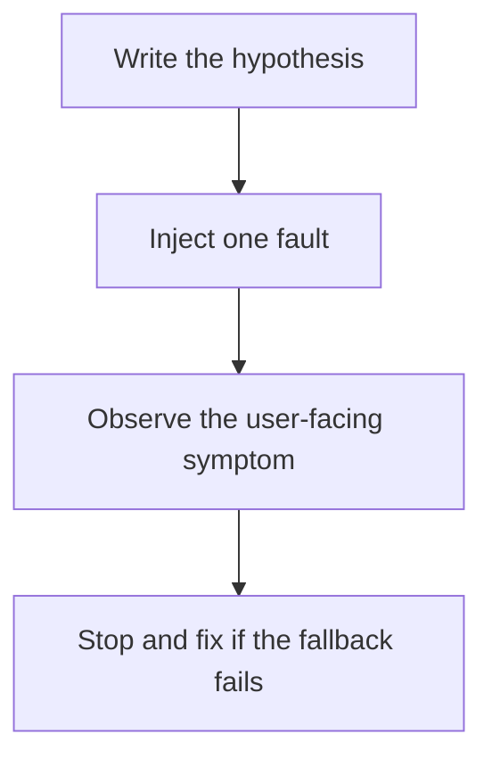

# D20-T023 — Fault injection and chaos testing

Topic ID: `D20-T023`
Domain: Software Testing
Subdomain: Fault injection and chaos testing
Importance: advanced
Complexity: advanced
Dependencies: `D20-T022`, `D20-T001`, `D05-T001`, `D05-T002`, `D07-T001`, `D07-T002`
Execution status of the code in section F: unexecuted

## A. Topic Overview

Fault injection and chaos testing deliberately break a dependency, a host, or a network path to see whether the system degrades as designed. Start with a hypothesis and a blast radius. Abort the experiment if the user impact exceeds the budget. The result is a fixed gap or a confirmed fallback, not a green dashboard. Production experiments need an owner.

In production this shows up as follows: The team drops the primary database connection for one minute in staging and expects the API to return 503 quickly rather than hang. A later, smaller production experiment uses the same abort rule.

Interviewers use Fault injection and chaos testing to see whether you can state the failure mode, not only the definition. The failure to name is: an experiment with no abort condition that becomes the outage, or a test that only kills a process in a way production will not

Prerequisites: `D20-T022`, `D20-T001`, `D05-T001`, `D05-T002`, `D07-T001`, `D07-T002`. Later notes should link here instead of repeating the mechanism.

## B. First-Principles Explanation

Fault injection and chaos testing deliberately break a dependency, a host, or a network path to see whether the system degrades as designed. Start with a hypothesis and a blast radius. Abort the experiment if the user impact exceeds the budget. The result is a fixed gap or a confirmed fallback, not a green dashboard. Production experiments need an owner.

The useful picture is: Chaos testing is a fire drill with a real extinguisher, planned, timed, and called off if the smoke reaches the stairwell. It is not lighting a match and leaving.

What has to be true:

1. Write the hypothesis
2. Inject one fault
3. Observe the user-facing symptom
4. Stop and fix if the fallback fails

It works when those steps preserve one invariant. It fails when an experiment with no abort condition that becomes the outage, or a test that only kills a process in a way production will not. The alternative is: you inject faults with no hypothesis and no stop button

## C. Internal Working and Architecture

Components involved: the caller, the state Fault injection and chaos testing mutates or reads, and the observer that reports whether the fallback met the SLO during the fault.

Execution:

1. Write the hypothesis
2. Inject one fault
3. Observe the user-facing symptom
4. Stop and fix if the fallback fails

Data moves only along that path. A retry re-enters at step 1, so the operation must say what a duplicate does. Memory and locks stay inside this mechanism. Callers see the result or a typed error, not a half-updated invariant.

State to remember: choose this when you claim a fallback or a timeout and have never seen the fault. Do not choose it when you inject faults with no hypothesis and no stop button.

## D. Diagrams and Visual Models



Read the diagram from top to bottom. Each box is one step of Fault injection and chaos testing. The failure mode (an experiment with no abort condition that becomes the outage, or a test that only kills a process in a way production will not) is what you look for when a later box never happens or happens twice.

## E. Examples and Analogies

Analogy: Chaos testing is a fire drill with a real extinguisher, planned, timed, and called off if the smoke reaches the stairwell. It is not lighting a match and leaving.

Production example: The team drops the primary database connection for one minute in staging and expects the API to return 503 quickly rather than hang. A later, smaller production experiment uses the same abort rule.

A small counterexample is enough in an interview. Show the input, apply the steps, and show the broken outcome if someone uses the mechanism outside its rule: an experiment with no abort condition that becomes the outage, or a test that only kills a process in a way production will not.

## F. Code Examples

The snippet is labeled unexecuted. It illustrates the shape of the idea. It is not a benchmark and it embeds no secret.

```python
def should_abort(error_rate, budget):
    return error_rate > budget
```

After the snippet, check whether the fallback met the SLO during the fault. If that signal moves the wrong way, the snippet is the wrong tool for the workload.

## G. Practical Backend Application

Use Fault injection and chaos testing in a service when you claim a fallback or a timeout and have never seen the fault.

A typical place is the production case already stated: The team drops the primary database connection for one minute in staging and expects the API to return 503 quickly rather than hang. A later, smaller production experiment uses the same abort rule.

Operationally you alert on whether the fallback met the SLO during the fault. You do not alert only on process uptime. The dashboard should show the failure mode, a success rate, and the saturation signal (queue depth, lock wait, or latency) that predicts it.

## H. Advantages, Limitations and Trade-offs

| Choice | Benefit | Cost | Choose when | Avoid when |
| --- | --- | --- | --- | --- |
| Apply Fault injection and chaos testing | you claim a fallback or a timeout and have never seen the fault | Extra moving parts and a new failure mode | The failure you are preventing is already real | you inject faults with no hypothesis and no stop button |
| Simpler alternative | Less code and fewer dependencies | an experiment with no abort condition that becomes the outage, or a test that only kills a process in a way production will not | The workload does not hit the limit | The invariant must hold under concurrency or failure |

Fault injection and chaos testing is a trade. State the benefit and the cost in the same sentence when you propose it in a design review.

## I. Common Mistakes and Misconceptions

- No abort.
- Only the happy instance.
- A drill that pages customers unexpectedly.
- Treating a diagram of Fault injection and chaos testing as proof that the invariant holds in production.
- Copying a default configuration without naming whether the fallback met the SLO during the fault.

## J. Debugging and Troubleshooting

Symptom: an experiment with no abort condition that becomes the outage, or a test that only kills a process in a way production will not

First check: whether the fallback met the SLO during the fault.

Then compare one healthy instance against one unhealthy instance. Confirm whether retries are duplicating work. Confirm whether a timeout is shorter than the work. Fix the invariant, then watch the same metric for a full peak, not only for the next minute.

Useful questions: did the step order in section C actually happen, or did a caller skip a step? Did a deploy change the data shape that Fault injection and chaos testing assumes?

## K. Interview Preparation

### Beginner

#### Q1. What problem does Fault injection and chaos testing solve?

**Answer:** Fault injection and chaos testing deliberately break a dependency, a host, or a network path to see whether the system degrades as designed. Start with a hypothesis and a blast radius. Abort the experiment if the user impact exceeds the budget. The result is a fixed gap or a confirmed fallback, not a green dashboard. Production experiments need an owner. Without it, the usual backend failure is: an experiment with no abort condition that becomes the outage, or a test that only kills a process in a way production will not.

#### Q2. Where does Fault injection and chaos testing sit on a request path?

**Answer:** Fault injection and chaos testing is not a library you sprinkle on every call. you claim a fallback or a timeout and have never seen the fault You notice it when whether the fallback met the SLO during the fault. Name the constraint that makes this choice correct. Say what you would measure to confirm it.

#### Q3. Give a concrete example of Fault injection and chaos testing.

**Answer:** The team drops the primary database connection for one minute in staging and expects the API to return 503 quickly rather than hang. A later, smaller production experiment uses the same abort rule. Walk the input, the state change, and the observable output. Name the constraint that makes this choice correct.

#### Q4. What is a common mix-up around Fault injection and chaos testing?

**Answer:** an experiment with no abort condition that becomes the outage, or a test that only kills a process in a way production will not The corrective check is whether the fallback met the SLO during the fault. Name the constraint that makes this choice correct. Say what you would measure to confirm it. Say which alternative you rejected and why.

#### Q5. When would you skip Fault injection and chaos testing?

**Answer:** you inject faults with no hypothesis and no stop button Skipping is a decision with a measured cost, not a slogan. Name the constraint that makes this choice correct. Say what you would measure to confirm it. Say which alternative you rejected and why.

### Intermediate

#### Q1. What invariant makes Fault injection and chaos testing correct?

**Answer:** Fault injection and chaos testing deliberately break a dependency, a host, or a network path to see whether the system degrades as designed. Start with a hypothesis and a blast radius. Abort the experiment if the user impact exceeds the budget. The result is a fixed gap or a confirmed fallback, not a green dashboard. Production experiments need an owner. State the invariant before you name the tool.

#### Q2. How do you test Fault injection and chaos testing?

**Answer:** Assert the failure mode directly: an experiment with no abort condition that becomes the outage, or a test that only kills a process in a way production will not. The assertion should watch whether the fallback met the SLO during the fault. Include a concurrent or retry case if the bug only appears then. Name the constraint that makes this choice correct.

#### Q3. What signal tells you Fault injection and chaos testing is misbehaving in production?

**Answer:** Watch whether the fallback met the SLO during the fault. The user-visible symptom is usually an experiment with no abort condition that becomes the outage, or a test that only kills a process in a way production will not. Name the constraint that makes this choice correct. Say what you would measure to confirm it.

#### Q4. How would you introduce Fault injection and chaos testing into a legacy service?

**Answer:** you claim a fallback or a timeout and have never seen the fault Ship it behind a metric so you can compare the old path. Roll back if an experiment with no abort condition that becomes the outage, or a test that only kills a process in a way production will not gets worse. Name the constraint that makes this choice correct. Say what you would measure to confirm it.

#### Q5. What do you trade away by choosing Fault injection and chaos testing?

**Answer:** you claim a fallback or a timeout and have never seen the fault you inject faults with no hypothesis and no stop button Say the cost in latency, storage, or operational load. Name the constraint that makes this choice correct. Say what you would measure to confirm it. Say which alternative you rejected and why.

### Advanced

#### Q1. What breaks if a dependency of Fault injection and chaos testing is slow or down?

**Answer:** an experiment with no abort condition that becomes the outage, or a test that only kills a process in a way production will not Degrade using the rule: you inject faults with no hypothesis and no stop button. Timeouts must be shorter than the caller's deadline. Name the constraint that makes this choice correct. Say what you would measure to confirm it.

#### Q2. How does Fault injection and chaos testing behave under retries?

**Answer:** Retries repeat work, so Fault injection and chaos testing must define what a duplicate does. an experiment with no abort condition that becomes the outage, or a test that only kills a process in a way production will not Idempotency keys or fences belong next to the write, not in a comment. Name the constraint that makes this choice correct. Say what you would measure to confirm it.

#### Q3. What is the capacity limit of Fault injection and chaos testing?

**Answer:** The limit shows up as whether the fallback met the SLO during the fault. Add capacity only after you know whether the bottleneck is CPU, lock wait, or network. Name the constraint that makes this choice correct. Say what you would measure to confirm it.

#### Q4. How do you evolve Fault injection and chaos testing without a flag day?

**Answer:** you claim a fallback or a timeout and have never seen the fault Version the contract or the on-disk format. Readers should tolerate one old and one new shape during the rollout. Name the constraint that makes this choice correct. Say what you would measure to confirm it.

#### Q5. What security or correctness bug hides inside Fault injection and chaos testing?

**Answer:** an experiment with no abort condition that becomes the outage, or a test that only kills a process in a way production will not Check authorization and tenancy at the same boundary as the mechanism. A cache or queue must not widen who can read the data. Name the constraint that makes this choice correct. Say what you would measure to confirm it.

### Scenario

#### Q1. Incident: an experiment with no abort condition that becomes the outage, or a test that only kills a process in a way production will not. What do you check first?

**Answer:** Start with whether the fallback met the SLO during the fault. Compare a good host and a bad host before you restart anything. Fault injection and chaos testing deliberately break a dependency, a host, or a network path to see whether the system degrades as designed. Start with a hypothesis and a blast radius. Abort the experiment if the user impact exceeds the budget. The result is a fixed gap or a confirmed fallback, not a green dashboard. Production experiments need an owner.

#### Q2. A reviewer wants the clever version. What data settles it?

**Answer:** you claim a fallback or a timeout and have never seen the fault you inject faults with no hypothesis and no stop button Bring whether the fallback met the SLO during the fault from a load test or from production, not a slogan. Name the constraint that makes this choice correct. Say what you would measure to confirm it. Say which alternative you rejected and why.

#### Q3. You have one hour to explain Fault injection and chaos testing at a whiteboard.

**Answer:** Draw the happy path in four boxes. Then draw the failure: an experiment with no abort condition that becomes the outage, or a test that only kills a process in a way production will not. End with the metric you would page on. Name the constraint that makes this choice correct.

#### Q4. The bug only appears under two concurrent callers.

**Answer:** an experiment with no abort condition that becomes the outage, or a test that only kills a process in a way production will not Reproduce with a barrier so both sides enter the critical window. Confirm the fix with whether the fallback met the SLO during the fault. Name the constraint that makes this choice correct. Say what you would measure to confirm it.

#### Q5. Leadership wants this on every service next week.

**Answer:** you inject faults with no hypothesis and no stop button you claim a fallback or a timeout and have never seen the fault Roll it out where the failure mode is already hurting users. Name the constraint that makes this choice correct. Say what you would measure to confirm it. Say which alternative you rejected and why.

### Follow-up

#### Q1. What did you assume about the data size or the clock?

**Answer:** Fault injection and chaos testing deliberately break a dependency, a host, or a network path to see whether the system degrades as designed. Start with a hypothesis and a blast radius. Abort the experiment if the user impact exceeds the budget. The result is a fixed gap or a confirmed fallback, not a green dashboard. Production experiments need an owner. Clocks are not a total order across machines. State whether the algorithm needs bounded size or a single leader.

#### Q2. What would you measure after the change ships?

**Answer:** Page on whether the fallback met the SLO during the fault. Keep a before/after dashboard for one week. Alert on the failure mode, not only on CPU. Name the constraint that makes this choice correct.

#### Q3. Which neighboring topic did you deliberately not re-teach?

**Answer:** This note owns Fault injection and chaos testing. Related identifiers are in section N. Shared ideas are linked, not copied. Name the constraint that makes this choice correct.

## L. Practical Exercises

Solutions are in `EXERCISES/solutions/D20-T023.md`, not in this section.

1. Whiteboard the four steps of Fault injection and chaos testing and mark where `an experiment with no abort condition that becomes the outage, or a test that only kills a process in a way production will not` enters.
2. Read the snippet in section F and write the assertion that would catch that failure. The assertion must mention `whether the fallback met the SLO during the fault`.
3. Argue for or against using Fault injection and chaos testing on a service you know. Use the choose and avoid rows from section H. Do not appeal to popularity.

## M. Revision Notes

- Mechanism: Fault injection and chaos testing deliberately break a dependency, a host, or a network path to see whether the system degrades as designed.
- Failure: an experiment with no abort condition that becomes the outage, or a test that only kills a process in a way production will not
- Metric: whether the fallback met the SLO during the fault
- Choose when: you claim a fallback or a timeout and have never seen the fault
- Avoid when: you inject faults with no hypothesis and no stop button

## N. Related Topics

Dependencies to review first: `D20-T022`, `D20-T001`, `D05-T001`, `D05-T002`, `D07-T001`, `D07-T002`.

Shared ideas stay in those notes. This note does not restate them.

## O. Completion Criteria

- You can explain Fault injection and chaos testing without reading this note, including the failure mode.
- You can draw the diagram in section D from memory.
- You can say when not to use it, using the avoid condition in section H.
- You can name the metric you would watch after shipping it.
