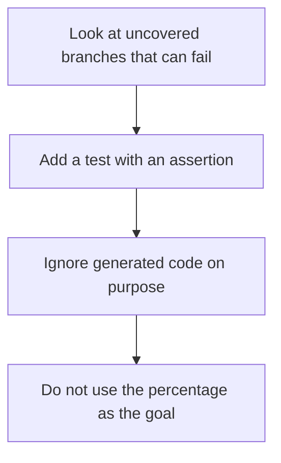

# D20-T024 — Test coverage vs test quality

Topic ID: `D20-T024`
Domain: Software Testing
Subdomain: Test coverage vs test quality
Importance: common
Complexity: intermediate
Dependencies: `D20-T023`, `D20-T001`, `D05-T001`, `D05-T002`, `D07-T001`, `D07-T002`
Execution status of the code in section F: unexecuted

## A. Topic Overview

Coverage counts which lines or branches ran during tests. It does not count whether the assertions would catch a bug. A high coverage number with weak assertions is a false comfort. Use coverage to find code with no tests, and use mutation or review to judge quality. Do not chase a number by asserting nothing on generated code.

In production this shows up as follows: The team treats uncovered error branches as a work list. They do not block a release on a one-percent coverage drop in a generated client. A payment function with coverage and a surviving mutant gets a better assertion.

Interviewers use Test coverage vs test quality to see whether you can state the failure mode, not only the definition. The failure to name is: 100 percent coverage and a mutant that survives, or a team deleting an assertion to keep a number

Prerequisites: `D20-T023`, `D20-T001`, `D05-T001`, `D05-T002`, `D07-T001`, `D07-T002`. Later notes should link here instead of repeating the mechanism.

## B. First-Principles Explanation

Coverage counts which lines or branches ran during tests. It does not count whether the assertions would catch a bug. A high coverage number with weak assertions is a false comfort. Use coverage to find code with no tests, and use mutation or review to judge quality. Do not chase a number by asserting nothing on generated code.

The useful picture is: Coverage is a map of streets you drove. It does not say you noticed the stop signs. Driving every street with your eyes closed still paints the map.

What has to be true:

1. Look at uncovered branches that can fail
2. Add a test with an assertion
3. Ignore generated code on purpose
4. Do not use the percentage as the goal

It works when those steps preserve one invariant. It fails when 100 percent coverage and a mutant that survives, or a team deleting an assertion to keep a number. The alternative is: you manage the team by the coverage percentage

## C. Internal Working and Architecture

Components involved: the caller, the state Test coverage vs test quality mutates or reads, and the observer that reports escaped defects in code that was marked covered.

Execution:

1. Look at uncovered branches that can fail
2. Add a test with an assertion
3. Ignore generated code on purpose
4. Do not use the percentage as the goal

Data moves only along that path. A retry re-enters at step 1, so the operation must say what a duplicate does. Memory and locks stay inside this mechanism. Callers see the result or a typed error, not a half-updated invariant.

State to remember: choose this when you are looking for code that tests never exercise. Do not choose it when you manage the team by the coverage percentage.

## D. Diagrams and Visual Models



Read the diagram from top to bottom. Each box is one step of Test coverage vs test quality. The failure mode (100 percent coverage and a mutant that survives, or a team deleting an assertion to keep a number) is what you look for when a later box never happens or happens twice.

## E. Examples and Analogies

Analogy: Coverage is a map of streets you drove. It does not say you noticed the stop signs. Driving every street with your eyes closed still paints the map.

Production example: The team treats uncovered error branches as a work list. They do not block a release on a one-percent coverage drop in a generated client. A payment function with coverage and a surviving mutant gets a better assertion.

A small counterexample is enough in an interview. Show the input, apply the steps, and show the broken outcome if someone uses the mechanism outside its rule: 100 percent coverage and a mutant that survives, or a team deleting an assertion to keep a number.

## F. Code Examples

The snippet is labeled unexecuted. It illustrates the shape of the idea. It is not a benchmark and it embeds no secret.

```python
def test_rejects_negative(fn):
    assert fn(-1) == 'error'
```

After the snippet, check escaped defects in code that was marked covered. If that signal moves the wrong way, the snippet is the wrong tool for the workload.

## G. Practical Backend Application

Use Test coverage vs test quality in a service when you are looking for code that tests never exercise.

A typical place is the production case already stated: The team treats uncovered error branches as a work list. They do not block a release on a one-percent coverage drop in a generated client. A payment function with coverage and a surviving mutant gets a better assertion.

Operationally you alert on escaped defects in code that was marked covered. You do not alert only on process uptime. The dashboard should show the failure mode, a success rate, and the saturation signal (queue depth, lock wait, or latency) that predicts it.

## H. Advantages, Limitations and Trade-offs

| Choice | Benefit | Cost | Choose when | Avoid when |
| --- | --- | --- | --- | --- |
| Apply Test coverage vs test quality | you are looking for code that tests never exercise | Extra moving parts and a new failure mode | The failure you are preventing is already real | you manage the team by the coverage percentage |
| Simpler alternative | Less code and fewer dependencies | 100 percent coverage and a mutant that survives, or a team deleting an assertion to keep a number | The workload does not hit the limit | The invariant must hold under concurrency or failure |

Test coverage vs test quality is a trade. State the benefit and the cost in the same sentence when you propose it in a design review.

## I. Common Mistakes and Misconceptions

- Assertions that only check a mock.
- Excluding the hard branches.
- Coverage as a bonus metric that people game.
- Treating a diagram of Test coverage vs test quality as proof that the invariant holds in production.
- Copying a default configuration without naming escaped defects in code that was marked covered.

## J. Debugging and Troubleshooting

Symptom: 100 percent coverage and a mutant that survives, or a team deleting an assertion to keep a number

First check: escaped defects in code that was marked covered.

Then compare one healthy instance against one unhealthy instance. Confirm whether retries are duplicating work. Confirm whether a timeout is shorter than the work. Fix the invariant, then watch the same metric for a full peak, not only for the next minute.

Useful questions: did the step order in section C actually happen, or did a caller skip a step? Did a deploy change the data shape that Test coverage vs test quality assumes?

## K. Interview Preparation

### Beginner

#### Q1. What problem does Test coverage vs test quality solve?

**Answer:** Coverage counts which lines or branches ran during tests. It does not count whether the assertions would catch a bug. A high coverage number with weak assertions is a false comfort. Use coverage to find code with no tests, and use mutation or review to judge quality. Do not chase a number by asserting nothing on generated code. Without it, the usual backend failure is: 100 percent coverage and a mutant that survives, or a team deleting an assertion to keep a number.

#### Q2. Where does Test coverage vs test quality sit on a request path?

**Answer:** Test coverage vs test quality is not a library you sprinkle on every call. you are looking for code that tests never exercise You notice it when escaped defects in code that was marked covered. Name the constraint that makes this choice correct. Say what you would measure to confirm it.

#### Q3. Give a concrete example of Test coverage vs test quality.

**Answer:** The team treats uncovered error branches as a work list. They do not block a release on a one-percent coverage drop in a generated client. A payment function with coverage and a surviving mutant gets a better assertion. Walk the input, the state change, and the observable output.

#### Q4. What is a common mix-up around Test coverage vs test quality?

**Answer:** 100 percent coverage and a mutant that survives, or a team deleting an assertion to keep a number The corrective check is escaped defects in code that was marked covered. Name the constraint that makes this choice correct. Say what you would measure to confirm it. Say which alternative you rejected and why.

#### Q5. When would you skip Test coverage vs test quality?

**Answer:** you manage the team by the coverage percentage Skipping is a decision with a measured cost, not a slogan. Name the constraint that makes this choice correct. Say what you would measure to confirm it. Say which alternative you rejected and why.

### Intermediate

#### Q1. What invariant makes Test coverage vs test quality correct?

**Answer:** Coverage counts which lines or branches ran during tests. It does not count whether the assertions would catch a bug. A high coverage number with weak assertions is a false comfort. Use coverage to find code with no tests, and use mutation or review to judge quality. Do not chase a number by asserting nothing on generated code. State the invariant before you name the tool.

#### Q2. How do you test Test coverage vs test quality?

**Answer:** Assert the failure mode directly: 100 percent coverage and a mutant that survives, or a team deleting an assertion to keep a number. The assertion should watch escaped defects in code that was marked covered. Include a concurrent or retry case if the bug only appears then. Name the constraint that makes this choice correct.

#### Q3. What signal tells you Test coverage vs test quality is misbehaving in production?

**Answer:** Watch escaped defects in code that was marked covered. The user-visible symptom is usually 100 percent coverage and a mutant that survives, or a team deleting an assertion to keep a number. Name the constraint that makes this choice correct. Say what you would measure to confirm it.

#### Q4. How would you introduce Test coverage vs test quality into a legacy service?

**Answer:** you are looking for code that tests never exercise Ship it behind a metric so you can compare the old path. Roll back if 100 percent coverage and a mutant that survives, or a team deleting an assertion to keep a number gets worse. Name the constraint that makes this choice correct. Say what you would measure to confirm it.

#### Q5. What do you trade away by choosing Test coverage vs test quality?

**Answer:** you are looking for code that tests never exercise you manage the team by the coverage percentage Say the cost in latency, storage, or operational load. Name the constraint that makes this choice correct. Say what you would measure to confirm it. Say which alternative you rejected and why.

### Advanced

#### Q1. What breaks if a dependency of Test coverage vs test quality is slow or down?

**Answer:** 100 percent coverage and a mutant that survives, or a team deleting an assertion to keep a number Degrade using the rule: you manage the team by the coverage percentage. Timeouts must be shorter than the caller's deadline. Name the constraint that makes this choice correct. Say what you would measure to confirm it.

#### Q2. How does Test coverage vs test quality behave under retries?

**Answer:** Retries repeat work, so Test coverage vs test quality must define what a duplicate does. 100 percent coverage and a mutant that survives, or a team deleting an assertion to keep a number Idempotency keys or fences belong next to the write, not in a comment. Name the constraint that makes this choice correct. Say what you would measure to confirm it.

#### Q3. What is the capacity limit of Test coverage vs test quality?

**Answer:** The limit shows up as escaped defects in code that was marked covered. Add capacity only after you know whether the bottleneck is CPU, lock wait, or network. Name the constraint that makes this choice correct. Say what you would measure to confirm it.

#### Q4. How do you evolve Test coverage vs test quality without a flag day?

**Answer:** you are looking for code that tests never exercise Version the contract or the on-disk format. Readers should tolerate one old and one new shape during the rollout. Name the constraint that makes this choice correct. Say what you would measure to confirm it.

#### Q5. What security or correctness bug hides inside Test coverage vs test quality?

**Answer:** 100 percent coverage and a mutant that survives, or a team deleting an assertion to keep a number Check authorization and tenancy at the same boundary as the mechanism. A cache or queue must not widen who can read the data. Name the constraint that makes this choice correct. Say what you would measure to confirm it.

### Scenario

#### Q1. Incident: 100 percent coverage and a mutant that survives, or a team deleting an assertion to keep a number. What do you check first?

**Answer:** Start with escaped defects in code that was marked covered. Compare a good host and a bad host before you restart anything. Coverage counts which lines or branches ran during tests. It does not count whether the assertions would catch a bug. A high coverage number with weak assertions is a false comfort. Use coverage to find code with no tests, and use mutation or review to judge quality. Do not chase a number by asserting nothing on generated code.

#### Q2. A reviewer wants the clever version. What data settles it?

**Answer:** you are looking for code that tests never exercise you manage the team by the coverage percentage Bring escaped defects in code that was marked covered from a load test or from production, not a slogan. Name the constraint that makes this choice correct. Say what you would measure to confirm it. Say which alternative you rejected and why.

#### Q3. You have one hour to explain Test coverage vs test quality at a whiteboard.

**Answer:** Draw the happy path in four boxes. Then draw the failure: 100 percent coverage and a mutant that survives, or a team deleting an assertion to keep a number. End with the metric you would page on. Name the constraint that makes this choice correct.

#### Q4. The bug only appears under two concurrent callers.

**Answer:** 100 percent coverage and a mutant that survives, or a team deleting an assertion to keep a number Reproduce with a barrier so both sides enter the critical window. Confirm the fix with escaped defects in code that was marked covered. Name the constraint that makes this choice correct. Say what you would measure to confirm it.

#### Q5. Leadership wants this on every service next week.

**Answer:** you manage the team by the coverage percentage you are looking for code that tests never exercise Roll it out where the failure mode is already hurting users. Name the constraint that makes this choice correct. Say what you would measure to confirm it. Say which alternative you rejected and why.

### Follow-up

#### Q1. What did you assume about the data size or the clock?

**Answer:** Coverage counts which lines or branches ran during tests. It does not count whether the assertions would catch a bug. A high coverage number with weak assertions is a false comfort. Use coverage to find code with no tests, and use mutation or review to judge quality. Do not chase a number by asserting nothing on generated code. Clocks are not a total order across machines. State whether the algorithm needs bounded size or a single leader.

#### Q2. What would you measure after the change ships?

**Answer:** Page on escaped defects in code that was marked covered. Keep a before/after dashboard for one week. Alert on the failure mode, not only on CPU. Name the constraint that makes this choice correct.

#### Q3. Which neighboring topic did you deliberately not re-teach?

**Answer:** This note owns Test coverage vs test quality. Related identifiers are in section N. Shared ideas are linked, not copied. Name the constraint that makes this choice correct.

## L. Practical Exercises

Solutions are in `EXERCISES/solutions/D20-T024.md`, not in this section.

1. Whiteboard the four steps of Test coverage vs test quality and mark where `100 percent coverage and a mutant that survives, or a team deleting an assertion to keep a number` enters.
2. Read the snippet in section F and write the assertion that would catch that failure. The assertion must mention `escaped defects in code that was marked covered`.
3. Argue for or against using Test coverage vs test quality on a service you know. Use the choose and avoid rows from section H. Do not appeal to popularity.

## M. Revision Notes

- Mechanism: Coverage counts which lines or branches ran during tests.
- Failure: 100 percent coverage and a mutant that survives, or a team deleting an assertion to keep a number
- Metric: escaped defects in code that was marked covered
- Choose when: you are looking for code that tests never exercise
- Avoid when: you manage the team by the coverage percentage

## N. Related Topics

Dependencies to review first: `D20-T023`, `D20-T001`, `D05-T001`, `D05-T002`, `D07-T001`, `D07-T002`.

Shared ideas stay in those notes. This note does not restate them.

## O. Completion Criteria

- You can explain Test coverage vs test quality without reading this note, including the failure mode.
- You can draw the diagram in section D from memory.
- You can say when not to use it, using the avoid condition in section H.
- You can name the metric you would watch after shipping it.
