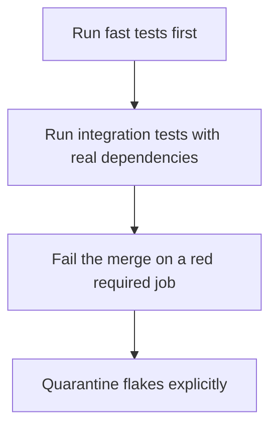

# D20-T025 — CI test pipelines

Topic ID: `D20-T025`
Domain: Software Testing
Subdomain: CI test pipelines
Importance: common
Complexity: intermediate
Dependencies: `D20-T024`, `D20-T001`, `D05-T001`, `D05-T002`, `D07-T001`, `D07-T002`
Execution status of the code in section F: unexecuted

## A. Topic Overview

A CI test pipeline runs tests on every change in a known order: fast unit tests, then integration, then slower end-to-end or contract jobs. It fails closed. Flaky tests are quarantined with a ticket, not retried into a green build forever. Artifacts and logs are kept for the failing run. The pipeline is the gate, not a suggestion.

In production this shows up as follows: Pull requests run unit tests, then a PostgreSQL job, then consumer contract verification. A flaky test is skipped with an issue link and a deadline. The merge button requires those checks.

Interviewers use CI test pipelines to see whether you can state the failure mode, not only the definition. The failure to name is: a required job that is ignored, or a retry button that hides a real race

Prerequisites: `D20-T024`, `D20-T001`, `D05-T001`, `D05-T002`, `D07-T001`, `D07-T002`. Later notes should link here instead of repeating the mechanism.

## B. First-Principles Explanation

A CI test pipeline runs tests on every change in a known order: fast unit tests, then integration, then slower end-to-end or contract jobs. It fails closed. Flaky tests are quarantined with a ticket, not retried into a green build forever. Artifacts and logs are kept for the failing run. The pipeline is the gate, not a suggestion.

The useful picture is: A pipeline is a door that locks. If people climb through the window, the lock is not a control. If the door sticks for an hour, people will start eyeing the window.

What has to be true:

1. Run fast tests first
2. Run integration tests with real dependencies
3. Fail the merge on a red required job
4. Quarantine flakes explicitly

It works when those steps preserve one invariant. It fails when a required job that is ignored, or a retry button that hides a real race. The alternative is: tests run only on a laptop

## C. Internal Working and Architecture

Components involved: the caller, the state CI test pipelines mutates or reads, and the observer that reports time to signal, flake rate, and merges that skipped the pipeline.

Execution:

1. Run fast tests first
2. Run integration tests with real dependencies
3. Fail the merge on a red required job
4. Quarantine flakes explicitly

Data moves only along that path. A retry re-enters at step 1, so the operation must say what a duplicate does. Memory and locks stay inside this mechanism. Callers see the result or a typed error, not a half-updated invariant.

State to remember: choose this when more than one person changes the code. Do not choose it when tests run only on a laptop.

## D. Diagrams and Visual Models



Read the diagram from top to bottom. Each box is one step of CI test pipelines. The failure mode (a required job that is ignored, or a retry button that hides a real race) is what you look for when a later box never happens or happens twice.

## E. Examples and Analogies

Analogy: A pipeline is a door that locks. If people climb through the window, the lock is not a control. If the door sticks for an hour, people will start eyeing the window.

Production example: Pull requests run unit tests, then a PostgreSQL job, then consumer contract verification. A flaky test is skipped with an issue link and a deadline. The merge button requires those checks.

A small counterexample is enough in an interview. Show the input, apply the steps, and show the broken outcome if someone uses the mechanism outside its rule: a required job that is ignored, or a retry button that hides a real race.

## F. Code Examples

The snippet is labeled unexecuted. It illustrates the shape of the idea. It is not a benchmark and it embeds no secret.

```python
stages = ['unit', 'integration', 'contract']
```

After the snippet, check time to signal, flake rate, and merges that skipped the pipeline. If that signal moves the wrong way, the snippet is the wrong tool for the workload.

## G. Practical Backend Application

Use CI test pipelines in a service when more than one person changes the code.

A typical place is the production case already stated: Pull requests run unit tests, then a PostgreSQL job, then consumer contract verification. A flaky test is skipped with an issue link and a deadline. The merge button requires those checks.

Operationally you alert on time to signal, flake rate, and merges that skipped the pipeline. You do not alert only on process uptime. The dashboard should show the failure mode, a success rate, and the saturation signal (queue depth, lock wait, or latency) that predicts it.

## H. Advantages, Limitations and Trade-offs

| Choice | Benefit | Cost | Choose when | Avoid when |
| --- | --- | --- | --- | --- |
| Apply CI test pipelines | more than one person changes the code | Extra moving parts and a new failure mode | The failure you are preventing is already real | tests run only on a laptop |
| Simpler alternative | Less code and fewer dependencies | a required job that is ignored, or a retry button that hides a real race | The workload does not hit the limit | The invariant must hold under concurrency or failure |

CI test pipelines is a trade. State the benefit and the cost in the same sentence when you propose it in a design review.

## I. Common Mistakes and Misconceptions

- Infinite retries.
- No logs on failure.
- A green badge from a job that does not run the suite.
- Treating a diagram of CI test pipelines as proof that the invariant holds in production.
- Copying a default configuration without naming time to signal, flake rate, and merges that skipped the pipeline.

## J. Debugging and Troubleshooting

Symptom: a required job that is ignored, or a retry button that hides a real race

First check: time to signal, flake rate, and merges that skipped the pipeline.

Then compare one healthy instance against one unhealthy instance. Confirm whether retries are duplicating work. Confirm whether a timeout is shorter than the work. Fix the invariant, then watch the same metric for a full peak, not only for the next minute.

Useful questions: did the step order in section C actually happen, or did a caller skip a step? Did a deploy change the data shape that CI test pipelines assumes?

## K. Interview Preparation

### Beginner

#### Q1. What problem does CI test pipelines solve?

**Answer:** A CI test pipeline runs tests on every change in a known order: fast unit tests, then integration, then slower end-to-end or contract jobs. It fails closed. Flaky tests are quarantined with a ticket, not retried into a green build forever. Artifacts and logs are kept for the failing run. The pipeline is the gate, not a suggestion. Without it, the usual backend failure is: a required job that is ignored, or a retry button that hides a real race.

#### Q2. Where does CI test pipelines sit on a request path?

**Answer:** CI test pipelines is not a library you sprinkle on every call. more than one person changes the code You notice it when time to signal, flake rate, and merges that skipped the pipeline. Name the constraint that makes this choice correct. Say what you would measure to confirm it.

#### Q3. Give a concrete example of CI test pipelines.

**Answer:** Pull requests run unit tests, then a PostgreSQL job, then consumer contract verification. A flaky test is skipped with an issue link and a deadline. The merge button requires those checks. Walk the input, the state change, and the observable output.

#### Q4. What is a common mix-up around CI test pipelines?

**Answer:** a required job that is ignored, or a retry button that hides a real race The corrective check is time to signal, flake rate, and merges that skipped the pipeline. Name the constraint that makes this choice correct. Say what you would measure to confirm it. Say which alternative you rejected and why.

#### Q5. When would you skip CI test pipelines?

**Answer:** tests run only on a laptop Skipping is a decision with a measured cost, not a slogan. Name the constraint that makes this choice correct. Say what you would measure to confirm it. Say which alternative you rejected and why.

### Intermediate

#### Q1. What invariant makes CI test pipelines correct?

**Answer:** A CI test pipeline runs tests on every change in a known order: fast unit tests, then integration, then slower end-to-end or contract jobs. It fails closed. Flaky tests are quarantined with a ticket, not retried into a green build forever. Artifacts and logs are kept for the failing run. The pipeline is the gate, not a suggestion. State the invariant before you name the tool.

#### Q2. How do you test CI test pipelines?

**Answer:** Assert the failure mode directly: a required job that is ignored, or a retry button that hides a real race. The assertion should watch time to signal, flake rate, and merges that skipped the pipeline. Include a concurrent or retry case if the bug only appears then. Name the constraint that makes this choice correct.

#### Q3. What signal tells you CI test pipelines is misbehaving in production?

**Answer:** Watch time to signal, flake rate, and merges that skipped the pipeline. The user-visible symptom is usually a required job that is ignored, or a retry button that hides a real race. Name the constraint that makes this choice correct. Say what you would measure to confirm it.

#### Q4. How would you introduce CI test pipelines into a legacy service?

**Answer:** more than one person changes the code Ship it behind a metric so you can compare the old path. Roll back if a required job that is ignored, or a retry button that hides a real race gets worse. Name the constraint that makes this choice correct. Say what you would measure to confirm it.

#### Q5. What do you trade away by choosing CI test pipelines?

**Answer:** more than one person changes the code tests run only on a laptop Say the cost in latency, storage, or operational load. Name the constraint that makes this choice correct. Say what you would measure to confirm it. Say which alternative you rejected and why.

### Advanced

#### Q1. What breaks if a dependency of CI test pipelines is slow or down?

**Answer:** a required job that is ignored, or a retry button that hides a real race Degrade using the rule: tests run only on a laptop. Timeouts must be shorter than the caller's deadline. Name the constraint that makes this choice correct. Say what you would measure to confirm it.

#### Q2. How does CI test pipelines behave under retries?

**Answer:** Retries repeat work, so CI test pipelines must define what a duplicate does. a required job that is ignored, or a retry button that hides a real race Idempotency keys or fences belong next to the write, not in a comment. Name the constraint that makes this choice correct. Say what you would measure to confirm it.

#### Q3. What is the capacity limit of CI test pipelines?

**Answer:** The limit shows up as time to signal, flake rate, and merges that skipped the pipeline. Add capacity only after you know whether the bottleneck is CPU, lock wait, or network. Name the constraint that makes this choice correct. Say what you would measure to confirm it.

#### Q4. How do you evolve CI test pipelines without a flag day?

**Answer:** more than one person changes the code Version the contract or the on-disk format. Readers should tolerate one old and one new shape during the rollout. Name the constraint that makes this choice correct. Say what you would measure to confirm it.

#### Q5. What security or correctness bug hides inside CI test pipelines?

**Answer:** a required job that is ignored, or a retry button that hides a real race Check authorization and tenancy at the same boundary as the mechanism. A cache or queue must not widen who can read the data. Name the constraint that makes this choice correct. Say what you would measure to confirm it.

### Scenario

#### Q1. Incident: a required job that is ignored, or a retry button that hides a real race. What do you check first?

**Answer:** Start with time to signal, flake rate, and merges that skipped the pipeline. Compare a good host and a bad host before you restart anything. A CI test pipeline runs tests on every change in a known order: fast unit tests, then integration, then slower end-to-end or contract jobs. It fails closed. Flaky tests are quarantined with a ticket, not retried into a green build forever. Artifacts and logs are kept for the failing run. The pipeline is the gate, not a suggestion.

#### Q2. A reviewer wants the clever version. What data settles it?

**Answer:** more than one person changes the code tests run only on a laptop Bring time to signal, flake rate, and merges that skipped the pipeline from a load test or from production, not a slogan. Name the constraint that makes this choice correct. Say what you would measure to confirm it. Say which alternative you rejected and why.

#### Q3. You have one hour to explain CI test pipelines at a whiteboard.

**Answer:** Draw the happy path in four boxes. Then draw the failure: a required job that is ignored, or a retry button that hides a real race. End with the metric you would page on. Name the constraint that makes this choice correct.

#### Q4. The bug only appears under two concurrent callers.

**Answer:** a required job that is ignored, or a retry button that hides a real race Reproduce with a barrier so both sides enter the critical window. Confirm the fix with time to signal, flake rate, and merges that skipped the pipeline. Name the constraint that makes this choice correct. Say what you would measure to confirm it.

#### Q5. Leadership wants this on every service next week.

**Answer:** tests run only on a laptop more than one person changes the code Roll it out where the failure mode is already hurting users. Name the constraint that makes this choice correct. Say what you would measure to confirm it. Say which alternative you rejected and why.

### Follow-up

#### Q1. What did you assume about the data size or the clock?

**Answer:** A CI test pipeline runs tests on every change in a known order: fast unit tests, then integration, then slower end-to-end or contract jobs. It fails closed. Flaky tests are quarantined with a ticket, not retried into a green build forever. Artifacts and logs are kept for the failing run. The pipeline is the gate, not a suggestion. Clocks are not a total order across machines. State whether the algorithm needs bounded size or a single leader.

#### Q2. What would you measure after the change ships?

**Answer:** Page on time to signal, flake rate, and merges that skipped the pipeline. Keep a before/after dashboard for one week. Alert on the failure mode, not only on CPU. Name the constraint that makes this choice correct.

#### Q3. Which neighboring topic did you deliberately not re-teach?

**Answer:** This note owns CI test pipelines. Related identifiers are in section N. Shared ideas are linked, not copied. Name the constraint that makes this choice correct.

## L. Practical Exercises

Solutions are in `EXERCISES/solutions/D20-T025.md`, not in this section.

1. Whiteboard the four steps of CI test pipelines and mark where `a required job that is ignored, or a retry button that hides a real race` enters.
2. Read the snippet in section F and write the assertion that would catch that failure. The assertion must mention `time to signal, flake rate, and merges that skipped the pipeline`.
3. Argue for or against using CI test pipelines on a service you know. Use the choose and avoid rows from section H. Do not appeal to popularity.

## M. Revision Notes

- Mechanism: A CI test pipeline runs tests on every change in a known order: fast unit tests, then integration, then slower end-to-end or contract jobs.
- Failure: a required job that is ignored, or a retry button that hides a real race
- Metric: time to signal, flake rate, and merges that skipped the pipeline
- Choose when: more than one person changes the code
- Avoid when: tests run only on a laptop

## N. Related Topics

Dependencies to review first: `D20-T024`, `D20-T001`, `D05-T001`, `D05-T002`, `D07-T001`, `D07-T002`.

Shared ideas stay in those notes. This note does not restate them.

## O. Completion Criteria

- You can explain CI test pipelines without reading this note, including the failure mode.
- You can draw the diagram in section D from memory.
- You can say when not to use it, using the avoid condition in section H.
- You can name the metric you would watch after shipping it.
