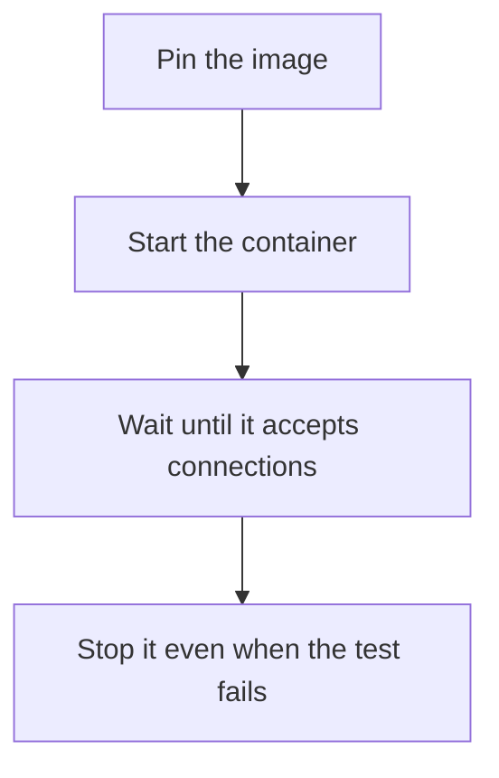

# D20-T026 — Testcontainers and ephemeral dependencies

Topic ID: `D20-T026`
Domain: Software Testing
Subdomain: Testcontainers and ephemeral dependencies
Importance: common
Complexity: intermediate
Dependencies: `D20-T025`, `D20-T001`, `D05-T001`, `D05-T002`, `D07-T001`, `D07-T002`
Execution status of the code in section F: unexecuted

## A. Topic Overview

Testcontainers and similar libraries start real dependencies in containers for a test and tear them down afterward. They beat a shared remote dev database. Images should be pinned. The test waits until the port is ready. They are heavier than fakes, so they belong at the boundary tests. A laptop that cannot run a container needs a documented fallback, not a silent skip that turns the test green.

In production this shows up as follows: The repository test starts a pinned PostgreSQL image, waits for readiness, migrates, and stops the container in a finalizer. CI uses the same image digest. A missing Docker daemon fails the job rather than skipping it.

Interviewers use Testcontainers and ephemeral dependencies to see whether you can state the failure mode, not only the definition. The failure to name is: a latest tag that changes behavior under you, or a skipped test that CI reports as passed

Prerequisites: `D20-T025`, `D20-T001`, `D05-T001`, `D05-T002`, `D07-T001`, `D07-T002`. Later notes should link here instead of repeating the mechanism.

## B. First-Principles Explanation

Testcontainers and similar libraries start real dependencies in containers for a test and tear them down afterward. They beat a shared remote dev database. Images should be pinned. The test waits until the port is ready. They are heavier than fakes, so they belong at the boundary tests. A laptop that cannot run a container needs a documented fallback, not a silent skip that turns the test green.

The useful picture is: Testcontainers is borrowing a real appliance for the exam and returning it clean, instead of drawing the appliance on the whiteboard.

What has to be true:

1. Pin the image
2. Start the container
3. Wait until it accepts connections
4. Stop it even when the test fails

It works when those steps preserve one invariant. It fails when a latest tag that changes behavior under you, or a skipped test that CI reports as passed. The alternative is: you start a cluster per unit test of a pure function

## C. Internal Working and Architecture

Components involved: the caller, the state Testcontainers and ephemeral dependencies mutates or reads, and the observer that reports startup time and tests skipped because the runtime was missing.

Execution:

1. Pin the image
2. Start the container
3. Wait until it accepts connections
4. Stop it even when the test fails

Data moves only along that path. A retry re-enters at step 1, so the operation must say what a duplicate does. Memory and locks stay inside this mechanism. Callers see the result or a typed error, not a half-updated invariant.

State to remember: choose this when the dependency's real behavior matters and a shared server would leak state. Do not choose it when you start a cluster per unit test of a pure function.

## D. Diagrams and Visual Models



Read the diagram from top to bottom. Each box is one step of Testcontainers and ephemeral dependencies. The failure mode (a latest tag that changes behavior under you, or a skipped test that CI reports as passed) is what you look for when a later box never happens or happens twice.

## E. Examples and Analogies

Analogy: Testcontainers is borrowing a real appliance for the exam and returning it clean, instead of drawing the appliance on the whiteboard.

Production example: The repository test starts a pinned PostgreSQL image, waits for readiness, migrates, and stops the container in a finalizer. CI uses the same image digest. A missing Docker daemon fails the job rather than skipping it.

A small counterexample is enough in an interview. Show the input, apply the steps, and show the broken outcome if someone uses the mechanism outside its rule: a latest tag that changes behavior under you, or a skipped test that CI reports as passed.

## F. Code Examples

The snippet is labeled unexecuted. It illustrates the shape of the idea. It is not a benchmark and it embeds no secret.

```text
# unexecuted shape: pin the image tag, wait for the port, then connect
IMAGE = 'postgres:16.4'
```

After the snippet, check startup time and tests skipped because the runtime was missing. If that signal moves the wrong way, the snippet is the wrong tool for the workload.

## G. Practical Backend Application

Use Testcontainers and ephemeral dependencies in a service when the dependency's real behavior matters and a shared server would leak state.

A typical place is the production case already stated: The repository test starts a pinned PostgreSQL image, waits for readiness, migrates, and stops the container in a finalizer. CI uses the same image digest. A missing Docker daemon fails the job rather than skipping it.

Operationally you alert on startup time and tests skipped because the runtime was missing. You do not alert only on process uptime. The dashboard should show the failure mode, a success rate, and the saturation signal (queue depth, lock wait, or latency) that predicts it.

## H. Advantages, Limitations and Trade-offs

| Choice | Benefit | Cost | Choose when | Avoid when |
| --- | --- | --- | --- | --- |
| Apply Testcontainers and ephemeral dependencies | the dependency's real behavior matters and a shared server would leak state | Extra moving parts and a new failure mode | The failure you are preventing is already real | you start a cluster per unit test of a pure function |
| Simpler alternative | Less code and fewer dependencies | a latest tag that changes behavior under you, or a skipped test that CI reports as passed | The workload does not hit the limit | The invariant must hold under concurrency or failure |

Testcontainers and ephemeral dependencies is a trade. State the benefit and the cost in the same sentence when you propose it in a design review.

## I. Common Mistakes and Misconceptions

- Floating image tags.
- Silent skips.
- No readiness wait.
- Treating a diagram of Testcontainers and ephemeral dependencies as proof that the invariant holds in production.
- Copying a default configuration without naming startup time and tests skipped because the runtime was missing.

## J. Debugging and Troubleshooting

Symptom: a latest tag that changes behavior under you, or a skipped test that CI reports as passed

First check: startup time and tests skipped because the runtime was missing.

Then compare one healthy instance against one unhealthy instance. Confirm whether retries are duplicating work. Confirm whether a timeout is shorter than the work. Fix the invariant, then watch the same metric for a full peak, not only for the next minute.

Useful questions: did the step order in section C actually happen, or did a caller skip a step? Did a deploy change the data shape that Testcontainers and ephemeral dependencies assumes?

## K. Interview Preparation

### Beginner

#### Q1. What problem does Testcontainers and ephemeral dependencies solve?

**Answer:** Testcontainers and similar libraries start real dependencies in containers for a test and tear them down afterward. They beat a shared remote dev database. Images should be pinned. The test waits until the port is ready. They are heavier than fakes, so they belong at the boundary tests. A laptop that cannot run a container needs a documented fallback, not a silent skip that turns the test green. Without it, the usual backend failure is: a latest tag that changes behavior under you, or a skipped test that CI reports as passed.

#### Q2. Where does Testcontainers and ephemeral dependencies sit on a request path?

**Answer:** Testcontainers and ephemeral dependencies is not a library you sprinkle on every call. the dependency's real behavior matters and a shared server would leak state You notice it when startup time and tests skipped because the runtime was missing. Name the constraint that makes this choice correct. Say what you would measure to confirm it.

#### Q3. Give a concrete example of Testcontainers and ephemeral dependencies.

**Answer:** The repository test starts a pinned PostgreSQL image, waits for readiness, migrates, and stops the container in a finalizer. CI uses the same image digest. A missing Docker daemon fails the job rather than skipping it. Walk the input, the state change, and the observable output.

#### Q4. What is a common mix-up around Testcontainers and ephemeral dependencies?

**Answer:** a latest tag that changes behavior under you, or a skipped test that CI reports as passed The corrective check is startup time and tests skipped because the runtime was missing. Name the constraint that makes this choice correct. Say what you would measure to confirm it. Say which alternative you rejected and why.

#### Q5. When would you skip Testcontainers and ephemeral dependencies?

**Answer:** you start a cluster per unit test of a pure function Skipping is a decision with a measured cost, not a slogan. Name the constraint that makes this choice correct. Say what you would measure to confirm it. Say which alternative you rejected and why.

### Intermediate

#### Q1. What invariant makes Testcontainers and ephemeral dependencies correct?

**Answer:** Testcontainers and similar libraries start real dependencies in containers for a test and tear them down afterward. They beat a shared remote dev database. Images should be pinned. The test waits until the port is ready. They are heavier than fakes, so they belong at the boundary tests. A laptop that cannot run a container needs a documented fallback, not a silent skip that turns the test green. State the invariant before you name the tool.

#### Q2. How do you test Testcontainers and ephemeral dependencies?

**Answer:** Assert the failure mode directly: a latest tag that changes behavior under you, or a skipped test that CI reports as passed. The assertion should watch startup time and tests skipped because the runtime was missing. Include a concurrent or retry case if the bug only appears then. Name the constraint that makes this choice correct.

#### Q3. What signal tells you Testcontainers and ephemeral dependencies is misbehaving in production?

**Answer:** Watch startup time and tests skipped because the runtime was missing. The user-visible symptom is usually a latest tag that changes behavior under you, or a skipped test that CI reports as passed. Name the constraint that makes this choice correct. Say what you would measure to confirm it.

#### Q4. How would you introduce Testcontainers and ephemeral dependencies into a legacy service?

**Answer:** the dependency's real behavior matters and a shared server would leak state Ship it behind a metric so you can compare the old path. Roll back if a latest tag that changes behavior under you, or a skipped test that CI reports as passed gets worse. Name the constraint that makes this choice correct. Say what you would measure to confirm it.

#### Q5. What do you trade away by choosing Testcontainers and ephemeral dependencies?

**Answer:** the dependency's real behavior matters and a shared server would leak state you start a cluster per unit test of a pure function Say the cost in latency, storage, or operational load. Name the constraint that makes this choice correct. Say what you would measure to confirm it. Say which alternative you rejected and why.

### Advanced

#### Q1. What breaks if a dependency of Testcontainers and ephemeral dependencies is slow or down?

**Answer:** a latest tag that changes behavior under you, or a skipped test that CI reports as passed Degrade using the rule: you start a cluster per unit test of a pure function. Timeouts must be shorter than the caller's deadline. Name the constraint that makes this choice correct. Say what you would measure to confirm it.

#### Q2. How does Testcontainers and ephemeral dependencies behave under retries?

**Answer:** Retries repeat work, so Testcontainers and ephemeral dependencies must define what a duplicate does. a latest tag that changes behavior under you, or a skipped test that CI reports as passed Idempotency keys or fences belong next to the write, not in a comment. Name the constraint that makes this choice correct. Say what you would measure to confirm it.

#### Q3. What is the capacity limit of Testcontainers and ephemeral dependencies?

**Answer:** The limit shows up as startup time and tests skipped because the runtime was missing. Add capacity only after you know whether the bottleneck is CPU, lock wait, or network. Name the constraint that makes this choice correct. Say what you would measure to confirm it.

#### Q4. How do you evolve Testcontainers and ephemeral dependencies without a flag day?

**Answer:** the dependency's real behavior matters and a shared server would leak state Version the contract or the on-disk format. Readers should tolerate one old and one new shape during the rollout. Name the constraint that makes this choice correct. Say what you would measure to confirm it.

#### Q5. What security or correctness bug hides inside Testcontainers and ephemeral dependencies?

**Answer:** a latest tag that changes behavior under you, or a skipped test that CI reports as passed Check authorization and tenancy at the same boundary as the mechanism. A cache or queue must not widen who can read the data. Name the constraint that makes this choice correct. Say what you would measure to confirm it.

### Scenario

#### Q1. Incident: a latest tag that changes behavior under you, or a skipped test that CI reports as passed. What do you check first?

**Answer:** Start with startup time and tests skipped because the runtime was missing. Compare a good host and a bad host before you restart anything. Testcontainers and similar libraries start real dependencies in containers for a test and tear them down afterward. They beat a shared remote dev database. Images should be pinned. The test waits until the port is ready. They are heavier than fakes, so they belong at the boundary tests. A laptop that cannot run a container needs a documented fallback, not a silent skip that turns the test green.

#### Q2. A reviewer wants the clever version. What data settles it?

**Answer:** the dependency's real behavior matters and a shared server would leak state you start a cluster per unit test of a pure function Bring startup time and tests skipped because the runtime was missing from a load test or from production, not a slogan. Name the constraint that makes this choice correct. Say what you would measure to confirm it. Say which alternative you rejected and why.

#### Q3. You have one hour to explain Testcontainers and ephemeral dependencies at a whiteboard.

**Answer:** Draw the happy path in four boxes. Then draw the failure: a latest tag that changes behavior under you, or a skipped test that CI reports as passed. End with the metric you would page on. Name the constraint that makes this choice correct.

#### Q4. The bug only appears under two concurrent callers.

**Answer:** a latest tag that changes behavior under you, or a skipped test that CI reports as passed Reproduce with a barrier so both sides enter the critical window. Confirm the fix with startup time and tests skipped because the runtime was missing. Name the constraint that makes this choice correct. Say what you would measure to confirm it.

#### Q5. Leadership wants this on every service next week.

**Answer:** you start a cluster per unit test of a pure function the dependency's real behavior matters and a shared server would leak state Roll it out where the failure mode is already hurting users. Name the constraint that makes this choice correct. Say what you would measure to confirm it. Say which alternative you rejected and why.

### Follow-up

#### Q1. What did you assume about the data size or the clock?

**Answer:** Testcontainers and similar libraries start real dependencies in containers for a test and tear them down afterward. They beat a shared remote dev database. Images should be pinned. The test waits until the port is ready. They are heavier than fakes, so they belong at the boundary tests. A laptop that cannot run a container needs a documented fallback, not a silent skip that turns the test green. Clocks are not a total order across machines. State whether the algorithm needs bounded size or a single leader.

#### Q2. What would you measure after the change ships?

**Answer:** Page on startup time and tests skipped because the runtime was missing. Keep a before/after dashboard for one week. Alert on the failure mode, not only on CPU. Name the constraint that makes this choice correct.

#### Q3. Which neighboring topic did you deliberately not re-teach?

**Answer:** This note owns Testcontainers and ephemeral dependencies. Related identifiers are in section N. Shared ideas are linked, not copied. Name the constraint that makes this choice correct.

## L. Practical Exercises

Solutions are in `EXERCISES/solutions/D20-T026.md`, not in this section.

1. Whiteboard the four steps of Testcontainers and ephemeral dependencies and mark where `a latest tag that changes behavior under you, or a skipped test that CI reports as passed` enters.
2. Read the snippet in section F and write the assertion that would catch that failure. The assertion must mention `startup time and tests skipped because the runtime was missing`.
3. Argue for or against using Testcontainers and ephemeral dependencies on a service you know. Use the choose and avoid rows from section H. Do not appeal to popularity.

## M. Revision Notes

- Mechanism: Testcontainers and similar libraries start real dependencies in containers for a test and tear them down afterward.
- Failure: a latest tag that changes behavior under you, or a skipped test that CI reports as passed
- Metric: startup time and tests skipped because the runtime was missing
- Choose when: the dependency's real behavior matters and a shared server would leak state
- Avoid when: you start a cluster per unit test of a pure function

## N. Related Topics

Dependencies to review first: `D20-T025`, `D20-T001`, `D05-T001`, `D05-T002`, `D07-T001`, `D07-T002`.

Shared ideas stay in those notes. This note does not restate them.

## O. Completion Criteria

- You can explain Testcontainers and ephemeral dependencies without reading this note, including the failure mode.
- You can draw the diagram in section D from memory.
- You can say when not to use it, using the avoid condition in section H.
- You can name the metric you would watch after shipping it.
