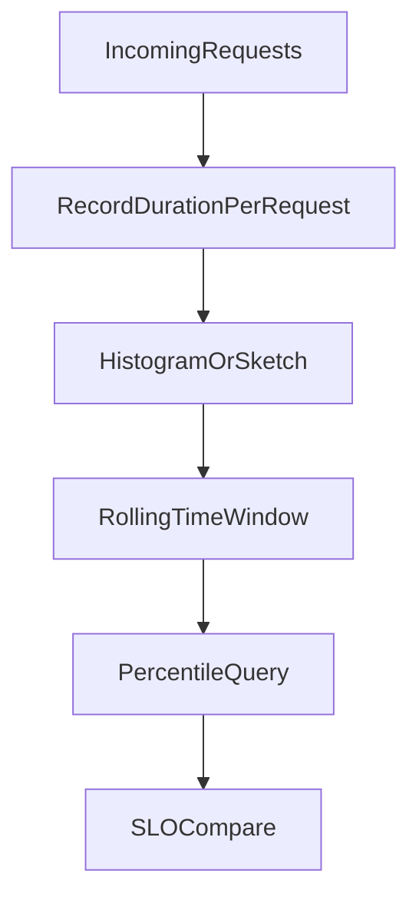

# D21-T001 — Latency percentiles: p50, p90, p95, p99

Topic ID: `D21-T001`
Domain: Performance Engineering
Subdomain: Latency percentiles: p50, p90, p95, p99
Importance: common
Complexity: advanced
Dependencies: `D02-T001`, `D02-T002`, `D07-T001`, `D07-T002`, `D13-T001`, `D13-T002`
Execution status of the code in section F: illustrative (not executed in CI for this topic)

## A. Topic Overview

A latency percentile (for example p50, p90, p95, p99) is the threshold below which that fraction of observed request durations fall, when computed over a defined population and time window.

Means hide tail behavior: most users can be fast while a minority waits on GC pauses, lock contention, or slow dependencies. SLOs and capacity discussions therefore use percentiles, not averages alone.

Interviewers test whether you know how percentiles are computed (sorted samples, histogram buckets, or t-digest), and why you must not average p99 across machines without merging histograms.

This topic underpins load testing (`D21-T020`), tail latency (`D21-T024`), and observability SLIs (`D22-T013`).

## B. First-Principles Explanation

Given n sorted latencies, the nearest-rank p99 is the value at rank ceil(0.99 × n). Histogram-based systems estimate percentiles from bucket counts; bucket boundaries change the estimate.

First principles start from constraints: finite CPU, memory, connections, and network bandwidth. Any technique here trades one resource for another or exposes hidden queueing.

Clients or servers record each request duration, aggregate into rolling windows, and export histograms or sketches. Dashboards query `histogram_quantile(0.99, rate(...))` in Prometheus or equivalent.

Alternatives always exist. The note calls out when a simpler approach (less caching, fewer threads, smaller payloads) beats a complex one.

## C. Internal Working and Architecture

Components involved in latency percentiles: p50, p90, p95, p99 typically include the application process, host OS, dependencies, and the observability pipeline.

Data flows from instrumentation (hooks, agents, sidecars) into time-series or log stores, then into dashboards and alerts. Control flows back through config, autoscaling, and deploy pipelines.

Under load, queues form at thread pools, connection pools, disk, and network buffers. Saturation shows up before correctness breaks, which is why proactive metrics matter.

State is rarely purely local: replicas share load balancers, caches, and databases. Design assumes partial failure and stale reads unless you prove otherwise.

## D. Diagrams and Visual Models



Read the diagram as the primary request or resource path; side branches are failure or backpressure paths.

## E. Examples and Analogies

Analogy: treating latency percentiles: p50, p90, p95, p99 like a speed limit sign—it does not fix traffic, but it tells everyone what 'normal' means and when to intervene.

If p50 is 40 ms and p99 is 800 ms, half of requests are faster than 40 ms and 99% are faster than 800 ms—one percent are at or above 800 ms depending on estimator definition.

Anti-pattern: optimizing a metric that users do not feel (average CPU) while tail latency or error rate violates the SLO.

Do not copy a large-company setup without matching traffic shape, team size, and compliance needs.

## F. Code Examples

File: `examples/d21_t001_percentiles.py`

Dependencies: Python 3 standard library only.

```python
from statistics import median


def nearest_rank_percentile(sorted_values: list[float], p: float) -> float:
    if not sorted_values:
        raise ValueError("empty sample")
    if not 0 < p <= 1:
        raise ValueError("p must be in (0, 1]")
    rank = int(__import__("math").ceil(p * len(sorted_values)))
    return sorted_values[rank - 1]


def summarize(latencies_ms: list[float]) -> dict[str, float]:
    s = sorted(latencies_ms)
    return {
        "p50": median(s),
        "p90": nearest_rank_percentile(s, 0.90),
        "p95": nearest_rank_percentile(s, 0.95),
        "p99": nearest_rank_percentile(s, 0.99),
    }


if __name__ == "__main__":
    sample = [10, 12, 15, 18, 20, 25, 30, 40, 200, 500]
    print(summarize(sample))
```

How to run: `python examples/d21_t001_percentiles.py` from `EXERCISES/examples/`.

Expected output: a dict with p50 near the median and p99 pulled upward by the 200 and 500 ms tail (exact numbers depend on the ten-point sample).

Important lines: sorting before rank selection; p99 uses the tail of the distribution, not the mean.

## G. Practical Backend Application

In production, latency percentiles: p50, p90, p95, p99 shows up during deploys, traffic spikes, and dependency outages. Rollouts should be guarded by the signals this topic emphasizes.

Concurrent requests amplify shared resources: pools, locks, and GC. Measure before adding hardware; often the bottleneck is software queueing.

Error handling: distinguish client errors from saturation. Return useful status codes and retry hints only when semantics allow idempotent retries.

Observability: tag metrics and logs with service, version, and region. Security: do not log secrets; redact tokens. Scaling: prefer horizontal scale when the workload is parallelizable.

## H. Advantages, Limitations and Trade-offs

| Choice | Benefit | Cost | Choose when | Avoid when |
| --- | --- | --- | --- | --- |
| Measure tails (p95/p99) | Matches user pain | Noisier, needs volume | User-facing latency SLOs | Batch jobs with loose deadlines |
| Aggressive caching | Cuts load | Staleness, complexity | Read-heavy hot keys | Strong consistency requirements |
| More threads | Hides I/O wait | Context switch, memory | Blocking I/O workers | CPU-bound work |
| Bigger payloads | Fewer round trips | Bandwidth, parsing cost | High latency links | Mobile or metered clients |

## I. Common Mistakes and Misconceptions

- Averaging per-host p99 values—merge histograms or raw samples instead.
- Using too-coarse histogram buckets, which flatten the tail.
- Reporting percentiles on a five-minute window while the SLO is monthly.
- Ignoring warmup: cold JVM or empty caches distort the first minutes after deploy.
- Treating p99 as a maximum; it is a threshold exceeded by about 1% of requests (definition-dependent).

## J. Debugging and Troubleshooting

Symptoms tied to latency percentiles: p50, p90, p95, p99 include elevated latency, rising error rate, or flat throughput while CPU looks idle (queueing).

Diagnosis: confirm the SLO window, check dependency health, compare canary vs stable, and profile one slow trace or request.

Mitigation: scale the bottleneck tier, shed load, disable noncritical features, or roll back. Long-term: capacity test and fix the root queue.

Metrics to watch: error rate, saturation (pool wait, CPU steal, disk queue), and request rate divided by successful responses.

## K. Interview Preparation

### Beginner

#### Q1. What is p50 latency?

**Answer:** p50 is the median latency: half of requests complete faster and half slower, for the chosen window and population. It describes typical user experience better than a mean when the distribution is skewed. It is still blind to the slowest users, which is why p95 and p99 exist. Always state the window (for example last 5 minutes) when quoting a percentile.

#### Q2. What is p99 latency?

**Answer:** p99 is the latency threshold below which about 99% of requests fall, depending on the estimator. Roughly one in a hundred requests is at or above p99 in a large steady sample. Product and SRE teams care because that minority can be high-value users or retries amplifying load. Do not confuse p99 with the maximum unless you explicitly track max.

#### Q3. Why not use average latency?

**Answer:** A few very slow requests pull the mean up, but most users may still be fast. Averages also hide bimodal distributions (fast cache hits vs slow misses). SLOs and autoscaling policies increasingly specify percentiles or error rates. Use mean only when the distribution is tight and symmetric, which HTTP latency rarely is.

#### Q4. What population should percentiles cover?

**Answer:** Define whether you measure server-side handling time, end-to-end user time, or per-dependency calls. Include only successful requests or also failures, matching the SLI definition. Exclude health checks if they skew the distribution. Document exclusions so dashboards match the SLO.

#### Q5. Name p90 versus p95 in one sentence each.

**Answer:** p90: 90% of requests are faster than this value. p95: 95% are faster—stricter than p90 and closer to tail-focused SLOs. Higher percentiles widen the gap between typical and worst-case batches. Pick the percentile your SLO names; do not cargo-cult p99 if the SLO says p95.

### Intermediate

#### Q1. How do Prometheus histograms estimate percentiles?

**Answer:** Observations increment bucket counters labeled `le` (less than or equal). `histogram_quantile` interpolates within buckets using bucket counts and rates. Finer buckets near your SLO line improve tail accuracy at the cost of cardinality. You must use consistent bucket boundaries across services you compare.

#### Q2. Can you average p99 across three replicas?

**Answer:** Averaging per-instance p99 is statistically wrong for the global tail. Merge histograms or combine raw samples, then compute the percentile once. If you only have per-pod summaries, treat comparisons as approximate and prefer a centralized sink. Exemplars help link histogram buckets to traces for investigation.

#### Q3. How does sample size affect percentile stability?

**Answer:** With few requests, p99 jumps when a single slow request arrives. Low-traffic endpoints need longer windows or Bayesian smoothing. High-traffic services stabilize quickly but still move after deploys. Use min traffic thresholds before paging on p99.

#### Q4. What is the difference between server and client measured latency?

**Answer:** Server time excludes DNS, TLS, and network last mile; client time includes them. Mobile clients add radio variability missing from datacenter metrics. Align SLIs with what users feel, often via RUM or synthetic checks plus server metrics. Disagreement between layers localizes the bottleneck.

#### Q5. How do retries change percentile interpretation?

**Answer:** Retries inflate server-side request counts and can make user-visible latency worse. Measure attempts separately from user-perceived success if retries are hidden. Idempotent retry policies belong in SLO discussions. Tail latency often spikes when a dependency degrades and retry storms follow.

### Advanced

#### Q1. Compare nearest-rank versus linear interpolation percentiles.

**Answer:** Nearest-rank picks an actual sample at a computed rank; simple but coarse on small n. Linear interpolation between ranks smooths estimates between data points. Different tools use different methods; document yours when comparing vendors. SLO compliance should use the same estimator in alert and dashboard.

#### Q2. How do coordinated omission problems affect load test percentiles?

**Answer:** If the load generator waits for responses before sending the next request, it omits slow periods from offered load. Reported percentiles look optimistic compared to open-loop offered load. Use tools that maintain target arrival rate independent of latency. Always pair percentile charts with achieved throughput and error rate.

#### Q3. Relate percentiles to multi-tenant noisy neighbor effects.

**Answer:** Shared CPU or disk can create tail spikes for one tenant without moving p50 much. Per-tenant percentiles expose fairness issues aggregate metrics hide. Isolation (quotas, dedicated pools) is a product decision informed by tail metrics. Watch steal time and IO wait alongside HTTP percentiles.

#### Q4. When is p99 the wrong SLO line?

**Answer:** When traffic is too low for stable p99, or when batch jobs dominate. When user experience is dominated by errors, prioritize availability SLIs. When p99 ignores the slowest 1% that includes paying customers on large carts. Sometimes p99.9 or joint SLIs (latency given success) fit better—negotiate with product.

#### Q5. How do you regression-test percentiles in CI?

**Answer:** Micro-benchmarks are noisy; prefer controlled load tests on release candidates. Store historical distributions, not single numbers, to detect shape changes. Gate on error rate first; latency gates need generous bands to avoid flakes. Compare canary vs baseline with the same load profile.

### Scenarios

#### Q1. p50 is flat but p99 doubled after a deploy. What hypotheses?

**Answer:** A new code path, lock, or dependency call adds rare slow work. GC or pool exhaustion affects only saturated periods. Check version-labeled histograms and traces at high percentiles. Roll back if error budget burn exceeds policy while investigating.

#### Q2. Two regions show different p99 for the same service. Why?

**Answer:** Different traffic mix, replica count, or cross-region dependency latency. Clock skew is rare for latency but replication lag affects read paths. Compare per-region histogram merges, not averaged percentiles. Route users to healthier regions if failover policy allows.

#### Q3. Marketing expects a latency SLO; engineering only tracks CPU. What do you propose?

**Answer:** Define an SLI on server or edge latency with a percentile and window. Instrument middleware histograms and validate bucket layout. Tie releases to error budget policy instead of CPU targets. Educate that CPU can be low while queues grow.

#### Q4. Histogram buckets stop at 1s but p99 SLO is 300 ms. Problem?

**Answer:** All times above 1s land in the +Inf bucket, losing tail shape inside the bucket. Add buckets between 300 ms and 1s for meaningful quantile error near the SLO. Revisit buckets when latency improves after optimization. Alerts on quantile error can fire if buckets are misaligned.

#### Q5. Synthetic monitoring shows good p99 but users complain. Next steps?

**Answer:** Compare synthetic path to real user monitoring and geography. Check auth-specific or checkout-specific routes omitted from synthetics. Inspect dependency and database percentiles on those routes. Expand probes to include mobile networks if that is the cohort complaining.

### Follow-ups

#### Q1. How does this connect to Little's Law (`D21-T021`)?

**Answer:** Higher concurrency at fixed service time increases queueing, which widens latency tails. Little's Law relates average concurrency, throughput, and residence time in steady state. Percentiles show the tail; Little's Law explains average queue depth trends. Use both when sizing pools and thread counts.

#### Q2. How do golden signals use percentiles?

**Answer:** Latency is a golden signal, often tracked as a percentile for user-facing services. Pair with rate and errors before optimizing duration. RED method names duration explicitly for services. See `D22-T004` and `D22-T005`.

#### Q3. How does load testing report percentiles fairly?

**Answer:** Maintain offered load independent of response time to avoid coordinated omission. Report warmup separately and align test duration with SLO windows. Include error rate and throughput alongside percentiles. See `D21-T020`.


## L. Practical Exercises

Solutions are in `EXERCISES/solutions/D21-T001.md`. Try these before opening that file.

### Exercise 1 — implementation

Implement or configure instrumentation for latency percentiles on a sample HTTP handler. Acceptance: expose at least one metric or log field named in the topic note and document how to query it.

### Exercise 2 — debugging

Given a production symptom related to latency percentiles, write a five-step debugging checklist referencing section J. Acceptance: each step names a signal and a decision.

### Exercise 3 — trade-off

Choose between two design options that trade cost versus reliability for latency percentiles. Acceptance: pick one, cite the table in section H, and state what you would measure for two weeks after the change.

## M. Revision Notes

- Define latency percentiles: p50, p90, p95, p99 in one sentence.
- Name one metric and one anti-pattern for this topic.
- Relate this topic to an SLO or capacity decision.

## N. Related Topics

Understand this before: `D02-T001`, `D02-T002`, `D07-T001`, `D07-T002`.

Often confused with: adjacent topics in the same domain—read `D02-T001` for sequence context.

Interviewers combine this with performance (`D21-T001`) and observability (`D22-T001`) when asking end-to-end stories.

## O. Completion Criteria

- Explain latency percentiles: p50, p90, p95, p99 without reading the note.
- Sketch the mermaid flow and name one failure branch.
- Walk through one incident scenario using section J.
- Answer five beginner and five intermediate interview questions aloud.
- Complete the three exercises and compare with the solution file.
