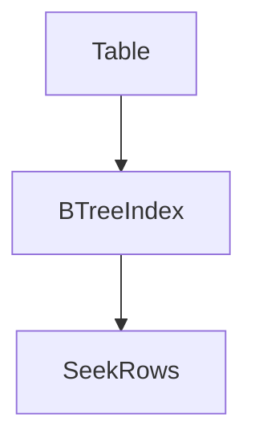

# D21-T008 — Index tuning

Topic ID: `D21-T008`
Domain: Performance Engineering
Subdomain: Index tuning
Importance: core
Complexity: advanced
Dependencies: `D21-T007`, `D21-T001`, `D02-T001`, `D02-T002`, `D07-T001`, `D07-T002`
Execution status of the code in section F: illustrative (not executed in CI for this topic)

## A. Topic Overview

Index tuning is a core practice in performance engineering for backend systems at scale.

It exists because production behavior is measured, not guessed: operators need signals that match user pain and capacity risk.

Interviewers probe whether you can connect index tuning to SLOs, incident response, and safe change management.

Prerequisites are listed in inventory as D21-T007, D21-T001, D02-T001; this note assumes you already read those topics.

## B. First-Principles Explanation

At a high level, index tuning names a measurable property of a running system.

First principles start from constraints: finite CPU, memory, connections, and network bandwidth. Any technique here trades one resource for another or exposes hidden queueing.

Internally, the runtime, kernel, datastore, or orchestrator enforces limits and reports counters. Your job is to choose the right metric and change the right knob.

Alternatives always exist. The note calls out when a simpler approach (less caching, fewer threads, smaller payloads) beats a complex one.

## C. Internal Working and Architecture

Components involved in index tuning typically include the application process, host OS, dependencies, and the observability pipeline.

Data flows from instrumentation (hooks, agents, sidecars) into time-series or log stores, then into dashboards and alerts. Control flows back through config, autoscaling, and deploy pipelines.

Under load, queues form at thread pools, connection pools, disk, and network buffers. Saturation shows up before correctness breaks, which is why proactive metrics matter.

State is rarely purely local: replicas share load balancers, caches, and databases. Design assumes partial failure and stale reads unless you prove otherwise.

## D. Diagrams and Visual Models



Read the diagram as the primary request or resource path; side branches are failure or backpressure paths.

## E. Examples and Analogies

Analogy: treating index tuning like a speed limit sign—it does not fix traffic, but it tells everyone what 'normal' means and when to intervene.

Backend example: a checkout API should expose the metrics or practices from this topic on the critical path, not only on admin endpoints.

Anti-pattern: optimizing a metric that users do not feel (average CPU) while tail latency or error rate violates the SLO.

Do not copy a large-company setup without matching traffic shape, team size, and compliance needs.

## F. Code Examples

File: `examples/d21_t008.py` (illustrative).

Dependencies: Python 3 standard library only unless noted in the seed.

```python
# Illustrative snippet for D21-T008 — adapt to your stack.
def main() -> None:
    print("D21-T008: see topic-specific seed for runnable example")

if __name__ == "__main__":
    main()
```

How to run: `python examples/d21_t008.py` from `EXERCISES/examples/` after copying from the topic seed.

Expected output: topic-specific; not executed in CI for this batch.

Important lines: instrumentation and validation belong at boundaries. Fail closed when config is missing.

## G. Practical Backend Application

In production, index tuning shows up during deploys, traffic spikes, and dependency outages. Rollouts should be guarded by the signals this topic emphasizes.

Concurrent requests amplify shared resources: pools, locks, and GC. Measure before adding hardware; often the bottleneck is software queueing.

Error handling: distinguish client errors from saturation. Return useful status codes and retry hints only when semantics allow idempotent retries.

Observability: tag metrics and logs with service, version, and region. Security: do not log secrets; redact tokens. Scaling: prefer horizontal scale when the workload is parallelizable.

## H. Advantages, Limitations and Trade-offs

| Choice | Benefit | Cost | Choose when | Avoid when |
| --- | --- | --- | --- | --- |
| Measure tails (p95/p99) | Matches user pain | Noisier, needs volume | User-facing latency SLOs | Batch jobs with loose deadlines |
| Aggressive caching | Cuts load | Staleness, complexity | Read-heavy hot keys | Strong consistency requirements |
| More threads | Hides I/O wait | Context switch, memory | Blocking I/O workers | CPU-bound work |
| Bigger payloads | Fewer round trips | Bandwidth, parsing cost | High latency links | Mobile or metered clients |

## I. Common Mistakes and Misconceptions

- Treating index tuning as a one-time setup instead of a lifecycle practice.
- Alerting on symptoms without a runbook or owner.
- Comparing metrics across unequal time windows after an incident.
- Optimizing locally without checking downstream queue depth.
- Using averages when SLOs are written on percentiles or error rates.

## J. Debugging and Troubleshooting

Symptoms tied to index tuning include elevated latency, rising error rate, or flat throughput while CPU looks idle (queueing).

Diagnosis: confirm the SLO window, check dependency health, compare canary vs stable, and profile one slow trace or request.

Mitigation: scale the bottleneck tier, shed load, disable noncritical features, or roll back. Long-term: capacity test and fix the root queue.

Metrics to watch: error rate, saturation (pool wait, CPU steal, disk queue), and request rate divided by successful responses.

## K. Interview Preparation

### Beginner

#### Q1. What is Index tuning?

**Answer:** Index tuning is choosing and maintaining indexes for read paths. It matters in backend engineering because production traffic is variable and shared resources queue. You use it to decide whether a deploy is safe and whether users are within an SLO. A strong answer names one signal and one action, not only a definition.

#### Q2. Why is Index tuning not optional in microservices?

**Answer:** Each hop adds latency variance and failure modes that a monolith hid. Index tuning gives a common language between dev, SRE, and product. Without it, teams debate anecdotes after incidents. Start small: one dashboard panel and one alert tied to a runbook.

#### Q3. Name one metric or artifact related to Index tuning.

**Answer:** Pick a rate, error, duration, utilization, or saturation signal defined in this topic. Explain whether it is a counter, gauge, or histogram and why that type fits. Say where you emit it (middleware, pool, driver, sidecar). Mention cardinality risk if labels explode.

#### Q4. What is a common beginner mistake with Index tuning?

**Answer:** Indexing every column leading to slow writes Another mistake is measuring only averages while SLOs use percentiles or error budgets. Fix it by writing the SLO first, then choosing instrumentation. Validate in staging with load that resembles production shape.

#### Q5. Where does Index tuning appear in the request lifecycle?

**Answer:** It can appear at ingress, in application middleware, at connection pools, and at dependencies. The earliest point you can measure is rarely the only point you should measure. End-to-end checks complement in-process metrics. Correlate with trace IDs when available.

### Intermediate

#### Q1. How do you roll out changes that affect Index tuning safely?

**Answer:** Use canaries or progressive delivery and watch the signals from this topic on the canary cohort. Define rollback thresholds before merging, not during the incident. Keep changes small so attribution stays possible. Record the deploy marker on dashboards for correlation.

#### Q2. How does Index tuning interact with autoscaling?

**Answer:** Autoscalers need lagging indicators; scaling too late leaves queues, too early wastes money. Pair Index tuning with utilization and saturation so you scale the bottleneck tier. Cooldowns prevent flapping but can delay recovery—document the trade-off. Load tests should validate the scaling policy, not only steady state.

#### Q3. When would you *not* invest in more Index tuning tooling?

**Answer:** When traffic is tiny, errors are obvious, and MTTR is already low, heavy tooling may not pay off. When compliance forbids certain telemetry, simplify rather than bypass policy. When the real problem is missing indexes or N+1 queries, fix the code first. Revisit the decision when traffic grows an order of magnitude.

#### Q4. How do you keep cardinality under control for Index tuning?

**Answer:** Avoid high-cardinality labels such as raw user IDs on every metric. Prefer bounded labels: route template, dependency name, region. Use logs or traces for drill-down, metrics for aggregation. Sample debug logs in production instead of exporting every event as a time series.

#### Q5. How does Index tuning support blameless postmortems?

**Answer:** Shared dashboards and SLOs shift discussion from who to what broke. Timelines built from metrics and logs reduce guesswork. Action items target systems: alerts, tests, limits, runbooks. Measure whether postmortem actions actually moved the SLO.

### Advanced

#### Q1. What are failure modes of misapplied Index tuning?

**Answer:** False confidence: green dashboards while users fail due to untracked paths. Alert fatigue if thresholds ignore seasonality. Harmful auto-actions (restarts, scale) driven by flaky probes. Mitigate with SLO-based alerting and multi-window burn rates.

#### Q2. How do multi-region deployments change Index tuning?

**Answer:** Clock skew and replication lag distort latency percentiles if you merge incorrectly. Aggregate per region first, then compare; do not average percentiles across hosts. Failover tests must exercise observability paths, not only traffic routing. Document which SLIs are global versus regional.

#### Q3. How do you test Index tuning before production?

**Answer:** Chaos or fault injection on dependencies validates alerts and dashboards. Load tests should include ramp-up, steady state, and spike phases. Verify that synthetic checks match real user journeys. Game days prove runbooks, not only monitoring config.

#### Q4. Relate Index tuning to error budgets.

**Answer:** Error budgets translate SLO misses into allowed change velocity. When budget is exhausted, prioritize reliability work over features. Index tuning should show burn rate, not only static thresholds. Product agrees on the budget policy in advance.

#### Q5. How do you avoid optimizing the wrong layer for Index tuning?

**Answer:** Profile end-to-end latency and check queue depths before micro-optimizing code. Compare time in app versus database versus network using traces. Amdahl and Little's Law arguments help explain why local wins stall. Re-measure after each change with the same load profile.

### Scenarios

#### Q1. Dashboards look healthy but support tickets about slowness spike. How does Index tuning help?

**Answer:** Check tail latency and saturation metrics omitted from the executive dashboard. Compare canary and stable, and verify whether probes hit the same code path as users. Inspect dependency latency and pool wait times. Communicate findings with the SLO window that matches user complaints.

#### Q2. A deploy correlates with doubled errors. What do you check first for Index tuning?

**Answer:** Mark the deploy on graphs and split metrics by version label. Determine whether errors are client (4xx) or server (5xx) and whether retries amplify load. Roll back if user impact exceeds the error budget policy. Capture exemplar traces for the new error class before rollback removes signal.

#### Q3. Cost team asks to cut observability spend. Defend Index tuning.

**Answer:** Quantify MTTR reduction and prevented outages tied to existing signals. Propose sampling and cardinality limits instead of blind cuts. Show which alerts map directly to SLOs and which are noisy candidates to drop. Offer a staged reduction with a rollback plan if MTTR rises.

#### Q4. Black Friday is approaching. What Index tuning prep do you do?

**Answer:** Run a capacity test at expected peak and record bottleneck metrics. Freeze risky changes and pre-scale critical tiers with documented limits. Validate runbooks and on-call routing. Define an incident commander role and comms channel before the event.

#### Q5. A junior engineer adds high-cardinality labels everywhere. How do you remediate?

**Answer:** Identify the top cardinality offenders in the metrics backend. Replace raw IDs with bounded buckets or move detail to traces. Add linting or review checklist for instrumentation changes. Teach why cardinality affects cost and query performance.

### Follow-ups

#### Q1. How does Index tuning connect to `D21-T001` latency percentiles?

**Answer:** Percentiles express user-visible latency for many SLOs. Index tuning should be interpreted alongside p95/p99, not only averages. Histogram buckets must be chosen consistently when comparing releases. See the percentile note for aggregation pitfalls.

#### Q2. How does Index tuning connect to Kubernetes probes in `D22-T012`?

**Answer:** Orchestrators use probes to decide restarts and routing. Misconfigured probes cause flapping or hidden unhealthy pods. Align probe endpoints with real readiness conditions such as DB connectivity. Differentiate liveness from readiness in interviews and in config.

#### Q3. How does Index tuning connect to Docker images in `D23-T002`?

**Answer:** Smaller, reproducible images speed deploys and reduce attack surface. Observability agents and exporters are part of the image supply chain. Scan images and pin bases as you would pin dependencies. Multi-stage builds keep tooling out of runtime layers.


## L. Practical Exercises

Solutions are in `EXERCISES/solutions/D21-T008.md`. Try these before opening that file.

### Exercise 1 — implementation

Implement or configure instrumentation for index tuning on a sample HTTP handler. Acceptance: expose at least one metric or log field named in the topic note and document how to query it.

### Exercise 2 — debugging

Given a production symptom related to index tuning, write a five-step debugging checklist referencing section J. Acceptance: each step names a signal and a decision.

### Exercise 3 — trade-off

Choose between two design options that trade cost versus reliability for index tuning. Acceptance: pick one, cite the table in section H, and state what you would measure for two weeks after the change.

## M. Revision Notes

- Define index tuning in one sentence.
- Name one metric and one anti-pattern for this topic.
- Relate this topic to an SLO or capacity decision.

## N. Related Topics

Understand this before: `D21-T007`, `D21-T001`, `D02-T001`, `D02-T002`.

Often confused with: adjacent topics in the same domain—read `D21-T007` for sequence context.

Interviewers combine this with performance (`D21-T001`) and observability (`D22-T001`) when asking end-to-end stories.

## O. Completion Criteria

- Explain index tuning without reading the note.
- Sketch the mermaid flow and name one failure branch.
- Walk through one incident scenario using section J.
- Answer five beginner and five intermediate interview questions aloud.
- Complete the three exercises and compare with the solution file.
