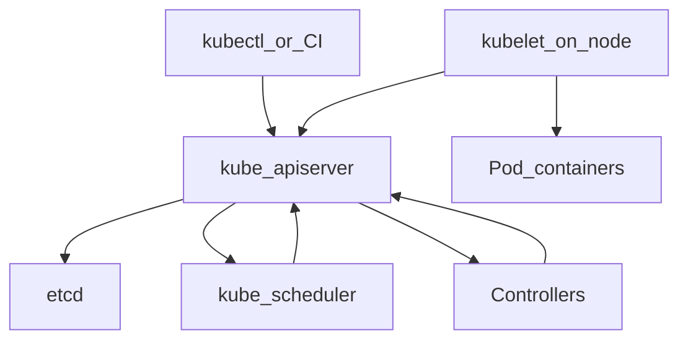

# D24-T001 — Kubernetes architecture

Topic ID: `D24-T001`
Domain: Kubernetes and Cloud Infrastructure
Subdomain: Kubernetes architecture
Importance: common
Complexity: advanced
Dependencies: `D23-T001`, `D23-T002`, `D22-T001`, `D22-T002`
Execution status of the code in section F: illustrative (commands not executed in CI for this topic)

## A. Topic Overview

Kubernetes architecture is the split between the control plane (cluster brain) and the data plane (nodes that run workloads). The API server is the only front door for declarative changes; etcd stores desired state; schedulers and controllers reconcile loops continuously.

The model exists because you cannot SSH to hundreds of VMs to restart services by hand. You declare Deployments, Services, and ConfigMaps; controllers converge reality toward that declaration under failure and scaling.

Interviewers use this topic to see whether you know which component owns scheduling, which stores state, and what happens when etcd is slow—not whether you can spell YAML.

Prerequisites: containers and networking (`D23-T001`, `D23-T002`). Next in track: `D24-T002` Pods and Deployments.

## B. First-Principles Explanation

At the bottom, Kubernetes is a distributed control system. Clients (kubectl, CI, operators) send resource objects to the API. Admission plugins validate and mutate them. Controllers watch the API and emit patches until observed state matches spec.

The control plane exposes the Kubernetes API through kube-apiserver; etcd holds the desired cluster state; kube-scheduler assigns pods to nodes; kube-controller-manager runs controllers (Deployment, ReplicaSet, Node). Every node runs kubelet (pod lifecycle) and a container runtime (containerd/CRI-O). kubectl and controllers are clients of the API; they never talk to kubelet directly for declarations.

Nodes are cattle. The scheduler scores feasible nodes against pod requests (CPU/memory, affinity, taints). kubelet pulls images, starts containers, mounts volumes, and reports node and pod status back to the API.

Failure is normal: nodes disappear, pods crash, networks partition. Controllers recreate ReplicaSet pods; the Service endpoints controller removes unready backends.

## C. Internal Working and Architecture

Components:

- **kube-apiserver** — REST API, authn/authz, admission, watch streams.
- **etcd** — consistent key-value store for all cluster objects.
- **kube-scheduler** — binds unscheduled pods to nodes.
- **kube-controller-manager** — Deployment, ReplicaSet, EndpointSlice, Node lifecycle, etc.
- **cloud-controller-manager** — optional; integrates load balancers and routes with the cloud provider.
- **kubelet** — per-node agent; CRI calls to start/stop containers; probes; volume mounts.
- **kube-proxy** or dataplane replacement — programs Service VIP/clusterIP forwarding (implementation varies by CNI/kube-proxy mode).

Request flow for `kubectl apply -f deployment.yaml`:

1. API persists new revision to etcd.
2. Deployment controller adjusts ReplicaSet generation.
3. ReplicaSet controller creates/deletes Pods.
4. Scheduler assigns Pod to Node.
5. kubelet starts containers; status flows back to API.
6. EndpointSlice controller updates backends when readiness passes.

## D. Diagrams and Visual Models



Read top-down: all durable changes go through the API into etcd; kubelet executes on the node.

## E. Examples and Analogies

Analogy: the API server is a ledger clerk; etcd is the ledger book; controllers are accountants fixing discrepancies; kubelet is the foreman on each factory floor.

Backend example: you scale an API Deployment from 3 to 10 replicas. You change `spec.replicas`; the Deployment controller updates a ReplicaSet; new Pods appear on nodes with capacity per **requests** (see `D24-T009`).

Anti-pattern: editing container files inside a running pod as the permanent fix—ephemeral pods will lose changes on restart.

## F. Code Examples

```bash
kubectl cluster-info
kubectl get nodes -o wide
kubectl get componentstatuses 2>/dev/null || kubectl get --raw='/healthz?verbose'
kubectl api-resources | head
```

`kubectl cluster-info` prints the API server URL and (if enabled) cluster DNS. `get nodes` shows Ready state, roles, version, and internal IP—unready nodes cannot schedule new pods. Health endpoints confirm control plane availability during incidents.

Declarative object (illustrative):

```yaml
apiVersion: apps/v1
kind: Deployment
metadata:
  name: api
  namespace: production
spec:
  replicas: 3
  selector:
    matchLabels:
      app: api
  template:
    metadata:
      labels:
        app: api
    spec:
      containers:
        - name: api
          image: registry.example.com/api:1.4.0@sha256:abc...
```

Pin image by digest in production; tags alone are not immutable.

## G. Practical Backend Application

Platform teams guard API availability and etcd latency SLOs. Application teams own Deployments, probes, and resource requests. On-call splits: cluster-wide failures (control plane, CNI) versus namespace-scoped app errors.

Security: RBAC limits who can read Secrets; audit logs record API mutations. Network policies (see `D24-T017`) restrict pod-to-pod traffic.

Observability: watch `kube-apiserver` latency, etcd fsync duration, scheduler queue depth, and node NotReady events alongside application RED metrics.

## H. Advantages, Limitations and Trade-offs

| Choice | Benefit | Cost | Choose when | Avoid when |
| --- | --- | --- | --- | --- |
| Managed control plane (EKS/GKE/AKS) | Less etcd/upgrade toil | Vendor semantics | Most teams | Hard compliance needing full control |
| Self-managed kubeadm | Full control | You own upgrades and etcd DR | Dedicated platform teams | Small product teams |
| Single large cluster | Simple tenancy | Blast radius | Early stage | Strict isolation requirements |
| Many small clusters | Isolation | Operational overhead | Regulated tenants | Tiny microservices count |

## I. Common Mistakes and Misconceptions

- Believing kubectl talks to kubelet directly for creates—it always goes through the API.
- Ignoring etcd backup/restore drills until a corruption event.
- Running control plane components on worker nodes without taints in production.
- Treating `kubectl delete pod` as a permanent fix for misconfigured Deployments.
- Assuming Ready nodes have free **schedulable** capacity without checking requested resources.

## J. Debugging and Troubleshooting

Symptoms: `kubectl` timeouts, widespread `Pending` pods, controllers not reconciling.

Steps:

1. `kubectl get nodes` — NotReady nodes?
2. `kubectl get events -A --sort-by=.lastTimestamp | tail -30`
3. Check API server logs and etcd metrics (managed consoles or SSH to masters in self-managed).
4. Verify client credentials and RBAC (`kubectl auth can-i create pods -n production`).

If only one namespace fails, suspect quota or admission webhook—not etcd.

## K. Interview Preparation

### Beginner

#### Q1. What are the main control plane components?

**Answer:** kube-apiserver fronts all API traffic. etcd stores object state. kube-scheduler assigns pods to nodes. kube-controller-manager runs reconciliation controllers. Together they implement the cluster brain. Data-plane work happens on nodes via kubelet and the container runtime.

#### Q2. What does kubelet do?

**Answer:** kubelet is the node agent. It watches pod specs bound to its node, pulls images, starts containers through CRI, runs health probes, reports status, and mounts volumes. It registers the node and enforces pod lifecycle. It is not a replacement for the API server.

#### Q3. Where is cluster state stored?

**Answer:** In etcd, accessed only through the API server in normal operation. Backups snapshot etcd or use provider backup tools. Losing etcd without backup loses desired state definitions.

#### Q4. How does a Deployment create pods?

**Answer:** Deployment controller manages ReplicaSets. ReplicaSet controller creates Pods matching labels. Scheduler binds each Pod to a node. kubelet starts containers. The indirection allows rolling updates and rollbacks.

#### Q5. What is the difference between control plane and data plane?

**Answer:** Control plane decides what should run and where. Data plane actually runs containers and serves traffic. Failures can be isolated: app bugs on data plane versus API/etcd issues on control plane.

### Intermediate

#### Q1. What happens when the scheduler cannot place a pod?

**Answer:** The pod stays Pending with events citing insufficient CPU/memory, affinity rules, taints, or volume binding. Fix requests, add nodes, relax affinity, or add tolerations. Do not assume the image is wrong without reading events.

#### Q2. Why watch etcd health?

**Answer:** etcd latency propagates to API latency and slows all controllers. Disk saturation on etcd members causes write stalls. Managed services hide nodes but still expose metrics—alert on fsync duration and leader changes.

#### Q3. How do controllers avoid infinite loops?

**Answer:** They react to watch events and periodic resyncs, comparing spec to status. Level-triggered reconciliation retries until success with backoff. Understanding this explains why temporary errors eventually heal.

#### Q4. What is a taint/toleration?

**Answer:** Taints repel pods unless they tolerate the taint. Used to reserve nodes for system pods or GPUs. Misconfigured tolerations can schedule noisy workloads onto control plane nodes—dangerous.

#### Q5. How does HA API server work?

**Answer:** Multiple apiservers behind a load balancer share etcd. Clients must tolerate brief leader elections. In managed clusters this is provider-operated; you still need to handle client QPS limits.

### Advanced

#### Q1. How can admission webhooks break deployments?

**Answer:** Mutating/validating webhooks run on create/update. A slow or failing webhook blocks all creates cluster-wide. Symptoms are sudden global Pending or timeout on apply. Monitor webhook latency and have a break-glass bypass policy.

#### Q2. What are split-brain risks with etcd?

**Answer:** Incorrect quorum sizing or network partitions can cause write unavailability or inconsistent reads if misconfigured. Follow provider guidance for member count and anti-affinity across zones.

#### Q3. How does the API aggregation layer matter?

**Answer:** Aggregated API servers extend Kubernetes with custom resources (metrics, Prometheus adapters). Broken aggregation breaks HPA custom metrics and operators relying on those APIs.

#### Q4. When would you run multiple clusters instead of namespaces?

**Answer:** Hard isolation (compliance), different Kubernetes versions, blast-radius containment, or different cloud accounts. Namespaces are soft isolation without network policy and quota discipline.

#### Q5. How do you upgrade a live cluster safely?

**Answer:** Read release notes, upgrade control plane then nodes in waves, drain nodes with PDB respect, validate workloads between waves. Keep etcd backups before the control plane upgrade.

### Scenarios

#### Q1. All `kubectl` commands hang. What do you check first?

**Answer:** Network path to API endpoint, credentials expiry, and control plane health. Try from another network and compare. If widespread, page platform; if local, fix VPN or kubeconfig context.

#### Q2. New pods stay Pending cluster-wide after a change.

**Answer:** Check for admission webhook outages, ResourceQuota exhaustion, or scheduler/controller failures. `kubectl get events` often shows webhook timeouts or quota denials.

#### Q3. Nodes are Ready but workloads fail health checks.

**Answer:** That is likely application or CNI dataplane issues, not scheduler issues. Use `kubectl describe pod` and logs. Architecture knowledge tells you to pivot from control plane to kubelet/CNI.

#### Q4. etcd restore drill—what must you verify after?

**Answer:** API serves objects, controllers reconcile, and critical CRDs exist. Run a smoke Deployment in a test namespace. Document RPO achieved versus backup frequency.

#### Q5. CI starts failing to apply manifests after cluster upgrade.

**Answer:** Deprecated API versions may be removed. `kubectl apply` errors cite removed `apiVersion`. Pin client versions, run `pluto` or similar deprecations scans in CI.

### Follow-ups

#### Q1. How does this relate to containers (`D23`)?

**Answer:** Kubernetes schedules OCI images via CRI. Image pull policy, entrypoints, and signals still matter. Orchestration adds networking, storage, and lifecycle around containers.

#### Q2. How does networking plug in?

**Answer:** CNI plugins assign pod IPs and enforce policies. Service abstraction depends on kube-proxy or eBPF dataplanes. See `D24-T004` and `D24-T017`.

#### Q3. What should you study next in this domain?

**Answer:** Pods and Deployments (`D24-T002`), then Services, probes, and resource requests—those four unlock most production debugging.

## L. Practical Exercises

Solutions are in `EXERCISES/solutions/D24-T001.md`. Try these before opening that file.

### Exercise 1 — implementation

Draw the control plane vs data plane for your staging cluster. Label where `kubectl apply`, etcd, scheduler, and kubelet sit. Acceptance: you can explain one failure domain per component.

### Exercise 2 — debugging

Given API timeouts, list five read-only checks in order. Acceptance: includes endpoint reachability, credentials, node/API health, and recent change window.

### Exercise 3 — trade-off

Managed versus self-managed control plane for a ten-person backend team. One paragraph with cost, risk, and velocity. Acceptance: names operational ownership explicitly.

## M. Revision Notes

- API server + etcd + scheduler + controllers = control plane.
- kubelet + runtime = node data plane.
- All declarative changes flow API → etcd → controllers → kubelet.
- Pending pods: read events before blaming images.
- Backup etcd; test restore.

## N. Related Topics

Understand this before: `D23-T001`, `D23-T002`.

This topic supports: `D24-T002` Pods and Deployments.

Often confused with: Docker Compose single-host orchestration.

Interviewers combine this with `D24-T008` probes and `D24-T009` requests/limits.

## O. Completion Criteria

- Whiteboard control plane vs node components from memory.
- Trace a Deployment scale-up through controllers.
- Run section F commands and interpret Ready vs schedulable capacity.
- Answer two scenario questions aloud.
- Document who owns platform versus app on-call in your org.
