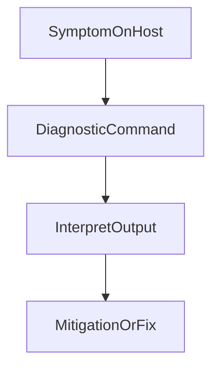

# D26-T007 — curl and wget

Topic ID: `D26-T007`
Domain: Linux and Backend Troubleshooting
Subdomain: curl and wget
Importance: core
Complexity: intermediate
Dependencies: `D26-T006`, `D26-T001`, `D03-T001`, `D03-T002`, `D23-T001`
Execution status of the code in section F: illustrative (commands/manifests not executed in CI for this topic)

## A. Topic Overview

curl and wget covers curl and wget for teams running backend services in production.

The concept exists because distributed systems fail in operational ways: bad deploys, exhausted disks, DNS drift, RBAC gaps, and pipelines that pass tests but miss integration risk.

In interviews, `D26-T007` checks whether you can reason about failure, mitigation, and trade-offs—not only happy-path APIs.

Prerequisites from inventory: `D26-T006`, `D26-T001`, `D03-T001`, `D03-T002`, `D23-T001`. Continue with `D26-T008` in this domain track.

## B. First-Principles Explanation

At the bottom, curl and wget is about maintaining desired state under change and load. Humans declare intent (manifests, terraform, git branches); controllers and schedulers reconcile reality.

curl and wget is a core operational topic for backend engineers shipping on Linux, Kubernetes, or cloud platforms.

In `curl and wget`, the failure modes are usually misconfiguration, capacity, or observability gaps rather than algorithm bugs.

Production debugging starts from symptoms (latency, 5xx, CrashLoopBackOff) and narrows with commands and control-plane state.

This note (`D26-T007`) ties the concept to commands, manifests, or workflow steps you can run in staging first.

## C. Internal Working and Architecture

Components involved in curl and wget:

- **Declarative config** — YAML, HCL, workflow files, or systemd units describing desired state.
- **Reconciliation loop** — control plane or CI job that compares desired vs actual and acts.
- **Data plane** — processes, packets, and bytes users depend on.
- **Observability** — metrics, logs, events, and traces proving which layer failed.

Execution flow: change lands in git or kubectl apply → admission/validation → scheduler/placement → runtime start → health signals → traffic shift → verification. Rollback reverses artifact or manifest revision.

State is stored in etcd (Kubernetes), remote state buckets (Terraform), or git tags (releases). Treat those stores as sensitive configuration history.

## D. Diagrams and Visual Models

Read the diagram as an operational flow for curl and wget, not as a vendor-specific internal implementation.

## E. Examples and Analogies

Analogy: curl and wget is the flight checklist—not the airplane. The checklist prevents skipping steps when tired.

Backend example: after deploying an API, you confirm readiness before shifting the Service, watch error rate for ten minutes, and keep the previous image digest tagged for instant rollback.

Anti-pattern: restarting pods randomly without reading events—masks a failing migration or probe misconfiguration.

Do run commands read-only first; do pin versions; do not share production kubeconfig broadly.

## F. Code Examples

Representative commands for `curl and wget` on Linux.

curl and wget is a core operational topic for backend engineers shipping on Linux, Kubernetes, or cloud platforms.

Run these on the host or in a debug container with matching network namespace. Capture output before changing state. Redact secrets from pasted logs.

## G. Practical Backend Application

On-call uses curl and wget when alerts tie to deploy windows or infrastructure change. Correlate `kubectl`/`git`/`ss` output with application logs and trace IDs.

Security: least privilege for CI tokens, RBAC, and SSH. Rotate secrets without printing them in job logs.

Scaling: autoscaling and queues only help when bottlenecks are identified—CPU without I/O checks misleads.

Observability: every runbook step should name a dashboard or log query.

## H. Advantages, Limitations and Trade-offs

| Choice | Benefit | Cost | Choose when | Avoid when |
| --- | --- | --- | --- | --- |
| Manual kubectl | Fast for one-off debug | Drift, no audit trail | Break-glass incident | Routine config |
| GitOps | Auditable desired state | Learning curve, sync delays | Multi-team clusters | Solo dev sandbox |
| Rolling deploy | Simple, native | Mixed versions during roll | Stateless APIs | Breaking schema change |
| Blue-green | Instant switch | Double capacity cost | Critical cutovers | Tight cost budget |
| Managed service | Less ops toil | Vendor lock-in, limits | Standard databases | Exotic tuning needs |

## I. Common Mistakes and Misconceptions

- Using liveness probes that fail when dependencies blip, causing restart loops.
- Setting memory limits below working set, causing OOMKilled pods under normal load.
- Pushing `:latest` images without recording digest in the deployment manifest.
- Running `kill -9` before capturing heap or thread dump for a JVM outage.
- Assuming `ping` failure means HTTP failure—ICMP is often blocked.
- Granting cluster-admin to CI service accounts.

## J. Debugging and Troubleshooting

Symptoms map to layers: `ImagePullBackOff` (registry/auth), `CrashLoopBackOff` (app exit), `Pending` (scheduling/resources), elevated 502 (readiness/endpoints), slow CI (cache/test flakiness).

Diagnosis loop: timestamp the change → collect events/logs → reproduce in staging → patch or rollback → add guardrail.

For Linux hosts: combine `ps`/`top` for CPU, `free`/`vmstat` for memory pressure, `df`/`du` for disk, `ss`/`lsof` for ports, `dig` for DNS.

Document findings in the incident channel before closing.

## K. Interview Preparation

### Beginner

#### Q1. What is curl and wget in one sentence?

**Answer:** It is the practice and tooling around curl and wget in production systems. Backend interviews use it to see whether you can operate what you build, not only write features. Strong answers name one command, one manifest field, or one pipeline stage. Weak answers stay abstract without a failure story.

#### Q2. Why does curl and wget matter for reliability?

**Answer:** Reliability is the sum of deployability, observability, and recovery time. curl and wget directly affects how fast you detect and fix incidents. SLOs are meaningless if you cannot inspect or change the running system safely. Teams that skip this topic ship faster until the first outage.

#### Q3. Name one tool or command for curl and wget.

**Answer:** Pick something you have actually run: kubectl, git, ss, dig, terraform, or a CI workflow. Say what output you expect and what would worry you. Interviewers follow up with 'what if that command lies?'—mention corroboration. Do not list ten tools without depth on one.

#### Q4. What is a common beginner mistake with curl and wget?

**Answer:** Copying snippets without understanding probes, permissions, or pipeline gates. Treating staging and production as identical when data and traffic shape differ. Restarting or redeploying before collecting logs and events. Confusing symptoms (502) with causes (readiness failing on DB migration).

#### Q5. How does curl and wget connect to security?

**Answer:** Least privilege applies to IAM, RBAC, CI secrets, and shell access. Misconfigured network paths and exposed secrets dominate cloud incidents. Supply-chain checks in CI reduce compromised dependency risk. Operational access should be audited and time-bound.

### Intermediate

#### Q1. How would you debug a production issue involving curl and wget?

**Answer:** Reproduce or narrow scope: one pod, one region, one deploy window. Collect evidence: metrics, logs, events, traces, and the last change. Form a hypothesis and test it with a read-only command before mutating state. Document timeline and fix forward with a guardrail (alert, probe, limit).

#### Q2. What signals would you alert on for curl and wget?

**Answer:** Alert on user-visible SLO burn or imminent capacity, not only CPU graphs. Use multi-window burn rates for error budgets where applicable. Page humans for actionable states; ticket for trends. Every alert should link to a runbook section tied to this topic.

#### Q3. Compare two design choices relevant to curl and wget.

**Answer:** State the trade-off: speed vs safety, cost vs redundancy, coupling vs autonomy. Pick a default for your context (traffic, team size, compliance). Mention how you would revisit the decision with metrics. Interviewers want a decision, not endless neutrality.

#### Q4. How do you test changes for curl and wget before production?

**Answer:** Use staging that exercises real integrations with sanitized data. Automate smoke tests in CI and post-deploy verification in CD. Practice game days or chaos in non-prod for failover paths. Roll out with canaries or flags when blast radius is large.

#### Q5. What documentation do you leave after touching curl and wget?

**Answer:** Update runbooks, ADRs, or README ops sections with commands and dashboards. Record rollback steps and known sharp edges. Link monitors and on-call playbooks. Future you is also on-call.

### Advanced

#### Q1. Explain advanced failure mode #1 for curl and wget.

**Answer:** Cascading failure happens when retries, restarts, or autoscaling amplify a small fault. Control plane degradation can make kubectl succeed while data plane starves. Split-brain and partial partitions look like flaky networks in metrics. Mitigate with budgets, backoff, and idempotent handlers.

#### Q2. How does curl and wget behave at multi-region scale?

**Answer:** Latency and consistency constraints dominate; health checks must be region-local. Global load balancing shifts traffic only when backends are actually ready. Configuration drift across regions causes subtle version skew bugs. Disaster recovery objectives (RTO/RPO) dictate how much automation you need.

#### Q3. How do GitOps and imperative changes interact with curl and wget?

**Answer:** Git becomes desired state; controllers reconcile clusters continuously. Manual kubectl edits get reverted unless escaped via break-glass process. Drift detection should alert when live state diverges from declared state. Pipelines should commit manifest changes, not only mutate clusters.

#### Q4. What capacity planning inputs feed curl and wget?

**Answer:** Traffic forecasts, payload growth, retention, and dependency limits (DB connections). Load tests with realistic think times beat guessing from CPU averages. Headroom for deploys and failures should be explicit in autoscaling max. Review quarterly or after major product launches.

#### Q5. How would you coach a junior on curl and wget?

**Answer:** Pair on a staged incident drill with read-only commands first. Have them write the timeline from symptoms to root cause. Review one change they would make to prevent recurrence. Depth beats breadth in the first month on-call.

### Scenarios

#### Q1. Pods CrashLoop after a deploy touching curl and wget. First three commands?

**Answer:** `kubectl describe pod` for probe and image pull errors. `kubectl logs --previous` for the crashed instance stack trace. `kubectl get events --sort-by=.lastTimestamp` for scheduling or quota issues. Only then roll back or patch if the blast radius is wide.

#### Q2. Latency spikes after a config change related to curl and wget. What do you check?

**Answer:** Diff the change against last known good in git or the config store. Check saturation: connections, thread pools, disk, and GC if JVM. Validate dependencies with curl from inside the network namespace. Roll forward with a fix if rollback is slower than a targeted patch.

#### Q3. CI is green but production breaks curl and wget. Why?

**Answer:** Tests may not cover integration, data shape, or feature-flag combinations. Environment variables or secrets differ between CI and prod. Migrations may be backward-incompatible despite passing unit tests. Add release verification and canaries tied to business metrics.

#### Q4. On-call sees flapping alerts for curl and wget. Response?

**Answer:** Stabilize paging: widen thresholds temporarily only with a ticket and owner. Find whether flapping is probe noise, metric cardinality, or real oscillation. Fix the root cause—often too aggressive autoscaling or retry storms. Post-incident, delete noisy alerts or fix the underlying signal.

#### Q5. Security audit flags curl and wget. Typical findings?

**Answer:** Overbroad IAM or cluster-admin bindings. Secrets in logs, images, or plain ConfigMaps. Missing network policies between tiers. Remediate with least privilege, sealed secrets, and policy-as-code.

### Follow-ups

#### Q1. How does curl and wget relate to observability (metrics, logs, traces)?

**Answer:** Metrics show rates and saturation; logs explain discrete failures; traces show cross-service latency. Instrument the code path this topic protects, not only the infrastructure. Correlate deploy markers with SLO dashboards. See domain 13 for deeper telemetry patterns.

#### Q2. How does curl and wget relate to containers and images?

**Answer:** Images package dependencies; orchestrators schedule and health-check them. Image digest pinning and scanning belong in CI before CD. Debug containers attach tools without rebuilding the app image. See domain 23 for Dockerfile and compose details.

#### Q3. What should you read next after curl and wget?

**Answer:** Follow the inventory dependency chain for this domain. Practice one staged drill that combines this topic with networking and data stores. Write a one-page runbook section for your current service. Teaching the topic once solidifies it for interviews.

## L. Practical Exercises

Solutions are in `EXERCISES/solutions/D26-T007.md`. Try these before opening that file.

### Exercise 1 — implementation

Apply one safe change for curl and wget in a staging cluster or VM: write the manifest/config, apply it, and capture `describe` or command output proving success.

### Exercise 2 — debugging

Given a fictional incident tied to curl and wget, list five read-only commands you would run in order and what bad output looks like.

### Exercise 3 — trade-off

Choose between two operational strategies for curl and wget (for example GitOps vs imperative, rolling vs blue-green). Write one paragraph defending your choice for a high-traffic API.

## M. Revision Notes

- curl and wget: know one command, one failure mode, one mitigation.
- Kubernetes: requests schedule; limits cap; liveness restarts; readiness routes traffic.
- CI/CD: immutable artifacts, verified promotions, secret hygiene.
- Linux: correlate process, network, DNS, disk, memory layers.
- SWE principles: cohesion, coupling, compatibility, deliberate debt.

## N. Related Topics

Understand this before: `D26-T006`.

This topic supports: `D26-T008` and adjacent inventory dependencies.

Often confused with: neighboring topics in the same domain—compare probes vs metrics, and CI vs CD.

Interviewers combine this with `D05-T019` health checks, `D13-T003` observability, and `D23-T007` containers.

## O. Completion Criteria

- Explain curl and wget without reading this note.
- Draw or narrate the mermaid flow for curl and wget.
- Run or write the section F example and interpret output.
- Answer two scenario questions from section K aloud.
- Add a runbook bullet to your team's doc.
