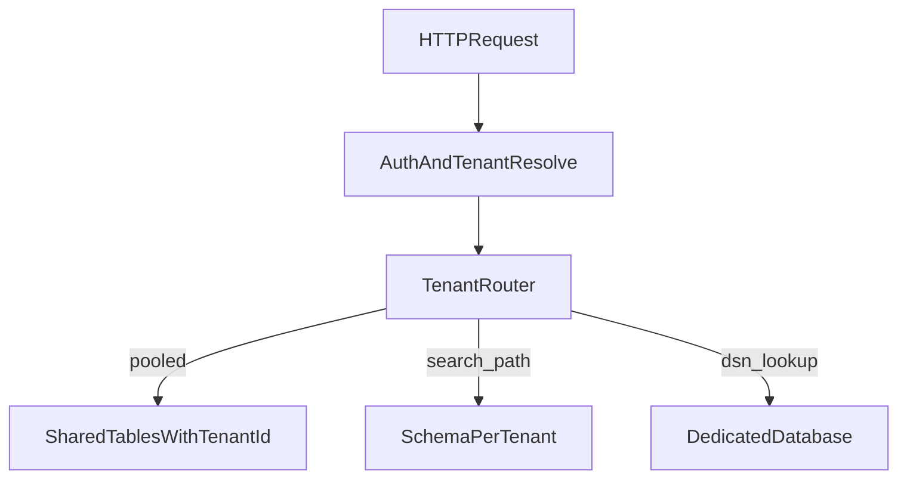

# D28-T001 — Multi-tenancy: shared DB vs schema vs database per tenant

Topic ID: `D28-T001`
Domain: Advanced Backend Topics That Make You Stand Out
Subdomain: Multi-tenancy: shared DB vs schema vs database per tenant
Importance: advanced
Complexity: advanced
Dependencies: `D15-T001`, `D15-T002`, `D19-T001`, `D19-T002`, `D12-T001`, `D12-T002`
Execution status of the code in section F: not executed (documentation example)

## A. Topic Overview

Multi-tenancy is how one deployed backend serves many customers (tenants) while keeping data and policy separated. The three classic storage patterns are: one shared database with a `tenant_id` column, one database with a schema per tenant, or one physical database per tenant.

The pattern exists because operating thousands of isolated single-tenant stacks does not scale operationally, yet enterprises still demand isolation, compliance, and predictable performance.

In production this drives connection pooling, backup strategy, migration cadence, and how you enforce authorization on every query. Interviewers use it to see whether you default to “add tenant_id” without discussing blast radius, noisy neighbors, or exit/migration cost.

Prerequisites: distributed systems and API auth basics. This topic supports tenant isolation (`D28-T002`) and quota design (`D28-T004`).

## B. First-Principles Explanation

A tenant is a boundary for data, configuration, billing, and policy. The application must answer: given an authenticated principal, which tenant context applies, and which rows or schemas are visible.

Shared-table multi-tenancy stores all tenants in the same tables. Isolation is logical: every query must filter on `tenant_id`, and unique constraints must include `tenant_id`. The benefit is simplest operations and cheapest idle cost. The cost is highest blast radius—a bug that omits the filter leaks data.

Schema-per-tenant keeps one cluster but separate namespaces. Migrations run per schema or via templating; connection routing may set `search_path` or equivalent. Blast radius shrinks for many classes of mistakes, but connection and migration complexity rises with tenant count.

Database-per-tenant gives the strongest isolation and clearest backup/restore per customer. Cost and connection overhead dominate; you need automation for provisioning, patching, and schema version drift.

What happens on a read: resolve tenant from token or subdomain, attach tenant context to the request scope, apply row-level or schema-level enforcement, then execute SQL with that context never optional.

## C. Internal Working and Architecture

Components:

- Identity layer issues tokens with `tenant_id` or org claims.
- Request middleware binds tenant context and rejects cross-tenant header tampering.
- Data access layer injects tenant predicates or selects datasource/schema.
- Ops plane provisions tenants, runs migrations, and tracks schema versions per tier.

Execution for a shared-table design:

1. Authenticate and map user to exactly one active tenant (or explicit tenant switch with audit).
2. Open transaction; set session variable or use ORM filters so every statement includes `tenant_id = :t`.
3. Run business logic; commit.
4. Async jobs carry tenant id in message metadata; workers re-validate before writes.

For database-per-tenant, a routing datasource picks a JDBC URL or connection string from a registry keyed by tenant id, with pool limits per tenant tier.

State: tenant metadata (plan, region, schema version, maintenance flags) lives in a control database separate from tenant data when possible, so platform operations do not require scanning tenant tables.

## D. Diagrams and Visual Models



Read top-down: every path assumes tenant resolution happens before any datastore access. The router encodes your isolation model; it is not optional middleware.

## E. Examples and Analogies

Analogy: shared-table is apartments in one building with unit numbers on the door; schema-per-tenant is separate floors with separate keycards; database-per-tenant is separate buildings.

Backend example: a B2B SaaS on PostgreSQL shared-table must use composite unique indexes `(tenant_id, external_id)` and never expose raw SQL debug endpoints in production.

Do not store tenant id only in the session without verifying it matches the token on each request. Do not run analytics queries without tenant partition filters. Do not pick database-per-tenant for 50k free-tier signups without automation.

## F. Code Examples

File: `examples/d28_t001.py`

Dependencies: Python 3 standard library only.

```python
from dataclasses import dataclass
from typing import Optional

@dataclass(frozen=True)
class TenantContext:
    tenant_id: str

class TenantRequiredError(PermissionError):
    pass

def apply_tenant_filter(sql: str, ctx: Optional[TenantContext]) -> str:
    if ctx is None or not ctx.tenant_id.strip():
        raise TenantRequiredError("tenant context missing")
    # Illustrative: real code uses parameters, not string concat.
    if "tenant_id" not in sql:
        raise TenantRequiredError("query must constrain tenant_id")
    return sql

if __name__ == "__main__":
    ctx = TenantContext("acme")
    ok = apply_tenant_filter("SELECT * FROM orders WHERE tenant_id = :t", ctx)
    assert "tenant_id" in ok
    print("ok", ctx.tenant_id)
```

How to run: `python examples/d28_t001.py` from `EXERCISES/examples/`.

Expected output: `ok acme`

Important lines: failing closed when `tenant_id` is absent mirrors production ORM scopes. Real implementations bind `:t` as a parameter and test that scopes cannot be disabled by a single forgotten call site.

## G. Practical Backend Application

On each request, resolve tenant once and store in a request-scoped context object passed to repositories. Repositories accept `TenantContext` as a required first argument so static analysis can flag missing usage.

Migrations: shared-table runs one migration globally; schema-per-tenant needs a job queue that applies migrations tenant-by-tenant with failure reporting; database-per-tenant needs a provisioning pipeline and version registry.

Observability: tag metrics and traces with `tenant_id` only when cardinality is controlled (sample or top-N); use tier labels for alerts. Scaling: noisy-neighbor protection (`D28-T003`) pairs with this choice—shared-table needs quotas and query guards.

## H. Advantages, Limitations and Trade-offs

| Choice | Benefit | Cost | Choose when | Avoid when |
| --- | --- | --- | --- | --- |
| Shared table + tenant_id | Lowest ops cost, simple backups | Data leak if filter missed | Many small tenants, strong engineering discipline | Strict regulatory isolation per DB |
| Schema per tenant | Better isolation, easier per-tenant export | Migration fan-out, connection routing | Hundreds of mid-size tenants | Huge tenant counts without automation |
| Database per tenant | Strongest isolation, custom tuning | Highest cost and connection overhead | Enterprise contracts, data residency | Mass-market freemium at scale |

Under load, shared-table hotspots on indexes shared across tenants; schema-per-tenant can exhaust connection limits; database-per-tenant needs pooler tiers and careful max connections per instance.

## I. Common Mistakes and Misconceptions

- Assuming ORM “scopes” are enough without integration tests that assert cross-tenant reads fail.
- Using global sequences for primary keys without including tenant in uniqueness constraints.
- Running ad-hoc support queries in production without tenant predicate.
- Picking database-per-tenant without a provisioning API and drift detection between tenants.
- Confusing “organization” and “tenant” when users can belong to multiple orgs—model membership explicitly.

## J. Debugging and Troubleshooting

Symptoms: customer A sees customer B’s invoice id in a URL; support reports “wrong workspace”; one tenant’s queries slow everyone.

Root causes differ: missing tenant filter, cached object keyed without tenant, connection pool pointing at wrong schema, or replica lag on a shared cluster.

Diagnosis: reproduce with two test tenants; capture SQL with parameters; verify JWT claim vs row tenant; check cache keys include tenant id.

Mitigation: emergency read-only mode for affected endpoint, invalidate caches, hotfix filter, notify if confirmed leak.

Prevention: mandatory tenant integration tests, static checks for raw queries, row-level security in Postgres where appropriate, regular pen tests on IDOR.

## K. Interview Preparation

### Beginner

#### Q1. What is multi-tenancy?

**Answer:** It is one software deployment serving multiple customers with separated data and policy. The separation can be logical (tenant_id column), namespace (schema), or physical (database). Interviewers want you to name the isolation mechanism, not only the business term “SaaS.” Production risk is cross-tenant data exposure when enforcement is forgotten on one code path.

#### Q2. What is the simplest multi-tenant data model?

**Answer:** Shared tables with a `tenant_id` on every tenant-owned row and on every unique constraint that must be per-tenant. Simplicity is operational: one migration, one backup. The cost is that every query must filter on tenant_id, and a single missed filter is a severity-1 incident. Tests and ORM scopes must make omitting the filter difficult.

#### Q3. Why would a company choose schema-per-tenant?

**Answer:** It increases isolation without provisioning a full database per customer, which helps compliance narratives and per-tenant restore. Migrations must run across many schemas, so you need automation and monitoring for schema version drift. Connection routing must set the correct schema or search_path per request. It fits hundreds of tenants more often than millions of tiny tenants.

#### Q4. What is a noisy neighbor in multi-tenancy?

**Answer:** One tenant consumes disproportionate CPU, IO, or connections, degrading others on shared infrastructure. The symptom is elevated latency for unrelated tenants during one tenant’s batch job. Mitigations include per-tenant quotas, rate limits, and separate pools for heavy tenants. This connects directly to fairness topics later in domain 28.

#### Q5. Where should tenant id come from in an API?

**Answer:** From a signed token claim or server-side session established after auth, not from an unvalidated client header alone. The server maps the user to allowed tenants and picks the active tenant explicitly. Client-supplied tenant id without verification is an IDOR vector. Audit tenant switches for support and enterprise accounts.

### Intermediate

#### Q1. How do you prevent cross-tenant leaks in a shared database?

**Answer:** Combine defense layers: request-scoped tenant context required by repositories, integration tests that attempt cross-tenant reads, composite unique keys including tenant_id, and optional database row-level security. Code review checklists flag raw SQL. Logging must not print rows from mixed tenants in one blob. Treat any generic cache key as suspect until tenant is part of the key.

#### Q2. How does connection pooling interact with schema-per-tenant?

**Answer:** Pools are usually per datasource or per schema route; resetting `search_path` on checkout prevents schema bleed between requests. Pool size multiplied by tenant routes can explode, so use a pooler and cap concurrent tenants per instance. Long-running transactions hold connections and amplify exhaustion. Monitor wait time for connections separately from query time.

#### Q3. How do backups differ between models?

**Answer:** Shared-table backups are single artifacts requiring logical export per tenant for GDPR deletes. Schema-per-tenant can dump one schema for one customer if tooling supports it. Database-per-tenant backup is naturally per customer but multiplies storage and restore drills. Interviewers want you to mention restore time objectives and legal hold, not only “we snapshot nightly.”

#### Q4. How do you onboard a new tenant?

**Answer:** Provision metadata in a control plane, run schema migration or create database, seed default configuration, and verify health checks with a synthetic tenant token. Automate idempotency so retries do not create duplicate schemas. Emit events for billing activation. Document rollback if provisioning fails halfway.

#### Q5. How do migrations work at scale?

**Answer:** Shared-table: one migration window with backward-compatible steps. Schema-per-tenant: worker queue applies migrations with per-tenant status and alerting on failures. Database-per-tenant: same queue but tracks DSN per tenant; stagger to avoid thundering herd on the admin API. Always support expand-contract for zero-downtime column changes.

### Advanced

#### Q1. When is database-per-tenant worth the cost?

**Answer:** When contracts require physical isolation, custom performance tuning, or data residency in specific regions per customer. The cost is automation for thousands of databases, patching cadence, and connection limits. You also need a routing layer and observability per DSN. If tenants are small and numerous, economics usually favor shared models with strong logical isolation.

#### Q2. How do you migrate a large tenant between models?

**Answer:** Use dual-write or change-data-capture with a cutover window, maintain id mapping, and verify row counts and checksums per table. Traffic switch uses feature flags per tenant. Plan rollback to source if error budgets burn. Communicate maintenance windows for enterprise SLAs. This is a program, not a single SQL script.

#### Q3. How does search or analytics change tenant design?

**Answer:** Analytics warehouses often denormalize tenant_id as a partition key. Search indices must filter by tenant on every query and use separate aliases per tier if needed. Export pipelines must not co-mingle tenant files in shared buckets without prefixes and IAM boundaries. Treat derived stores as equally sensitive as OLTP.

#### Q4. What role does row-level security play?

**Answer:** RLS in PostgreSQL enforces tenant predicates inside the database even if application code regresses. Policies bind to session variables set at connection time. It is not a substitute for authz in the app layer but reduces blast radius. Test policies with multiple roles and connection pool reset behavior.

#### Q5. How do you test multi-tenant correctness?

**Answer:** Property-based tests that generate two tenants and assert no read crosses boundary; contract tests on every public API; chaos tests that rotate tenant tokens mid-session. Include background workers and batch jobs, not only HTTP handlers. Measure coverage of repositories, not only controllers.

### Scenarios

#### Q1. A support engineer pastes a query without tenant_id and runs it in prod. What happens?

**Answer:** This is a potential data breach and must trigger incident response even if they “only looked.” Immediately revoke access, determine rows returned, and notify per policy. Root cause is tooling that allows unconstrained queries. Mitigation: read-only role with mandatory tenant predicate templates, query guardrails, and break-glass auditing.

#### Q2. One enterprise tenant demands a dedicated database on shared-table SaaS.

**Answer:** Treat as tenant migration project: export, provision DSN, dual-write, cutover, decommission rows from shared tables after retention period. Pricing and SLA change. Feature flags route tenant to new pool. Validate backups and monitoring per DSN before switch.

#### Q3. After deploy, error “tenant not found” spikes for one region.

**Answer:** Check deploy included control-plane migration, DNS for regional auth, and replica lag on tenant registry. Compare failing tenant ids with registry contents. Roll back if registry write path broken. Add canary tenants per region in CI.

#### Q4. CPU is high on shared DB; one tenant runs heavy reports.

**Answer:** Symptom is global latency; root cause is unbounded read on shared cluster. Mitigate with read replica routing for reports, per-tenant rate limits, or move tenant to dedicated tier. Long-term: asynchronous reporting product path.

#### Q5. GDPR erasure request for one tenant on shared tables.

**Answer:** Run documented erasure job scoped by tenant_id across OLTP and derived stores (cache, search, warehouse). Verify object storage prefixes. Keep audit log of deletion without retaining PII. Test job in staging with synthetic tenant.

### Follow-ups

#### Q1. How does this connect to authorization?

**Answer:** Authentication proves who; tenant membership proves which workspace; authorization proves which actions inside that workspace. All three must align before datastore access. See `D19-T001` and `D28-T002`.

#### Q2. How does caching interact with tenants?

**Answer:** Cache keys must include tenant id or be namespaced per tenant; TTL alone does not prevent leaks. Consider separate cache clusters for enterprise tiers. Invalidate on tenant-wide config changes.

#### Q3. What is the next topic after choosing a model?

**Answer:** Tenant-aware authorization and fairness (`D28-T002`, `D28-T003`), then quotas (`D28-T004`). Operations runbooks for migration between models belong in advanced project work.

## L. Practical Exercises

Solutions are in `EXERCISES/solutions/D28-T001.md`. Try these before opening that file.

### Exercise 1 — implementation

Design a `TenantContext` type and repository interface that makes it impossible to call `find_order(id)` without tenant. Write three unit tests including a cross-tenant access attempt.

### Exercise 2 — debugging

Logs show orders returned with correct ids but wrong company names after a cache deploy. Trace how missing tenant in cache keys could cause this and list fixes.

### Exercise 3 — trade-off

Your startup has 2k SMB tenants and 5 enterprise prospects demanding isolation. Recommend shared-table vs schema vs database for each segment and how routing would work.

## M. Revision Notes

- Multi-tenancy is isolation + operations + cost, not only `tenant_id`.
- Every query and cache key must carry tenant context.
- Schema-per-tenant and DB-per-tenant need provisioning automation.
- Migrations and backups scale with tenant count.
- Noisy neighbors require quotas on shared models.

Flashcards:

- What is the blast radius of shared-table? A missed filter can expose all tenants.
- Why composite unique keys? Uniqueness is per tenant, not global.

## N. Related Topics

Understand this before: `D12-T001` APIs, `D19-T001` auth.

This topic supports: `D28-T002` tenant authorization, `D28-T003` fairness, `D28-T021` tenant migration.

Often confused with: multi-org user membership vs tenant boundary.

Interviewers combine this with `D07-T002` schema design, `D15-T001` distributed systems, `D33-T012` tenant monopolizes resources.

## O. Completion Criteria

- Draw three storage patterns and name one trade-off each.
- Explain how tenant is resolved on an HTTP request.
- List three defenses against cross-tenant IDOR.
- Describe migration steps for one enterprise tenant to dedicated DB.
- Answer a scenario on missing tenant filter without hand-waving.
