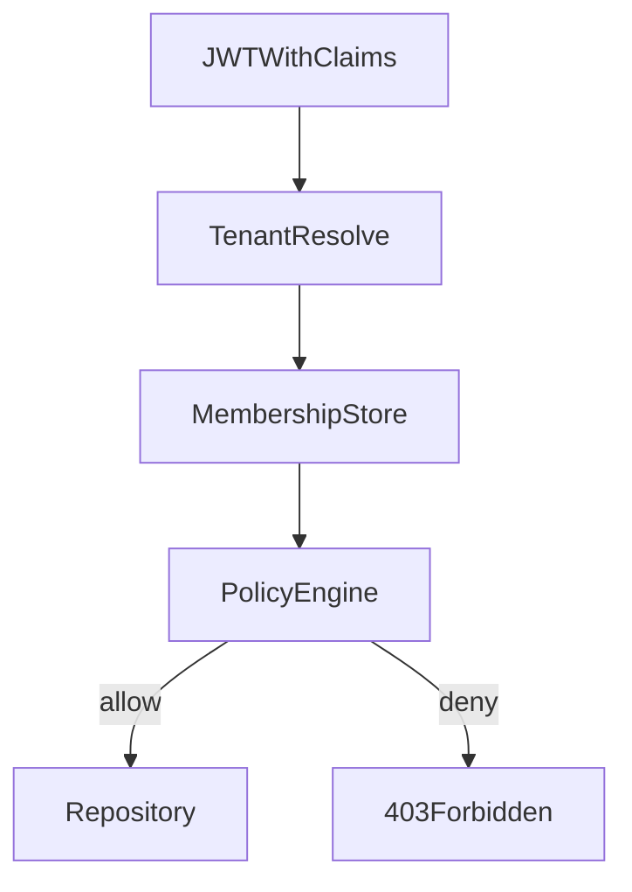

# D28-T002 — Tenant isolation and tenant-aware authorization

Topic ID: `D28-T002`
Domain: Advanced Backend Topics That Make You Stand Out
Subdomain: Tenant isolation and tenant-aware authorization
Importance: advanced
Complexity: advanced
Dependencies: `D28-T001`, `D15-T001`, `D15-T002`, `D19-T001`, `D19-T002`, `D12-T001`
Execution status of the code in section F: not executed (documentation example)

## A. Topic Overview

Tenant isolation ensures one customer cannot read or mutate another’s data. Tenant-aware authorization decides which actions a principal may perform inside the active tenant.

Storage layout (`D28-T001`) is necessary but not sufficient: a correct `tenant_id` filter still fails if a user lacks permission for the operation. Production incidents often mix IDOR (wrong tenant) with privilege escalation (right tenant, wrong role).

Interviewers probe whether you enforce authorization at the service layer consistently, including batch jobs and admin tools.

## B. First-Principles Explanation

Authentication establishes identity. Tenant membership establishes workspace scope. Authorization maps (principal, tenant, resource, action) to allow/deny.

Defense in depth: edge gateway may strip dangerous headers; application services enforce policy; database RLS optional backstop. Policy should be default-deny with explicit grants.

Roles are tenant-scoped: `admin@tenantA` must not imply `admin@tenantB`. Service accounts likewise carry tenant and capability lists.

## C. Internal Working and Architecture

Request pipeline: validate JWT → resolve tenant → load membership/roles from cache → attach `AuthzContext` → policy engine checks before repository calls.

Policy sources: static RBAC tables, attribute-based rules (owner_id), or external policy service. Cache TTL must balance latency vs revocation speed; support force-revoke via versioned session or short-lived tokens.

Async workers deserialize the same `AuthzContext` from message envelope; never trust payload tenant id without signature.

## D. Diagrams and Visual Models



## E. Examples and Analogies

Analogy: tenant is the building; authorization is whether your keycard opens a specific room.

Example: `DELETE /invoices/{id}` must check invoice.tenant_id matches context and principal has `invoice:delete` or owns the resource.

## F. Code Examples

File: `examples/d28_t002.py`

```python
from dataclasses import dataclass

@dataclass(frozen=True)
class AuthzContext:
    tenant_id: str
    user_id: str
    permissions: frozenset[str]

def can_delete_invoice(ctx: AuthzContext, invoice_tenant: str, invoice_owner: str) -> bool:
    if ctx.tenant_id != invoice_tenant:
        return False
    if "invoice:delete" in ctx.permissions:
        return True
    return ctx.user_id == invoice_owner

if __name__ == "__main__":
    ctx = AuthzContext("t1", "u1", frozenset())
    assert can_delete_invoice(ctx, "t1", "u1")
    assert not can_delete_invoice(ctx, "t2", "u1")
    print("ok")
```

How to run: `python examples/d28_t002.py` — Expected: `ok`

## G. Practical Backend Application

Centralize policy checks in a small module; avoid sprinkling `if role ==` in controllers. Integration tests matrix: two tenants × roles × endpoints.

Admin/support tools use break-glass roles with MFA and full audit; never bypass tenant checks without ticket id.

## H. Advantages, Limitations and Trade-offs

| Choice | Benefit | Cost | Choose when | Avoid when |
| --- | --- | --- | --- | --- |
| RBAC in app DB | Simple queries | Role explosion | B2B standard roles | Fine-grained ABAC everywhere |
| External policy service | Centralized policy | Latency, dependency | Many products share auth | Tiny service |
| RLS only | DB-enforced | Hard to debug | Postgres-heavy | Complex business rules |

## I. Common Mistakes and Misconceptions

- Checking role without tenant scope.
- Trusting `X-Tenant-Id` header from clients.
- Skipping authz in internal gRPC “because it’s internal”.
- Caching permissions without invalidation on role change.

## J. Debugging and Troubleshooting

Symptoms: 403 spikes, support “can’t access own data”, cross-tenant tickets.

Check: claim vs membership table, clock skew on token expiry, stale permission cache, feature flag disabling new policy.

Mitigation: roll back policy deploy, flush permission cache, extend token TTL temporarily only if safe.

Prevention: contract tests per endpoint, audit log on deny with reason code.

## K. Interview Preparation

### Beginner

#### Q1. What is tenant-aware authorization?

**Answer:** It evaluates permissions inside a specific tenant boundary after authentication. A user may be admin in one tenant and guest in another, so roles must not be global unless intentionally platform-level. The check is `(user, tenant, action, resource)` not `(user, action)` alone. Missing tenant scope is a common IDOR bug in SaaS APIs.

#### Q2. How is it different from authentication?

**Answer:** Authentication proves identity; authorization proves entitlement. A valid token for user U does not mean U may access tenant T until membership is verified. Confusing the two leads to endpoints that only check JWT signature. Always resolve tenant membership before loading sensitive resources.

#### Q3. What is default-deny?

**Answer:** Unless a policy explicitly allows an action, the request is rejected. Default-allow legacy codepaths are hazardous during refactors. New endpoints should call a shared `authorize()` helper. Tests should include users with no roles.

#### Q4. Where should checks live?

**Answer:** At the service layer closest to business invariants, not only at the edge. Repositories should still include tenant predicates even if authz passed, for defense in depth. UI hiding buttons is not authorization.

#### Q5. What is a platform admin?

**Answer:** A principal with cross-tenant capabilities, tightly controlled, audited, and MFA-protected. Platform admins should not reuse normal user JWTs. Separate tooling and break-glass process prevents casual cross-tenant browsing.

### Intermediate

#### Q1. How do you model roles vs permissions?

**Answer:** Roles are bundles of permissions assigned per tenant membership. Permissions are strings like `invoice:read`. Mapping tables link user_tenant → roles → permissions. Avoid hardcoding role names in many services; use a shared catalog. Version permission changes with deploy notes.

#### Q2. How fast should permission revocation work?

**Answer:** Bounded by token TTL unless you maintain a revocation list or session version in JWT. Short access token TTL plus refresh rotation limits exposure. Critical revocations may require killing sessions in store. Product must accept delay or pay cost of central session service.

#### Q3. How do service accounts fit?

**Answer:** Machine principals have tenant id and scoped permissions, not human roles. Rotate credentials automatically. Never share one service account across tenants. Audit their actions like human admins.

#### Q4. How do you test authorization?

**Answer:** Table-driven tests: tenant A user cannot access tenant B resource ids. Include negative tests for every new endpoint. Snapshot policy definitions in CI. Pen test IDOR annually.

#### Q5. How does caching interact?

**Answer:** Cache keys include tenant and permission version. On role change, bump version or purge user entries. Stale cache causes false allows or denies; false allows are worse. Monitor cache hit rate separately from authz errors.

### Advanced

#### Q1. ABAC vs RBAC for tenants?

**Answer:** RBAC scales to standard job functions; ABAC handles row ownership and attributes. Hybrid is common: RBAC for coarse, ABAC for resource owner checks. External policy engines help when rules change often. Keep evaluation deterministic and logged.

#### Q2. Multi-tenant admin APIs?

**Answer:** Separate router, stricter rate limits, distinct OpenAPI, mandatory audit fields. Never reuse tenant user middleware without platform scope checks. Consider separate deployment or network policy.

#### Q3. GraphQL and authorization?

**Answer:** Resolvers must call authz per object, not only top-level query. Batching can leak fields if parent authorized but child not. Use dataloaders with tenant context threaded through.

#### Q4. Delegation and impersonation?

**Answer:** Support sessions need actor vs subject ids in audit log, time limits, and customer consent where required. Impersonation tokens must be visually distinct in UI. Auto-expire and alert customer.

#### Q5. Zero trust between services?

**Answer:** mTLS plus service JWT with tenant claim for calls that carry tenant data. Do not trust network location alone. Policy on callee mirrors user-facing rules for that operation.

### Scenarios

#### Q1. User reports seeing empty list but colleague sees data.

**Answer:** Likely missing role or wrong tenant selected, not data loss. Compare JWT claims, membership rows, and authz deny logs. Fix role assignment or tenant switch UX. Add explicit error when tenant has zero access vs empty dataset.

#### Q2. Deploy adds new permission; old tokens lack it.

**Answer:** Users need refresh or re-login unless permissions loaded server-side per request. Mitigate with server-side permission fetch not embedded only in JWT. Communicate session refresh in release notes.

#### Q3. Partner API key accesses wrong tenant.

**Answer:** API keys must bind to single tenant id in vault; rotate key, audit access logs, add integration test per key. Root cause often copy-paste of key across environments.

#### Q4. Batch job exported all tenants’ rows.

**Answer:** Incident: job used platform credential without tenant filter. Stop job, assess leak, notify. Fix: require tenant argument, dry-run mode, row count caps, dual approval.

#### Q5. 403 only in one region.

**Answer:** Check replicated membership DB lag, feature flag per region, or wrong identity provider mapping. Compare policy version hash across regions. Roll back regional config diff.

### Follow-ups

#### Q1. Link to `D28-T001`?

**Answer:** Storage isolation without authz still leaks via IDOR; authz without tenant filters still leaks via SQL bugs. Both required.

#### Q2. Link to OAuth scopes?

**Answer:** Scopes are coarse; map to internal permissions explicitly per tenant integration.

#### Q3. Next topic?

**Answer:** `D28-T003` fairness and noisy-neighbor protection when authorized users overload shared tiers.

## L. Practical Exercises

Solutions in `EXERCISES/solutions/D28-T002.md`.

### Exercise 1 — implementation

Implement `authorize(ctx, action, resource)` with tenant match and permission set; three tests.

### Exercise 2 — debugging

403 after role change—trace cache TTL and JWT claims.

### Exercise 3 — trade-off

JWT-embedded permissions vs server-side lookup—pick for 50ms p95 budget.

## M. Revision Notes

- Authn ≠ authz; tenant scope on both.
- Default-deny; central policy module.
- Test cross-tenant IDOR every endpoint.
- Platform admin is special class.
- Cache permissions with version keys.

Flashcards:

- Tenant-aware? Permissions evaluated inside active tenant.
- IDOR? Access resource without proper tenant scope.

## N. Related Topics

Before: `D28-T001`, `D19-T001`. Supports: `D28-T003`. Confused with: global admin roles. Combine: `D12-T001`, `D33-T012`.

## O. Completion Criteria

- Explain authn/authz/tenant membership order.
- Draw policy pipeline diagram.
- Give IDOR test matrix example.
- Handle role revocation design.
- Answer platform admin scenario.
