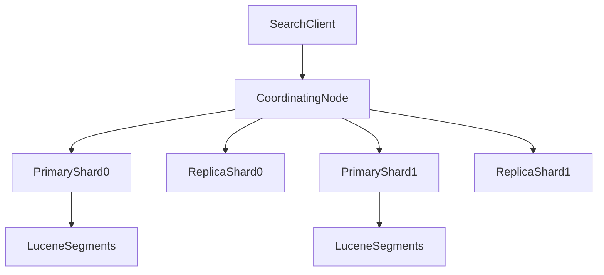

# D29-T001 — Elasticsearch / OpenSearch architecture

Topic ID: `D29-T001`
Domain: Search and Specialized Storage
Subdomain: Elasticsearch / OpenSearch architecture
Importance: common
Complexity: advanced
Dependencies: `D07-T001`, `D07-T002`, `D10-T001`, `D10-T002`
Execution status of the code in section F: not executed (documentation example)

## A. Topic Overview

Elasticsearch and OpenSearch are distributed search and analytics engines built on Apache Lucene. They store JSON documents in indices, shard them across nodes, and answer full-text and structured queries with inverted indexes rather than row-oriented table scans.

The cluster model exists because a single machine cannot hold every log line, product catalog, or trace span while still serving low-latency search. Sharding spreads data and query load; replication adds read capacity and failover.

In production you use them as a search tier beside PostgreSQL or as a log/metrics store (often via OpenSearch/ELK). Interviewers probe whether you know the difference between a search engine and a primary database, how writes become searchable, and what breaks during yellow/red cluster states.

Prerequisites: relational storage basics and caching concepts. This topic supports inverted indexes (`D29-T002`), analyzers (`D29-T003`), and vector search (`D29-T010`).

## B. First-Principles Explanation

At the bottom, Lucene builds immutable on-disk segments. Each segment has its own inverted index: terms point to posting lists of document ids. Elasticsearch wraps many Lucene indices (one per shard) in a distributed layer that routes documents, coordinates queries, and merges segments in the background.

A **cluster** is named set of nodes. One elected **master-eligible** node coordinates cluster metadata (index creation, shard allocation). **Data nodes** hold shards and execute queries. **Coordinating nodes** (any node can act as one) fan out search requests and merge results.

An **index** is a logical namespace (like a database table). It is split into **primary shards** for horizontal scale. Each primary can have **replica shards** for redundancy and extra read throughput. Shard count is chosen at index creation and is hard to change without reindexing.

Writes go to a primary shard, are replicated to replica shards, then refresh makes new segments visible for search (near real-time, not instantaneous commit). Reads hit one copy of each shard (primary or replica) and use scatter-gather.

Why not use only PostgreSQL? B-tree indexes excel at equality and range on columns; inverted indexes excel at tokenized text, scoring, and aggregations over huge denormalized documents. The trade-off is weaker transactional guarantees and eventual visibility after refresh.

## C. Internal Working and Architecture

Components:

- **Cluster state**: mappings, settings, routing table (which shard lives on which node).
- **Ingest path**: HTTP bulk/index API → routing by `_routing` or `_id` hash → primary shard → Lucene index writer → translog for durability → periodic refresh.
- **Search path**: query DSL parsed on coordinating node → shard-level Lucene search → top hits merged (and aggregations reduced).
- **Background**: segment merges, snapshot to object storage, ILM/ISM policies.

Execution for indexing one document:

1. Client sends `PUT /products/_doc/42` with JSON body.
2. Coordinating node resolves primary shard for id 42 from routing table.
3. Primary validates mapping, writes to translog and memory buffer.
4. Replicas receive the operation in parallel; all must acknowledge per `wait_for_active_shards`.
5. Refresh (default ~1s) opens a new searcher on the new segment; document becomes searchable.

Execution for a search:

1. Client sends `GET /products/_search` with query and `size`.
2. Coordinating node builds a query plan per shard.
3. Each shard returns local top-N plus aggregation partials.
4. Coordinator merges scores, trims global top-N, returns `_source` or `fields`.

State colors: **green** — all primary and replica shards assigned; **yellow** — primaries assigned but some replicas missing; **red** — at least one primary unassigned (partial data loss risk for that index).

Memory: heap for caches, aggregations, and field data; OS page cache for segment files. Disk must stay below flood-stage watermark or the cluster blocks writes.

## D. Diagrams and Visual Models



Read left to right: one HTTP search fans out to every shard copy in the index; only one copy per shard id participates per query. Writes always hit the primary first, then replicas.

## E. Examples and Analogies

Analogy: an index is a library catalog split into volumes (shards). The coordinating librarian asks each volume for the best matches, then sorts the combined shortlist. Replicas are duplicate volumes on another shelf for failover and extra readers.

Backend example: product search in e-commerce keeps authoritative stock and price in PostgreSQL. A CDC or outbox worker denormalizes title, facets, and popularity into an `products` index. The API searches OpenSearch for relevance, then hydrates authoritative fields from SQL by id.

Do not use the search cluster as the system of record for money or inventory without a reconciliation story. Do not set `number_of_shards` to 100 on a tiny index—you multiply segment overhead. Do not ignore yellow cluster state in production; missing replicas mean the next node loss drops primaries.

## F. Code Examples

File: `examples/d29_t001_health_routing.py`

Dependencies: Python 3 standard library only (illustrates routing math, not a live cluster).

```python
import hashlib


def routing_hash(doc_id: str, num_shards: int) -> int:
    """Same idea as Elasticsearch default routing: hash(id) % num_shards."""
    digest = hashlib.md5(doc_id.encode("utf-8")).hexdigest()
    # Use lower bits; production uses a consistent hash defined by the engine.
    return int(digest[:8], 16) % num_shards


def interpret_health(status: str, unassigned_primaries: int) -> str:
    if unassigned_primaries > 0:
        return "red"
    if status == "yellow":
        return "yellow"
    return "green"


if __name__ == "__main__":
    assert routing_hash("42", 3) == routing_hash("42", 3)
    assert interpret_health("green", 0) == "green"
    assert interpret_health("green", 1) == "red"
    print("ok", routing_hash("sku-9001", 5))
```

How to run: `python examples/d29_t001_health_routing.py` from `28_SEARCH_AND_STORAGE` or copy under `EXERCISES/examples/`.

Expected output: `ok` plus a shard number 0–4.

Important lines: routing picks exactly one primary per document id. Health interpretation treats unassigned primaries as worse than missing replicas. Real clients should call `/_cluster/health` and `/_cat/shards` instead of reimplementing this.

## G. Practical Backend Application

A typical service exposes `GET /search?q=...` to the UI. The handler validates input, builds a bool query with filters (tenant id, in-stock), calls OpenSearch with timeouts, and maps hits to DTOs. Writes to products still go to SQL; a worker consumes change events and bulk-indexes with `refresh=wait_for` only when the UI must read-after-write for admin tools.

Concurrent indexing and search share thread pools on data nodes. Bulk indexing during peak search can raise latency unless you throttle ingest or separate coordinating-only nodes for heavy search.

Error handling: map `503` from cluster overload to retry with backoff; map `index_not_found_exception` to deployment/config bugs. Security: terminate TLS at the gateway, use IAM or API keys, and never expose `_cluster` admin APIs publicly.

Observability: track search latency p95, indexing rate, JVM heap, circuit breaker trips, and `unassigned_shards`. Scaling: add data nodes and rebalance; increase replicas for read-heavy workloads; split hot indices via aliases and reindex (`D29-T007`).

## H. Advantages, Limitations and Trade-offs

| Choice | Benefit | Cost | Choose when | Avoid when |
| --- | --- | --- | --- | --- |
| OpenSearch/Elasticsearch | Fast full-text, aggregations, horizontal scale | Ops complexity, near-real-time lag | Catalog, logs, RAG retrieval | Sole transactional store |
| Few large shards | Less overhead per index | Harder to rebalance huge shards | Predictable large data | Unknown growth |
| Many small shards | Finer placement | Cluster state bloat, more merges | Very large clusters with hot spots | Small datasets |
| Replicas > 0 | Failover, read scale | Extra disk and write amplification | Production | Dev-only single node |
| Frequent refresh | Fresher search | More segments, slower indexing | Admin UIs | High-volume log ingest |

Failure modes: split-brain (mitigated by quorum master election), disk full blocking writes, mapping explosions from dynamic fields, and expensive aggregations on high-cardinality fields.

## I. Common Mistakes and Misconceptions

- Treating search results as strongly consistent with the database. Replication and refresh mean a just-updated row may not appear for hundreds of milliseconds or until bulk refresh.
- Using `number_of_replicas=0` in production to save disk, then losing a node and entering red.
- Running expensive `wildcard` or `script` queries on every user keystroke without guards.
- Assuming OpenSearch is a drop-in SQL replacement; joins are limited and denormalization is normal.
- Ignoring index templates and letting the first document define a wrong mapping (e.g., `price` as text).

A weak interview answer lists buzzwords (ELK, shards) without explaining primary vs replica or refresh. A strong answer traces one write and one read through the cluster.

## J. Debugging and Troubleshooting

Symptoms: search latency spikes, `503` errors, yellow/red health, missing documents after update, uneven node disk.

Those are symptoms. Root causes include shard hotspots, heap pressure, slow merges, network partitions, or ingest faster than refresh can keep up.

Diagnosis:

1. `GET _cluster/health` and `GET _cat/shards?v` for unassigned shards.
2. Compare indexing rate vs search QPS; check thread pool rejections in node stats.
3. Inspect slow logs for heavy queries; verify filters use keyword fields.
4. Confirm the application uses the correct index alias and routing key.

Example message: `[cluster_block_exception] index [logs-2025] blocked by: [TOO_MANY_REQUESTS]` after flood-stage disk watermark.

Immediate mitigation: shed load (rate limit search), add data nodes or disk, increase replicas only after primaries are stable, pause expensive aggregations. Long-term: ILM rollover, shard sizing review, separate ingest and search tiers, snapshots for restore drills.

Metrics: `search_latency`, `indexing_latency`, `jvm_heap_used_percent`, `unassigned_shards`, `circuit_breaker_tripped`.

## K. Interview Preparation

### Beginner

#### Q1. What is Elasticsearch or OpenSearch used for?

**Answer:** It is a distributed search and analytics engine that stores JSON documents and answers queries using inverted indexes built by Lucene. Teams use it for full-text search, faceted navigation, log analytics, and as a retrieval layer in RAG pipelines. It is optimized for search relevance and aggregations over large denormalized documents rather than multi-row ACID transactions. The application still usually keeps authoritative business data in a relational database and syncs into indices.

#### Q2. What is a shard?

**Answer:** A shard is a horizontal partition of an index; each shard is a Lucene index on one node. Primary shards hold the canonical copy of a subset of documents; replica shards are copies for redundancy and read scaling. Routing picks which primary owns a document based on its id and shard count. Changing shard count after creation typically requires reindexing into a new index.

#### Q3. What is the difference between a node and a cluster?

**Answer:** A cluster is the full named deployment of search engines working together. A node is one JVM process that participates in that cluster with roles such as master-eligible, data, or ingest. Multiple nodes share cluster metadata and coordinate queries. A single-node cluster is valid for development but provides no failover.

#### Q4. Why is cluster health yellow sometimes?

**Answer:** Yellow means all primary shards are assigned but at least one replica shard is not. Common causes are too few data nodes to place every replica, disk thresholds preventing allocation, or deliberate settings during maintenance. Yellow is a warning that you have reduced redundancy: losing another node can move indices to red if primaries become unassigned. Production should treat sustained yellow as an incident.

#### Q5. Is a document visible immediately after indexing?

**Answer:** Not necessarily; visibility is near real-time. After a write, the document is in the translog and memory buffer, but search uses refreshed segments. The default refresh interval is about one second, so readers may miss the document briefly. Forcing `refresh=true` on every write makes search fresher but hurts indexing throughput. Product pages often accept sub-second lag; financial ledgers should not use the search index as source of truth.

### Intermediate

#### Q1. How does a search request execute across shards?

**Answer:** The coordinating node receives the query, resolves the target indices, and builds a shard-level plan. It sends the same query to one copy of each shard (primary or replica). Each shard runs Lucene, returns local top hits and aggregation partials, and the coordinator merges global results. This scatter-gather pattern means latency tends toward the slowest shard plus merge cost. Skewed routing or hot shards therefore hurt tail latency for the whole query.

#### Q2. What roles do master-eligible nodes play?

**Answer:** They participate in electing a single active master that applies cluster-state changes such as creating indices, allocating shards, and updating mappings. Data nodes hold shards but rely on the master for metadata updates. Split-brain is prevented by quorum-based election and `discovery.seed_hosts` configuration. You should not overload master nodes with heavy indexing; dedicated master nodes are common in large clusters.

#### Q3. How do replicas help reads and writes?

**Answer:** Replicas serve search and get requests, spreading read load off the primary. Writes still go to the primary first, then replicate to each replica, so more replicas increase write amplification and disk use. During failover, a replica can be promoted if the primary is lost, which restores green if enough nodes remain. The trade-off is cost versus availability and read throughput.

#### Q4. When would you denormalize into Elasticsearch instead of joining?

**Answer:** Joins across many documents are expensive and limited compared to SQL. Search UIs need fast filters on category, brand, and price in one round trip, so you embed or flatten related fields at index time. CDC from orders and products might produce a `product_search` document with titles and stock flags. The cost is dual writes or lag and the need to reindex when mapping changes. Joins in SQL remain for reporting and consistency.

#### Q5. What is the translog?

**Answer:** The transaction log records operations not yet safely committed to Lucene segments. If a node crashes, the translog replays recent writes after restart. It is part of durability within a shard, separate from cluster-wide backup snapshots. Heavy bulk indexing fills translogs and triggers flushes to disk. Monitoring translog size and flush times helps catch slow disks or oversized bulk batches.

### Advanced

#### Q1. How do segment merges affect performance?

**Answer:** Lucene writes immutable segments; background merges combine small segments into larger ones to keep query performance stable. Merges are disk- and CPU-intensive and can compete with indexing and search thread pools. Too many tiny shards multiply merge work across the cluster. Tuning `index.merge.policy`, ingest throttling, and shard size targets reduces merge storms during bulk loads.

#### Q2. What happens when a data node runs out of disk?

**Answer:** Elasticsearch/OpenSearch enforces disk watermarks. As free space falls, the cluster may relocate shards, then block writes on affected indices at flood stage while still allowing deletes. Searches may continue until metadata or files are corrupt. Operations must expand disk, delete old indices via ILM, or add nodes before flood stage. Ignoring yellow warnings often ends in write outages during log spikes.

#### Q3. How do you design shard count for a new index?

**Answer:** Estimate total data size and growth, target shard size often between tens of GB and low hundreds of GB per shard, and align with data node count for even spread. Too few shards limit parallelism; too many inflate cluster state and merge overhead. For time-series logs, daily indices with rollover keep shard sizing predictable. Changing primaries later requires reindex, so initial sizing should include a two-year growth model.

#### Q4. OpenSearch vs Elasticsearch in operations—what should backends care about?

**Answer:** Both share Lucene core concepts: indices, shards, DSL, and snapshots. Licensing and plugin ecosystems differ; managed cloud offerings vary in IAM integration and version cadence. Backends should abstract the HTTP API behind an internal client, pin compatible versions in CI, and test upgrades on a clone cluster. Feature flags for k-NN or security plugins should not leak into domain logic.

#### Q5. How does routing customization affect ordering?

**Answer:** Default routing hashes `_id` to pick a shard. Custom `_routing` (for example `tenant_id`) co-locates related documents on one shard, which can help tenant-scoped queries but create hotspots if one tenant is huge. Parent-child and join field types historically relied on routing; modern designs often denormalize instead. Interviewers want awareness that routing is a load-balancing knob, not magic locality for free.

### Scenarios

#### Q1. Product search returns stale prices after a flash sale update. Where do you look?

**Answer:** Confirm the sale price committed in PostgreSQL and that the indexer consumed the change event without lag. Check the search handler: it might cache responses or read an old alias. Inspect indexing errors in the worker and OpenSearch `/_cat/indices` for refresh interval and bulk rejections. Mitigation is fix the pipeline lag, temporarily lower refresh interval only if needed, and display price from SQL for checkout while search catches up.

#### Q2. After deploying a new node, the cluster stays yellow for hours. Why?

**Answer:** Replicas may be allocating slowly due to disk thresholds, shard allocation filters, or large shard relocation bandwidth limits. Another cause is `cluster.routing.allocation.enable` set to `primaries` during maintenance and not restored. Check `/_cluster/allocation/explain` for the blocking reason. Mitigation is add disk, relax mistaken settings, or throttle concurrent recoveries versus accept longer rebalance.

#### Q3. Search p95 doubled but CPU looks fine. What besides CPU matters?

**Answer:** Disk IO wait during merges, heap garbage collection pauses, network latency between coordinating and data nodes, and a single hot shard can raise p95 without average CPU moving much. Slow queries logged on one shard often indicate a missing filter on a keyword field or a high-cardinality aggregation. Trace one slow request id through coordinating and shard timings. Mitigation is rewrite the query, add request caches where safe, or rebalance shards away from the hot node.

#### Q4. You must migrate from self-hosted Elasticsearch to managed OpenSearch with minimal downtime. Outline the approach.

**Answer:** Snapshot to S3-compatible storage if both sides support it, or run dual-write with a reindex from remote cluster while reads cut over via alias. Freeze mapping changes during migration and validate query compatibility in staging. Use index aliases so the application never hard-codes physical index names. Practice rollback: keep the old cluster read-only until error budgets recover.

#### Q5. A developer runs a match-all query with size=10000 in production. What breaks?

**Answer:** Each shard materializes and sorts huge hit lists; coordinating merge becomes memory-heavy and can trip circuit breakers. Network payload to the app may exceed timeouts and harm gateways. Deep pagination should use `search_after` or scroll only for batch jobs (`D29-T008`). Mitigation is block the query pattern via review, enforce `size` limits in the API gateway, and educate teams on cursor pagination.

### Follow-ups

#### Q1. How does this connect to inverted indexes?

**Answer:** Each shard's Lucene index is the physical inverted index structure terms and postings. Elasticsearch distributes many Lucene indices and merges results. Understanding segments explains refresh and merge behavior you see at cluster level. See `D29-T002` for term-level detail.

#### Q2. How does caching relate to search nodes?

**Answer:** Node query cache and request cache reuse filter bitsets and shard results for repeated queries. Application Redis caches whole responses separately (`D10-T001`). Both layers need TTL and invalidation when underlying documents change. Over-caching stale search pages is a product trade-off, not only an infra knob.

#### Q3. Where do vector fields fit architecturally?

**Answer:** Dense vectors for semantic search are stored in k-NN capable indices, often alongside keyword and text fields in hybrid retrieval (`D29-T010`, `D30-T014`). The same cluster may run text BM25 and vector HNSW graphs with different memory profiles. Plan heap and disk for vector segments separately from classic text indices.

## L. Practical Exercises

Solutions are in `EXERCISES/solutions/D29-T001.md`. Try these before opening that file.

### Exercise 1 — implementation

Given a list of document ids and `num_shards`, compute shard assignments with the provided hash function and report counts per shard. Acceptance: identical ids always map to the same shard; report which shard is hottest for a skewed tenant prefix.

### Exercise 2 — debugging

Cluster health is yellow, disk free is 18% on two nodes, and writes recently increased. Use the troubleshooting section to list three checks and one mitigation ordered by urgency.

### Exercise 3 — trade-off

Choose shard count and replica count for a 200 GB product catalog on three data nodes with read-heavy traffic. State failover behavior if one node dies with your choice.

## M. Revision Notes

- Cluster = nodes; index = logical; shard = Lucene instance.
- Writes: primary → replicas → refresh for search visibility.
- Yellow = missing replicas; red = missing primaries.
- Not a transactional system of record; denormalize for search.
- Scatter-gather search; tail latency follows slowest shard.
- Disk watermarks can block writes before CPU saturates.

Flashcards:

- What is a primary shard? Canonical copy for a partition of an index.
- What does refresh do? Opens new segments for search near real-time.
- Why replicas? Failover and read scaling at cost of disk and write path.

## N. Related Topics

Understand this before: relational storage (`D07-T001`), column types (`D07-T002`), caching basics (`D10-T001`).

This topic supports: `D29-T002` inverted indexes, `D29-T006` mappings, `D29-T007` reindexing, `D30-T014` embeddings retrieval.

Often confused with: primary database vs search index; Elasticsearch vs message queue for events.

Interviewers combine this with `D15-T001` observability, `D22-T001` load patterns, and `D29-T005` aggregations.

## O. Completion Criteria

- Explain cluster, node, index, primary shard, and replica without notes.
- Trace one index write and one search through coordinating and data nodes.
- Interpret green, yellow, and red health and name one cause of each.
- Size shards and replicas for a given data volume and node count with trade-offs.
- Debug stale search results using the database vs index pipeline.
- Describe why the search tier should not be the financial system of record.
