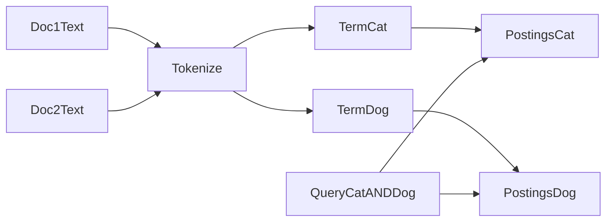

# D29-T002 — Inverted indexes

Topic ID: `D29-T002`
Domain: Search and Specialized Storage
Subdomain: Inverted indexes
Importance: common
Complexity: advanced
Dependencies: `D29-T001`, `D07-T001`, `D07-T002`, `D10-T001`, `D10-T002`
Execution status of the code in section F: not executed (documentation example)

## A. Topic Overview

An inverted index maps each term to the list of documents (or positions) where that term appears. Search engines answer “find documents containing these words” by intersecting posting lists instead of scanning every document’s text.

The structure exists because full table scans on terabytes of text are too slow for interactive search. Inverted indexes trade extra storage and indexing work for sub-second lookups on tokenized terms.

Backends encounter inverted indexes in Elasticsearch/OpenSearch, Lucene, and many full-text extensions. Interviewers ask how it differs from a B-tree index on a column and why stemming or analyzers change what users find.

Prerequisites: `D29-T001` cluster basics. Supports analyzers (`D29-T003`) and scoring (`D29-T004`).

## B. First-Principles Explanation

Forward storage lists documents and their fields. Inverted storage lists terms and, for each term, a **posting list** of document ids (often with frequencies and positions). A query tokenizes the user string, looks up each term’s postings, and combines them with Boolean or scoring logic.

**Terms** are usually normalized: lowercased, stemmed, or filtered by stop words depending on the analyzer. **Postings** may store doc id only (for filtering) or tf-idf components (for ranking). **Segments** in Lucene are immutable; updates delete old doc ids and add new segments.

Intersection of posting lists is efficient when lists are sorted; merge-join style algorithms skip large gaps. Phrase queries need position information in postings. Prefix and fuzzy queries expand the term set and are more expensive.

Limitations: exact substring search on raw text is hard without n-grams; numeric range uses different structures (BKD trees in Lucene); highly selective terms are fast, common terms (stop words) are slow unless blocked.

## C. Internal Working and Architecture

Components:

- **Tokenizer** splits text into tokens at index and query time.
- **Inverted file** stores term → postings on disk, often compressed.
- **Skip lists** accelerate merging long posting lists.
- **Norms** store per-field length normalization for scoring.

Indexing flow:

1. Document fields marked `text` run through analyzer → token stream.
2. For each token, append doc id (and positions) to that term’s in-memory buffer.
3. Flush creates a new segment with on-disk inverted index.
4. Background merge compacts segments.

Query flow:

1. Parse query → terms (possibly expanded).
2. Fetch posting lists per term from segment readers.
3. Boolean AND/OR/NOT combines bitsets or iterators.
4. Scoring layer (BM25, etc.) ranks surviving docs.

## D. Diagrams and Visual Models



Terms point to postings; queries combine multiple posting lists.

## E. Examples and Analogies

Analogy: a book index at the back lists words and page numbers—that is inverted compared to reading page by page forward.

Backend example: product descriptions indexed as `title` (boosted) and `description`. Search for `wireless mouse` intersects postings for `wireless` and `mouse` after analysis.

Do not expect SQL `LIKE '%mouse%'` to use the inverted index. Do not index high-cardinality ids as analyzed text. Do use keyword fields for filters.

## F. Code Examples

File: `examples/d29_t002_intersect.py`

```python
from typing import Dict, List, Set


def intersect(postings: Dict[str, List[int]], terms: List[str]) -> Set[int]:
    sets = [set(postings[t]) for t in terms if t in postings]
    if not sets:
        return set()
    out = sets[0]
    for s in sets[1:]:
        out &= s
    return out


if __name__ == "__main__":
    idx = {"wireless": [1, 2], "mouse": [2, 3], "keyboard": [1]}
    assert intersect(idx, ["wireless", "mouse"]) == {2}
    print("ok", sorted(intersect(idx, ["wireless", "keyboard"])))
```

Expected output: `ok [1]`

## G. Practical Backend Application

Application search APIs should send analyzed queries to the search cluster and keyword filters for tenant id, category, and stock flag. Keep canonical product rows in SQL; the inverted index is derived data rebuilt from CDC.

Watch index size: storing positions for every field increases storage. Use `index: false` on large blobs not searched.

## H. Advantages, Limitations and Trade-offs

| Choice | Benefit | Cost | Choose when | Avoid when |
| --- | --- | --- | --- | --- |
| Inverted index | Fast token lookup | Indexing CPU/disk | Full-text search | Pure key-value get |
| Positions enabled | Phrase queries | Larger postings | Legal/search phrases | Filter-only fields |
| N-gram analyzer | Substring match | Index explosion | SKU fragments | Long prose |
| keyword type | Exact filters | No stemming | IDs, enums | User prose |

## I. Common Mistakes and Misconceptions

- Mapping a field as `text` when you only need exact match (use `keyword`).
- Assuming PostgreSQL GIN is identical to Lucene scoring—they solve overlap but APIs differ.
- Indexing HTML without stripping tags, polluting terms.
- Querying with a different analyzer than indexing, yielding zero hits.

## J. Debugging and Troubleshooting

Symptoms: zero hits for obvious matches, slow queries on common words, huge index size.

Checks: `_analyze` API on sample text; compare index vs search analyzer; explain query; profile slow queries.

Mitigation: fix mapping with reindex; add filters first to shrink posting unions; remove stop-word-only queries.

## K. Interview Preparation

### Beginner

#### Q1. What is an inverted index?

**Answer:** It maps terms to the documents that contain them, the inverse of storing document text forward. Lookup starts from query words and merges posting lists. It powers full-text search engines built on Lucene. Relational B-tree indexes on columns serve different access patterns.

#### Q2. What is a posting list?

**Answer:** The list of document identifiers (and optional frequencies or positions) associated with one term. Queries fetch posting lists for each query term and combine them. Sorted lists enable efficient intersection. Size of lists drives query cost.

#### Q3. Why tokenize text?

**Answer:** Users type words with case and punctuation; tokenization normalizes text so `Cat` and `cat` can match. Token boundaries depend on language rules. The same tokenizer should run at index and query time for consistency. Mismatched analyzers cause confusing misses.

#### Q4. How is this different from a database index?

**Answer:** B-trees excel at equality and range on typed columns. Inverted indexes excel at many-to-many term-to-document relationships for search. SQL databases may offer full-text features, but search clusters optimize distributed scoring and aggregations at scale. Choose based on query shape and operability.

#### Q5. What is a stop word?

**Answer:** A very common word such as “the” that often carries little discriminative power. Removing stop words shrinks indexes and speeds queries. Over-aggressive removal can break phrases or names. Configure stop filters per language and product needs.

### Intermediate

#### Q1. How does AND work on posting lists?

**Answer:** The engine walks iterators over sorted doc ids and advances the smallest id until all lists align on the same id. Skip lists jump over gaps when one term is rare and another is common. This is cheaper than scanning all documents. Query planners reorder terms by frequency for efficiency.

#### Q2. Why store term positions?

**Answer:** Positions enable phrase queries (“exact phrase”), proximity clauses, and some ranking features. They increase storage per posting. Fields that only need filtering do not need positions. Mapping settings control whether positions are indexed.

#### Q3. What is BM25 in relation to inverted indexes?

**Answer:** BM25 is a scoring function using term frequency in a document and inverse document frequency across the corpus. The inverted index supplies tf and collection statistics. Higher scores mean better lexical relevance before business boosts. It is a default in Lucene-based engines.

#### Q4. What happens when you update a document?

**Answer:** Lucene segments are immutable; updates delete the old doc id in the segment metadata and index a new version in a fresh segment. Merges eventually reclaim space. Near-real-time search refreshes expose new segments. Heavy update rates increase merge pressure.

#### Q5. When would you add n-grams?

**Answer:** When users need substring or autocomplete matching that standard tokenizers miss. N-grams multiply term count and index size. Use edge n-grams on specific fields rather than entire documents. Monitor disk and merge times after enabling.

### Advanced

#### Q1. How does compression affect posting lists?

**Answer:** Postings are delta-encoded and compressed on disk to save space. Decompression happens per query shard, using CPU for IO savings. Very selective queries touch few postings; broad queries decode more. Hardware with fast SSD and ample CPU balances this trade-off.

#### Q2. What is index skew?

**Answer:** A term appearing in most documents behaves like a stop word and makes intersections expensive. High-cardinality fields mapped as analyzed text create many unique terms. Mitigate with filters, `keyword` types, or normalizing SKUs separately. Query rewriting can block overly common terms.

#### Q3. Compare leapfrog join vs bitset intersection.

**Answer:** Leapfrog iterates sorted posting lists with synchronized pointers. Bitsets precompute sets for fast AND when lists are dense. Engines pick strategies based on selectivity and caching. Wrong assumptions at interview time matter less than knowing selectivity drives cost.

#### Q4. How do nested objects affect inverted structure?

**Answer:** Nested docs index children as separate hidden documents linked to parents. Queries must use nested queries to avoid cross-matching fields from different child objects. Flattening at index time is often simpler for backends. Choose based on query complexity and reindex cost.

#### Q5. Distributed search and local inverted indexes?

**Answer:** Each shard holds an inverted index for its subset of documents. Coordinators merge shard-level hits. Global idf statistics may be approximated or computed with additional passes. Shard sizing affects both index size per node and query parallelism.

### Scenarios

#### Q1. Users search SKU `AB-12` but get no hits while SQL `LIKE` works.

**Answer:** SKUs may be tokenized into `ab` and `12` or stemmed unexpectedly. Check analyzers with `_analyze` and map a `keyword` subfield for exact SKU search. Reindex after mapping fix. Expose API param to choose exact vs fuzzy mode.

#### Q2. Index size doubled after adding autocomplete.

**Answer:** Edge n-grams generate many terms per input string. Review n-gram length and which fields use them. Consider a dedicated suggester or completion field. Roll back analyzer change and reindex if disk thresholds are threatened.

#### Q3. Phrase search matches wrong products.

**Answer:** Positions might be missing if `index_options` were limited. Confirm phrase query targets the same analyzed field used at index time. Check synonyms expanding phrases unexpectedly. Add a stricter `match_phrase` on a less stemmed subfield.

#### Q4. Stop word removal breaks brand search.

**Answer:** Brand names may coincide with common words in some locales. Customize stop word lists or use keyword fields for brand filters. Protect critical tokens with `keyword` markers or synonym files. Test with production-like analyzer chains.

#### Q5. AND query slower after catalog growth.

**Answer:** One term’s posting list may have grown dominant while filters were removed. Profile query; reintroduce structured filters (category, in_stock). Consider rewrite to rare term first. Scale shards if per-shard data is huge.

### Follow-ups

#### Q1. Link to analyzers?

**Answer:** Analyzers define tokenization and filters at index and query time. They directly shape the inverted index contents. See `D29-T003`.

#### Q2. Link to Elasticsearch architecture?

**Answer:** Shards host Lucene inverted indexes; cluster coordinates merges and queries. See `D29-T001`.

#### Q3. Link to vector search?

**Answer:** Dense vectors use different index structures (HNSW) alongside inverted text. Hybrid retrieval combines both. See `D29-T010` and `D30-T014`.

## L. Practical Exercises

Solutions in `EXERCISES/solutions/D29-T002.md`.

### Exercise 1 — implementation

Extend the posting intersection example with OR and NOT. Acceptance: OR unions ids; NOT subtracts from a universe set.

### Exercise 2 — debugging

SKU search fails after analyzer change—list three `_analyze` checks.

### Exercise 3 — trade-off

Choose `keyword` vs `text` for `brand_name` and `description` fields.

## M. Revision Notes

- Inverted = term → doc ids.
- Analyzer consistency at index and query time.
- Posting intersection cost ~ selectivity.
- Updates are segment-level, not in-place row edits.
- Use keyword for exact tokens; text for prose.

## N. Related Topics

Before: `D29-T001`. Next: `D29-T003`. Confused with: SQL full-text vs Lucene.

## O. Completion Criteria

- Draw term → postings and explain query intersection.
- Explain why analyzers must match on index and query paths.
- Debug a zero-hit SKU search using field types.
- Choose text vs keyword for three example fields.
- Describe how updates appear in immutable segments.
