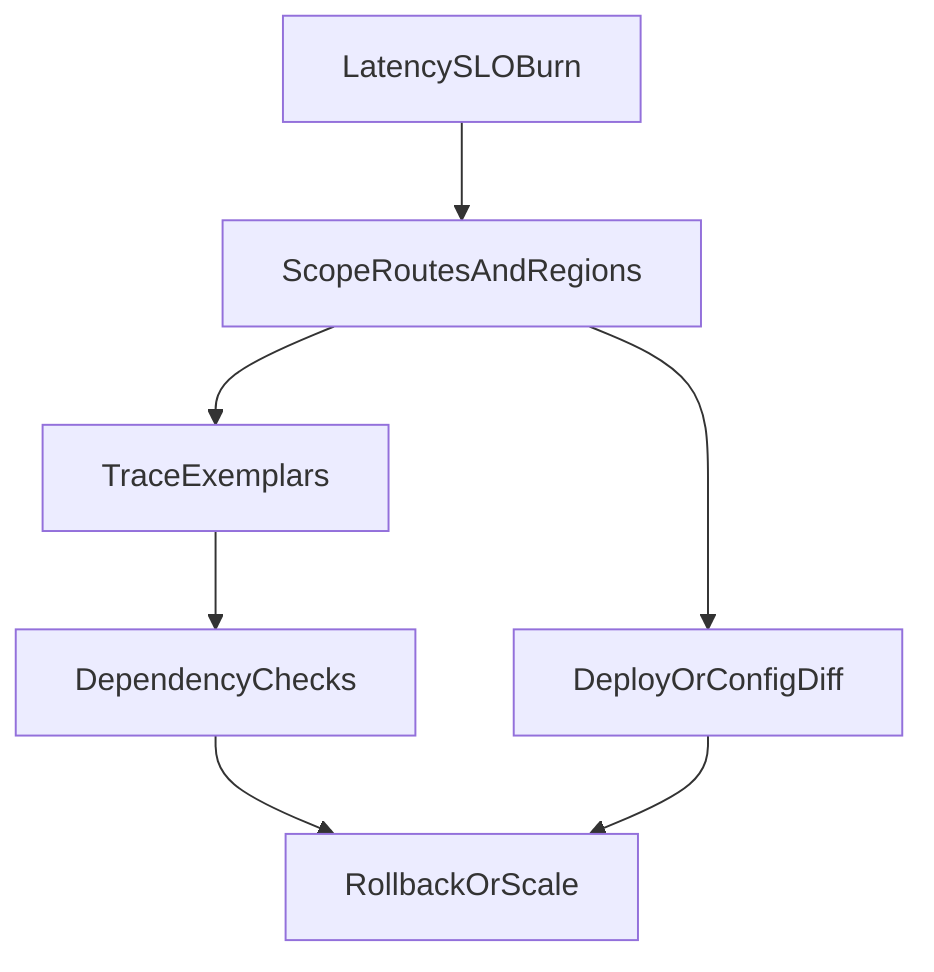

# D33-T001 — API latency suddenly increases

Topic ID: `D33-T001`
Domain: Real-World Engineering Scenarios
Subdomain: API latency suddenly increases
Importance: core
Complexity: intermediate
Dependencies: `D15-T001`, `D15-T002`, `D22-T001`, `D22-T002`, `D07-T001`, `D07-T002`
Execution status of the code in section F: not executed (documentation example)

## A. Topic Overview

Sudden API latency increases mean p95 or p99 response times jump without a proportional traffic increase, often visible in SLO dashboards, support tickets, or synthetic monitors before error rates move.

This scenario is common after deploys, dependency slowdowns, cache loss, database plan regressions, or infrastructure saturation. Interviewers use it to test structured incident response, not guessing.

Workflow for this domain: **symptom → likely causes → checks → mitigation → prevention**. Prerequisites include observability basics and data-store fundamentals.

## B. First-Principles Explanation

**Symptom:** Endpoints that normally respond in tens to low hundreds of milliseconds now take seconds; users perceive “spinning” UI; queue depth or thread pool saturation may rise before hard errors appear.

**Likely causes:** New code path (N+1 queries, larger payloads), lost cache (Redis failover, TTL storm), database lock or slow query, downstream HTTP dependency timeout retries, GC pause, CPU throttling, noisy neighbor on shared nodes, bad rollout (canary not representative), or DDoS/abuse on hot routes.

**Checks (read-only first):** Confirm scope (one region, service, tenant, route); compare canary vs stable; inspect golden signals (latency histogram, error rate, saturation); trace slow requests; check deploy and flag timeline; validate dependency dashboards; review DB `pg_stat_activity` or equivalent; verify cache hit ratio.

**Mitigation:** Roll back or scale out; enable circuit breakers; shed load (rate limit, disable non-critical features); increase pool sizes only after confirming DB capacity; extend timeouts only as temporary measure with owner.

**Prevention:** SLO alerts with multi-window burn; autoscaling with caps; load tests on release candidates; query review in CI; cache stampede protection; capacity dashboards per dependency.

## C. Internal Working and Architecture

Incident components mapped to latency:

- **Detection** — APM p95, ingress latency, synthetic probes, user reports.
- **Triage** — Severity from SLO impact; assign commander; freeze unrelated deploys.
- **Diagnostics** — Exemplar traces from slow bucket; compare before/after deploy marker.
- **Mitigation** — Reversible actions with customer comms.
- **Follow-up** — Postmortem, fix forward, guardrail alerts.

Latency stacks: TLS, auth, handler, ORM, SQL, cache, external APIs, serialization. A spike in one layer appears as longer span duration in traces.

## D. Diagrams and Visual Models



## E. Examples and Analogies

Analogy: traffic jam—symptom is slow movement; cause may be accident miles ahead (dependency), closed lane (deploy), or too many cars (load).

Backend example: p95 doubled on `GET /orders` after release; traces show 40 SQL calls per request instead of 2—classic N+1 from new eager loading.

Do not scale pods blindly when DB is the bottleneck—that increases connection pile-up.

## F. Code Examples

File: `examples/d33_t001_latency_triage.py`

```python
from dataclasses import dataclass


@dataclass
class Signal:
    name: str
    healthy: bool


def triage(signals: list[Signal]) -> str:
    if any(s.name == "error_rate" and not s.healthy for s in signals):
        return "prioritize_errors"
    if any(s.name == "db_latency" and not s.healthy for s in signals):
        return "inspect_database"
    if any(s.name == "cache_hit_ratio" and not s.healthy for s in signals):
        return "inspect_cache"
    return "deep_trace_analysis"


if __name__ == "__main__":
    out = triage([
        Signal("cache_hit_ratio", False),
        Signal("error_rate", True),
    ])
    assert out == "inspect_cache"
    print("ok", out)
```

## G. Practical Backend Application

On-call: open service dashboard, select spike window, compare deploy annotations, pull top slow traces, share findings in incident channel with UTC timestamps.

Communicate externally only after confirming customer impact scope.

## H. Advantages, Limitations and Trade-offs

| Action | Benefit | Risk | Use when | Avoid when |
| --- | --- | --- | --- | --- |
| Rollback | Fast restore | Loses forward fix | Clear bad deploy | DB migration mid-flight |
| Scale out | More capacity | Hides DB limit | CPU-bound app | DB saturated |
| Raise timeouts | Fewer client errors | Thread pile-up | Brief vendor blip | Permanent fix |
| Rate limit | Protects core | Angry power users | Abuse or overload | Already under capacity |

## I. Common Mistakes and Misconceptions

- Scaling replicas while DB connections maxed.
- Blaming network without trace evidence.
- Ignoring canary pool differences.
- Changing many variables at once during mitigation.

## J. Debugging and Troubleshooting

**Symptom:** API latency suddenly increases.

**Checks:** Ingress p95 by route; trace waterfall; DB slow query log; cache metrics; recent deploy/flag; dependency latency; node CPU throttling.

**Mitigation:** Rollback, fix query, warm cache, throttle abuse, scale correct tier.

**Prevention:** Release verification, query budgets, cache protection, SLO alerts, game days.

## K. Interview Preparation

### Beginner

#### Q1. What is the first thing you do when API latency spikes?

**Answer:** Confirm the symptom in dashboards with timestamps and scope (which routes, regions, tenants). Check whether errors rose or only latency, because different causes dominate each case. Look at the deploy and configuration change log for the same window. Communicate that you are investigating before deep diving.

#### Q2. What is golden signals in this context?

**Answer:** Latency, traffic, errors, and saturation (USE/RED methods). Latency histograms show tail behavior better than averages. Saturation includes thread pools, CPU, and connection pools. Together they narrow which layer is failing.

#### Q3. Why compare canary vs stable?

**Answer:** A bad canary explains a partial spike tied to a new version. Stable pool healthy implicates rollout rather than global dependency outage. It guides rollback versus platform-wide response. Always verify traffic split percentages.

#### Q4. What is an exemplar trace?

**Answer:** A sampled trace from the slow latency bucket linked from a metric. It shows which span consumed time—SQL, HTTP client, or serialization. Without exemplars you only know slowness, not where. Modern APM ties metrics to traces.

#### Q5. When is rollback appropriate?

**Answer:** When a deploy correlates with the spike and traces show new behavior (extra queries, new dependency). Rollback is fast and reversible if migrations are backward compatible. If DB schema changed irreversibly, rollback may be unsafe—then feature-flag off code paths instead.

### Intermediate

#### Q1. How do cache failures affect latency?

**Answer:** Miss storms hit the database with traffic the cache used to absorb. Hit ratio drops sharply on dashboards. Mitigation includes TTL jitter, request coalescing, and temporary read-only mode. Restore cache tier before scaling app pods endlessly.

#### Q2. How do retries amplify latency?

**Answer:** Clients and gateways retry on slow responses, multiplying load on a struggling dependency. Tail latency grows as queues fill. Check retry configuration and circuit breaker state. Fix root dependency rather than only increasing timeouts.

#### Q3. What database signals matter?

**Answer:** Active connections, slow queries, lock waits, and buffer cache hit ratio. A single missing index can flip p95 after data growth. Compare query plans before and after. Kill only after identifying harmful queries, not randomly.

#### Q4. How do you rule out client-side causes?

**Answer:** Compare mobile vs web, geographic regions, and API vs CDN paths. Synthetic monitors from neutral networks isolate backend issues. If only one client version is affected, inspect payload size or new polling loops.

#### Q5. What metrics prove mitigation worked?

**Answer:** p95/p99 return to baseline, error rate stable, saturation below thresholds for 30–60 minutes. Watch for secondary effects after rollback (cold caches). Document the recovery timestamp in the incident record.

### Advanced

#### Q1. Tail latency vs average during incidents?

**Answer:** Averages hide p99 regressions users feel. Histograms and SLO burn on p99 are standard. Hedged requests can help tails but add load—use cautiously during incidents. Focus mitigation on the slow span in traces.

#### Q2. Multi-region latency spike only in one region?

**Answer:** Points to regional dependency (database replica, cache cluster, or peering). Check regional deploy order and DNS/geo routing. Fail over read traffic if architecture supports it. Engage cloud provider if networking metrics show packet loss.

#### Q3. Latency up but CPU low?

**Answer:** Often waiting—IO, locks, external HTTP, or thread starvation. Look at blocked threads and pool queue depth. CPU low does not mean healthy. Profile wait times, not only CPU flame graphs.

#### Q4. How do feature flags interact?

**Answer:** A flag enabling a heavy code path affects only users in the cohort, sometimes misread as random slowness. Segment metrics by flag value. Disable flag before full rollback if isolated.

#### Q5. Post-incident prevention for latency class?

**Answer:** Add release latency canaries, automatic rollback on SLO burn, query count assertions in tests, and load tests in pipeline. Track repeat incident rate. Architecture fixes beat runbook heroics long term.

### Scenarios

#### Q1. p95 doubled ten minutes after deploy. Steps?

**Answer:** Roll back or disable feature if SLO burn is steep. Pull traces from slow requests comparing to pre-deploy baseline. Identify new SQL or HTTP calls. Communicate ETA to stakeholders. Root-cause in postmortem with test gap noted.

#### Q2. Latency spike without deploy—cache hit ratio 20% down.

**Answer:** Investigate Redis failover, large key eviction, or bad deployment of cache keys. Warm critical keys from DB with rate limits. Fix TTL stampede with jitter. Monitor DB load while cache recovers.

#### Q3. One tenant reports slowness; others fine.

**Answer:** Segment metrics by tenant id. Check tenant-specific data volume, missing index on tenant filter, or abusive usage. Apply per-tenant rate limits if needed. Verify authorization still applies on slow paths.

#### Q4. Synthetic checks green but users angry.

**Answer:** Synthetics may hit simple health routes, not heavy business flows. Add scenario tests mirroring real journeys. Compare real user monitoring if available. Expand probe paths and geographies.

#### Q5. You increased timeouts and latency got worse.

**Answer:** Longer timeouts retain threads waiting on a sick dependency, increasing queueing delay. Revert timeout change; add circuit breaker and fail fast. Fix dependency or degrade features.

### Follow-ups

#### Q1. Link to connection pool exhaustion?

**Answer:** Pool wait time appears as latency without SQL time in traces. See `D33-T003`.

#### Q2. Link to database CPU 100%?

**Answer:** DB-bound latency often follows CPU saturation on the primary. See `D33-T002`.

#### Q3. Link to observability?

**Answer:** Metrics, logs, and traces are the check phase backbone. See `D15-T001` and `D22-T001`.

## L. Practical Exercises

Solutions: `EXERCISES/solutions/D33-T001.md`.

### Exercise 1 — implementation

Run the triage script and extend it with a `deploy_correlated` signal branch.

### Exercise 2 — debugging

Write ordered checks for a latency spike with falling cache hit ratio.

### Exercise 3 — trade-off

Rollback vs scale-out when p95 is high and DB connections are at 90%.

## M. Revision Notes

- Symptom: latency SLO burn, scope first.
- Causes: deploy, cache, DB, deps, abuse.
- Checks: metrics, traces, change log, read-only.
- Mitigate: rollback, shed load, fix query.
- Prevent: canaries, tests, alerts, postmortems.

## N. Related Topics

Next: `D33-T002` database CPU. Dependencies: observability and SQL basics.

## O. Completion Criteria

- Recite symptom → cause → checks → mitigation → prevention for this scenario.
- Name three read-only checks and one harmful reaction to avoid.
- Walk a trace-based diagnosis aloud in under five minutes.
- Explain when rollback beats scale-out.
- Propose two prevention items measurable within a quarter.
