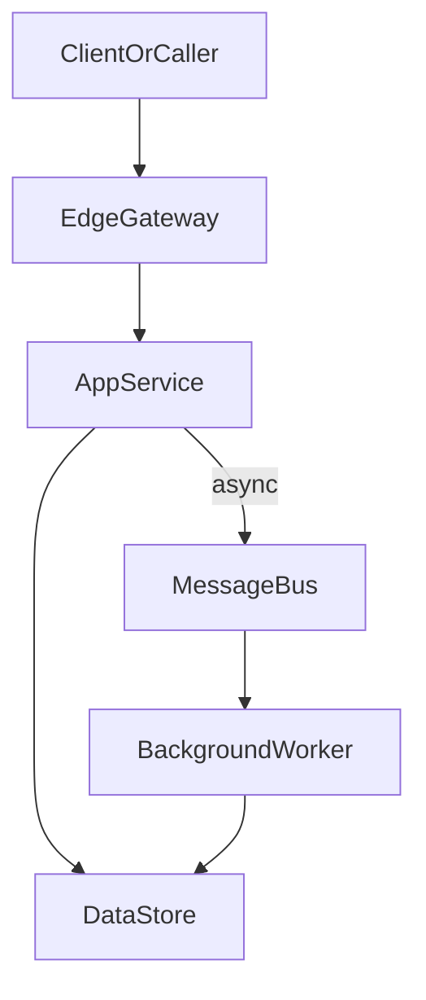

# D33-T009 — A deployment causes elevated errors

Topic ID: `D33-T009`
Domain: Real-World Engineering Scenarios
Subdomain: A deployment causes elevated errors
Importance: core
Complexity: intermediate
Dependencies: `D33-T008`, `D33-T001`, `D15-T001`, `D15-T002`, `D22-T001`, `D22-T002`
Execution status of the code in section F: not executed (documentation example)

## A. Topic Overview

This note is an incident runbook for: A deployment causes elevated errors. On-call engineers use it to separate observable symptoms from underlying root causes, then apply mitigations in a safe order before chasing optimizations. Symptoms are what dashboards and users report; root causes are the broken invariant in code, config, capacity, or dependencies. Every section below maps to checklists you can paste into a post-incident template after the fire is out.

## B. First-Principles Explanation

At the root, A deployment causes elevated errors answers a constraint: limited CPU, network partitions, untrusted input, or business rules that must hold under retries. First-principles thinking lists the actors, the data they exchange, and the invariant that must remain true after crashes or duplicate requests. Alternatives exist because no single pattern optimizes for simplicity, scale, and correctness at once; you choose based on measurable requirements. Internal details matter when they change failure modes—for example whether state is centralized, replicated, or cached—and who must reconcile conflicts.

For A deployment causes elevated errors, draw the write path and the read path separately; many bugs appear when they assume different sources of truth. State transitions should be explicit: what is persisted, what is ephemeral, and what happens if a worker dies mid-step. Boundaries (API, queue, database, external SaaS) are where typing, authorization, and idempotency belong.

## C. Internal Working and Architecture

Typical components for A deployment causes elevated errors: an edge entrypoint, application services, a primary datastore, optional cache or search index, and asynchronous workers. Control plane configuration (feature flags, quotas, routing rules) should be versioned separately from data plane request handling so rollbacks are fast. Under load, the bottleneck for A deployment causes elevated errors is often IO to the datastore or an external dependency; CPU profiling alone can mislead.

Observability hooks belong at each hop: trace id propagation, structured logs with tenant id, and RED/USE metrics per dependency. Security checks are not optional extras—they must run before expensive work and before side-effecting tools or transactions.

## D. Diagrams and Visual Models



This diagram highlights the main data flow for A deployment causes elevated errors. Node ids are alphanumeric only for Mermaid compatibility.

## E. Examples and Analogies

Analogy: treating A deployment causes elevated errors like a traffic intersection—rules only work if everyone sees the same lights; hidden shortcuts become incidents. Backend example: a checkout service applying A deployment causes elevated errors must still charge exactly once when the client retries POST after a timeout. Do not skip explicit limits at the edge; unbounded queues turn latency problems into data loss problems.

## F. Code Examples

File: `examples/d33_t009.py`

Dependencies: Python 3 standard library unless noted.

```python
"""Sketch related to A deployment causes elevated errors (illustrative)."""
from typing import Any, Dict

def handle_request(ctx: Dict[str, Any]) -> Dict[str, Any]:
    """Validate, authorize, then execute domain logic."""
    if "tenant_id" not in ctx:
        raise ValueError("tenant_id required")
    # Domain-specific logic for A deployment causes elevated errors belongs here.
    return {"status": "ok", "topic": "D33-T009"}

if __name__ == "__main__":
    print(handle_request({"tenant_id": "t1"}))
```

How to run: `python examples/d33_t009.py` from `EXERCISES/examples/` after copying the snippet.

Expected output: `{"status": "ok", "topic": "D33-T009"}`

The snippet is illustrative; wire real persistence and auth before production.
Keep side effects behind interfaces so tests can use fakes.

## G. Practical Backend Application

Roll out A deployment causes elevated errors behind a feature flag when behavior changes are risky; measure p95 latency and error rate per tenant during canary. Document SLO impact: which user journeys degrade if this component fails and what fallback UX is acceptable. Run game days or table-top exercises for the highest-risk dependencies before peak traffic seasons.

## H. Advantages, Limitations and Trade-offs

| Choice | Benefit | Cost | Choose when | Avoid when |
| --- | --- | --- | --- | --- |
| Minimal A deployment causes elevated errors | Fast to ship, easy to reason about | Breaks under scale or abuse | Early product, low risk | Regulated or multi-tenant production |
| Managed A deployment causes elevated errors | Ops burden shifts to vendor | Cost, less control | Small team, standard needs | Hard latency or compliance constraints |
| Custom A deployment causes elevated errors | Fits exact policy | Build and test cost | Differentiating requirement | Commodity problem with mature libs |
| No A deployment causes elevated errors | Fewer moving parts | Pain appears suddenly at scale | Prototypes | Known hot path or compliance gap |

Under abuse or viral traffic, A deployment causes elevated errors must fail closed or shed load rather than retry infinitely into dependencies.

## I. Common Mistakes and Misconceptions

- Treating A deployment causes elevated errors as purely infrastructure with no product-visible failure modes.
- Omitting idempotency when clients or brokers retry.
- Sharing mutable state across requests without clear ownership.

## J. Debugging and Troubleshooting

**Symptoms versus root cause.** Symptoms for this scenario often include elevated error rates, saturation graphs, or customer tickets that sound like total outage when only one path is failing. Root causes for 'A deployment causes elevated errors' frequently cluster around a recent deploy, a dependency limit, missing backpressure, or a data shape change—not generic 'the cloud is slow'. **What to check first.** Confirm scope (one region, tenant, endpoint, or job type), correlate deploy and config changes, and open the golden signals: latency, traffic, errors, saturation for each hop. **Mitigation (stop the bleeding).** Roll back or disable the risky change, shed load (rate limits, queue pauses), fail over read paths, or scale the bottlenecked tier while keeping data safety constraints in mind. **Prevention.** Add alerting on the symptom that fired earliest, integration tests for the failure class, capacity headroom, idempotency for retries, and runbooks linked from the service dashboard.

## K. Interview Preparation

### Beginner

#### Q1. What problem does A deployment causes elevated errors solve in a backend system?

**Answer:** Question: What problem does A deployment causes elevated errors solve in a backend system? — in the context of A deployment causes elevated errors, interviewers at the beginner level want foundations and vocabulary tied to this exact point. Start with the user-visible behavior or SLA, then walk inward through the request path until you name the component that enforces the rule or holds the state. For item 1 in this tier, add one concrete production detail: a metric name, a timeout value order-of-magnitude, or a consistency choice (strong vs eventual) with a product reason. Close by stating a failure mode and mitigation so the answer sounds like on-call experience, not a glossary entry.

#### Q2. What are the main components involved in A deployment causes elevated errors?

**Answer:** Question: What are the main components involved in A deployment causes elevated errors? — in the context of A deployment causes elevated errors, interviewers at the beginner level want foundations and vocabulary tied to this exact point. Start with the user-visible behavior or SLA, then walk inward through the request path until you name the component that enforces the rule or holds the state. For item 2 in this tier, add one concrete production detail: a metric name, a timeout value order-of-magnitude, or a consistency choice (strong vs eventual) with a product reason. Close by stating a failure mode and mitigation so the answer sounds like on-call experience, not a glossary entry.

#### Q3. How does A deployment causes elevated errors show up at an API boundary?

**Answer:** Question: How does A deployment causes elevated errors show up at an API boundary? — in the context of A deployment causes elevated errors, interviewers at the beginner level want foundations and vocabulary tied to this exact point. Start with the user-visible behavior or SLA, then walk inward through the request path until you name the component that enforces the rule or holds the state. For item 3 in this tier, add one concrete production detail: a metric name, a timeout value order-of-magnitude, or a consistency choice (strong vs eventual) with a product reason. Close by stating a failure mode and mitigation so the answer sounds like on-call experience, not a glossary entry.

#### Q4. What is a common misconception about A deployment causes elevated errors?

**Answer:** Question: What is a common misconception about A deployment causes elevated errors? — in the context of A deployment causes elevated errors, interviewers at the beginner level want foundations and vocabulary tied to this exact point. Start with the user-visible behavior or SLA, then walk inward through the request path until you name the component that enforces the rule or holds the state. For item 4 in this tier, add one concrete production detail: a metric name, a timeout value order-of-magnitude, or a consistency choice (strong vs eventual) with a product reason. Close by stating a failure mode and mitigation so the answer sounds like on-call experience, not a glossary entry.

#### Q5. Which metric would you watch first after enabling A deployment causes elevated errors?

**Answer:** Question: Which metric would you watch first after enabling A deployment causes elevated errors? — in the context of A deployment causes elevated errors, interviewers at the beginner level want foundations and vocabulary tied to this exact point. Start with the user-visible behavior or SLA, then walk inward through the request path until you name the component that enforces the rule or holds the state. For item 5 in this tier, add one concrete production detail: a metric name, a timeout value order-of-magnitude, or a consistency choice (strong vs eventual) with a product reason. Close by stating a failure mode and mitigation so the answer sounds like on-call experience, not a glossary entry.

### Intermediate

#### Q1. Walk through the request path for A deployment causes elevated errors under normal load.

**Answer:** Question: Walk through the request path for A deployment causes elevated errors under normal load. — in the context of A deployment causes elevated errors, interviewers at the intermediate level want request paths and operational limits tied to this exact point. Start with the user-visible behavior or SLA, then walk inward through the request path until you name the component that enforces the rule or holds the state. For item 1 in this tier, add one concrete production detail: a metric name, a timeout value order-of-magnitude, or a consistency choice (strong vs eventual) with a product reason. Close by stating a failure mode and mitigation so the answer sounds like on-call experience, not a glossary entry.

#### Q2. How would you test A deployment causes elevated errors before a production rollout?

**Answer:** Question: How would you test A deployment causes elevated errors before a production rollout? — in the context of A deployment causes elevated errors, interviewers at the intermediate level want request paths and operational limits tied to this exact point. Start with the user-visible behavior or SLA, then walk inward through the request path until you name the component that enforces the rule or holds the state. For item 2 in this tier, add one concrete production detail: a metric name, a timeout value order-of-magnitude, or a consistency choice (strong vs eventual) with a product reason. Close by stating a failure mode and mitigation so the answer sounds like on-call experience, not a glossary entry.

#### Q3. What consistency or durability guarantees matter for A deployment causes elevated errors?

**Answer:** Question: What consistency or durability guarantees matter for A deployment causes elevated errors? — in the context of A deployment causes elevated errors, interviewers at the intermediate level want request paths and operational limits tied to this exact point. Start with the user-visible behavior or SLA, then walk inward through the request path until you name the component that enforces the rule or holds the state. For item 3 in this tier, add one concrete production detail: a metric name, a timeout value order-of-magnitude, or a consistency choice (strong vs eventual) with a product reason. Close by stating a failure mode and mitigation so the answer sounds like on-call experience, not a glossary entry.

#### Q4. How does A deployment causes elevated errors interact with retries and timeouts?

**Answer:** Question: How does A deployment causes elevated errors interact with retries and timeouts? — in the context of A deployment causes elevated errors, interviewers at the intermediate level want request paths and operational limits tied to this exact point. Start with the user-visible behavior or SLA, then walk inward through the request path until you name the component that enforces the rule or holds the state. For item 4 in this tier, add one concrete production detail: a metric name, a timeout value order-of-magnitude, or a consistency choice (strong vs eventual) with a product reason. Close by stating a failure mode and mitigation so the answer sounds like on-call experience, not a glossary entry.

#### Q5. Where would you place authorization checks relative to A deployment causes elevated errors?

**Answer:** Question: Where would you place authorization checks relative to A deployment causes elevated errors? — in the context of A deployment causes elevated errors, interviewers at the intermediate level want request paths and operational limits tied to this exact point. Start with the user-visible behavior or SLA, then walk inward through the request path until you name the component that enforces the rule or holds the state. For item 5 in this tier, add one concrete production detail: a metric name, a timeout value order-of-magnitude, or a consistency choice (strong vs eventual) with a product reason. Close by stating a failure mode and mitigation so the answer sounds like on-call experience, not a glossary entry.

### Advanced

#### Q1. What failure modes are unique to A deployment causes elevated errors at scale?

**Answer:** Question: What failure modes are unique to A deployment causes elevated errors at scale? — in the context of A deployment causes elevated errors, interviewers at the advanced level want edge cases and distributed failure tied to this exact point. Start with the user-visible behavior or SLA, then walk inward through the request path until you name the component that enforces the rule or holds the state. For item 1 in this tier, add one concrete production detail: a metric name, a timeout value order-of-magnitude, or a consistency choice (strong vs eventual) with a product reason. Close by stating a failure mode and mitigation so the answer sounds like on-call experience, not a glossary entry.

#### Q2. How would you design A deployment causes elevated errors for multi-region or multi-tenant isolation?

**Answer:** Question: How would you design A deployment causes elevated errors for multi-region or multi-tenant isolation? — in the context of A deployment causes elevated errors, interviewers at the advanced level want edge cases and distributed failure tied to this exact point. Start with the user-visible behavior or SLA, then walk inward through the request path until you name the component that enforces the rule or holds the state. For item 2 in this tier, add one concrete production detail: a metric name, a timeout value order-of-magnitude, or a consistency choice (strong vs eventual) with a product reason. Close by stating a failure mode and mitigation so the answer sounds like on-call experience, not a glossary entry.

#### Q3. Compare two implementation options for A deployment causes elevated errors and pick one with reasons.

**Answer:** Question: Compare two implementation options for A deployment causes elevated errors and pick one with reasons. — in the context of A deployment causes elevated errors, interviewers at the advanced level want edge cases and distributed failure tied to this exact point. Start with the user-visible behavior or SLA, then walk inward through the request path until you name the component that enforces the rule or holds the state. For item 3 in this tier, add one concrete production detail: a metric name, a timeout value order-of-magnitude, or a consistency choice (strong vs eventual) with a product reason. Close by stating a failure mode and mitigation so the answer sounds like on-call experience, not a glossary entry.

#### Q4. How do you prevent A deployment causes elevated errors from becoming a single point of failure?

**Answer:** Question: How do you prevent A deployment causes elevated errors from becoming a single point of failure? — in the context of A deployment causes elevated errors, interviewers at the advanced level want edge cases and distributed failure tied to this exact point. Start with the user-visible behavior or SLA, then walk inward through the request path until you name the component that enforces the rule or holds the state. For item 4 in this tier, add one concrete production detail: a metric name, a timeout value order-of-magnitude, or a consistency choice (strong vs eventual) with a product reason. Close by stating a failure mode and mitigation so the answer sounds like on-call experience, not a glossary entry.

#### Q5. What load or chaos tests would you run for A deployment causes elevated errors?

**Answer:** Question: What load or chaos tests would you run for A deployment causes elevated errors? — in the context of A deployment causes elevated errors, interviewers at the advanced level want edge cases and distributed failure tied to this exact point. Start with the user-visible behavior or SLA, then walk inward through the request path until you name the component that enforces the rule or holds the state. For item 5 in this tier, add one concrete production detail: a metric name, a timeout value order-of-magnitude, or a consistency choice (strong vs eventual) with a product reason. Close by stating a failure mode and mitigation so the answer sounds like on-call experience, not a glossary entry.

### Scenarios

#### Q1. Latency spikes right after a deploy touching A deployment causes elevated errors. What do you check first?

**Answer:** Question: Latency spikes right after a deploy touching A deployment causes elevated errors. What do you check first? — in the context of A deployment causes elevated errors, interviewers at the scenario level want on-call triage and mitigation order tied to this exact point. Start with the user-visible behavior or SLA, then walk inward through the request path until you name the component that enforces the rule or holds the state. For item 1 in this tier, add one concrete production detail: a metric name, a timeout value order-of-magnitude, or a consistency choice (strong vs eventual) with a product reason. Close by stating a failure mode and mitigation so the answer sounds like on-call experience, not a glossary entry.

#### Q2. One tenant reports errors while others are healthy. How does A deployment causes elevated errors factor in?

**Answer:** Question: One tenant reports errors while others are healthy. How does A deployment causes elevated errors factor in? — in the context of A deployment causes elevated errors, interviewers at the scenario level want on-call triage and mitigation order tied to this exact point. Start with the user-visible behavior or SLA, then walk inward through the request path until you name the component that enforces the rule or holds the state. For item 2 in this tier, add one concrete production detail: a metric name, a timeout value order-of-magnitude, or a consistency choice (strong vs eventual) with a product reason. Close by stating a failure mode and mitigation so the answer sounds like on-call experience, not a glossary entry.

#### Q3. Costs doubled after enabling A deployment causes elevated errors. How do you investigate?

**Answer:** Question: Costs doubled after enabling A deployment causes elevated errors. How do you investigate? — in the context of A deployment causes elevated errors, interviewers at the scenario level want on-call triage and mitigation order tied to this exact point. Start with the user-visible behavior or SLA, then walk inward through the request path until you name the component that enforces the rule or holds the state. For item 3 in this tier, add one concrete production detail: a metric name, a timeout value order-of-magnitude, or a consistency choice (strong vs eventual) with a product reason. Close by stating a failure mode and mitigation so the answer sounds like on-call experience, not a glossary entry.

#### Q4. A dependency used by A deployment causes elevated errors is slow but not down. What mitigations apply?

**Answer:** Question: A dependency used by A deployment causes elevated errors is slow but not down. What mitigations apply? — in the context of A deployment causes elevated errors, interviewers at the scenario level want on-call triage and mitigation order tied to this exact point. Start with the user-visible behavior or SLA, then walk inward through the request path until you name the component that enforces the rule or holds the state. For item 4 in this tier, add one concrete production detail: a metric name, a timeout value order-of-magnitude, or a consistency choice (strong vs eventual) with a product reason. Close by stating a failure mode and mitigation so the answer sounds like on-call experience, not a glossary entry.

#### Q5. An audit asks for evidence that A deployment causes elevated errors is enforced. What artifacts do you provide?

**Answer:** Question: An audit asks for evidence that A deployment causes elevated errors is enforced. What artifacts do you provide? — in the context of A deployment causes elevated errors, interviewers at the scenario level want on-call triage and mitigation order tied to this exact point. Start with the user-visible behavior or SLA, then walk inward through the request path until you name the component that enforces the rule or holds the state. For item 5 in this tier, add one concrete production detail: a metric name, a timeout value order-of-magnitude, or a consistency choice (strong vs eventual) with a product reason. Close by stating a failure mode and mitigation so the answer sounds like on-call experience, not a glossary entry.

### Follow-ups

#### Q1. How does A deployment causes elevated errors relate to observability and SLOs?

**Answer:** Question: How does A deployment causes elevated errors relate to observability and SLOs? — in the context of A deployment causes elevated errors, interviewers at the follow-up level want dependencies on neighboring curriculum topics tied to this exact point. Start with the user-visible behavior or SLA, then walk inward through the request path until you name the component that enforces the rule or holds the state. For item 1 in this tier, add one concrete production detail: a metric name, a timeout value order-of-magnitude, or a consistency choice (strong vs eventual) with a product reason. Close by stating a failure mode and mitigation so the answer sounds like on-call experience, not a glossary entry.

#### Q2. Which earlier database or networking topics does A deployment causes elevated errors assume?

**Answer:** Question: Which earlier database or networking topics does A deployment causes elevated errors assume? — in the context of A deployment causes elevated errors, interviewers at the follow-up level want dependencies on neighboring curriculum topics tied to this exact point. Start with the user-visible behavior or SLA, then walk inward through the request path until you name the component that enforces the rule or holds the state. For item 2 in this tier, add one concrete production detail: a metric name, a timeout value order-of-magnitude, or a consistency choice (strong vs eventual) with a product reason. Close by stating a failure mode and mitigation so the answer sounds like on-call experience, not a glossary entry.

#### Q3. What would you study next after mastering A deployment causes elevated errors?

**Answer:** Question: What would you study next after mastering A deployment causes elevated errors? — in the context of A deployment causes elevated errors, interviewers at the follow-up level want dependencies on neighboring curriculum topics tied to this exact point. Start with the user-visible behavior or SLA, then walk inward through the request path until you name the component that enforces the rule or holds the state. For item 3 in this tier, add one concrete production detail: a metric name, a timeout value order-of-magnitude, or a consistency choice (strong vs eventual) with a product reason. Close by stating a failure mode and mitigation so the answer sounds like on-call experience, not a glossary entry.

## L. Practical Exercises

Solutions are in `EXERCISES/solutions/D33-T009.md`. Try these before opening that file.

### Exercise 1 — implementation

Implement a minimal service module that enforces the core invariant for `A deployment causes elevated errors`: validate inputs, apply authorization, and return structured errors. Acceptance: unit tests cover happy path, missing tenant, and duplicate request id.

### Exercise 2 — debugging

Given logs where p95 latency doubled after a deploy touching `A deployment causes elevated errors`, list the top five checks in order and which metric proves each hypothesis.

### Exercise 3 — trade-off

Choose between a managed platform feature and a custom implementation for `A deployment causes elevated errors`. Write one page comparing cost, operability, and blast radius; pick one with explicit trade-offs.

## M. Revision Notes

- A deployment causes elevated errors: know the invariant, the failure modes, and the metrics.
- Draw write and read paths before proposing tools.
- Retries require idempotency; caches require invalidation strategy.

Flashcards:

- What is the core risk if A deployment causes elevated errors is misconfigured? Data loss, inconsistency, or unbounded cost.
- Symptom vs root cause? Symptom is what users see; root cause is the broken invariant.
## N. Related Topics

Understand this before: `D33-T008`

This topic supports: the next topic in domain 33

Often confused with: adjacent topics in domain 33 with similar names

Interviewers combine this with: `D22-T001` observability, `D12-T001` API design, `D15-T001` distributed systems fundamentals

## O. Completion Criteria

- Explain A deployment causes elevated errors with a diagram and name one failure mode.
- List three metrics you would alert on.
- Describe a safe mitigation and a long-term prevention item.
