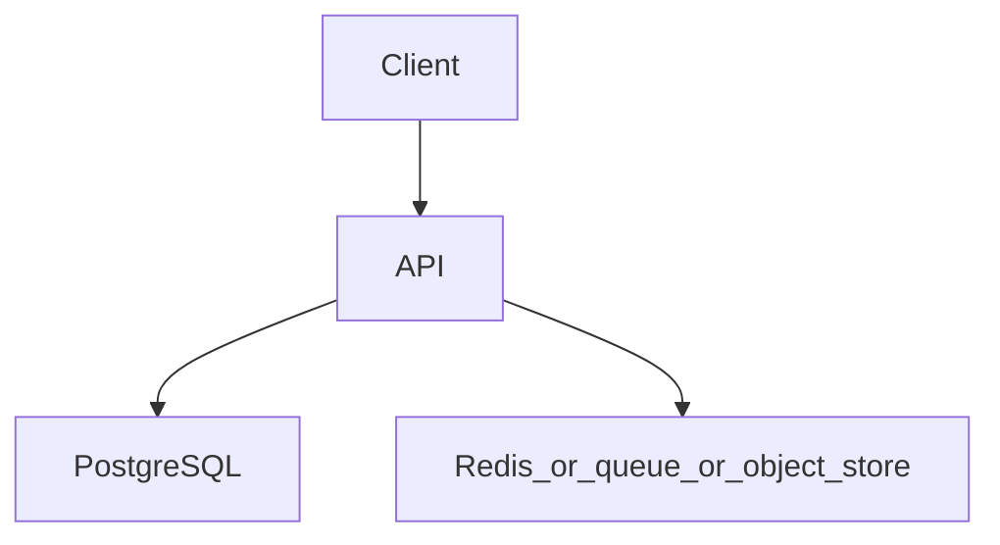

# Production-style REST API

Topics: D05-T001, D05-T004, D06-T001, D06-T004, D06-T009, D07-T011, D07-T018, D20-T001

## Requirements

A task service: create, read, update, and list tasks for an authenticated user.

Functional: the API behaves as specified below, including the error cases.
Non-functional: one failed dependency must not corrupt data. A second identical request must not double-apply a side effect where the project says so.

## API

POST /v1/tasks, GET /v1/tasks/{id}, PATCH /v1/tasks/{id}, GET /v1/tasks?limit=&cursor=

Use JSON. Return a stable error shape: code, message, and field errors when the input is bad.

## Data model

tasks(id uuid pk, owner_id uuid not null, title text not null, status text not null, version int not null, created_at timestamptz)

## Architecture



Read it as the request path. The extra box is Redis, a queue, or object storage depending on the project. If a step can fail, the API still leaves the database consistent.

## Component responsibilities

- The API validates input, authenticates the caller, and writes the database.
- The database holds the source of truth for the business record.
- The extra component is a cache, a queue, or a blob store. It is not the only copy of a fact you must not lose, unless the project is explicitly the rate limiter, whose quota state lives in Redis.

## Flow

Client creates a task. API validates the body, writes one row in a transaction, returns 201 with the resource. List uses a cursor on (created_at, id).

## Failure scenarios

Invalid body returns 400 with a field error. Lost update returns 409 when version mismatches. Database down returns 503.

## Testing

Unit tests for validation. API tests with a real database for the transaction and the cursor. One test that two patches of the same version produce a single winner.

## Observability

Request log with correlation id, latency histogram, and error rate by status code.

## Local demonstration

Docker is optional for reading this page. A demo Compose file would pin `postgres:16` and, when the project needs it, `redis:7`. Do not put real passwords in the file. Use a local-only password such as `localdev` and say so in the README.

This Compose sketch was not executed as part of writing the knowledge base.

```yaml
services:
  postgres:
    image: postgres:16
    environment:
      POSTGRES_PASSWORD: localdev
      POSTGRES_DB: app
    ports:
      - "5432:5432"
```

## Interview prompts

- Walk the write path and name the transaction boundary.
- What happens if the process dies at the worst line?
- Which topic IDs did you actually exercise, and which did you skip?
- What metric would page you?

## Trade-off

The smallest version that passes the tests is the one to build first. Add a queue, a cache, or a second region only when this document's failure scenario requires it.
