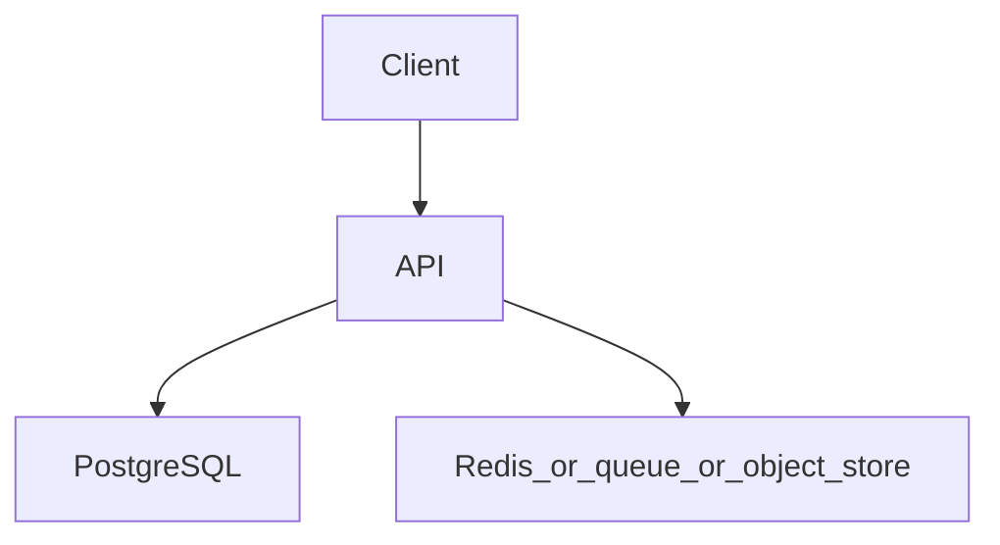

# Authentication and authorization service

Topics: D12-T001, D12-T002, D12-T003, D12-T010, D12-T008, D12-T023

## Requirements

Register, log in, and call an API that only the owner of a resource may change.

Functional: the API behaves as specified below, including the error cases.
Non-functional: one failed dependency must not corrupt data. A second identical request must not double-apply a side effect where the project says so.

## API

POST /v1/register, POST /v1/login, POST /v1/logout, GET /v1/me

Use JSON. Return a stable error shape: code, message, and field errors when the input is bad.

## Data model

users(id uuid pk, email text unique, password_hash text, created_at timestamptz). sessions(id uuid pk, user_id uuid, expires_at timestamptz)

## Architecture



Read it as the request path. The extra box is Redis, a queue, or object storage depending on the project. If a step can fail, the API still leaves the database consistent.

## Component responsibilities

- The API validates input, authenticates the caller, and writes the database.
- The database holds the source of truth for the business record.
- The extra component is a cache, a queue, or a blob store. It is not the only copy of a fact you must not lose, unless the project is explicitly the rate limiter, whose quota state lives in Redis.

## Flow

Login verifies a password hash, creates a server-side session, sets an HttpOnly cookie. Each request loads the session and checks resource ownership.

## Failure scenarios

Wrong password is a generic 401. Expired session is 401. User A requesting user B's task is 403 or 404, chosen so you do not leak existence if the product requires that.

## Testing

Tests that a missing cookie is rejected, a tampered session id is rejected, and a user cannot patch another user's row.

## Observability

Count login failures by IP and account, without logging the password or the session token.

## Local demonstration

Docker is optional for reading this page. A demo Compose file would pin `postgres:16` and, when the project needs it, `redis:7`. Do not put real passwords in the file. Use a local-only password such as `localdev` and say so in the README.

This Compose sketch was not executed as part of writing the knowledge base.

```yaml
services:
  postgres:
    image: postgres:16
    environment:
      POSTGRES_PASSWORD: localdev
      POSTGRES_DB: app
    ports:
      - "5432:5432"
```

## Interview prompts

- Walk the write path and name the transaction boundary.
- What happens if the process dies at the worst line?
- Which topic IDs did you actually exercise, and which did you skip?
- What metric would page you?

## Trade-off

The smallest version that passes the tests is the one to build first. Add a queue, a cache, or a second region only when this document's failure scenario requires it.
