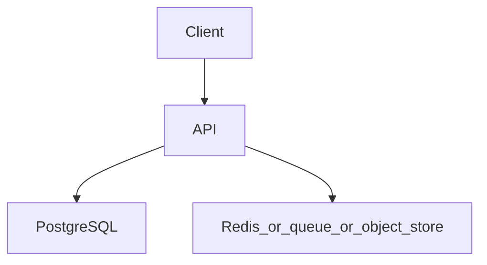

# URL shortener with caching

Topics: D17-T001, D11-T001, D11-T003, D07-T018, D06-T004

## Requirements

Create a short code for a long URL. Redirect with low latency. Expire codes.

Functional: the API behaves as specified below, including the error cases.
Non-functional: one failed dependency must not corrupt data. A second identical request must not double-apply a side effect where the project says so.

## API

POST /v1/links, GET /{code} as a 302

Use JSON. Return a stable error shape: code, message, and field errors when the input is bad.

## Data model

links(code text pk, target_url text not null, owner_id uuid, expires_at timestamptz, created_at timestamptz)

## Architecture



Read it as the request path. The extra box is Redis, a queue, or object storage depending on the project. If a step can fail, the API still leaves the database consistent.

## Component responsibilities

- The API validates input, authenticates the caller, and writes the database.
- The database holds the source of truth for the business record.
- The extra component is a cache, a queue, or a blob store. It is not the only copy of a fact you must not lose, unless the project is explicitly the rate limiter, whose quota state lives in Redis.

## Flow

Write the row, then cache code to target. Read path checks cache, then database, then fills cache. A miss on an unknown code is a 404, not a cached empty that never expires.

## Failure scenarios

Cache and database disagree after an update. A stampede on a hot code. A code that expires in SQL but lives on in cache.

## Testing

Test redirect, unknown code, and expiry. Test that an update deletes or replaces the cache key.

## Observability

Cache hit ratio, redirect latency, and 404 rate.

## Local demonstration

Docker is optional for reading this page. A demo Compose file would pin `postgres:16` and, when the project needs it, `redis:7`. Do not put real passwords in the file. Use a local-only password such as `localdev` and say so in the README.

This Compose sketch was not executed as part of writing the knowledge base.

```yaml
services:
  postgres:
    image: postgres:16
    environment:
      POSTGRES_PASSWORD: localdev
      POSTGRES_DB: app
    ports:
      - "5432:5432"
```

## Interview prompts

- Walk the write path and name the transaction boundary.
- What happens if the process dies at the worst line?
- Which topic IDs did you actually exercise, and which did you skip?
- What metric would page you?

## Trade-off

The smallest version that passes the tests is the one to build first. Add a queue, a cache, or a second region only when this document's failure scenario requires it.
