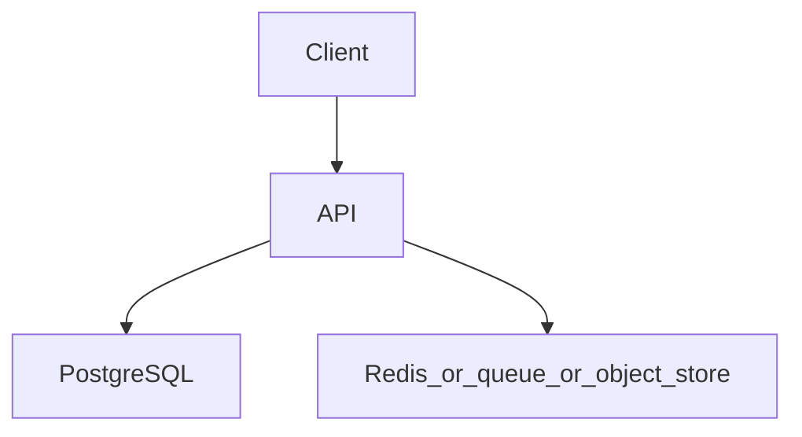

# Distributed rate limiter

Topics: D17-T002, D11-T020, D11-T021, D06-T012, D15-T019

## Requirements

Limit each API key to N requests per window across more than one app instance.

Functional: the API behaves as specified below, including the error cases.
Non-functional: one failed dependency must not corrupt data. A second identical request must not double-apply a side effect where the project says so.

## API

The limiter is middleware on any route. Response includes remaining quota when you choose to expose it.

Use JSON. Return a stable error shape: code, message, and field errors when the input is bad.

## Data model

Redis keys only. No quota stored solely in process memory.

## Architecture



Read it as the request path. The extra box is Redis, a queue, or object storage depending on the project. If a step can fail, the API still leaves the database consistent.

## Component responsibilities

- The API validates input, authenticates the caller, and writes the database.
- The database holds the source of truth for the business record.
- The extra component is a cache, a queue, or a blob store. It is not the only copy of a fact you must not lose, unless the project is explicitly the rate limiter, whose quota state lives in Redis.

## Flow

A Redis-side counter or sliding window decides allow or deny atomically. Two app servers must share the same Redis key.

## Failure scenarios

Redis timeout: fail open or fail closed, and document which. A clock jump. A key that is so hot one Redis shard saturates.

## Testing

Concurrent test that 100 parallel allows never exceed the limit. Test the Redis-down policy.

## Observability

Allow rate, deny rate, Redis latency, and error rate of the limiter itself.

## Local demonstration

Docker is optional for reading this page. A demo Compose file would pin `postgres:16` and, when the project needs it, `redis:7`. Do not put real passwords in the file. Use a local-only password such as `localdev` and say so in the README.

This Compose sketch was not executed as part of writing the knowledge base.

```yaml
services:
  postgres:
    image: postgres:16
    environment:
      POSTGRES_PASSWORD: localdev
      POSTGRES_DB: app
    ports:
      - "5432:5432"
```

## Interview prompts

- Walk the write path and name the transaction boundary.
- What happens if the process dies at the worst line?
- Which topic IDs did you actually exercise, and which did you skip?
- What metric would page you?

## Trade-off

The smallest version that passes the tests is the one to build first. Add a queue, a cache, or a second region only when this document's failure scenario requires it.
