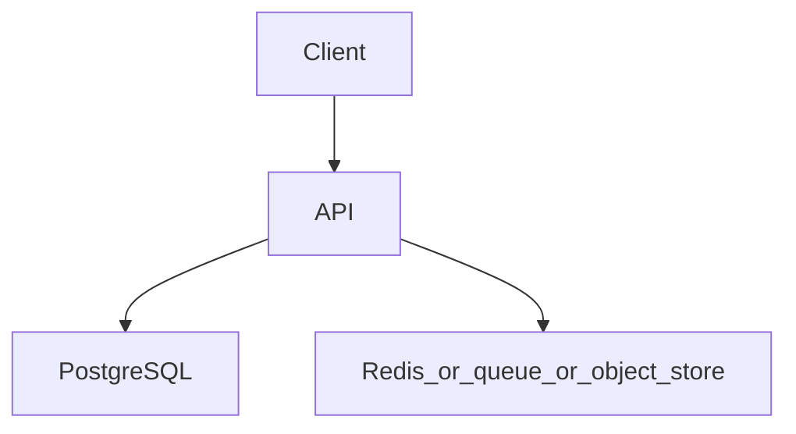

# Notification service with a queue

Topics: D14-T001, D14-T009, D14-T013, D05-T015, D14-T011

## Requirements

Accept an email request and deliver it through a worker. Retries must not send two emails for one request.

Functional: the API behaves as specified below, including the error cases.
Non-functional: one failed dependency must not corrupt data. A second identical request must not double-apply a side effect where the project says so.

## API

POST /v1/notifications with an Idempotency-Key. GET /v1/notifications/{id} for status.

Use JSON. Return a stable error shape: code, message, and field errors when the input is bad.

## Data model

notifications(id uuid pk, idempotency_key text unique, status text, payload jsonb). A queue holds the id, not a second copy of the business effect.

## Architecture



Read it as the request path. The extra box is Redis, a queue, or object storage depending on the project. If a step can fail, the API still leaves the database consistent.

## Component responsibilities

- The API validates input, authenticates the caller, and writes the database.
- The database holds the source of truth for the business record.
- The extra component is a cache, a queue, or a blob store. It is not the only copy of a fact you must not lose, unless the project is explicitly the rate limiter, whose quota state lives in Redis.

## Flow

The API writes the row and enqueues the id in one logical handoff. Prefer an outbox row in the same database transaction, then a publisher. The worker sends and marks sent.

## Failure scenarios

Worker crashes after the provider accepts and before the status update. Redelivery must see status sent and not send again.

## Testing

Test duplicate POST with the same idempotency key. Test a crash between send and status update using a fake provider.

## Observability

Queue depth, delivery success, duplicate-send count (must stay zero), provider latency.

## Local demonstration

Docker is optional for reading this page. A demo Compose file would pin `postgres:16` and, when the project needs it, `redis:7`. Do not put real passwords in the file. Use a local-only password such as `localdev` and say so in the README.

This Compose sketch was not executed as part of writing the knowledge base.

```yaml
services:
  postgres:
    image: postgres:16
    environment:
      POSTGRES_PASSWORD: localdev
      POSTGRES_DB: app
    ports:
      - "5432:5432"
```

## Interview prompts

- Walk the write path and name the transaction boundary.
- What happens if the process dies at the worst line?
- Which topic IDs did you actually exercise, and which did you skip?
- What metric would page you?

## Trade-off

The smallest version that passes the tests is the one to build first. Add a queue, a cache, or a second region only when this document's failure scenario requires it.
