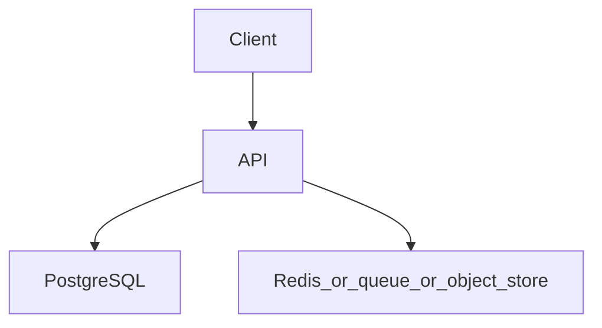

# Event-driven order processing

Topics: D14-T021, D14-T023, D15-T019, D15-T030, D07-T011, D12-T001

## Requirements

Place an order, reserve inventory, and take payment. A timeout from the payment provider must not create two charges or a stuck order with no record.

Functional: the API behaves as specified below, including the error cases.
Non-functional: one failed dependency must not corrupt data. A second identical request must not double-apply a side effect where the project says so.

## API

POST /v1/orders with Idempotency-Key. GET /v1/orders/{id}.

Use JSON. Return a stable error shape: code, message, and field errors when the input is bad.

## Data model

orders, order_items, outbox(id, aggregate_id, type, payload, published_at). Inventory holds a reservation row, not only a counter decrement without a record.

## Architecture



Read it as the request path. The extra box is Redis, a queue, or object storage depending on the project. If a step can fail, the API still leaves the database consistent.

## Component responsibilities

- The API validates input, authenticates the caller, and writes the database.
- The database holds the source of truth for the business record.
- The extra component is a cache, a queue, or a blob store. It is not the only copy of a fact you must not lose, unless the project is explicitly the rate limiter, whose quota state lives in Redis.

## Flow

The order insert and the outbox insert commit together. A consumer reserves stock. Another charges payment. Failure runs a compensation that releases the reservation.

## Failure scenarios

Payment timeout after the provider charged. Duplicate event delivery. Inventory reserved but the process dies.

## Testing

Test the outbox publishes after commit and not before. Test a redelivered event does not double-charge. Test compensation releases stock.

## Observability

Outbox age, consumer lag, orders stuck in pending, payment error rate.

## Local demonstration

Docker is optional for reading this page. A demo Compose file would pin `postgres:16` and, when the project needs it, `redis:7`. Do not put real passwords in the file. Use a local-only password such as `localdev` and say so in the README.

This Compose sketch was not executed as part of writing the knowledge base.

```yaml
services:
  postgres:
    image: postgres:16
    environment:
      POSTGRES_PASSWORD: localdev
      POSTGRES_DB: app
    ports:
      - "5432:5432"
```

## Interview prompts

- Walk the write path and name the transaction boundary.
- What happens if the process dies at the worst line?
- Which topic IDs did you actually exercise, and which did you skip?
- What metric would page you?

## Trade-off

The smallest version that passes the tests is the one to build first. Add a queue, a cache, or a second region only when this document's failure scenario requires it.
