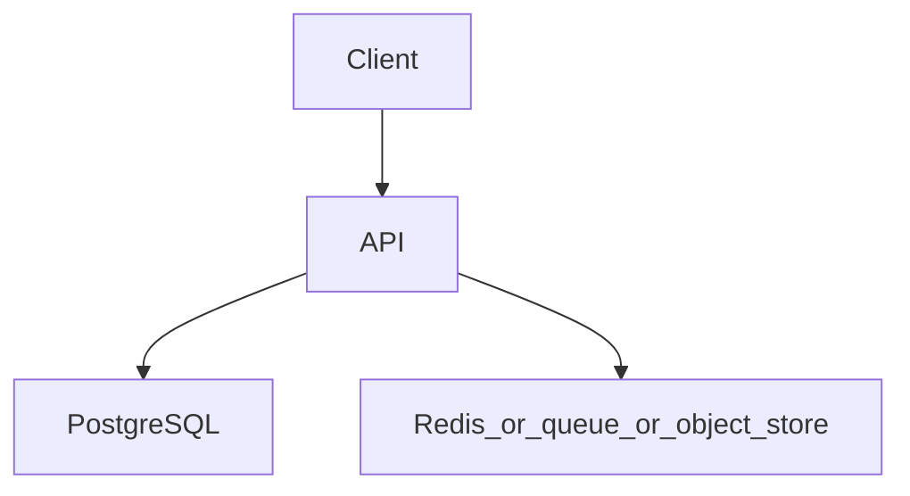

# Multi-tenant SaaS backend

Topics: D28-T001, D28-T002, D28-T003, D12-T020, D07-T018

## Requirements

Many customers share the deployment. One tenant must not read another's rows, and one tenant must not consume the whole database.

Functional: the API behaves as specified below, including the error cases.
Non-functional: one failed dependency must not corrupt data. A second identical request must not double-apply a side effect where the project says so.

## API

Every route is under /v1 and takes the tenant from the authenticated token, not from a client-supplied tenant id alone.

Use JSON. Return a stable error shape: code, message, and field errors when the input is bad.

## Data model

Shared schema with tenant_id on every tenant-owned table. Composite indexes start with tenant_id. Optional later split is a documented decision, not the first step.

## Architecture



Read it as the request path. The extra box is Redis, a queue, or object storage depending on the project. If a step can fail, the API still leaves the database consistent.

## Component responsibilities

- The API validates input, authenticates the caller, and writes the database.
- The database holds the source of truth for the business record.
- The extra component is a cache, a queue, or a blob store. It is not the only copy of a fact you must not lose, unless the project is explicitly the rate limiter, whose quota state lives in Redis.

## Flow

The repository adds tenant_id to every query. A per-tenant rate limit sits in front of expensive routes.

## Failure scenarios

A missing tenant predicate returns another tenant's data. A report query without tenant_id in the index scans the whole table. One tenant's import saturates the pool.

## Testing

A test that user from tenant A cannot read tenant B even if they guess the id. A test that the generated SQL contains tenant_id.

## Observability

Queries missing tenant_id (via a check or review), pool wait time, per-tenant request rate.

## Local demonstration

Docker is optional for reading this page. A demo Compose file would pin `postgres:16` and, when the project needs it, `redis:7`. Do not put real passwords in the file. Use a local-only password such as `localdev` and say so in the README.

This Compose sketch was not executed as part of writing the knowledge base.

```yaml
services:
  postgres:
    image: postgres:16
    environment:
      POSTGRES_PASSWORD: localdev
      POSTGRES_DB: app
    ports:
      - "5432:5432"
```

## Interview prompts

- Walk the write path and name the transaction boundary.
- What happens if the process dies at the worst line?
- Which topic IDs did you actually exercise, and which did you skip?
- What metric would page you?

## Trade-off

The smallest version that passes the tests is the one to build first. Add a queue, a cache, or a second region only when this document's failure scenario requires it.
