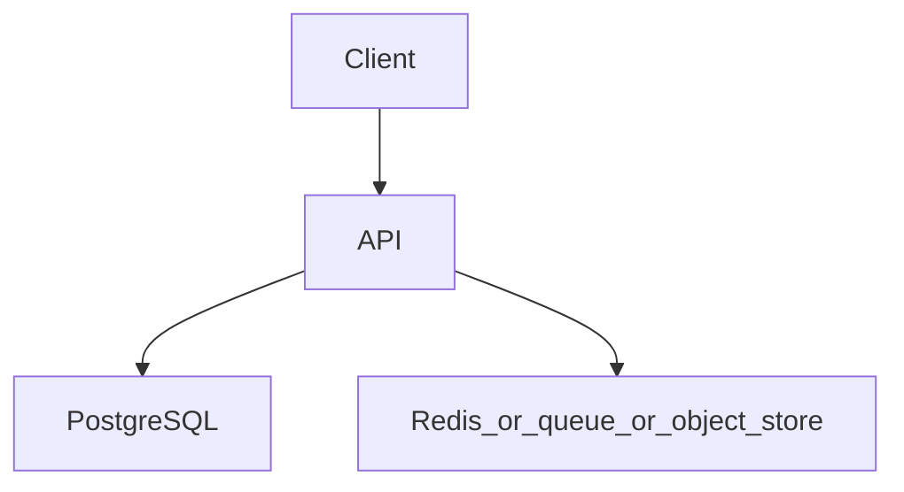

# Distributed job scheduler

Topics: D17-T023, D15-T011, D14-T009, D13-T001

## Requirements

Run a job at a time, on one worker, even if several workers poll.

Functional: the API behaves as specified below, including the error cases.
Non-functional: one failed dependency must not corrupt data. A second identical request must not double-apply a side effect where the project says so.

## API

POST /v1/jobs, GET /v1/jobs/{id}. Workers are internal processes, not a public API.

Use JSON. Return a stable error shape: code, message, and field errors when the input is bad.

## Data model

jobs(id, run_at, status, locked_by, locked_until, attempts). The lock is a lease, not a forever flag.

## Architecture



Read it as the request path. The extra box is Redis, a queue, or object storage depending on the project. If a step can fail, the API still leaves the database consistent.

## Component responsibilities

- The API validates input, authenticates the caller, and writes the database.
- The database holds the source of truth for the business record.
- The extra component is a cache, a queue, or a blob store. It is not the only copy of a fact you must not lose, unless the project is explicitly the rate limiter, whose quota state lives in Redis.

## Flow

A worker updates a due job to locked where status is pending and locked_until is in the past, in one conditional update. Only the worker that changed a row runs it.

## Failure scenarios

Two workers take the same job. A worker dies and the lease never expires. A retry runs a job that already succeeded.

## Testing

Concurrent test with two workers and one due job. Test that a lease expiry allows another worker to take it. Test that success is not repeated if the effect already happened.

## Observability

Jobs due and not locked, lock expirations, job failure rate, run duration.

## Local demonstration

Docker is optional for reading this page. A demo Compose file would pin `postgres:16` and, when the project needs it, `redis:7`. Do not put real passwords in the file. Use a local-only password such as `localdev` and say so in the README.

This Compose sketch was not executed as part of writing the knowledge base.

```yaml
services:
  postgres:
    image: postgres:16
    environment:
      POSTGRES_PASSWORD: localdev
      POSTGRES_DB: app
    ports:
      - "5432:5432"
```

## Interview prompts

- Walk the write path and name the transaction boundary.
- What happens if the process dies at the worst line?
- Which topic IDs did you actually exercise, and which did you skip?
- What metric would page you?

## Trade-off

The smallest version that passes the tests is the one to build first. Add a queue, a cache, or a second region only when this document's failure scenario requires it.
