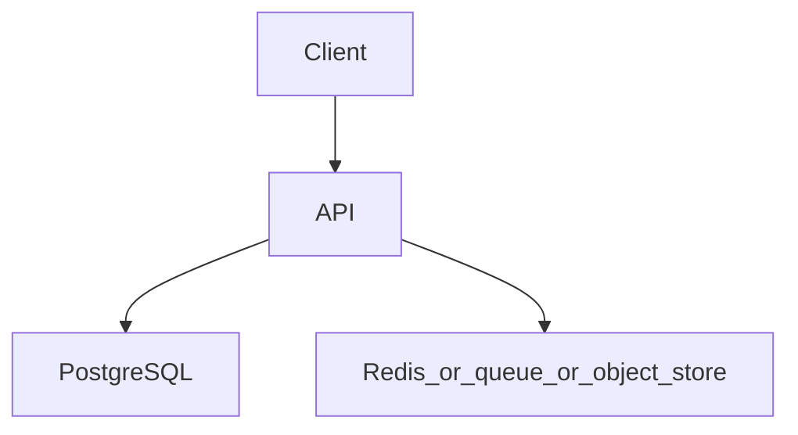

# File storage with signed URLs

Topics: D29-T011, D29-T012, D29-T014, D12-T013, D06-T001

## Requirements

The API stores metadata. Bytes go directly to object storage using a time-limited URL.

Functional: the API behaves as specified below, including the error cases.
Non-functional: one failed dependency must not corrupt data. A second identical request must not double-apply a side effect where the project says so.

## API

POST /v1/files returns an upload URL. GET /v1/files/{id}/download returns a download URL. The API never proxies the bytes on the hot path.

Use JSON. Return a stable error shape: code, message, and field errors when the input is bad.

## Data model

files(id, owner_id, bucket, object_key, checksum, byte_size, status). The object key is server-generated.

## Architecture



Read it as the request path. The extra box is Redis, a queue, or object storage depending on the project. If a step can fail, the API still leaves the database consistent.

## Component responsibilities

- The API validates input, authenticates the caller, and writes the database.
- The database holds the source of truth for the business record.
- The extra component is a cache, a queue, or a blob store. It is not the only copy of a fact you must not lose, unless the project is explicitly the rate limiter, whose quota state lives in Redis.

## Flow

The API authorizes the user, writes a pending metadata row, and signs a PUT. A completion call records size and checksum after the client finishes.

## Failure scenarios

A signed URL leaked and still valid. A client marks complete without uploading. A key that includes a user-supplied path.

## Testing

Test that user B cannot get a download URL for user A's file. Test that the object key ignores client path input. Test expiry.

## Observability

Sign latency, upload completion rate, 403 rate on download.

## Local demonstration

Docker is optional for reading this page. A demo Compose file would pin `postgres:16` and, when the project needs it, `redis:7`. Do not put real passwords in the file. Use a local-only password such as `localdev` and say so in the README.

This Compose sketch was not executed as part of writing the knowledge base.

```yaml
services:
  postgres:
    image: postgres:16
    environment:
      POSTGRES_PASSWORD: localdev
      POSTGRES_DB: app
    ports:
      - "5432:5432"
```

## Interview prompts

- Walk the write path and name the transaction boundary.
- What happens if the process dies at the worst line?
- Which topic IDs did you actually exercise, and which did you skip?
- What metric would page you?

## Trade-off

The smallest version that passes the tests is the one to build first. Add a queue, a cache, or a second region only when this document's failure scenario requires it.
