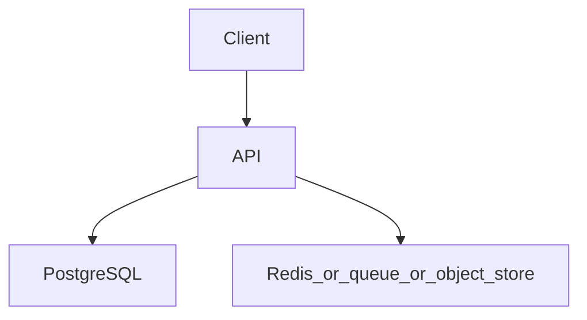

# Production-style RAG backend

Topics: D30-T001, D30-T012, D30-T013, D30-T014, D30-T017, D30-T022, D30-T025

## Requirements

Ingest documents for one tenant, answer a question from retrieved passages, and refuse to invent citations.

Functional: the API behaves as specified below, including the error cases.
Non-functional: one failed dependency must not corrupt data. A second identical request must not double-apply a side effect where the project says so.

## API

POST /v1/documents, POST /v1/answers with the question. The answer returns text plus the passage ids used.

Use JSON. Return a stable error shape: code, message, and field errors when the input is bad.

## Data model

documents and chunks(id, document_id, tenant_id, text, embedding). Queries always filter tenant_id.

## Architecture



Read it as the request path. The extra box is Redis, a queue, or object storage depending on the project. If a step can fail, the API still leaves the database consistent.

## Component responsibilities

- The API validates input, authenticates the caller, and writes the database.
- The database holds the source of truth for the business record.
- The extra component is a cache, a queue, or a blob store. It is not the only copy of a fact you must not lose, unless the project is explicitly the rate limiter, whose quota state lives in Redis.

## Flow

Ingest splits text, embeds chunks, and stores them. Answer embeds the question, retrieves a bounded set, and calls the model with those passages only.

## Failure scenarios

Retrieval from the wrong tenant. The model cites a passage that was not retrieved. The provider times out. A prompt asks the model to ignore the documents.

## Testing

Test tenant isolation on retrieval. Test that a timeout returns a clear error and does not bill a second hidden call unless you meant to retry. Test an empty retrieval returns 'I do not have that' rather than a fluent guess.

## Observability

Retrieval latency, model latency, token use, empty-retrieval rate, and error rate. Do not log document text if it is sensitive.

## Local demonstration

Docker is optional for reading this page. A demo Compose file would pin `postgres:16` and, when the project needs it, `redis:7`. Do not put real passwords in the file. Use a local-only password such as `localdev` and say so in the README.

This Compose sketch was not executed as part of writing the knowledge base.

```yaml
services:
  postgres:
    image: postgres:16
    environment:
      POSTGRES_PASSWORD: localdev
      POSTGRES_DB: app
    ports:
      - "5432:5432"
```

## Interview prompts

- Walk the write path and name the transaction boundary.
- What happens if the process dies at the worst line?
- Which topic IDs did you actually exercise, and which did you skip?
- What metric would page you?

## Trade-off

The smallest version that passes the tests is the one to build first. Add a queue, a cache, or a second region only when this document's failure scenario requires it.
