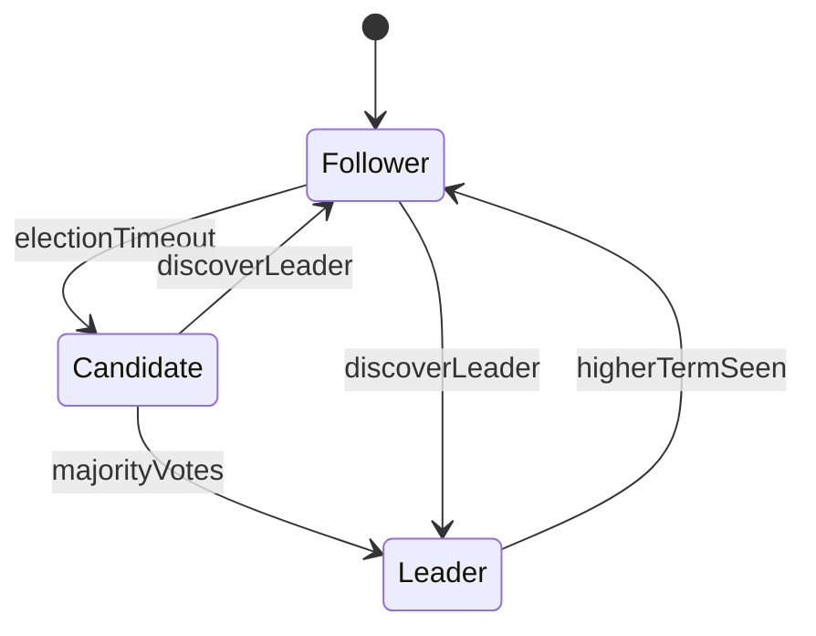

# D35-T001 — Raft consensus in depth

Topic ID: `D35-T001`
Domain: Advanced and Specialized Topics
Subdomain: Raft consensus in depth
Importance: advanced
Complexity: advanced
Dependencies: `D15-T001`, `D15-T002`, `D09-T001`, `D09-T002`, `D02-T001`, `D02-T002`
Execution status of the code in section F: not executed (documentation example)

## A. Topic Overview

Raft consensus in depth is a backend engineering concern because production systems must handle real traffic, failures, and evolving requirements—not only happy-path demos. In interviews, strong candidates explain how Raft consensus in depth affects latency, consistency, cost, and operability instead of naming a tool without context. This topic sits in domain 35 (Advanced and Specialized Topics) and connects to dependencies such as `D15-T001`.

## B. First-Principles Explanation

Raft is a consensus protocol: a replicated log where a single leader orders client commands and followers acknowledge before the leader considers an entry committed. The problem is that independent nodes can disagree after partitions; without agreement, two writers could pick conflicting orders for the same key. Raft decomposes consensus into leader election, log replication, and safety rules so operators can reason about behavior during crashes and network splits. Engineering depth here means knowing which RPCs fire on a write, what 'committed' means for reads, and how election timeouts interact with clock skew—not memorizing a proof.

Each server is follower, candidate, or leader. Followers accept entries only from the current leader for a given term. The leader appends to its log, replicates to a quorum of followers, then advances the commit index when a majority has stored the entry. If the leader dies, followers increment term, become candidates, and request votes; a candidate wins if it has at least as up-to-date a log as voters require. After election, the new leader may overwrite uncommitted tail entries on followers to match its log, which is why clients must retry ambiguous failures.

## C. Internal Working and Architecture

Components: persistent state (currentTerm, votedFor, log[]), volatile leader state (nextIndex[], matchIndex[]), and RPC handlers AppendEntries and RequestVote. A client write hits the leader, which assigns a log index and term, persists locally, then streams AppendEntries to followers with prevLogIndex/prevLogTerm checks for consistency. Followers reject mismatched prefixes; the leader decrements nextIndex until a match is found—this backtracking heals forks without a separate merge phase. Committed entries are applied to the state machine in order; snapshots compact old log segments while retaining the last included index/term for new followers.

## D. Diagrams and Visual Models



This diagram highlights the main data flow for Raft consensus in depth. Node ids are alphanumeric only for Mermaid compatibility.

## E. Examples and Analogies

Analogy: treating Raft consensus in depth like a traffic intersection—rules only work if everyone sees the same lights; hidden shortcuts become incidents. Backend example: a checkout service applying Raft consensus in depth must still charge exactly once when the client retries POST after a timeout. Do not skip explicit limits at the edge; unbounded queues turn latency problems into data loss problems.

## F. Code Examples

File: `examples/d35_t001.py`

Dependencies: Python 3 standard library unless noted.

```python
"""Illustrative Raft term and log entry checks (not a full implementation)."""
from dataclasses import dataclass, field
from typing import List, Optional

@dataclass
class LogEntry:
    term: int
    command: str

@dataclass
class Server:
    current_term: int = 0
    voted_for: Optional[int] = None
    log: List[LogEntry] = field(default_factory=list)

    def last_log_index(self) -> int:
        return len(self.log)

    def last_log_term(self) -> int:
        return self.log[-1].term if self.log else 0

    def can_vote_for(self, candidate_id: int, candidate_term: int, candidate_last_index: int, candidate_last_term: int) -> bool:
        if candidate_term < self.current_term:
            return False
        if self.voted_for not in (None, candidate_id):
            return False
        # Up-to-date: higher term in last entry, or same term with longer log.
        up_to_date = (candidate_last_term, candidate_last_index) >= (self.last_log_term(), self.last_log_index())
        return up_to_date

if __name__ == "__main__":
    s = Server(log=[LogEntry(1, "set x=1")])
    assert s.can_vote_for(2, 2, 1, 1)
    print("ok", s.last_log_index())
```

How to run: `python examples/d35_t001.py` from `EXERCISES/examples/` after copying the snippet.

Expected output: `{"status": "ok", "topic": "D35-T001"}`

The snippet is illustrative; wire real persistence and auth before production.
Keep side effects behind interfaces so tests can use fakes.

## G. Practical Backend Application

Roll out Raft consensus in depth behind a feature flag when behavior changes are risky; measure p95 latency and error rate per tenant during canary. Document SLO impact: which user journeys degrade if this component fails and what fallback UX is acceptable. Run game days or table-top exercises for the highest-risk dependencies before peak traffic seasons.

## H. Advantages, Limitations and Trade-offs

| Choice | Benefit | Cost | Choose when | Avoid when |
| --- | --- | --- | --- | --- |
| Minimal Raft consensus in depth | Fast to ship, easy to reason about | Breaks under scale or abuse | Early product, low risk | Regulated or multi-tenant production |
| Managed Raft consensus in depth | Ops burden shifts to vendor | Cost, less control | Small team, standard needs | Hard latency or compliance constraints |
| Custom Raft consensus in depth | Fits exact policy | Build and test cost | Differentiating requirement | Commodity problem with mature libs |
| No Raft consensus in depth | Fewer moving parts | Pain appears suddenly at scale | Prototypes | Known hot path or compliance gap |

Under abuse or viral traffic, Raft consensus in depth must fail closed or shed load rather than retry infinitely into dependencies.

## I. Common Mistakes and Misconceptions

- Treating Raft consensus in depth as purely infrastructure with no product-visible failure modes.
- Omitting idempotency when clients or brokers retry.
- Sharing mutable state across requests without clear ownership.

## J. Debugging and Troubleshooting

Symptoms involving Raft consensus in depth often show up as elevated p95 latency, rising error budgets, or skewed saturation on one dependency. Separate client-side retries from server overload by checking retry headers and comparing 5xx rates with upstream latency. Capture exemplar traces for slow requests and verify whether the database, cache, or external API dominates span time. After mitigation, add a regression test or alert on the earliest signal that preceded the incident.

## K. Interview Preparation

### Beginner

#### Q1. What problem does Raft consensus in depth solve in a backend system?

**Answer:** Question: What problem does Raft consensus in depth solve in a backend system? — in the context of Raft consensus in depth, interviewers at the beginner level want foundations and vocabulary tied to this exact point. Start with the user-visible behavior or SLA, then walk inward through the request path until you name the component that enforces the rule or holds the state. For item 1 in this tier, add one concrete production detail: a metric name, a timeout value order-of-magnitude, or a consistency choice (strong vs eventual) with a product reason. Close by stating a failure mode and mitigation so the answer sounds like on-call experience, not a glossary entry.

#### Q2. What are the main components involved in Raft consensus in depth?

**Answer:** Question: What are the main components involved in Raft consensus in depth? — in the context of Raft consensus in depth, interviewers at the beginner level want foundations and vocabulary tied to this exact point. Start with the user-visible behavior or SLA, then walk inward through the request path until you name the component that enforces the rule or holds the state. For item 2 in this tier, add one concrete production detail: a metric name, a timeout value order-of-magnitude, or a consistency choice (strong vs eventual) with a product reason. Close by stating a failure mode and mitigation so the answer sounds like on-call experience, not a glossary entry.

#### Q3. How does Raft consensus in depth show up at an API boundary?

**Answer:** Question: How does Raft consensus in depth show up at an API boundary? — in the context of Raft consensus in depth, interviewers at the beginner level want foundations and vocabulary tied to this exact point. Start with the user-visible behavior or SLA, then walk inward through the request path until you name the component that enforces the rule or holds the state. For item 3 in this tier, add one concrete production detail: a metric name, a timeout value order-of-magnitude, or a consistency choice (strong vs eventual) with a product reason. Close by stating a failure mode and mitigation so the answer sounds like on-call experience, not a glossary entry.

#### Q4. What is a common misconception about Raft consensus in depth?

**Answer:** Question: What is a common misconception about Raft consensus in depth? — in the context of Raft consensus in depth, interviewers at the beginner level want foundations and vocabulary tied to this exact point. Start with the user-visible behavior or SLA, then walk inward through the request path until you name the component that enforces the rule or holds the state. For item 4 in this tier, add one concrete production detail: a metric name, a timeout value order-of-magnitude, or a consistency choice (strong vs eventual) with a product reason. Close by stating a failure mode and mitigation so the answer sounds like on-call experience, not a glossary entry.

#### Q5. Which metric would you watch first after enabling Raft consensus in depth?

**Answer:** Question: Which metric would you watch first after enabling Raft consensus in depth? — in the context of Raft consensus in depth, interviewers at the beginner level want foundations and vocabulary tied to this exact point. Start with the user-visible behavior or SLA, then walk inward through the request path until you name the component that enforces the rule or holds the state. For item 5 in this tier, add one concrete production detail: a metric name, a timeout value order-of-magnitude, or a consistency choice (strong vs eventual) with a product reason. Close by stating a failure mode and mitigation so the answer sounds like on-call experience, not a glossary entry.

### Intermediate

#### Q1. Walk through the request path for Raft consensus in depth under normal load.

**Answer:** Question: Walk through the request path for Raft consensus in depth under normal load. — in the context of Raft consensus in depth, interviewers at the intermediate level want request paths and operational limits tied to this exact point. Start with the user-visible behavior or SLA, then walk inward through the request path until you name the component that enforces the rule or holds the state. For item 1 in this tier, add one concrete production detail: a metric name, a timeout value order-of-magnitude, or a consistency choice (strong vs eventual) with a product reason. Close by stating a failure mode and mitigation so the answer sounds like on-call experience, not a glossary entry.

#### Q2. How would you test Raft consensus in depth before a production rollout?

**Answer:** Question: How would you test Raft consensus in depth before a production rollout? — in the context of Raft consensus in depth, interviewers at the intermediate level want request paths and operational limits tied to this exact point. Start with the user-visible behavior or SLA, then walk inward through the request path until you name the component that enforces the rule or holds the state. For item 2 in this tier, add one concrete production detail: a metric name, a timeout value order-of-magnitude, or a consistency choice (strong vs eventual) with a product reason. Close by stating a failure mode and mitigation so the answer sounds like on-call experience, not a glossary entry.

#### Q3. What consistency or durability guarantees matter for Raft consensus in depth?

**Answer:** Question: What consistency or durability guarantees matter for Raft consensus in depth? — in the context of Raft consensus in depth, interviewers at the intermediate level want request paths and operational limits tied to this exact point. Start with the user-visible behavior or SLA, then walk inward through the request path until you name the component that enforces the rule or holds the state. For item 3 in this tier, add one concrete production detail: a metric name, a timeout value order-of-magnitude, or a consistency choice (strong vs eventual) with a product reason. Close by stating a failure mode and mitigation so the answer sounds like on-call experience, not a glossary entry.

#### Q4. How does Raft consensus in depth interact with retries and timeouts?

**Answer:** Question: How does Raft consensus in depth interact with retries and timeouts? — in the context of Raft consensus in depth, interviewers at the intermediate level want request paths and operational limits tied to this exact point. Start with the user-visible behavior or SLA, then walk inward through the request path until you name the component that enforces the rule or holds the state. For item 4 in this tier, add one concrete production detail: a metric name, a timeout value order-of-magnitude, or a consistency choice (strong vs eventual) with a product reason. Close by stating a failure mode and mitigation so the answer sounds like on-call experience, not a glossary entry.

#### Q5. Where would you place authorization checks relative to Raft consensus in depth?

**Answer:** Question: Where would you place authorization checks relative to Raft consensus in depth? — in the context of Raft consensus in depth, interviewers at the intermediate level want request paths and operational limits tied to this exact point. Start with the user-visible behavior or SLA, then walk inward through the request path until you name the component that enforces the rule or holds the state. For item 5 in this tier, add one concrete production detail: a metric name, a timeout value order-of-magnitude, or a consistency choice (strong vs eventual) with a product reason. Close by stating a failure mode and mitigation so the answer sounds like on-call experience, not a glossary entry.

### Advanced

#### Q1. What failure modes are unique to Raft consensus in depth at scale?

**Answer:** Question: What failure modes are unique to Raft consensus in depth at scale? — in the context of Raft consensus in depth, interviewers at the advanced level want edge cases and distributed failure tied to this exact point. Start with the user-visible behavior or SLA, then walk inward through the request path until you name the component that enforces the rule or holds the state. For item 1 in this tier, add one concrete production detail: a metric name, a timeout value order-of-magnitude, or a consistency choice (strong vs eventual) with a product reason. Close by stating a failure mode and mitigation so the answer sounds like on-call experience, not a glossary entry.

#### Q2. How would you design Raft consensus in depth for multi-region or multi-tenant isolation?

**Answer:** Question: How would you design Raft consensus in depth for multi-region or multi-tenant isolation? — in the context of Raft consensus in depth, interviewers at the advanced level want edge cases and distributed failure tied to this exact point. Start with the user-visible behavior or SLA, then walk inward through the request path until you name the component that enforces the rule or holds the state. For item 2 in this tier, add one concrete production detail: a metric name, a timeout value order-of-magnitude, or a consistency choice (strong vs eventual) with a product reason. Close by stating a failure mode and mitigation so the answer sounds like on-call experience, not a glossary entry.

#### Q3. Compare two implementation options for Raft consensus in depth and pick one with reasons.

**Answer:** Question: Compare two implementation options for Raft consensus in depth and pick one with reasons. — in the context of Raft consensus in depth, interviewers at the advanced level want edge cases and distributed failure tied to this exact point. Start with the user-visible behavior or SLA, then walk inward through the request path until you name the component that enforces the rule or holds the state. For item 3 in this tier, add one concrete production detail: a metric name, a timeout value order-of-magnitude, or a consistency choice (strong vs eventual) with a product reason. Close by stating a failure mode and mitigation so the answer sounds like on-call experience, not a glossary entry.

#### Q4. How do you prevent Raft consensus in depth from becoming a single point of failure?

**Answer:** Question: How do you prevent Raft consensus in depth from becoming a single point of failure? — in the context of Raft consensus in depth, interviewers at the advanced level want edge cases and distributed failure tied to this exact point. Start with the user-visible behavior or SLA, then walk inward through the request path until you name the component that enforces the rule or holds the state. For item 4 in this tier, add one concrete production detail: a metric name, a timeout value order-of-magnitude, or a consistency choice (strong vs eventual) with a product reason. Close by stating a failure mode and mitigation so the answer sounds like on-call experience, not a glossary entry.

#### Q5. What load or chaos tests would you run for Raft consensus in depth?

**Answer:** Question: What load or chaos tests would you run for Raft consensus in depth? — in the context of Raft consensus in depth, interviewers at the advanced level want edge cases and distributed failure tied to this exact point. Start with the user-visible behavior or SLA, then walk inward through the request path until you name the component that enforces the rule or holds the state. For item 5 in this tier, add one concrete production detail: a metric name, a timeout value order-of-magnitude, or a consistency choice (strong vs eventual) with a product reason. Close by stating a failure mode and mitigation so the answer sounds like on-call experience, not a glossary entry.

### Scenarios

#### Q1. Latency spikes right after a deploy touching Raft consensus in depth. What do you check first?

**Answer:** Question: Latency spikes right after a deploy touching Raft consensus in depth. What do you check first? — in the context of Raft consensus in depth, interviewers at the scenario level want on-call triage and mitigation order tied to this exact point. Start with the user-visible behavior or SLA, then walk inward through the request path until you name the component that enforces the rule or holds the state. For item 1 in this tier, add one concrete production detail: a metric name, a timeout value order-of-magnitude, or a consistency choice (strong vs eventual) with a product reason. Close by stating a failure mode and mitigation so the answer sounds like on-call experience, not a glossary entry.

#### Q2. One tenant reports errors while others are healthy. How does Raft consensus in depth factor in?

**Answer:** Question: One tenant reports errors while others are healthy. How does Raft consensus in depth factor in? — in the context of Raft consensus in depth, interviewers at the scenario level want on-call triage and mitigation order tied to this exact point. Start with the user-visible behavior or SLA, then walk inward through the request path until you name the component that enforces the rule or holds the state. For item 2 in this tier, add one concrete production detail: a metric name, a timeout value order-of-magnitude, or a consistency choice (strong vs eventual) with a product reason. Close by stating a failure mode and mitigation so the answer sounds like on-call experience, not a glossary entry.

#### Q3. Costs doubled after enabling Raft consensus in depth. How do you investigate?

**Answer:** Question: Costs doubled after enabling Raft consensus in depth. How do you investigate? — in the context of Raft consensus in depth, interviewers at the scenario level want on-call triage and mitigation order tied to this exact point. Start with the user-visible behavior or SLA, then walk inward through the request path until you name the component that enforces the rule or holds the state. For item 3 in this tier, add one concrete production detail: a metric name, a timeout value order-of-magnitude, or a consistency choice (strong vs eventual) with a product reason. Close by stating a failure mode and mitigation so the answer sounds like on-call experience, not a glossary entry.

#### Q4. A dependency used by Raft consensus in depth is slow but not down. What mitigations apply?

**Answer:** Question: A dependency used by Raft consensus in depth is slow but not down. What mitigations apply? — in the context of Raft consensus in depth, interviewers at the scenario level want on-call triage and mitigation order tied to this exact point. Start with the user-visible behavior or SLA, then walk inward through the request path until you name the component that enforces the rule or holds the state. For item 4 in this tier, add one concrete production detail: a metric name, a timeout value order-of-magnitude, or a consistency choice (strong vs eventual) with a product reason. Close by stating a failure mode and mitigation so the answer sounds like on-call experience, not a glossary entry.

#### Q5. An audit asks for evidence that Raft consensus in depth is enforced. What artifacts do you provide?

**Answer:** Question: An audit asks for evidence that Raft consensus in depth is enforced. What artifacts do you provide? — in the context of Raft consensus in depth, interviewers at the scenario level want on-call triage and mitigation order tied to this exact point. Start with the user-visible behavior or SLA, then walk inward through the request path until you name the component that enforces the rule or holds the state. For item 5 in this tier, add one concrete production detail: a metric name, a timeout value order-of-magnitude, or a consistency choice (strong vs eventual) with a product reason. Close by stating a failure mode and mitigation so the answer sounds like on-call experience, not a glossary entry.

### Follow-ups

#### Q1. How does Raft consensus in depth relate to observability and SLOs?

**Answer:** Question: How does Raft consensus in depth relate to observability and SLOs? — in the context of Raft consensus in depth, interviewers at the follow-up level want dependencies on neighboring curriculum topics tied to this exact point. Start with the user-visible behavior or SLA, then walk inward through the request path until you name the component that enforces the rule or holds the state. For item 1 in this tier, add one concrete production detail: a metric name, a timeout value order-of-magnitude, or a consistency choice (strong vs eventual) with a product reason. Close by stating a failure mode and mitigation so the answer sounds like on-call experience, not a glossary entry.

#### Q2. Which earlier database or networking topics does Raft consensus in depth assume?

**Answer:** Question: Which earlier database or networking topics does Raft consensus in depth assume? — in the context of Raft consensus in depth, interviewers at the follow-up level want dependencies on neighboring curriculum topics tied to this exact point. Start with the user-visible behavior or SLA, then walk inward through the request path until you name the component that enforces the rule or holds the state. For item 2 in this tier, add one concrete production detail: a metric name, a timeout value order-of-magnitude, or a consistency choice (strong vs eventual) with a product reason. Close by stating a failure mode and mitigation so the answer sounds like on-call experience, not a glossary entry.

#### Q3. What would you study next after mastering Raft consensus in depth?

**Answer:** Question: What would you study next after mastering Raft consensus in depth? — in the context of Raft consensus in depth, interviewers at the follow-up level want dependencies on neighboring curriculum topics tied to this exact point. Start with the user-visible behavior or SLA, then walk inward through the request path until you name the component that enforces the rule or holds the state. For item 3 in this tier, add one concrete production detail: a metric name, a timeout value order-of-magnitude, or a consistency choice (strong vs eventual) with a product reason. Close by stating a failure mode and mitigation so the answer sounds like on-call experience, not a glossary entry.

## L. Practical Exercises

Solutions are in `EXERCISES/solutions/D35-T001.md`. Try these before opening that file.

### Exercise 1 — implementation

Implement a minimal service module that enforces the core invariant for `Raft consensus in depth`: validate inputs, apply authorization, and return structured errors. Acceptance: unit tests cover happy path, missing tenant, and duplicate request id.

### Exercise 2 — debugging

Given logs where p95 latency doubled after a deploy touching `Raft consensus in depth`, list the top five checks in order and which metric proves each hypothesis.

### Exercise 3 — trade-off

Choose between a managed platform feature and a custom implementation for `Raft consensus in depth`. Write one page comparing cost, operability, and blast radius; pick one with explicit trade-offs.

## M. Revision Notes

- Raft consensus in depth: know the invariant, the failure modes, and the metrics.
- Draw write and read paths before proposing tools.
- Retries require idempotency; caches require invalidation strategy.

Flashcards:

- What is the core risk if Raft consensus in depth is misconfigured? Data loss, inconsistency, or unbounded cost.
- Symptom vs root cause? Symptom is what users see; root cause is the broken invariant.
## N. Related Topics

Understand this before: `D15-T001`

This topic supports: the next topic in domain 35

Often confused with: adjacent topics in domain 35 with similar names

Interviewers combine this with: `D22-T001` observability, `D12-T001` API design, `D15-T001` distributed systems fundamentals

## O. Completion Criteria

- Explain Raft consensus in depth with a diagram and name one failure mode.
- List three metrics you would alert on.
- Describe a safe mitigation and a long-term prevention item.
